# Lista de Exercícios 2: Inteligência Artificial

**Universidade Federal de Alagoas (UFAL)**  
**Instituto de Computação / Engenharia de Computação**  
**Componente curricular:** ECOM031 (Graduação / PPGI)

**Dupla:** Bruno Gomes de Barros Filho (21111360); Antônio Rodrigo Lima de Andrade Tenório (23210707)  
**Professor:** Evandro de Barros Costa  
**Período:** 2026.2

---

## Sumário

1. [Questão 1: Ontologias versus grafos de conhecimento](#questao-1-ontologias-versus-grafos-de-conhecimento)
2. [Questão 2: Classificador dos K-Vizinhos Mais Próximos (KNN)](#questao-2-classificador-dos-k-vizinhos-mais-proximos-knn)
3. [Questão 3: Chatbot ELIZA, diálogo, algoritmo e evoluções (PARRY e AIML/ALICE)](#questao-3-chatbot-eliza-dialogo-algoritmo-e-evolucoes-parry-e-aiml-alice)
4. [Questão 4: Taxonomia de agentes, descrição PEAS e propriedades dos ambientes de tarefa](#questao-4-taxonomia-de-agentes-descricao-peas-e-propriedades-dos-ambientes-de-tarefa)
5. [Questão 5: Resumo estendido — Inferência em LLMs](#questao-5-resumo-estendido-inferencia-em-llms)
6. [Questão 6: Sistema fuzzy de Mamdani para irrigação de hortaliças](#questao-6-sistema-fuzzy-de-mamdani-para-irrigacao-de-hortalicas)
7. [Questão 7: Sistema de Apoio ao Diagnóstico Médico Baseado em Casos (CBR)](#questao-7-sistema-de-apoio-ao-diagnostico-medico-baseado-em-casos-cbr)
8. [Questão 8: Sistema de Diagnóstico Médico com Redes Bayesianas](#questao-8-sistema-de-diagnostico-medico-com-redes-bayesianas)
9. [Questão 9: Sistema de recomendação baseado em ontologias OWL 2.0](#questao-9-sistema-de-recomendacao-baseado-em-ontologias-owl-2-0)
10. [Questão 10: Planejamento de rotas para entregas urbanas](#questao-10-planejamento-de-rotas-para-entregas-urbanas)
11. [Questão 11: Agentes clássicos (AIMA Cap. 2) versus agentes baseados em LLM](#questao-11-agentes-classicos-aima-cap-2-versus-agentes-baseados-em-llm)
12. [Questão 12: Assistente de agenda acadêmica baseado em LLM](#questao-12-assistente-de-agenda-academica-baseado-em-llm)
13. [Questão 13: Ensaio sobre a arquitetura Transformer](#questao-13-ensaio-sobre-a-arquitetura-transformer)
14. [Questão 14: Representação, inferência e aplicação em Knowledge Graphs](#questao-14-representacao-inferencia-e-aplicacao-em-knowledge-graphs)
15. [Questão 15: Aplicação de ontologia OWL 2.0 e raciocínio no Protégé](#questao-15-aplicacao-de-ontologia-owl-2-0-e-raciocinio-no-protege)
16. [Referências](#referencias)

---

## Questão 1

Ontologias e grafos de conhecimento são duas formas de representar informações e relacionamentos entre diferentes entidades. Apesar de utilizarem estruturas semelhantes, com nós, relações e propriedades, cada abordagem possui características próprias e atende a necessidades diferentes. Enquanto as ontologias dão maior atenção à definição formal dos conceitos e às regras que relacionam esses conceitos, os grafos de conhecimento priorizam a organização das informações e as conexões entre os dados.

Para entender melhor essas diferenças, é importante observar como cada abordagem representa o conhecimento, realiza inferências e lida com grandes volumes de informação.

### Comparativo: principais diferenças entre as abordagens

A diferença entre ontologias e grafos de conhecimento vai além da maneira como os dados são organizados. Ela também está relacionada à interpretação das informações, às regras utilizadas e ao tipo de consulta que cada modelo permite realizar.

#### 1. Formalismo lógico e hipótese de mundo

As ontologias utilizam como fundamento as Lógicas de Descrição (*Description Logics*), que fornecem uma base matemática para definir conceitos, propriedades e restrições. Um exemplo de padrão baseado nessa abordagem é o OWL 2. Nele, os elementos do domínio são descritos por meio de axiomas, permitindo estabelecer relações e regras que podem ser verificadas automaticamente.

Uma característica importante é a Hipótese de Mundo Aberto (*Open World Assumption*, OWA). Nessa abordagem, quando uma informação não está registrada, não significa necessariamente que ela seja falsa. O sistema considera que aquele dado pode simplesmente não ser conhecido ou ainda não ter sido informado.

Outro aspecto é a ausência da pressuposição de nomes únicos (*Non-Unique Name Assumption*). Isso significa que duas entidades com identificadores diferentes podem representar o mesmo indivíduo. Por exemplo, dois registros de uma pessoa podem ser considerados equivalentes por meio de uma relação como `owl:sameAs`, desde que existam informações que justifiquem essa equivalência.

Já nos grafos de conhecimento, especialmente nos modelos de propriedades rotuladas (*Labeled Property Graphs*, LPG), como os utilizados pelo Neo4j, o foco costuma estar na consulta e na navegação entre as informações armazenadas. Em aplicações que seguem a Hipótese de Mundo Fechado (*Closed World Assumption*, CWA), considera-se que os dados não encontrados na base não estão disponíveis para aquela consulta.

É importante destacar que essa diferença depende da tecnologia utilizada. Grafos baseados em RDF, por exemplo, também podem seguir a semântica de mundo aberto. Portanto, não se pode afirmar que todo grafo de conhecimento utiliza obrigatoriamente a hipótese de mundo fechado.

#### 2. Mecanismos de inferência: dedução e navegação

Outra diferença importante está na maneira como cada abordagem trabalha com as informações.

Nas ontologias, a inferência é baseada em deduções lógicas. Para isso, são utilizados programas chamados *reasoners*, como HermiT, Pellet e FaCT++, que analisam os axiomas definidos no modelo. Esses mecanismos conseguem identificar relações que não foram cadastradas diretamente, verificar inconsistências e classificar automaticamente os indivíduos de acordo com as regras existentes.

Entre as principais tarefas realizadas estão:

- **Verificação de consistência:** identifica se existem informações contraditórias na ontologia.
- **Classificação:** organiza automaticamente as classes de acordo com as relações de especialização e generalização.
- **Subsunção:** verifica se uma classe está contida em outra, ou seja, se todos os seus indivíduos também pertencem a uma classe mais abrangente.
- **Instanciação:** identifica a quais classes um indivíduo pertence, inclusive quando essa relação pode ser deduzida a partir dos axiomas.

Nos grafos de conhecimento, o trabalho geralmente está mais relacionado à consulta e à análise das conexões entre os dados. Em ferramentas como o Neo4j, é possível utilizar a linguagem Cypher para percorrer relacionamentos, encontrar caminhos entre entidades e identificar informações conectadas.

Além disso, existem técnicas que permitem descobrir relações que ainda não foram registradas explicitamente. Entre elas estão os *embeddings* de grafos, como TransE e RotatE, e as Redes Neurais em Grafos (*Graph Neural Networks*, GNNs). Esses métodos podem ser utilizados para prever conexões que provavelmente existem entre duas entidades, tarefa conhecida como *link prediction*.

Assim, enquanto as ontologias se destacam pela aplicação de regras lógicas para deduzir informações, os grafos oferecem recursos para explorar relacionamentos e identificar padrões presentes na rede.

#### 3. Escalabilidade e custo de processamento

O nível de formalização das ontologias também influencia o custo de processamento. Quanto mais complexas forem as regras e relações definidas, maior pode ser o esforço necessário para realizar as inferências.

Em fragmentos expressivos do OWL 2 DL, alguns problemas de raciocínio apresentam complexidade computacional elevada, podendo chegar a níveis como NEXPTIME e 2EXPTIME. Por isso, executar inferências complexas sobre bases com centenas de milhões de instâncias pode exigir muitos recursos e não ser adequado para consultas em tempo real.

Nos grafos de propriedades, a estrutura de relacionamentos permite percorrer conexões diretamente, sem precisar analisar toda a base a cada consulta. No Neo4j, por exemplo, o conceito de *index-free adjacency* permite que os nós mantenham referências diretas aos seus relacionamentos, facilitando a navegação entre entidades conectadas.

Isso pode tornar consultas locais bastante eficientes, especialmente quando o objetivo é encontrar caminhos ou relacionamentos próximos. Entretanto, o desempenho também depende da quantidade de conexões percorridas, da estrutura do grafo e da complexidade da consulta.

Na prática, a escolha entre as abordagens depende do objetivo da aplicação: quando a prioridade é validar regras e realizar deduções formais, as ontologias oferecem recursos adequados. Quando o objetivo é explorar grandes redes de relacionamentos e consultar conexões entre entidades, os grafos de conhecimento podem ser mais convenientes.

| Dimensão de análise | Sistemas baseados em ontologias | Sistemas baseados em grafos de conhecimento |
| :--- | :--- | :--- |
| Núcleo teórico | Lógicas de Descrição (DL) e semântica formal | Teoria dos grafos e propriedades rotuladas (LPG) |
| Ferramentas comuns | OWL 2, Protégé, HermiT e Pellet | Neo4j, Cypher, Amazon Neptune e RDF/SPARQL |
| Hipótese de mundo | Geralmente Mundo Aberto (OWA) | Depende da tecnologia; LPGs frequentemente utilizam Mundo Fechado (CWA) |
| Tipo de inferência | Dedução lógica baseada em axiomas | Navegação, análise de caminhos e métodos estatísticos |
| Principal desafio | Custo computacional de inferências complexas | Manutenção da consistência e qualidade dos relacionamentos |

### Exemplo prático: catálogo e recomendação de filmes

Para visualizar melhor como essas abordagens funcionam, podemos considerar um sistema de recomendação de filmes. A ideia é utilizar informações sobre diretores, atores, gêneros e produções para sugerir títulos de acordo com os interesses de cada usuário.

#### Abordagem por ontologia: conceitos e regras

Na construção da ontologia, inicialmente são definidas as classes que representam os elementos do domínio. Por exemplo:

- `Pessoa`, representando pessoas envolvidas na produção cinematográfica.
- `Diretor` e `Ator`, como subclasses de `Pessoa`, declaradas disjuntas entre si.
- `Filme`, representando as produções cinematográficas.
- `dirigiu`, uma propriedade que relaciona um indivíduo da classe `Diretor` a um indivíduo da classe `Filme`.

Também podem ser definidas restrições para garantir que determinadas relações sejam utilizadas corretamente. Por exemplo, uma pessoa não pode ser classificada simultaneamente como `Diretor` e `Ator` caso o modelo tenha estabelecido essas classes como disjuntas.

A partir dessas definições, o *reasoner* consegue deduzir novas informações. Se a base receber o fato de que `Christopher Nolan dirigiu Oppenheimer` e a propriedade `dirigiu` tiver domínio definido como `Diretor` e alcance definido como `Filme`, o sistema poderá inferir que Christopher Nolan pertence à classe `Diretor` e que Oppenheimer pertence à classe `Filme`.

Como `Diretor` é uma subclasse de `Pessoa`, também será possível concluir que Nolan pertence à classe `Pessoa`, sem que essa informação precise ser cadastrada diretamente.

Por outro lado, se a base registrar que `Inception` é o responsável por dirigir `Tenet`, o sistema poderá identificar uma inconsistência caso `Inception` esteja classificado como `Filme` e a propriedade exija que seu domínio seja `Diretor`. Nesse caso, o modelo identifica a incompatibilidade lógica, embora a detecção não signifique necessariamente que o registro será automaticamente rejeitado pelo sistema de armazenamento.

Dessa forma, a ontologia permite estabelecer regras sobre o domínio e verificar se as informações cadastradas estão de acordo com elas.

#### Abordagem por grafo de conhecimento: conexões e consultas

No grafo de conhecimento, a representação é feita por meio de entidades concretas e dos relacionamentos existentes entre elas.

Por exemplo, podemos cadastrar:

- `Steven Spielberg`, como um nó que representa uma pessoa.
- `Jurassic Park`, como um nó que representa um filme.
- `Ficção Científica`, como um nó que representa um gênero cinematográfico.

Esses elementos são conectados por arestas direcionadas, como:

- `(:Pessoa)-[:DIRIGIU]->(:Filme)`
- `(:Filme)-[:GENERO]->(:Tema)`

Com essa estrutura, o sistema consegue percorrer os relacionamentos e encontrar filmes que compartilham características com outros títulos.

Por exemplo, quando um usuário demonstra interesse em `Jurassic Park`, podemos executar uma consulta Cypher para localizar outros filmes dirigidos pela mesma pessoa ou que possuam gêneros e características em comum.

Nesse caso, o sistema pode encontrar títulos como `Tubarão` e `E.T.`, também dirigidos por Steven Spielberg. A recomendação acontece a partir das conexões existentes no grafo, sem a necessidade de utilizar um mecanismo de dedução lógica como o empregado nas ontologias.

### Mapeamento: da ontologia para o grafo de propriedades

Na prática, também é possível utilizar as duas abordagens em conjunto. Uma possibilidade é desenvolver inicialmente o modelo conceitual no Protégé, utilizando OWL, e depois transportar sua estrutura para um banco de grafos, como o Neo4j.

Essa conversão exige alguns cuidados, pois nem todas as características de uma ontologia possuem uma representação direta em um grafo de propriedades.

De maneira geral, o processo pode ser dividido em quatro etapas:

1. **Classes se tornam rótulos de nós (*labels*).**

   Cada classe definida na ontologia pode ser representada por um rótulo no grafo. Por exemplo, as classes `Diretor` e `Pessoa` podem ser utilizadas como *labels* de um mesmo nó, indicando que aquela entidade pertence às duas categorias.

   As hierarquias definidas por `subClassOf` também podem ser representadas dessa maneira, desde que a aplicação mantenha corretamente as relações entre as classes.

2. **Propriedades de objeto se tornam relacionamentos.**

   As propriedades que representam relações entre entidades são convertidas em arestas direcionadas. Por exemplo, a propriedade `dirigiu`, que relaciona um diretor a um filme, pode ser representada no grafo como `[:DIRIGIU]`.

3. **Propriedades de dados se tornam atributos dos nós.**

   Informações como ano de lançamento, orçamento e título não precisam ser representadas como nós separados. Elas podem ser armazenadas diretamente como atributos da entidade correspondente.

   Assim, um filme pode possuir propriedades como `titulo`, `anoLancamento` e `orcamento`.

4. **Axiomas e restrições precisam ser adaptados.**

   Uma diferença importante é que bancos de grafos de propriedades não oferecem, nativamente, o mesmo mecanismo de raciocínio lógico das ontologias OWL. Algumas restrições podem ser representadas por *constraints*, como regras de unicidade, enquanto outras precisam ser verificadas pela aplicação antes que os dados sejam armazenados.

   Por exemplo, regras de disjunção entre classes e determinadas restrições de cardinalidade precisam de validações adicionais para preservar a semântica do modelo original.

O fluxo abaixo apresenta um exemplo simplificado dessa conversão, mostrando como as classes e propriedades definidas na ontologia podem ser representadas por nós, atributos e relacionamentos em um grafo de conhecimento.

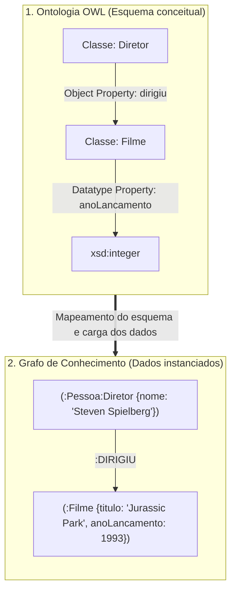

Como podemos observar, a ontologia fornece a estrutura conceitual e as regras que definem o domínio, enquanto o grafo representa as entidades e suas conexões de maneira adequada para consultas e exploração dos relacionamentos.

Portanto, as duas abordagens não precisam ser utilizadas de forma isolada. Em determinadas aplicações, a combinação das duas permite aproveitar a organização formal e a capacidade de inferência das ontologias, juntamente com a facilidade de navegação e consulta dos grafos de conhecimento.

---

## Questão 2: Classificador dos K-Vizinhos Mais Próximos (KNN)

### Base de dados e configuração do experimento

O algoritmo dos K-Vizinhos Mais Próximos (*K-Nearest Neighbors*, KNN) foi aplicado à mesma base de 30 instâncias de risco de crédito utilizada na Lista de Exercícios 1. A base tem como ponto de partida um exemplo apresentado no livro de Luger e foi ampliada na Questão 1 daquela lista, passando a contar com seis atributos categóricos e 30 exemplos, identificados de E1 a E30.

Os atributos utilizados para fazer as previsões são História de Crédito, Dívida, Garantia, Renda, Emprego e Imóvel. A variável que o modelo deve classificar é o risco de crédito, dividido em três categorias: Alto, Moderado e Baixo.

Como o KNN trabalha com medidas de distância numéricas, foi necessário transformar os atributos categóricos antes de aplicar o algoritmo. Para isso, utilizamos *one-hot encoding* (`get_dummies`), seguindo a mesma estratégia adotada no CART da Lista 1. Com essa transformação, cada categoria passou a ser representada por uma coluna binária, resultando em um conjunto de 14 dimensões com valores 0 ou 1.

Nesse formato, a distância euclidiana permite comparar os exemplos contando, de forma indireta, as diferenças entre suas categorias. Como todas as variáveis passaram a ter a mesma escala binária, não foi necessário aplicar normalização min-max.

Código e experimentos: `src/q02_knn/q02_knn.ipynb`.

### As 30 instâncias utilizadas no experimento

A tabela apresenta a base completa utilizada na Lista 1, que também serviu de entrada para este experimento.

| Ex. | História | Dívida | Garantia | Renda | Emprego | Imóvel | Risco |
| --- | --- | --- | --- | --- | --- | --- | --- |
| E1 | Ruim | Alta | Nenhuma | 0–15 | Instável | Alugado | Alto |
| E2 | Desconhecida | Alta | Nenhuma | 15–35 | Instável | Alugado | Alto |
| E3 | Desconhecida | Baixa | Nenhuma | 15–35 | Estável | Alugado | Moderado |
| E4 | Desconhecida | Baixa | Nenhuma | 0–15 | Instável | Alugado | Alto |
| E5 | Desconhecida | Baixa | Nenhuma | >35 | Estável | Próprio | Baixo |
| E6 | Desconhecida | Baixa | Adequada | >35 | Estável | Próprio | Baixo |
| E7 | Ruim | Baixa | Nenhuma | 0–15 | Instável | Alugado | Alto |
| E8 | Ruim | Baixa | Adequada | >35 | Estável | Alugado | Moderado |
| E9 | Boa | Baixa | Nenhuma | >35 | Estável | Próprio | Baixo |
| E10 | Boa | Alta | Adequada | >35 | Estável | Próprio | Baixo |
| E11 | Boa | Alta | Nenhuma | 0–15 | Instável | Alugado | Alto |
| E12 | Boa | Alta | Nenhuma | 15–35 | Estável | Alugado | Moderado |
| E13 | Boa | Alta | Nenhuma | >35 | Estável | Alugado | Baixo |
| E14 | Ruim | Alta | Nenhuma | 15–35 | Instável | Alugado | Alto |
| E15 | Boa | Baixa | Adequada | 15–35 | Estável | Próprio | Baixo |
| E16 | Boa | Baixa | Nenhuma | 15–35 | Estável | Próprio | Baixo |
| E17 | Desconhecida | Baixa | Adequada | >35 | Instável | Próprio | Moderado |
| E18 | Ruim | Alta | Nenhuma | >35 | Estável | Alugado | Moderado |
| E19 | Desconhecida | Alta | Nenhuma | 0–15 | Estável | Alugado | Alto |
| E20 | Boa | Baixa | Adequada | >35 | Estável | Alugado | Baixo |
| E21 | Ruim | Baixa | Nenhuma | 15–35 | Estável | Alugado | Moderado |
| E22 | Boa | Alta | Adequada | 15–35 | Estável | Próprio | Moderado |
| E23 | Ruim | Alta | Adequada | 0–15 | Instável | Próprio | Alto |
| E24 | Desconhecida | Baixa | Nenhuma | 15–35 | Instável | Próprio | Moderado |
| E25 | Boa | Baixa | Nenhuma | 0–15 | Estável | Próprio | Moderado |
| E26 | Ruim | Baixa | Nenhuma | >35 | Instável | Alugado | Alto |
| E27 | Desconhecida | Alta | Adequada | >35 | Estável | Próprio | Baixo |
| E28 | Ruim | Alta | Nenhuma | 15–35 | Estável | Alugado | Alto |
| E29 | Boa | Baixa | Nenhuma | >35 | Instável | Próprio | Baixo |
| E30 | Desconhecida | Baixa | Nenhuma | 0–15 | Estável | Alugado | Alto |

A distribuição das classes na base ficou relativamente equilibrada: são 11 exemplos de risco Alto, 9 de Moderado e 10 de Baixo.

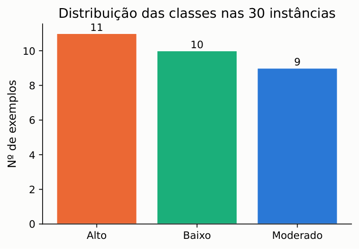

### Funcionamento do algoritmo KNN

O KNN é um algoritmo de aprendizado baseado em instâncias, também conhecido como *lazy learner*. Diferentemente de outros classificadores, ele não constrói um modelo explícito durante o treinamento. Em vez disso, mantém os exemplos disponíveis e utiliza a distância entre eles para classificar uma nova instância.

O processo de classificação pode ser dividido em três etapas:

1. **Cálculo das distâncias.** Para uma instância de teste \(\mathbf{q} \in \mathbb{R}^p\), o algoritmo calcula a distância euclidiana em relação a cada exemplo do conjunto de treinamento:

\[
d(\mathbf{q}, \mathbf{x}_i) = \sqrt{\sum_{j=1}^{p} (q_j - x_{ij})^2}
\]

2. **Seleção dos \(k\) vizinhos mais próximos.** Depois de calcular as distâncias, os exemplos são ordenados do menor para o maior valor. Os \(k\) primeiros são selecionados para participar da classificação:

\[
\mathcal{N}_k(\mathbf{q}) = \operatorname{arg\,min}_{S \subset D,\ |S|=k} \sum_{\mathbf{x}_i \in S} d(\mathbf{q}, \mathbf{x}_i)
\]

3. **Votação das classes.** Cada vizinho selecionado contribui com sua classe, e a previsão corresponde à categoria que aparece com maior frequência:

\[
\hat{y} = \operatorname{arg\,max}_{c \in C} \sum_{\mathbf{x}_i \in \mathcal{N}_k(\mathbf{q})} \mathbb{I}(y_i = c)
\]

Caso duas ou mais classes tenham a mesma quantidade de votos, é necessário utilizar um critério de desempate. Isso pode ser feito, por exemplo, considerando a distância dos vizinhos ou a distribuição das classes no conjunto de treinamento.

### Seleção do hiperparâmetro \(k\) via Leave-One-Out (LOO-CV)

Um dos pontos importantes na configuração do KNN é a escolha do valor de \(k\), que determina quantos vizinhos serão considerados em cada previsão. Para definir esse parâmetro, utilizamos a validação cruzada *Leave-One-Out* (LOO-CV).

Como a base possui apenas 30 instâncias, esse método permite aproveitar todos os exemplos na avaliação. O procedimento consiste em retirar uma instância da base para utilizá-la como teste e treinar o classificador com as outras 29. Isso é repetido até que cada uma das 30 instâncias tenha sido utilizada uma vez como teste.

Foram avaliados os valores ímpares \(k \in \{1, 3, 5, 7, 9\}\). A escolha de valores ímpares ajuda a diminuir a ocorrência de empates na votação, embora não elimine essa possibilidade em classificações com três classes.

| Valor de \(k\) | Acertos (/30) | Acurácia LOO-CV (%) |
| --- | ---: | ---: |
| \(k = 1\) | 18 | 60,00% |
| \(k = 3\) | 19 | 63,33% |
| **\(k = 5\)** | **21** | **70,00%** |
| \(k = 7\) | 19 | 63,33% |
| \(k = 9\) | 18 | 60,00% |

O melhor resultado foi obtido com \(k = 5\), que acertou 21 das 30 classificações, alcançando 70% de acurácia. Com \(k = 1\), a decisão depende de apenas um exemplo, o que pode tornar o resultado mais sensível a casos específicos da base. Por outro lado, valores maiores de \(k\) ampliam a quantidade de exemplos considerados na votação. Neste experimento, a partir de \(k = 7\), o desempenho voltou a cair, indicando que a inclusão de mais vizinhos não melhorou a separação entre as classes.

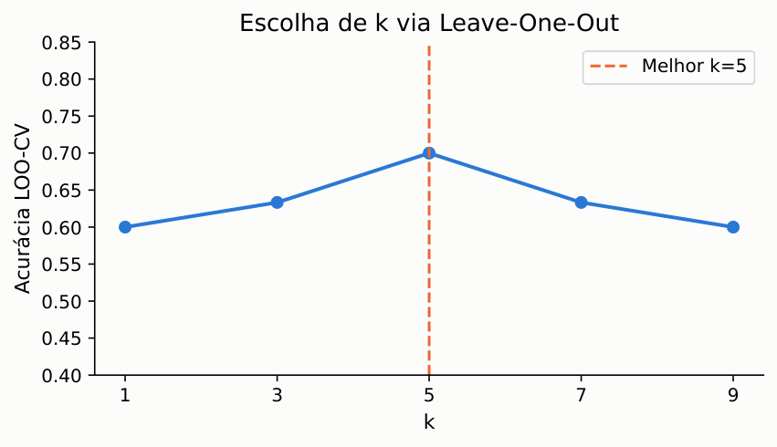

### Resultados e análise de desempenho

Após a escolha de \(k = 5\), avaliamos as previsões obtidas pelo procedimento *Leave-One-Out*. As métricas de classificação estão apresentadas na tabela:

| Classe | Precisão | Revocação | F1-Score | Suporte |
| --- | ---: | ---: | ---: | ---: |
| Alto | 0,71 | 0,91 | 0,80 | 11 |
| Baixo | 0,71 | 1,00 | 0,83 | 10 |
| Moderado | 0,50 | 0,11 | 0,18 | 9 |
| **Acurácia global** | | | **70,00%** | **30** |
| Média macro | 0,64 | 0,67 | 0,61 | 30 |
| Média ponderada | 0,65 | 0,70 | 0,63 | 30 |

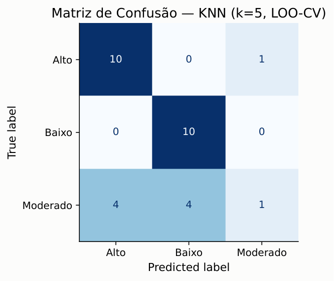

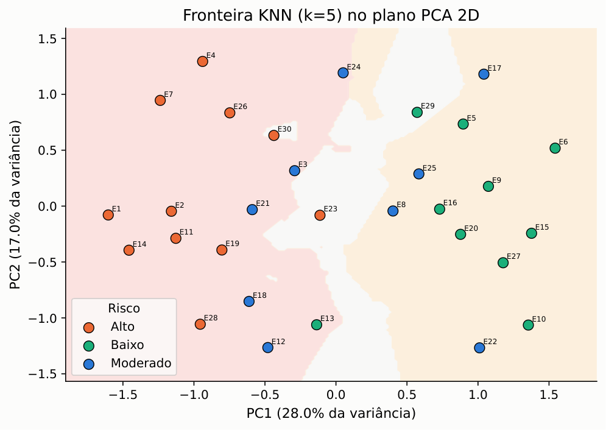

Os resultados mostram que o classificador teve um desempenho melhor nas classes Alto e Baixo. Foram identificados corretamente 10 dos 11 exemplos de risco Alto e todos os 10 exemplos de risco Baixo.

A maior dificuldade apareceu na classe Moderado: apenas um dos nove exemplos foi classificado corretamente. Os demais foram confundidos com as classes Alto ou Baixo. Esse resultado indica que o KNN teve dificuldade para separar os casos intermediários dos extremos. Como a base é pequena, a posição de poucos exemplos no espaço de atributos pode influenciar bastante a votação dos vizinhos.

Um exemplo que ajuda a entender o funcionamento do algoritmo é a classificação da instância E1, cujo risco verdadeiro é Alto. Seus cinco vizinhos mais próximos são E7, E11, E14, E2 e E4. Todos pertencem à classe Alto. Dessa forma, a votação é unânime e o algoritmo classifica E1 corretamente.

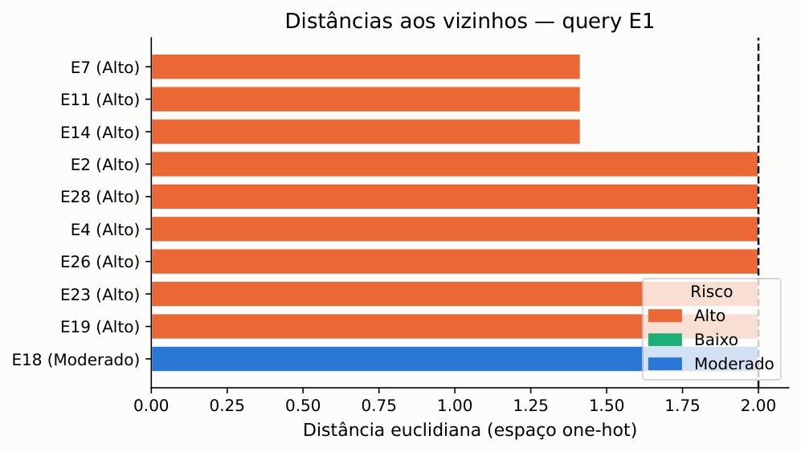

### Referências (Q2)

1. RUSSELL, Stuart J.; NORVIG, Peter. *Inteligência Artificial: uma abordagem moderna*. 3. ed. Rio de Janeiro: Elsevier / Campus, 2013.
2. CARVALHO, André C. P. L. F. et al. *Inteligência Artificial: Uma Abordagem de Aprendizado de Máquina*. Rio de Janeiro: LTC, 2011.
3. LUGER, George F. *Artificial Intelligence: Structures and Strategies for Complex Problem Solving*. 6. ed. Boston: Pearson, 2009.
4. TENÓRIO, Antônio Rodrigo L. A.; GOMES, Bruno B. F. *Lista de Exercícios 1: Inteligência Artificial*. Notebook `Lista_IA.ipynb`, UFAL, 2026.

---

## Questão 3: Chatbot ELIZA, diálogo, algoritmo e evoluções (PARRY e AIML/ALICE)

**Disciplina:** ECOM031: Inteligência Artificial (UFAL)  
**Equipe:** Bruno Gomes de Barros Filho e Antônio Rodrigo Lima de Andrade Tenório  
**Professor:** Evandro de Barros Costa

## 1. O chatbot ELIZA e o script DOCTOR

O ELIZA foi desenvolvido por Joseph Weizenbaum, no MIT Artificial Intelligence Laboratory, entre 1964 e 1966. O programa foi criado para simular uma conversa em inglês utilizando regras de reconhecimento e substituição de padrões. A proposta não era fazer com que o computador realmente compreendesse o significado das frases, mas demonstrar como um conjunto relativamente simples de regras poderia levar uma pessoa a acreditar que estava conversando com um sistema inteligente e capaz de demonstrar empatia. Esse comportamento ficou conhecido como efeito ELIZA.

Um dos scripts mais conhecidos do programa é o DOCTOR, que simula uma conversa com um psicoterapeuta da abordagem centrada na pessoa, desenvolvida por Carl Rogers. Essa escolha não foi por acaso. Nesse tipo de abordagem, o terapeuta costuma ouvir o paciente, fazer perguntas e retomar partes do que foi dito, sem necessariamente apresentar opiniões ou soluções. Isso facilita a simulação, pois o programa não precisa ter um conhecimento aprofundado sobre o assunto discutido. Basta identificar determinadas palavras e construir respostas que mantenham a conversa.

### Principais funcionalidades

1. **Reconhecimento de padrões (*pattern matching*):** o programa analisa a frase enviada pelo usuário e procura palavras-chave e estruturas que correspondam às regras cadastradas. Para isso, utiliza curingas, como `*`, que representam trechos variáveis da frase.
2. **Montagem das respostas (*reassembly*):** depois de identificar um padrão, o ELIZA utiliza partes da frase original para construir uma resposta. Nesse processo, também realiza substituições de pronomes, como `I` e `my` por `you` e `your`.
3. **Prioridade das palavras-chave (*keystack*):** cada palavra-chave possui um nível de prioridade. Quando mais de uma é identificada na mesma frase, o programa tenta processar primeiro aquela que possui maior prioridade.
4. **Memória de tópicos:** algumas informações mencionadas pelo usuário, principalmente frases que contêm o possessivo `my`, podem ser armazenadas para serem utilizadas posteriormente, especialmente quando a conversa não encontra um novo caminho.
5. **Respostas alternativas (*fallback*):** quando nenhuma palavra-chave ou regra consegue produzir uma resposta específica, o programa utiliza frases genéricas, como *"Please go on"* ou *"What does that suggest to you?"*, para evitar que a conversa seja interrompida.

## 2. Trecho de diálogo e análise técnica

O diálogo a seguir é uma adaptação para o português de uma interação clássica apresentada por Weizenbaum (1966), utilizando o script DOCTOR. As falas foram organizadas para mostrar como o programa reage a diferentes tipos de frases e quais regras podem estar envolvidas na construção de suas respostas.

```text
[U1] Homens são todos iguais.
[E1] DE QUE MANEIRA?

[U2] Eles estão sempre nos incomodando por causa de alguma coisa.
[E2] VOCÊ CONSEGUE PENSAR EM UM EXEMPLO ESPECÍFICO?

[U3] Bem, meu namorado me fez vir aqui.
[E3] SEU NAMORADO FEZ VOCÊ VIR AQUI?

[U4] Ele disse que eu fico deprimida quase o tempo todo.
[E4] SINTO MUITO EM OUVIR QUE VOCÊ FICA DEPRIMIDA.

[U5] É verdade. Eu sou infeliz.
[E5] VOCÊ ACHA QUE VIR AQUI VAI TE AJUDAR A NÃO SER INFELIZ?

[U6] Eu preciso de um pouco de ajuda, isso é certo.
[E6] O QUE SIGNIFICARIA PARA VOCÊ SE VOCÊ CONSEGUISSE UM POUCO DE AJUDA?

[U7] Talvez eu pudesse aprender a me dar bem com minha mãe.
[E7] FALE-ME MAIS SOBRE A SUA FAMÍLIA.

[U8] Você não gosta de mim.
[E8] O QUE FAZ VOCÊ PENSAR QUE EU NÃO GOSTO DE VOCÊ?

[U9] Você não é uma pessoa de verdade, você é um computador.
[E9] IMPORTA SE EU SOU UM COMPUTADOR?
```

### Analisando algumas respostas do ELIZA

Algumas trocas desse diálogo ajudam a entender melhor como o programa funciona na prática.

- **[U3] → [E3].** Na frase, o usuário menciona que seu namorado o fez ir até ali. A palavra `my` (meu), no script original, está associada a uma regra que permite capturar o restante da informação e reutilizá-la na resposta. O programa também troca os pronomes para adaptar a frase ao ponto de vista do interlocutor. Assim, transforma a declaração em uma pergunta: *"Seu namorado fez você vir aqui?"*. Embora pareça uma demonstração de atenção ao que foi dito, o processo consiste basicamente em reconhecer e reorganizar partes da frase.

- **[U4] → [E4].** Quando o usuário menciona que está deprimido, o programa identifica uma palavra relacionada a esse estado emocional e utiliza uma resposta previamente definida. Nesse caso, a frase transmite uma ideia de acolhimento, mas o ELIZA não reconhece ou compreende o sentimento da pessoa. Ele apenas seleciona um modelo de resposta associado à palavra identificada.

- **[U7] → [E7].** Ao mencionar a mãe, o usuário aciona uma regra relacionada ao contexto familiar. Em vez de repetir diretamente a frase, o programa amplia o assunto e pergunta sobre a família. Isso demonstra que as regras não servem apenas para repetir palavras, mas também podem direcionar a conversa para temas previamente definidos no script.

- **[U2] → [E2].** A palavra `always` (sempre) está associada a uma regra que incentiva o usuário a apresentar um exemplo específico. A resposta segue o estilo de uma conversa terapêutica, na qual o interlocutor é levado a explicar melhor o que acabou de dizer.

### Limitações observadas no diálogo

Apesar de conseguir manter uma conversa aparentemente coerente, o ELIZA apresenta algumas limitações quando analisamos o funcionamento do programa.

- **Pouca compreensão do contexto entre as mensagens:** o programa não constrói uma representação completa da história contada pelo usuário. Mesmo que consiga armazenar alguns tópicos, não consegue relacionar informações de maneira semelhante a uma pessoa. Por exemplo, se o usuário mencionasse um problema com o pai depois de falar sobre a mãe, o ELIZA não seria capaz de compreender as relações familiares a partir dessas duas informações.

- **Dificuldade para interpretar negações:** frases como *"Eu não acho que estou infeliz"* podem acionar a mesma regra utilizada para a palavra `infeliz`. Nesse caso, o programa pode gerar uma resposta inadequada, pois identifica a palavra-chave sem necessariamente considerar o sentido da frase inteira.

- **Dificuldade com perguntas sobre o próprio funcionamento:** na última troca, o usuário afirma que está conversando com um computador. O ELIZA responde com outra pergunta, utilizando um padrão previamente programado. Ele não consegue explicar o que é ou como funciona, apenas tenta manter a interação.

- **Coerência limitada entre as respostas:** em [E5], por exemplo, o programa pergunta se estar ali poderia ajudar o usuário a deixar de ser infeliz. Essa resposta parece dar continuidade à conversa, mas não necessariamente representa uma conclusão baseada nas mensagens anteriores. O sistema seleciona um modelo associado à palavra `unhappy` (infeliz), sem construir um raciocínio sobre a situação apresentada.

## 3. Como o ELIZA funciona: regras e algoritmo

O funcionamento do ELIZA é baseado em uma sequência de etapas que seguem regras previamente definidas. O programa recebe a mensagem, identifica as palavras-chave, procura padrões correspondentes e, a partir disso, monta uma resposta.

No script DOCTOR original, essas regras são escritas em inglês e utilizam estruturas como `(* I REMEMBER *)`. O exemplo apresentado nesta seção ajuda a entender essa lógica, enquanto o diálogo anterior mostra uma adaptação das interações para o português.

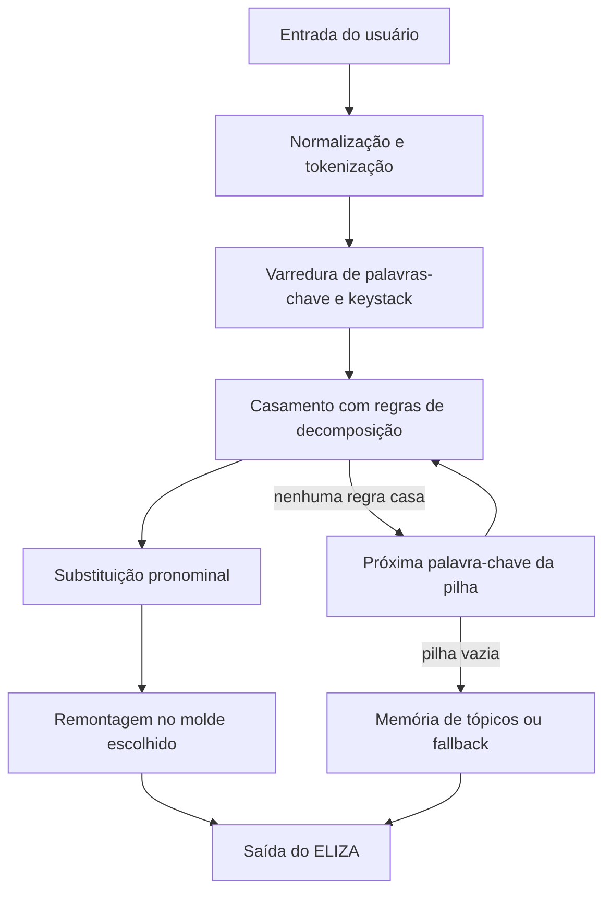

### 3.1. Pré-processamento e identificação das palavras-chave

Primeiramente, a mensagem recebida passa por um processo de normalização. O programa remove ou ajusta elementos como pontuação e diferenças entre letras maiúsculas e minúsculas. Em seguida, divide a frase em unidades menores, chamadas *tokens*.

Cada palavra é consultada no dicionário do script para verificar se corresponde a alguma palavra-chave cadastrada. Quando existe uma correspondência, o programa considera a prioridade associada a ela.

Alguns exemplos de palavras-chave utilizadas no DOCTOR são:

| Palavra-chave | Prioridade aproximada | Função |
| :--- | :---: | :--- |
| `always` | 1 | Solicitar um exemplo específico |
| `what` | 2 | Gerar uma pergunta relacionada à fala |
| `mother` / `family` | 4 | Introduzir assuntos familiares |
| `remember` | 5 | Produzir uma resposta reflexiva |
| `my` | Alta | Capturar informações e possibilitar o armazenamento de tópicos |

Quando encontra mais de uma palavra-chave, o ELIZA organiza essas ocorrências em uma estrutura chamada *keystack*. Dessa forma, consegue definir qual delas será processada primeiro, considerando sua prioridade.

### 3.2. Decomposição da frase

Depois de identificar a palavra-chave, o programa procura uma regra que corresponda à estrutura da mensagem. Essas regras utilizam curingas para identificar e separar diferentes partes da frase.

Um exemplo clássico é o padrão:

- **Padrão:** `(* I REMEMBER *)`
- **Entrada:** *"Well, I remember when we lived in Maceió"*
- **Partes identificadas:** (1) `"Well,"` · (2) `"I remember"` · (3) `"when we lived in Maceió"`

Nesse exemplo, o programa consegue separar a introdução da frase e o trecho que será utilizado posteriormente na resposta. Isso permite aproveitar partes da mensagem original sem precisar compreender seu significado.

### 3.3. Substituição pronominal

Após a decomposição, os trechos capturados podem passar por um processo de substituição de pronomes e outras palavras. O objetivo é adaptar a perspectiva da frase para que a resposta pareça ter sido construída pelo outro interlocutor.

Algumas substituições utilizadas no script original são:

- `I` → `you`
- `me` → `you`
- `my` → `your`
- `am` → `are`
- `myself` → `yourself`

No diálogo traduzido para o português, podemos observar uma lógica semelhante nas substituições de `meu` por `seu`, `me` por `você` e `eu` por `você`.

### 3.4. Remontagem da resposta

Com os trechos já identificados e ajustados, o programa utiliza um conjunto de modelos de resposta, chamados *templates*. Cada padrão de decomposição pode possuir várias alternativas, que são utilizadas de maneira circular para evitar que a mesma resposta seja repetida em todas as ocasiões.

Para o padrão `I REMEMBER`, por exemplo, algumas possibilidades de resposta são:

1. `(DO YOU OFTEN THINK OF (3)?)`
2. `(DOES THINKING OF (3) BRING ANYTHING ELSE TO MIND?)`
3. `(WHY DO YOU REMEMBER (3) JUST NOW?)`

Considerando o primeiro modelo e o trecho identificado como componente (3), o programa produziria uma resposta semelhante a: *"DO YOU OFTEN THINK OF WHEN WE LIVED IN MACEIO?"*.

Caso nenhuma regra corresponda à frase, o ELIZA tenta processar a próxima palavra-chave da pilha. Se todas as possibilidades forem esgotadas, pode recorrer à memória de tópicos ou utilizar uma resposta genérica para continuar a conversa.

## 4. Como o ELIZA responde a cada sentença do diálogo

Para relacionar o funcionamento do algoritmo com o exemplo apresentado anteriormente, a tabela abaixo reúne as mensagens do usuário, as palavras-chave ou regras envolvidas e as transformações realizadas pelo programa.

| Turno | Entrada (resumo) | Gatilho ou regra | Transformação realizada | Resposta |
| :--- | :--- | :--- | :--- | :--- |
| U1 → E1 | "Homens são todos iguais." | Padrão genérico de generalização ou ausência de palavra-chave específica | Utiliza uma pergunta genérica | "De que maneira?" |
| U2 → E2 | "...sempre nos incomodando..." | `sempre` / `always` | Identifica a generalização e solicita um exemplo | "Você consegue pensar em um exemplo específico?" |
| U3 → E3 | "Meu namorado me fez vir aqui" | `meu` / `my` | Captura o trecho e realiza a substituição dos pronomes | "Seu namorado fez você vir aqui?" |
| U4 → E4 | "...eu fico deprimida..." | Palavra-chave relacionada ao estado emocional | Insere o estado mencionado em um modelo de resposta | "Sinto muito em ouvir que você fica deprimida." |
| U5 → E5 | "Eu sou infeliz." | `infeliz` / `unhappy` | Seleciona um modelo de resposta relacionado à infelicidade | "Você acha que vir aqui vai te ajudar a não ser infeliz?" |
| U6 → E6 | "Eu preciso de um pouco de ajuda..." | `preciso` / `need` e `ajuda` / `help` | Reorganiza o pedido em uma pergunta hipotética | "O que significaria para você se você conseguisse um pouco de ajuda?" |
| U7 → E7 | "...com minha mãe." | `mãe` / `mother` | Direciona a conversa para o assunto família | "Fale-me mais sobre a sua família." |
| U8 → E8 | "Você não gosta de mim." | Padrão de acusação ao interlocutor | Transforma a afirmação em uma pergunta reflexiva | "O que faz você pensar que eu não gosto de você?" |
| U9 → E9 | "...você é um computador." | Padrão relacionado à identificação do sistema | Utiliza uma pergunta que questiona a afirmação do usuário | "Importa se eu sou um computador?" |

Ao observar os exemplos, fica mais fácil perceber que o ELIZA não precisa compreender o significado completo de cada mensagem para produzir respostas que parecem adequadas. Seu funcionamento depende principalmente da identificação de palavras-chave e da aplicação de regras previamente estabelecidas.

É justamente essa combinação que torna o diálogo interessante: mesmo sem compreender o que está sendo discutido, o programa consegue manter uma sequência de respostas que, em determinadas situações, pode ser interpretada pelo usuário como uma conversa com alguém que está prestando atenção.

## 5. Evoluções de funcionalidade: ELIZA (1966), PARRY (1972) e AIML/ALICE (1995–2000)

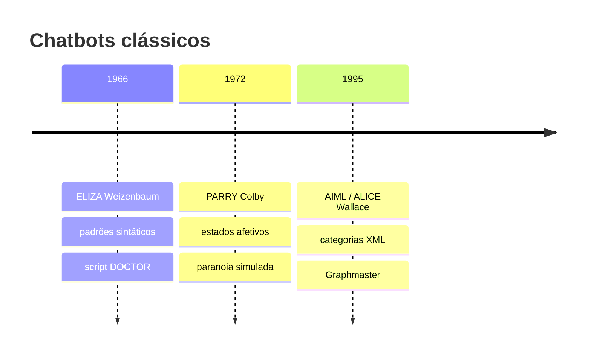

### 5.1. PARRY (Kenneth Colby, Stanford, 1972)

Alguns anos depois do ELIZA, Kenneth Colby desenvolveu o PARRY, um programa criado para simular o comportamento de uma pessoa com esquizofrenia paranoica. A principal diferença entre os dois está na forma como as respostas são construídas. Enquanto o ELIZA trabalha principalmente com padrões de texto, o PARRY utiliza variáveis internas que representam determinados estados emocionais e influenciam o comportamento do programa durante a conversa.

Entre suas principais características estão:

1. **Variáveis de estado emocional:** o programa trabalha com fatores como medo (*fear*), raiva (*anger*) e desconfiança (*mistrust*). Esses valores podem variar conforme o andamento da conversa.
2. **Respostas influenciadas pelo estado interno:** uma mesma pergunta pode gerar respostas diferentes dependendo dos níveis dessas variáveis. Quando os níveis de medo e raiva estão baixos, por exemplo, o PARRY pode falar mais sobre suas preocupações, como a máfia das corridas. Quando esses níveis aumentam, suas respostas podem se tornar mais hostis, evasivas ou até interromper o assunto.
3. **Avaliação por psiquiatras:** Colby realizou experimentos nos quais médicos receberam transcrições de conversas do PARRY e de pacientes reais, sem saber previamente quais eram humanas e quais haviam sido produzidas pelo programa. Em algumas avaliações, os profissionais tiveram dificuldade para distinguir as conversas.

A principal evolução em relação ao ELIZA foi a introdução de um estado interno capaz de influenciar as respostas. Assim, o PARRY não se limita a identificar palavras e aplicar modelos de frases: ele também considera variáveis que representam o comportamento que pretende simular.

### 5.2. AIML e A.L.I.C.E. (Richard Wallace, 1995–2000)

Outra evolução importante aconteceu com a criação da AIML (*Artificial Intelligence Markup Language*), uma linguagem baseada em XML desenvolvida para organizar regras e respostas de chatbots. Um dos programas mais conhecidos que utilizam essa linguagem é o A.L.I.C.E. (*Artificial Linguistic Internet Computer Entity*), desenvolvido por Richard Wallace. O chatbot ganhou destaque e venceu o Prêmio Loebner em mais de uma edição.

A principal contribuição da AIML foi facilitar a organização e a manutenção das regras de conversação. Em vez de manter toda a lógica concentrada em um único script, as respostas passaram a ser estruturadas em categorias, tornando a base de conhecimento mais organizada e fácil de expandir.

Entre os recursos mais importantes estão:

1. **Categorias declarativas em XML:** cada categoria define um padrão de entrada e a resposta correspondente. Isso permite adicionar novas possibilidades de interação sem precisar alterar diretamente o funcionamento do motor do chatbot.

```xml
<category>
  <pattern>EU GOSTO DE *</pattern>
  <template>
    Há quanto tempo você gosta de <star/>?
  </template>
</category>
```

2. **Normalização com `<srai>`:** esse recurso permite encaminhar diferentes formas de uma mesma pergunta para uma categoria principal. Dessa maneira, não é necessário cadastrar uma resposta diferente para cada variação de frase.

```xml
<category>
  <pattern>COMO VAI VOCE</pattern>
  <template><srai>OLA</srai></template>
</category>
```

3. **Controle de contexto com `<that>` e `<topic>`:** essas tags permitem que a resposta considere uma mensagem anterior do próprio chatbot ou um assunto que esteja sendo discutido. Isso ajuda a manter uma continuidade maior entre as mensagens.

4. **Graphmaster:** é a estrutura utilizada para organizar e localizar os padrões cadastrados. Funciona como uma árvore de busca (*trie*), permitindo encontrar correspondências de forma eficiente mesmo quando a base possui milhares de categorias.

### 5.3. Comparação entre as três gerações

Ao comparar os três modelos, podemos perceber que cada um trouxe mudanças na maneira de organizar as informações e construir as respostas.

| Critério | ELIZA (1966) | PARRY (1972) | AIML / ALICE (1995) |
| :--- | :--- | :--- | :--- |
| Arquitetura | Script com padrões e regras de substituição | Regras associadas a estados emocionais | Categorias XML organizadas pelo Graphmaster |
| Modelo interno | Pouco desenvolvido, baseado no reconhecimento de padrões | Variáveis que representam estados emocionais | Base de conhecimento organizada hierarquicamente |
| Contexto | Memória simples de tópicos | Histórico influenciado pelo estado interno | Recursos como `<that>` e `<topic>` |
| Variações de frases | Regras fixas de decomposição | Heurísticas associadas ao comportamento simulado | Normalização e encaminhamento com `<srai>` |
| Domínio | Conversa no estilo de uma sessão terapêutica | Simulação de comportamento paranoico | Agente conversacional de domínio mais amplo |

Observando essa evolução, percebemos que o ELIZA demonstrou como regras simples de reconhecimento de padrões poderiam produzir uma conversa aparentemente natural. O PARRY avançou nesse aspecto ao introduzir variáveis internas que influenciavam o comportamento do programa. Posteriormente, a AIML e o A.L.I.C.E. contribuíram para tornar a construção de chatbots mais organizada, permitindo trabalhar com bases de regras maiores e recursos de controle de contexto.

Apesar dessas diferenças, os três sistemas ainda apresentam limitações quando comparados a modelos capazes de interpretar linguagem de maneira mais profunda. Nenhum deles possui compreensão semântica semelhante à humana. O que muda de uma geração para outra é principalmente a capacidade de armazenar informações, considerar o contexto da conversa, controlar o comportamento das respostas e organizar uma quantidade maior de regras.

---

## Questão 4: Taxonomia de agentes, descrição PEAS e propriedades dos ambientes de tarefa

Esta questão usa a taxonomia do Capítulo 2 de Russell e Norvig (*Inteligência Artificial*, 3ª ed.): agente reativo simples, agente reativo baseado em modelo, agente baseado em objetivos, agente baseado em utilidade e agente com aprendizagem (o "agente adaptativo" da aula). Para cada categoria explicamos a estrutura do agente, mostramos o programa do agente em pseudocódigo e apresentamos duas aplicações. Cada aplicação tem a descrição PEAS do ambiente de tarefa e a caracterização do ambiente nas sete dimensões do livro.

### 0. Ferramentas da análise

No livro, um agente é qualquer coisa que percebe o ambiente por sensores e age sobre ele por atuadores, e agente = arquitetura + programa. O ambiente de tarefa é especificado pela descrição **PEAS**:

| Elemento | Pergunta que responde |
| :--- | :--- |
| P (*Performance*): medida de desempenho | Como julgamos se o agente se saiu bem? |
| E (*Environment*): ambiente | Em que mundo o agente opera e com o que ele interage? |
| A (*Actuators*): atuadores | Que ações ele pode executar? |
| S (*Sensors*): sensores | O que ele consegue perceber? |

As propriedades do ambiente de tarefa (Seção 2.3.2) são classificadas em sete dimensões:

| Dimensão | Pergunta |
| :--- | :--- |
| Completamente ou parcialmente observável | Os sensores dão acesso, a cada instante, a tudo o que é relevante para escolher a ação? |
| Agente único ou multiagente | Há outras entidades cujo comportamento é melhor descrito como a maximização de uma medida de desempenho que depende das ações do nosso agente? |
| Determinístico ou estocástico | O próximo estado é completamente determinado pelo estado atual e pela ação? |
| Episódico ou sequencial | A decisão atual afeta as decisões futuras? |
| Estático ou dinâmico | O ambiente pode mudar enquanto o agente delibera? (Semidinâmico: o ambiente não muda, mas o desempenho muda com o tempo.) |
| Discreto ou contínuo | Estados, tempo, percepções e ações assumem valores discretos ou contínuos? |
| Conhecido ou desconhecido | O agente (ou o projetista) conhece os resultados das ações, ou as probabilidades deles? |

O próprio livro avisa que muitas respostas dependem de como a tarefa é definida e que algumas não são definitivas. Por isso cada classificação abaixo vem com a justificativa para aquela aplicação específica.

### 1. Agente reativo simples

O agente reativo simples escolhe a ação olhando só para a percepção atual, por meio de regras condição-ação ("se carro-da-frente-está-freando então começar-a-frear"). Ele não guarda nada sobre o passado e não tem modelo de como o mundo evolui. O programa do agente da Figura 2.10 do livro é:

```text
função AGENTE-REATIVO-SIMPLES(percepção) retorna uma ação
  persistente: regras, um conjunto de regras condição-ação
  estado ← INTERPRETAR-ENTRADA(percepção)
  regra  ← REGRA-CORRESPONDENTE(estado, regras)
  ação   ← AÇÃO-DA-REGRA[regra]
  retornar ação
```

O livro mostra que esse agente só funciona bem se a decisão correta puder ser tomada a partir da percepção atual, isto é, se o ambiente for completamente observável no que importa para a decisão. Com observação parcial ele pode entrar em laços infinitos, como o aspirador sem sensor de posição que não sabe para que lado ir quando percebe [Limpo]. As duas aplicações abaixo foram escolhidas porque a percepção de cada instante já carrega a informação necessária.

#### 1.1 Porta automática de pedestres

O controlador de uma porta deslizante de shopping abre quando detecta alguém na área de aproximação e fecha quando a área fica vazia. As regras são duas: "se há presença na zona de detecção ou na soleira, abrir" e "senão, fechar".

```text
função AGENTE-PORTA([presença_zona, presença_soleira]) retorna uma ação
  se presença_zona ou presença_soleira então retornar Abrir
  senão retornar Fechar
```

| PEAS | Descrição |
| :--- | :--- |
| Desempenho | Abrir a tempo de a pessoa passar sem diminuir o passo; nunca fechar sobre alguém; manter a porta aberta o mínimo possível (perda de ar-condicionado, entrada de poeira); evitar aberturas para quem só passa ao lado |
| Ambiente | Entrada do prédio, pedestres, carrinhos de compras, cadeiras de rodas, objetos deixados na passagem, vento e chuva |
| Atuadores | Motor das folhas deslizantes (abrir, fechar), trava eletromecânica |
| Sensores | Sensor de movimento por micro-ondas acima da porta (zona de aproximação), barreira infravermelha na soleira |

| Propriedade | Classificação | Justificativa |
| :--- | :--- | :--- |
| Observabilidade | Parcialmente observável | O sensor detecta movimento na zona, não a intenção: quem passa rente à porta sem querer entrar dispara a abertura. Para a regra adotada ("há alguém na zona?"), porém, a percepção atual basta |
| Agentes | Agente único | Os pedestres não tentam maximizar nada que dependa das ações da porta; entram como parte do ambiente |
| Determinismo | Estocástico | A chegada de pessoas não é determinada pelo estado atual nem pela ação da porta |
| Episódico/sequencial | Episódico | Cada decisão depende só da leitura atual dos sensores, e abrir ou fechar agora não muda quem vai aparecer depois |
| Estático/dinâmico | Dinâmico | As pessoas continuam andando enquanto o controlador decide, embora a decisão leve milissegundos |
| Discreto/contínuo | Contínuo no mundo, discreto na interface | Posições e velocidades dos pedestres são contínuas, mas o agente só recebe presença sim/não e só escolhe entre abrir e fechar |
| Conhecido/desconhecido | Conhecido | O efeito de acionar o motor é especificado pelo fabricante |

#### 1.2 Triagem de pacotes por código de barras numa esteira

Num centro de distribuição, cada pacote passa por um leitor de código de barras logo antes de um conjunto de desviadores. A regra é uma tabela: "se o CEP lido está na faixa da região k, acionar o desviador da rampa k; se a leitura falhou, mandar para a rampa de rejeito, onde uma pessoa trata o pacote". Na versão mais simples, o leitor fica imediatamente antes do desviador e a percepção atual basta para agir.

```text
função AGENTE-TRIAGEM([código_lido]) retorna uma ação
  se código_lido = falha então retornar Desviar(rampa_rejeito)
  retornar Desviar(TABELA-CEP[REGIÃO(código_lido)])
```

| PEAS | Descrição |
| :--- | :--- |
| Desempenho | Porcentagem de pacotes na rampa correta, pacotes processados por hora, fração de pacotes mandados ao rejeito |
| Ambiente | Esteira, pacotes de tamanhos e formatos variados, etiquetas (algumas amassadas ou molhadas), rampas de destino |
| Atuadores | Desviadores pneumáticos ou sapatas deslizantes de cada rampa |
| Sensores | Leitor de código de barras ou câmera, sensor fotoelétrico que detecta a passagem do pacote, encoder da esteira |

| Propriedade | Classificação | Justificativa |
| :--- | :--- | :--- |
| Observabilidade | Completamente observável (com etiqueta legível) | O destino do pacote está inteiro no código lido. Quando a etiqueta está danificada a informação falta, e a regra de rejeito cobre esse caso |
| Agentes | Agente único | Não há outro agente cujo desempenho dependa das escolhas do desviador |
| Determinismo | Determinístico (em operação normal) | Acionar o desviador manda o pacote para a rampa. Falhas raras, como um pacote que escorrega, introduzem alguma estocasticidade |
| Episódico/sequencial | Episódico | Cada pacote é um episódio. A decisão sobre um pacote não afeta o destino nem a leitura do próximo, como no robô de seleção de peças do livro |
| Estático/dinâmico | Dinâmico | A esteira continua andando: se o agente demorar, o pacote passa do desviador e a ação vira "não fazer nada" |
| Discreto/contínuo | Discreto | Percepções (códigos) e ações (qual rampa) são discretas. O tempo é contínuo, mas o agente só age nos eventos de passagem |
| Conhecido/desconhecido | Conhecido | A tabela de CEPs e o efeito dos desviadores são dados de projeto |

### 2. Agente reativo baseado em modelo

Quando o ambiente é parcialmente observável, o agente precisa lembrar o que não está vendo agora. O agente baseado em modelo mantém um **estado interno** e o atualiza com dois tipos de conhecimento: como o mundo evolui independentemente do agente e como as ações do agente afetam o mundo. Esse conhecimento é o **modelo do mundo**. A escolha da ação continua sendo feita por regras condição-ação, só que aplicadas ao estado estimado e não à percepção crua. Programa do agente (Figura 2.12):

```text
função AGENTE-REATIVO-BASEADO-EM-MODELOS(percepção) retorna uma ação
  persistente: estado, a concepção do agente do estado atual do mundo
               modelo, como o próximo estado depende do estado atual e da ação
               regras, um conjunto de regras condição-ação
               ação, a ação mais recente, inicialmente nenhuma
  estado ← ATUALIZAR-ESTADO(estado, ação, percepção, modelo)
  regra  ← REGRA-CORRESPONDENTE(estado, regras)
  ação   ← AÇÃO-DA-REGRA[regra]
  retornar ação
```

O estado é o "melhor palpite" do agente. Ele pode estar errado, mas é o que permite agir de forma sensata quando a percepção do momento não basta.

#### 2.1 Robô aspirador que constrói um mapa da casa

Diferente do aspirador de dois quadrados do livro, um robô aspirador doméstico atual mapeia o apartamento enquanto limpa. O estado interno guarda um mapa de ocupação (paredes, móveis), a posição estimada do robô, as regiões já limpas e o nível de bateria. As regras são aplicadas sobre esse estado: "se bateria < 15%, voltar para a base", "se a região atual já foi limpa, seguir para a fronteira não limpa mais próxima", "se o sensor de sujeira acusa muita sujeira, passar de novo no mesmo lugar".

| PEAS | Descrição |
| :--- | :--- |
| Desempenho | Fração da área livre que foi limpa, tempo total, energia gasta, número de colisões, nunca cair de escadas, terminar na base |
| Ambiente | Apartamento com cômodos, móveis, tapetes, fios no chão, portas que abrem e fecham, pessoas e animais, base de recarga |
| Atuadores | Rodas com tração diferencial, escovas, motor de sucção, aviso sonoro |
| Sensores | LiDAR ou câmera para mapear, para-choque com chave de contato, sensores de desnível (anti-queda), encoders das rodas (odometria), sensor de sujeira, medidor de bateria |

| Propriedade | Classificação | Justificativa |
| :--- | :--- | :--- |
| Observabilidade | Parcialmente observável | O robô não vê os outros cômodos nem o que está atrás do sofá, e sua posição é uma estimativa (a odometria acumula erro quando as rodas patinam no tapete). Por isso precisa do mapa e da posição estimada como estado |
| Agentes | Agente único | Pessoas e animais mudam o ambiente, mas não agem em função do desempenho do robô |
| Determinismo | Estocástico | As rodas patinam, a sujeira aparece, um animal empurra um objeto para o caminho |
| Episódico/sequencial | Sequencial | O trajeto de agora determina o que falta limpar e quanto de bateria sobra para o resto |
| Estático/dinâmico | Dinâmico | Pessoas e animais se movem e portas são fechadas durante a limpeza |
| Discreto/contínuo | Contínuo | Posição, orientação e velocidade são contínuas; o mapa costuma ser discretizado em células para facilitar o raciocínio |
| Conhecido/desconhecido | Conhecido quanto às ações, desconhecido quanto ao mapa | O efeito de girar as rodas é conhecido, mas a planta da casa não é dada; o robô precisa construí-la durante a operação |

#### 2.2 Monitor de sinais vitais em UTI com alarme filtrado

Monitores multiparamétricos de UTI disparam muitos alarmes falsos, por exemplo quando o paciente mexe a mão e o oxímetro perde o sinal. Um agente baseado em modelo reduz esse problema mantendo como estado as tendências recentes de cada sinal, uma estimativa da qualidade do sinal (há artefato de movimento?) e os alarmes já emitidos e reconhecidos pela equipe. As regras olham para esse estado. Um exemplo de regra: "se a SpO2 estimada está abaixo de 90% há mais de 15 segundos e a qualidade do sinal é boa, emitir alarme de alta prioridade". Os limiares aqui são ilustrativos; na prática são definidos pela equipe clínica.

| PEAS | Descrição |
| :--- | :--- |
| Desempenho | Detectar deterioração real rapidamente (sensibilidade), reduzir alarmes falsos e a fadiga de alarme da equipe, nunca suprimir um evento crítico |
| Ambiente | Paciente no leito, equipe de enfermagem e médica, cabos e eletrodos, outros equipamentos do quarto |
| Atuadores | Alarmes sonoros e visuais com níveis de prioridade, mensagens na central de enfermagem, registro no prontuário eletrônico |
| Sensores | Oxímetro de pulso (SpO2), ECG, pressão arterial invasiva ou não invasiva, frequência respiratória, detecção de cabo desconectado |

| Propriedade | Classificação | Justificativa |
| :--- | :--- | :--- |
| Observabilidade | Parcialmente observável | O agente mede sinais indiretos e ruidosos. O estado fisiológico real não é medido, e um valor baixo isolado pode ser artefato. Daí a necessidade da tendência como estado |
| Agentes | Agente único | O "processo" da doença não é modelado como agente (o livro faz a mesma escolha para o diagnóstico médico). A equipe recebe os alarmes, mas não compete nem coopera com o agente no sentido do livro |
| Determinismo | Estocástico | A evolução do paciente e o ruído dos sensores não são determinados pelo estado e pela ação |
| Episódico/sequencial | Sequencial | Um alarme emitido agora e reconhecido pela equipe muda o que deve ser feito em seguida (não repetir o mesmo alarme), e a decisão depende do histórico recente |
| Estático/dinâmico | Dinâmico | O paciente continua evoluindo enquanto o agente decide |
| Discreto/contínuo | Contínuo | Os sinais são grandezas contínuas amostradas ao longo do tempo; só as ações (níveis de alarme) são discretas |
| Conhecido/desconhecido | Conhecido | O efeito das ações (soar um alarme, enviar mensagem) é conhecido, e a fisiologia dos sinais está documentada na literatura clínica |

### 3. Agente baseado em objetivos

Saber como o mundo está não diz o que fazer quando há várias ações possíveis e só algumas levam aonde se quer chegar. O agente baseado em objetivos tem, além do estado e do modelo, uma descrição das situações desejáveis, e usa o modelo para prever o resultado de sequências de ações ("o que acontece se eu fizer isso?") até encontrar uma que atinja o objetivo. Busca (Capítulos 3 a 5) e planejamento (Capítulos 10 e 11) são as técnicas para isso. O livro mostra esse agente só em diagrama (Figura 2.13); um programa no mesmo estilo seria:

```text
função AGENTE-BASEADO-EM-OBJETIVOS(percepção) retorna uma ação
  persistente: estado, modelo, objetivo
               plano, uma sequência de ações, inicialmente vazia
               ação, a ação mais recente, inicialmente nenhuma
  estado ← ATUALIZAR-ESTADO(estado, ação, percepção, modelo)
  se plano está vazio ou não é mais válido para estado então
      plano ← BUSCA(estado, objetivo, modelo)
  ação  ← PRIMEIRO(plano)
  plano ← RESTO(plano)
  retornar ação
```

A vantagem que o livro aponta é a flexibilidade: o conhecimento está explícito, então basta trocar o objetivo para o agente ir a outro destino, enquanto um agente reativo precisaria de outro conjunto de regras.

#### 3.1 Navegação por GPS em aplicativo de rotas

O agente recebe o destino digitado pelo usuário, localiza o carro no mapa e busca no grafo da malha viária um caminho até o destino, usando, por exemplo, A* com o tempo estimado de cada trecho como custo. O agente não dirige: ele age por meio das instruções dadas ao motorista. Quando o motorista não segue a instrução, o estado (posição) deixa de ser compatível com o plano e o agente recalcula a rota, que é exatamente o teste "plano não é mais válido" do pseudocódigo.

| PEAS | Descrição |
| :--- | :--- |
| Desempenho | Chegar ao destino; tempo e distância da rota; respeitar mão de via e conversões proibidas; recalcular rápido quando o motorista sai da rota; instruções dadas com antecedência suficiente |
| Ambiente | Malha viária (grafo de ruas e cruzamentos), trânsito, obras e bloqueios, motorista |
| Atuadores | Instruções por voz e na tela ("em 200 m, vire à direita"), desenho da rota no mapa |
| Sensores | Receptor GPS, acelerômetro e giroscópio do celular, base de mapas, dados de trânsito do servidor, tela de toque para o destino |

| Propriedade | Classificação | Justificativa |
| :--- | :--- | :--- |
| Observabilidade | Parcialmente observável | O GPS tem erro de alguns metros e perde sinal em túneis; o trânsito à frente é conhecido só de forma agregada e atrasada |
| Agentes | Agente único | Os outros motoristas aparecem como condição de trânsito, não como adversários ou parceiros do aplicativo. O motorista funciona como atuador, um atuador que às vezes desobedece |
| Determinismo | Estocástico, planejado como determinístico | Na busca, cada trecho tem custo fixo e a ação "seguir pela rua X" leva ao cruzamento seguinte. Na prática o tempo de viagem varia e o motorista pode errar, por isso o replanejamento |
| Episódico/sequencial | Sequencial | Cada conversão restringe as rotas possíveis dali em diante |
| Estático/dinâmico | Dinâmico | O carro continua andando enquanto a rota é recalculada; se o cálculo demorar, a saída indicada já passou |
| Discreto/contínuo | Discreto no planejamento, contínuo no mundo | A busca trabalha num grafo finito de cruzamentos, mas posição e tempo são contínuos |
| Conhecido/desconhecido | Conhecido | O mapa e as regras de circulação são dados ao agente |

A fronteira com o agente baseado em utilidade aparece aqui. Enquanto o objetivo for "chegar ao destino" e o custo for um único número somado ao longo do caminho, o agente é de objetivos com custo de caminho, como nos problemas de busca do Capítulo 3. Se o aplicativo passar a pesar tempo, pedágio, risco de congestionamento e preferência do usuário por vias expressas, ele vira um agente baseado em utilidade.

#### 3.2 Robô móvel de armazém

Em armazéns automatizados, robôs pequenos andam sobre uma grade marcada no piso, entram embaixo de uma prateleira móvel, levantam-na e a levam até a estação onde um operador separa os itens do pedido. O objetivo de cada missão é "prateleira P na estação E, depois prateleira P de volta a uma posição livre". O robô planeja um caminho na grade com A*, reservando as células que vai ocupar junto ao servidor central, e replaneja quando o caminho é bloqueado.

| PEAS | Descrição |
| :--- | :--- |
| Desempenho | Pedidos atendidos por hora, tempo médio por missão, nenhuma colisão, nenhum impasse (robôs bloqueando uns aos outros), consumo de energia |
| Ambiente | Piso do armazém dividido em células com marcadores, prateleiras móveis, dezenas de outros robôs, estações de separação com operadores, estações de recarga |
| Atuadores | Rodas (avançar, girar 90°), elevador que levanta a prateleira, rádio para pedir e liberar reservas de células |
| Sensores | Câmera inferior que lê os marcadores do piso (posição), câmera superior que identifica a prateleira, sensores de obstáculo, encoders, mensagens do servidor com as reservas dos outros robôs |

| Propriedade | Classificação | Justificativa |
| :--- | :--- | :--- |
| Observabilidade | Completamente observável (no nível da grade) | Os marcadores dão a posição exata na grade, e as posições e reservas dos outros robôs chegam pelo servidor. Isso cobre tudo o que importa para o planejamento |
| Agentes | Multiagente cooperativo | Os outros robôs também estão maximizando o desempenho do armazém, e as escolhas de um afetam as dos outros (disputa por células e corredores) |
| Determinismo | Determinístico (praticamente) | "Avançar uma célula" leva à célula seguinte; falhas mecânicas são raras e tratadas como exceção. Pela definição do livro, a incerteza causada só pelas ações dos outros agentes não torna o ambiente estocástico |
| Episódico/sequencial | Sequencial | Cada movimento muda as opções seguintes e a missão só termina com a sequência completa |
| Estático/dinâmico | Dinâmico | Os outros robôs se movem enquanto este planeja |
| Discreto/contínuo | Discreto | Estados são células e orientações; ações são movimentos de uma célula e giros de 90° |
| Conhecido/desconhecido | Conhecido | A planta do armazém e o efeito de cada movimento são definidos no projeto |

### 4. Agente baseado em utilidade

Objetivos dão só uma distinção binária entre estados "felizes" e "infelizes". Quando há objetivos conflitantes (rapidez e segurança, por exemplo) ou quando nenhum objetivo pode ser atingido com certeza, o agente precisa de uma forma de comparar estados pelo grau de preferência. A **função utilidade** $U$ é, nas palavras do livro, uma internalização da medida de desempenho. Em ambiente estocástico ou parcialmente observável, o agente racional escolhe a ação de maior **utilidade esperada**:

$$a^* = \arg\max_{a} \sum_{s'} P(s' \mid s, a)\, U(s')$$

Como para o agente de objetivos, o livro mostra esse agente em diagrama (Figura 2.14). Um programa no mesmo estilo:

```text
função AGENTE-BASEADO-EM-UTILIDADE(percepção) retorna uma ação
  persistente: estado, modelo (inclui P(s' | s, a)), U, a função utilidade
               ação, a ação mais recente, inicialmente nenhuma
  estado ← ATUALIZAR-ESTADO(estado, ação, percepção, modelo)
  para cada a em AÇÕES(estado) faça
      UE[a] ← Σ sobre s' de P(s' | estado, a) × U(s')
  ação ← a com maior UE[a]
  retornar ação
```

#### 4.1 Agente de negociação e rebalanceamento de carteira

Um agente que administra uma carteira de ações não pode ter como objetivo apenas "ganhar dinheiro": quase toda estratégia pode ganhar ou perder, e as que rendem mais em média costumam ser as mais arriscadas. Uma função utilidade clássica é a de média e variância de Markowitz, $U = \mathbb{E}[R] - \lambda\,\text{Var}[R]$, em que $\lambda$ expressa a aversão do investidor ao risco. Antes de cada ordem, o agente estima a distribuição de retornos da carteira resultante, desconta os custos de transação e escolhe a operação (comprar, vender, não fazer nada) de maior utilidade esperada.

| PEAS | Descrição |
| :--- | :--- |
| Desempenho | Retorno ajustado ao risco (por exemplo, índice de Sharpe), perda máxima acumulada dentro do limite, custos de corretagem e de impacto no preço, respeito às regras de exposição definidas pelo cliente e pela regulação |
| Ambiente | Bolsa de valores, livro de ofertas, outros investidores e robôs de negociação, notícias e indicadores econômicos |
| Atuadores | Envio, alteração e cancelamento de ordens de compra e venda; tamanho de cada posição |
| Sensores | Cotações em tempo real, livro de ofertas, saldo e posições da conta, notícias e calendário de indicadores |

| Propriedade | Classificação | Justificativa |
| :--- | :--- | :--- |
| Observabilidade | Parcialmente observável | O agente não vê as intenções nem as ordens ocultas dos outros participantes, nem a informação que eles têm |
| Agentes | Multiagente competitivo | Do outro lado de cada negociação há outro agente tentando lucrar, e muitos deles reagem às ordens que aparecem no livro |
| Determinismo | Estocástico | Uma ordem enviada pode ser executada ou não, e a preços diferentes; o preço seguinte não é determinado pelo estado e pela ação |
| Episódico/sequencial | Sequencial | A posição montada hoje limita o que se pode fazer amanhã e determina o risco acumulado |
| Estático/dinâmico | Dinâmico | Os preços mudam enquanto o agente calcula; atraso de milissegundos muda o preço obtido |
| Discreto/contínuo | Discreto em sentido estrito, tratado como contínuo | Preços variam em incrementos mínimos e as quantidades são lotes inteiros, mas a granularidade é tão fina que os modelos tratam preço e tempo como contínuos |
| Conhecido/desconhecido | Desconhecido | As "leis" do mercado não são dadas: a distribuição de retornos e o impacto das próprias ordens precisam ser estimados a partir de dados, e mudam com o tempo |

#### 4.2 Despacho de ambulâncias (central de regulação do SAMU)

O agente decide qual viatura atende cada chamado e onde as viaturas livres devem esperar. A regra "mandar sempre a mais próxima" atinge o objetivo de atender o chamado, mas pode deixar uma região inteira descoberta. Um exemplo com valores hipotéticos: chega um chamado grave no centro. A viatura A está a 6 minutos, mas é a única cobrindo a zona norte; a viatura B está a 11 minutos. Suponha que a chance de sobrevida do paciente atual seja 0,80 com resposta em 6 minutos e 0,70 em 11 minutos, que a probabilidade de surgir outro chamado grave na zona norte enquanto A estiver fora seja 0,3, e que esse segundo paciente tenha sobrevida 0,78 se A estiver disponível e 0,40 se o socorro vier de longe. Tomando como utilidade o número esperado de sobreviventes:

$$UE(\text{mandar A}) = 0{,}80 + 0{,}3 \times 0{,}40 = 0{,}92 \qquad UE(\text{mandar B}) = 0{,}70 + 0{,}3 \times 0{,}78 = 0{,}934$$

Com esses números, mandar a viatura mais distante é a melhor decisão. O resultado muda se a probabilidade do segundo chamado for menor, e é justamente esse tipo de compromisso entre resultados incertos que um agente só de objetivos não consegue representar.

| PEAS | Descrição |
| :--- | :--- |
| Desempenho | Tempo de resposta ponderado pela gravidade, sobrevida e sequelas esperadas, cobertura da cidade (fração da população a menos de X minutos de uma viatura livre), quilometragem e custo |
| Ambiente | Cidade com vias e trânsito, bases das viaturas, hospitais e sua lotação, chamados, equipe de regulação médica |
| Atuadores | Designar viatura a um chamado, reposicionar viaturas ociosas, indicar o hospital de destino |
| Sensores | Chamados com classificação de gravidade feita na triagem telefônica, GPS e status das viaturas (livre, em deslocamento, ocupada), dados de trânsito, ocupação dos hospitais |

| Propriedade | Classificação | Justificativa |
| :--- | :--- | :--- |
| Observabilidade | Parcialmente observável | A gravidade real só é conhecida quando a equipe chega, e os chamados futuros, que definem o valor da cobertura, são desconhecidos |
| Agentes | Agente único | As viaturas são atuadores do mesmo agente; os pacientes e o trânsito não otimizam nada que dependa do despacho |
| Determinismo | Estocástico | O tempo de deslocamento varia com o trânsito, e o surgimento de chamados é aleatório |
| Episódico/sequencial | Sequencial | Mandar uma viatura agora muda a cobertura disponível para os próximos chamados, como o exemplo mostra |
| Estático/dinâmico | Dinâmico | Novos chamados chegam e as viaturas se movem enquanto o agente decide; demora na decisão é tempo de resposta perdido |
| Discreto/contínuo | Contínuo no mundo, discreto nas ações | Posições e tempos são contínuos; as ações são escolhas discretas (qual viatura, qual hospital) |
| Conhecido/desconhecido | Conhecido (em grande parte) | O efeito de despachar uma viatura é conhecido; as probabilidades de chamados por região e horário são estimadas do histórico e tratadas como dadas |

### 5. Agente com aprendizagem (adaptativo)

Qualquer um dos quatro tipos anteriores pode ser transformado em um agente com aprendizagem. O livro divide esse agente em quatro componentes (Figura 2.15):

- o **elemento de desempenho**, que é o agente "completo" das seções anteriores, recebe percepções e escolhe ações;
- o **crítico** compara o comportamento do agente com um **padrão de desempenho fixo**, externo ao agente, e gera realimentação;
- o **elemento de aprendizado** usa essa realimentação para modificar o elemento de desempenho;
- o **gerador de problemas** sugere ações exploratórias, que podem não ser ótimas agora mas trazem informação útil para depois.

A aprendizagem é o que permite operar em ambientes desconhecidos ou que mudam com o tempo. Um programa no espírito do livro:

```text
função AGENTE-COM-APRENDIZAGEM(percepção) retorna uma ação
  persistente: elemento_desempenho, o programa que escolhe as ações
               padrão, o padrão de desempenho (fixo, externo ao agente)
  realimentação ← CRÍTICO(percepção, padrão)
  elemento_desempenho ← ELEMENTO-DE-APRENDIZADO(elemento_desempenho, realimentação)
  ação ← elemento_desempenho(percepção)
  se GERADOR-DE-PROBLEMAS sugere experimento então
      ação ← AÇÃO-EXPLORATÓRIA()
  retornar ação
```

A Aula 2 da disciplina mostra um caso desse esquema: a base de conhecimento de um agente de análise de risco de crédito é construída automaticamente, por indução de árvore de decisão, a partir de exemplos rotulados. O algoritmo de indução faz o papel do elemento de aprendizado, e a árvore (ou as regras extraídas dela) vira o elemento de desempenho.

#### 5.1 Filtro de spam que aprende com o usuário

O elemento de desempenho é um classificador, por exemplo Naive Bayes sobre as palavras e os cabeçalhos da mensagem. O crítico é o próprio usuário: cada vez que ele marca uma mensagem como spam ou tira uma mensagem da pasta de spam, o crítico registra um erro do classificador. O elemento de aprendizado atualiza as contagens de palavras ou os pesos do modelo com esses rótulos. O gerador de problemas é fraco nesta aplicação, porque mandar de propósito um e-mail legítimo para o spam só para aprender custaria caro ao usuário. O máximo de exploração aceitável é deixar mensagens duvidosas na caixa de entrada com um aviso de "possível spam", o que obtém o rótulo do usuário sem esconder a mensagem.

| PEAS | Descrição |
| :--- | :--- |
| Desempenho | Porcentagem de spam bloqueado; taxa de falsos positivos (e-mail legítimo na pasta de spam), que pesa mais que deixar passar um spam; manutenção da taxa de acerto à medida que os spammers mudam as mensagens |
| Ambiente | Fluxo de e-mails recebidos, remetentes legítimos, spammers, o usuário |
| Atuadores | Entregar na caixa de entrada, mover para spam, marcar como suspeito, bloquear remetente |
| Sensores | Texto, anexos e cabeçalhos da mensagem, reputação do remetente e do servidor de origem, ações do usuário (marcar como spam, "não é spam") |

| Propriedade | Classificação | Justificativa |
| :--- | :--- | :--- |
| Observabilidade | Parcialmente observável | A intenção do remetente não é visível, e o usuário só rotula uma fração das mensagens, então boa parte dos erros nunca chega ao crítico |
| Agentes | Multiagente competitivo | Os spammers mudam o texto das mensagens para passar pelo filtro: o desempenho deles depende de enganar o agente |
| Determinismo | Estocástico | O próximo e-mail não é determinado pela decisão atual, e a reação do usuário também não |
| Episódico/sequencial | Episódico na decisão, sequencial no aprendizado | Classificar uma mensagem não muda a próxima, mas cada rótulo altera o modelo e as decisões seguintes, e os spammers reagem ao que é bloqueado |
| Estático/dinâmico | Estático | A mensagem não muda enquanto é classificada |
| Discreto/contínuo | Discreto | Texto, tokens e ações (entregar, mover) são discretos |
| Conhecido/desconhecido | Desconhecido | O que distingue spam de mensagem legítima não é dado de antemão e muda com o tempo; precisa ser aprendido e reaprendido |

#### 5.2 Sistema de recomendação de vídeos

O elemento de desempenho é um modelo que pontua os itens do catálogo para o usuário (por exemplo, filtragem colaborativa) e monta a tela inicial. O crítico compara a reação do usuário com o padrão de desempenho: assistir até o fim conta como sucesso, abandonar em segundos conta como falha. O elemento de aprendizado atualiza as representações do usuário e dos itens. Aqui o gerador de problemas tem papel central: se o sistema só mostrar o que já sabe que agrada, nunca vai descobrir o interesse do usuário por um gênero novo, nem quanto vale um lançamento ainda sem histórico. Por isso parte das posições da tela é reservada para exploração, com estratégias como $\varepsilon$-greedy ou bandidos multibraço.

O cuidado que o livro pede com o padrão de desempenho aparece de forma concreta. Se o crítico medir só cliques, o agente aprende a recomendar títulos chamativos que não satisfazem o usuário, e a métrica sobe enquanto o desempenho real cai.

| PEAS | Descrição |
| :--- | :--- |
| Desempenho | Tempo assistido, taxa de conclusão, avaliações, retenção do assinante ao longo dos meses, diversidade e novidade das recomendações, não recomendar conteúdo impróprio para o perfil |
| Ambiente | Catálogo de títulos, usuários e perfis, contexto (horário, dispositivo), lançamentos |
| Atuadores | Escolher e ordenar os títulos de cada fileira da tela inicial, enviar notificações, sugerir o próximo episódio |
| Sensores | Histórico de reprodução, pausas e abandonos, buscas, avaliações, metadados dos títulos |

| Propriedade | Classificação | Justificativa |
| :--- | :--- | :--- |
| Observabilidade | Parcialmente observável | A preferência do usuário não é observada diretamente, só inferida do comportamento; numa conta compartilhada nem se sabe quem está assistindo |
| Agentes | Agente único | Há muitos usuários, mas eles não competem nem cooperam com o agente; cada um é tratado como parte do ambiente |
| Determinismo | Estocástico | O mesmo usuário reage de forma diferente à mesma recomendação em dias diferentes |
| Episódico/sequencial | Sequencial | As recomendações de hoje moldam o histórico que alimenta as de amanhã e podem até mudar o gosto do usuário |
| Estático/dinâmico | Dinâmico | O catálogo muda, os gostos mudam, e a tela precisa ser montada em milissegundos |
| Discreto/contínuo | Discreto | Itens, cliques e posições na tela são discretos (as representações internas são vetores contínuos, mas isso é escolha do agente, não propriedade do ambiente) |
| Conhecido/desconhecido | Desconhecido | O efeito de recomendar um título a um usuário não é conhecido de antemão, sobretudo para usuários e títulos novos |

### 6. Comparação das dez aplicações

| Aplicação | Categoria | Observável | Agentes | Determinístico | Episódico | Estático | Discreto | Conhecido |
| :--- | :--- | :--- | :--- | :--- | :--- | :--- | :--- | :--- |
| Porta automática | Reativo simples | Parcial (basta para a regra) | Único | Estocástico | Episódico | Dinâmico | Contínuo / interface discreta | Conhecido |
| Triagem de pacotes | Reativo simples | Completo | Único | Determinístico | Episódico | Dinâmico | Discreto | Conhecido |
| Robô aspirador com mapa | Baseado em modelo | Parcial | Único | Estocástico | Sequencial | Dinâmico | Contínuo | Ações conhecidas, mapa não |
| Monitor de UTI | Baseado em modelo | Parcial | Único | Estocástico | Sequencial | Dinâmico | Contínuo | Conhecido |
| Navegação GPS | Baseado em objetivos | Parcial | Único | Estocástico (planejado como determinístico) | Sequencial | Dinâmico | Discreto no plano | Conhecido |
| Robô de armazém | Baseado em objetivos | Completo (na grade) | Multi (cooperativo) | Determinístico | Sequencial | Dinâmico | Discreto | Conhecido |
| Negociação de ações | Baseado em utilidade | Parcial | Multi (competitivo) | Estocástico | Sequencial | Dinâmico | Tratado como contínuo | Desconhecido |
| Despacho de ambulâncias | Baseado em utilidade | Parcial | Único | Estocástico | Sequencial | Dinâmico | Contínuo / ações discretas | Conhecido |
| Filtro de spam | Com aprendizagem | Parcial | Multi (competitivo) | Estocástico | Episódico (decisão) | Estático | Discreto | Desconhecido |
| Recomendação de vídeos | Com aprendizagem | Parcial | Único | Estocástico | Sequencial | Dinâmico | Discreto | Desconhecido |

### 7. Por que a categoria depende das propriedades do ambiente

A tabela mostra um padrão. Os dois agentes reativos simples estão em ambientes episódicos em que a informação necessária para decidir está na percepção do momento. Os agentes que precisam de estado interno aparecem exatamente onde o ambiente é parcialmente observável e sequencial. Os agentes de objetivo e de utilidade trabalham em ambientes sequenciais, em que é preciso pensar à frente. Os agentes com aprendizagem estão onde o ambiente é desconhecido ou muda.

Cada propriedade do ambiente cria uma exigência para o programa do agente:

| Propriedade do ambiente | O que ela exige do agente | Categoria mínima |
| :--- | :--- | :--- |
| Completamente observável e episódico | Mapear a percepção atual na ação | Reativo simples |
| Parcialmente observável | Lembrar o que não está sendo visto agora e estimar o estado | Baseado em modelo |
| Sequencial, com muitas sequências possíveis e um destino explícito | Prever o efeito de sequências de ações e buscar uma que atinja o objetivo | Baseado em objetivos |
| Estocástico, com objetivos conflitantes ou sem garantia de sucesso | Comparar resultados incertos por grau de preferência | Baseado em utilidade |
| Desconhecido ou não estacionário | Melhorar o próprio programa a partir da experiência | Com aprendizagem |

As categorias são cumulativas. O agente de objetivos usa o modelo do agente baseado em modelo, e o de utilidade também mantém estado e modelo. A aprendizagem pode ser acrescentada a qualquer uma delas: o robô aspirador aprende o mapa, o agente de negociação reestima a distribuição de retornos todos os dias. Nos sistemas reais as categorias aparecem misturadas. O próprio robô aspirador tem um componente de objetivo ("voltar à base"), e o aplicativo de rotas vira um agente de utilidade quando passa a pesar pedágio e risco de congestionamento.

A escolha certa é a categoria mais simples que atinge a medida de desempenho no ambiente dado. Uma porta automática com função utilidade e planejamento seria mais cara, mais lenta e mais difícil de certificar, sem abrir a porta melhor. Por outro lado, aplicar um agente reativo ao despacho de ambulâncias ("sempre a mais próxima") ignora a natureza sequencial e estocástica da tarefa e, como mostrou o exemplo da seção 4.2, pode levar a decisões piores. O livro resume a questão ao apresentar as dimensões: "Em grande parte, essas dimensões determinam o projeto apropriado de agentes". Analisar o ambiente de tarefa com PEAS e as sete propriedades antes de escolher a arquitetura evita tanto o agente simples demais quanto o complexo demais.

### Referências (Q4)

1. RUSSELL, Stuart J.; NORVIG, Peter. *Inteligência Artificial*. 3. ed. Rio de Janeiro: Elsevier, 2013. Capítulo 2 (Agentes inteligentes).
2. COSTA, Evandro de Barros. *Aprendizagem de Máquina e Construção de Base de Conhecimento: Indução de Árvore de Decisão* (Aula 2). Slides da disciplina ECOM031, UFAL, 2026.
3. MARKOWITZ, Harry. Portfolio Selection. *The Journal of Finance*, v. 7, n. 1, p. 77-91, 1952.

---

## Questão 5: Resumo estendido — Inferência em LLMs

**Fonte:** vídeo *What is LLM Inference? How AI Models Generate Response*  
**Link:** https://www.youtube.com/watch?v=615-yWyS1n0

Este resumo apresenta os principais conceitos abordados no vídeo indicado no enunciado da Lista 2. O conteúdo explica o que acontece entre o envio de um *prompt* e a geração de uma resposta por um modelo de linguagem de grande porte (*Large Language Model*, LLM). Ao longo da explicação, são apresentados o papel da inferência, os motores responsáveis por executar os modelos e as etapas que influenciam o tempo de resposta percebido pelo usuário.

### 1. Treino versus inferência: do modelo treinado à geração de respostas

O vídeo começa explicando a diferença entre treinar um modelo de linguagem e utilizá-lo depois que o treinamento foi concluído. O treinamento de modelos de grande porte exige uma infraestrutura computacional significativa, pode levar meses e envolver investimentos de centenas de milhões de dólares. Ao final desse processo, o modelo possui um conjunto de parâmetros numéricos, chamados de pesos (*weights*), que armazenam o conhecimento aprendido durante o treinamento.

Esses pesos, por si só, não representam um sistema pronto para conversar ou responder a perguntas. É necessário executar o modelo para que ele processe uma entrada e produza uma saída. Esse processo é chamado de inferência.

Enquanto o treinamento é realizado em etapas específicas do desenvolvimento e da atualização do modelo, a inferência acontece continuamente, sempre que uma aplicação envia uma nova solicitação. É ela que permite o funcionamento de chatbots, assistentes de programação e outras aplicações baseadas em LLMs.

O vídeo também chama atenção para o impacto financeiro dessa etapa. Embora o treinamento tenha um custo inicial muito elevado, a inferência é executada repetidamente a cada solicitação recebida. Quando um modelo passa a ser utilizado por milhões de pessoas, o custo acumulado de execução pode superar o investimento realizado no treinamento. Por isso, reduzir o tempo e o custo de cada inferência é um dos principais desafios para disponibilizar esses modelos em larga escala.

### 2. O motor de inferência (*inference engine*)

Para que um modelo treinado possa atender às solicitações dos usuários, é necessário um componente de software responsável por coordenar sua execução: o motor de inferência (*inference engine*).

Ele atua como uma camada intermediária entre o modelo e a aplicação que o utiliza. Em vez de simplesmente carregar os pesos e executar cálculos, precisa organizar as requisições recebidas, controlar o uso das GPUs e distribuir o processamento de maneira eficiente.

Entre suas principais responsabilidades estão:

- Receber e organizar as requisições enviadas pelas aplicações;
- Gerenciar a utilização da memória e das GPUs;
- Definir quais solicitações serão processadas em conjunto;
- Coordenar a geração e o envio dos tokens de resposta.

O vídeo apresenta ferramentas como **vLLM**, **Ollama** e **llama.cpp** como exemplos de soluções utilizadas para executar modelos localmente ou em servidores.

Outro aspecto importante é a compatibilidade com APIs. Alguns motores oferecem endpoints compatíveis com o formato da API da OpenAI. Isso permite que uma aplicação utilize diferentes modelos ou servidores sem precisar modificar toda a implementação responsável pelo envio das requisições. Assim, a integração entre o modelo e o sistema que o consome fica mais simples.

### 3. Do texto aos identificadores numéricos: tokenização

Antes de ser processado pelo modelo, o texto enviado pelo usuário precisa passar por uma etapa chamada **tokenização**. Nela, a mensagem é dividida em unidades menores, conhecidas como *tokens*.

Um token pode representar uma palavra inteira, parte de uma palavra, um número ou até mesmo um sinal de pontuação. Cada unidade é associada a um identificador numérico, chamado de ID. É essa sequência de números que será utilizada pelo modelo durante o processamento, e não o texto original da maneira como aparece para o usuário.

A quantidade de tokens gerada depende do texto e do vocabulário utilizado pelo modelo. Por isso, duas mensagens com o mesmo número de caracteres podem resultar em quantidades diferentes de tokens.

Essa etapa também tem impacto no custo e no desempenho da inferência. Em muitos serviços, o consumo é contabilizado com base na quantidade de tokens de entrada e saída. Além disso, o número de tokens do *prompt* influencia o volume de informações que o modelo precisará processar.

O tamanho do vocabulário também merece atenção. Um vocabulário maior pode permitir que determinadas palavras sejam representadas com menos tokens, mas aumenta a quantidade de possibilidades que o modelo precisa considerar na etapa de previsão. Portanto, não significa necessariamente que um vocabulário maior resulte em uma inferência mais rápida.

### 4. Autenticação, roteamento e processamento de múltiplas requisições

Depois da tokenização, a solicitação segue para a infraestrutura responsável por executar o modelo. Em serviços disponibilizados pela internet, essa etapa pode envolver autenticação por meio de uma chave de API, utilizada para verificar se a aplicação tem autorização para acessar o serviço.

Em seguida, mecanismos de roteamento direcionam a requisição para os recursos computacionais disponíveis. Essa decisão pode considerar fatores como o tamanho da entrada, o modelo solicitado e a capacidade dos servidores naquele momento.

Um ponto importante apresentado no vídeo é que os servidores normalmente precisam atender várias requisições ao mesmo tempo. Processar cada solicitação isoladamente poderia deixar parte da capacidade das GPUs sem utilização. Para explicar esse problema, o vídeo utiliza a comparação com uma padaria que ligasse um forno industrial para assar apenas um pão por vez.

Uma das soluções para aproveitar melhor esses recursos é o **agrupamento de requisições (*batching*)**. Nesse processo, várias solicitações são reunidas para que o hardware consiga processá-las de maneira mais eficiente.

O vídeo também apresenta o *continuous batching*, ou agrupamento contínuo. Nesse modelo, novas requisições podem ocupar os espaços liberados por aquelas que já terminaram, sem que seja necessário esperar todo o grupo finalizar para iniciar outro processamento.

Um componente chamado *scheduler* coordena essa distribuição, organizando quais requisições serão executadas e em que momento. O objetivo é manter os recursos computacionais ocupados de forma eficiente, sem comprometer excessivamente o tempo de resposta de cada usuário.

### 5. As duas fases da inferência: *prefill* e *decode*

A geração de uma resposta por um LLM não acontece de uma única vez. O processo é dividido em duas fases principais: *prefill* e *decode*. Cada uma possui características próprias e exige os recursos computacionais de maneiras diferentes.

#### 5.1. Prefill e o KV cache

Na fase de *prefill*, o modelo processa os tokens que compõem o *prompt* enviado pelo usuário. Durante esse processamento, são calculadas e armazenadas informações intermediárias chamadas de *key-value cache* (KV cache).

O KV cache guarda os valores de *keys* e *values* produzidos pelas camadas de atenção do modelo para os tokens já processados. Essas informações são reutilizadas durante a geração da resposta, evitando que o modelo precise recalcular tudo a cada novo token.

Isso é especialmente importante em conversas longas. Sem esse mecanismo, o processamento dos tokens seguintes exigiria repetir parte significativa dos cálculos relacionados ao contexto anterior, aumentando o custo da geração.

O *prefill* costuma ser uma etapa limitada pela capacidade de processamento (*compute-bound*), pois envolve operações matemáticas que podem ser executadas em paralelo sobre os tokens de entrada. Seu desempenho depende, entre outros fatores, da capacidade computacional disponível e do tamanho do *prompt*.

#### 5.2. Decode: geração token a token

Depois que o *prefill* termina, começa a fase de *decode*. É nesse momento que o modelo passa a produzir a resposta, gerando um token por vez.

Em cada etapa, o modelo utiliza os tokens anteriores e as informações armazenadas no KV cache para calcular uma distribuição de probabilidades sobre os possíveis próximos tokens. Com base nessa distribuição e na estratégia de geração configurada, um token é selecionado e adicionado à sequência. O processo se repete até que a resposta seja concluída.

Como cada novo token depende dos anteriores, a geração ocorre de maneira sequencial. O KV cache é atualizado durante esse processo para armazenar as informações necessárias aos próximos passos.

Diferentemente do *prefill*, o *decode* costuma ser limitado pela largura de banda da memória (*memory-bandwidth bound*). Isso acontece porque, a cada passo, é necessário acessar os pesos do modelo e as informações armazenadas em memória. Assim, a velocidade de geração depende bastante da rapidez com que esses dados podem ser disponibilizados para o processamento.

De forma simplificada, as duas fases apresentam gargalos diferentes: o *prefill* exige maior capacidade de cálculo sobre a entrada, enquanto o *decode* depende bastante da velocidade de acesso à memória para gerar os tokens seguintes.

### 6. Latência na prática: TTFT e ITL

Para avaliar o desempenho de um sistema de inferência, não basta observar apenas quanto tempo ele leva para gerar uma resposta completa. Também é importante entender quanto tempo o usuário espera pelo início da resposta e qual é a velocidade com que os próximos tokens são enviados.

O vídeo apresenta duas métricas utilizadas para analisar esses aspectos:

| Métrica | Significado | Relação com as fases |
| :--- | :--- | :--- |
| **TTFT** (*Time to First Token*) | Tempo entre o envio da solicitação e o recebimento do primeiro token da resposta. | É influenciado principalmente pelo processamento do *prefill*, além de etapas anteriores, como roteamento e agendamento. |
| **ITL** (*Inter-Token Latency*) | Intervalo de tempo entre o recebimento de tokens consecutivos. | Está relacionado principalmente à velocidade da fase de *decode*. |

As duas métricas ajudam a entender a experiência do usuário durante uma interação com um LLM. Um sistema pode apresentar um TTFT baixo, fazendo com que a resposta comece rapidamente, mas ainda assim gerar os tokens seguintes de forma lenta. Da mesma maneira, pode demorar para iniciar a resposta, mas apresentar uma geração rápida depois que o primeiro token é entregue.

Por isso, analisar TTFT e ITL separadamente permite identificar melhor em qual etapa está o principal gargalo de desempenho.

### 7. Síntese do caminho entre o *prompt* e a resposta

Com base nas etapas apresentadas no vídeo, é possível organizar o funcionamento da inferência na seguinte sequência:

1. O usuário envia uma mensagem para um *endpoint*, que pode utilizar um formato compatível com a API da OpenAI.
2. O texto é convertido em uma sequência de IDs por meio da tokenização.
3. A solicitação passa pelos mecanismos de autenticação e roteamento da infraestrutura.
4. O *scheduler* organiza as requisições e utiliza técnicas de *batching* e *continuous batching* para aproveitar melhor as GPUs.
5. Na fase de *prefill*, o modelo processa os tokens de entrada e constrói o KV cache.
6. Na fase de *decode*, a resposta é gerada token a token, utilizando as informações armazenadas no KV cache.
7. Durante a geração, o desempenho pode ser observado por métricas como TTFT e ITL, que representam o tempo até o primeiro token e o intervalo entre os tokens seguintes.

O fluxo pode ser representado pelo seguinte diagrama:

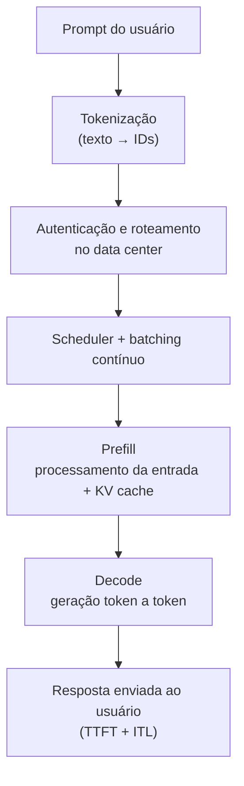

### 8. Considerações finais

O vídeo apresenta a inferência sob uma perspectiva de engenharia de sistemas, concentrando-se no que acontece para que um modelo já treinado consiga responder às solicitações dos usuários em tempo real. Em vez de abordar como um LLM aprende durante o treinamento, a explicação mostra como seus parâmetros são utilizados na prática e quais componentes tornam possível executar o modelo em escala.

Nesse processo, os motores de inferência organizam o uso dos recursos computacionais e o atendimento das requisições. A tokenização transforma o texto em uma representação numérica, enquanto as fases de *prefill* e *decode* realizam o processamento necessário para gerar a resposta. O KV cache evita a repetição de cálculos sobre o contexto anterior, e métricas como TTFT e ITL ajudam a avaliar a velocidade percebida pelo usuário.

Um dos principais pontos que ficam da explicação é que o desempenho de um LLM não depende somente do tamanho ou da qualidade do modelo. A infraestrutura utilizada para executá-lo também tem papel fundamental. Em aplicações reais, é necessário equilibrar velocidade, custo e capacidade de atendimento, especialmente quando muitas pessoas utilizam o serviço simultaneamente.

### Referência do vídeo

IBM Technology. *What is LLM Inference? How AI Models Generate Response*. YouTube, 2025. Disponível em: https://www.youtube.com/watch?v=615-yWyS1n0. Acesso em: 6 nov. 2026.

---

## Questão 6: Sistema fuzzy de Mamdani para irrigação de hortaliças

**Dupla:** Bruno Gomes de Barros Filho (21111360); Antônio Rodrigo Lima de Andrade Tenório (23210707)
**Disciplina:** ECOM031: Inteligência Artificial
**Professor:** Evandro de Barros Costa
**Período:** 2026.2

## Enunciado

> Desenvolva um sistema baseado em regras fuzzy, usando a ferramenta Scikit Fuzzy (ou uma outra de
> sua livre escolha), para uma aplicação de sua escolha. Sobre a solução a ser desenvolvida, apresente:
> Descrição do processo de modelagem, mostrando e discutindo as variáveis e os seus universos de
> discursos, as funções de pertinência utilizadas na etapa de fuzzificação, bem como a solução para
> etapa de defuzzificação), e discuta e mostre como é feita a inferência sobre o conhecimento.
> Obs.: Considere a metodologia e inferência de Mamdani.

Onde cada item do enunciado é respondido:

| Item pedido | Seção deste relatório |
|---|---|
| processo de modelagem | [1](#1-aplicação-escolhida) e [2](#2-processo-de-modelagem) |
| variáveis e universos de discurso | [2.1](#21-variáveis-e-universos-de-discurso) |
| funções de pertinência (fuzzificação) | [2.2](#22-funções-de-pertinência-fuzzificação) |
| base de conhecimento | [2.3](#23-base-de-conhecimento-27-regras) |
| inferência de Mamdani, mostrada e discutida | [3](#3-inferência-de-mamdani-passo-a-passo) |
| defuzzificação | [3.5](#35-etapa-5-defuzzificação-pelo-centroide) e [4](#4-comparação-dos-métodos-de-defuzzificação) |

## Como executar

Na raiz do repositório, com o ambiente virtual já criado:

```bash
# testes (112 casos)
.venv/bin/python -m pytest src/q06_fuzzy -q

# executa o notebook do zero e regrava as saídas e as figuras
cd src/q06_fuzzy && ../../.venv/bin/jupyter nbconvert --to notebook --execute --inplace q06_fuzzy.ipynb
```

Uso direto do módulo (com `src/q06_fuzzy` como diretório atual):

```python
import fuzzy_irrigacao as fi
fi.tempo_irrigacao(umidade=38, temperatura=32, chuva=25)   # 32.75 (minutos)
```

Bibliotecas usadas: scikit-fuzzy 0.5.0, NumPy 2.5.4, pandas, matplotlib e pytest, todas já listadas
no ambiente do repositório.

## Arquivos

| Arquivo | Conteúdo |
|---|---|
| `fuzzy_irrigacao.py` | variáveis, universos, funções de pertinência, base de regras, inferência Mamdani manual e o mesmo sistema montado com `skfuzzy.control` |
| `fuzzy_graficos.py` | funções que geram as figuras |
| `q06_fuzzy.ipynb` | notebook executado: percorre a modelagem e a inferência passo a passo |
| `test_q06_fuzzy_irrigacao.py` | testes pytest |
| `figures/*.png` | figuras geradas pelo notebook |

O sistema foi implementado duas vezes de propósito. A função `inferir` faz a inferência de Mamdani
com NumPy e devolve todos os valores intermediários (graus, forças, cortes, conjunto agregado), o que
permite mostrar cada etapa. A função `criar_sistema_skfuzzy` monta o mesmo sistema com a API de alto
nível do scikit-fuzzy e serve de referência: as duas versões são comparadas no notebook e nos testes.

## 1. Aplicação escolhida

O sistema decide quanto tempo ligar a irrigação por gotejamento de uma horta no Agreste alagoano
(região de Arapiraca, onde a olericultura irrigada é comum). Uma vez por dia ele lê três grandezas e
devolve o tempo de funcionamento da bomba.

| Papel | Variável | Origem da medida |
|---|---|---|
| entrada | umidade do solo, em % da água disponível | sensor capacitivo ou tensiômetro |
| entrada | temperatura do ar, em °C | estação meteorológica simples |
| entrada | probabilidade de chuva nas próximas 24 h, em % | previsão do tempo |
| saída | tempo de irrigação, em minutos | acionamento da bomba |

A escolha se justifica porque o conhecimento de quem maneja a horta já é verbal ("solo seco e dia muito
quente pedem irrigação longa", "se vai chover, não precisa irrigar") e as categorias têm fronteiras
graduais: 34 % de água disponível não é muito diferente de 36 %. Um controle por limiar fixo (liga
abaixo de X %) ignora temperatura e previsão e muda de comportamento de forma brusca no limiar. A
aplicação também tem significado prático no estado, onde parte da produção de hortaliças depende de
irrigação na estação seca.

## 2. Processo de modelagem

A modelagem seguiu a ordem clássica de um controlador de Mamdani:

1. escolher as variáveis linguísticas de entrada e de saída;
2. definir o universo de discurso de cada uma;
3. dividir cada universo em termos linguísticos e escolher a função de pertinência de cada termo;
4. escrever a base de regras SE-ENTÃO;
5. escolher os operadores de inferência e o método de defuzzificação;
6. validar o comportamento (superfície de controle, sensibilidade, casos de borda).

### 2.1 Variáveis e universos de discurso

| Variável | Universo | Discretização | Termos |
|---|---|---|---|
| Umidade do solo (% da água disponível) | 0 a 100 | passo 0,5 (201 pontos) | seca, adequada, úmida |
| Temperatura do ar (°C) | 15 a 40 | passo 0,1 (251 pontos) | amena, quente, muito quente |
| Probabilidade de chuva prevista (%) | 0 a 100 | passo 0,5 (201 pontos) | baixa, média, alta |
| Tempo de irrigação (min) | 0 a 60 | passo 0,1 (601 pontos) | nenhum, curto, médio, longo, muito longo |

Justificativas:

* **Umidade do solo.** A escala é a fração da água disponível: 0 % é o ponto de murcha permanente e
  100 % é a capacidade de campo. Com ela o sistema não depende do tipo de solo; a calibração do sensor
  converte a umidade volumétrica para essa escala.
* **Temperatura.** No Agreste alagoano as mínimas raramente ficam abaixo de 15 °C e as máximas raramente
  passam de 40 °C, então o intervalo cobre o ano com folga.
* **Chuva prevista.** É uma probabilidade, então o universo é o intervalo inteiro.
* **Tempo de irrigação.** Para gotejamento em canteiros de hortaliças, uma hora por dia é um teto
  razoável; acima disso a água em excesso drena abaixo das raízes.

O passo fino da saída importa na defuzzificação, porque o centroide é uma integral calculada
numericamente sobre esses pontos.

### 2.2 Funções de pertinência (fuzzificação)

| Variável | Termo | Tipo | Parâmetros |
|---|---|---|---|
| umidade | seca | trapezoidal | [0, 0, 20, 45] |
| umidade | adequada | triangular | [25, 50, 75] |
| umidade | úmida | trapezoidal | [55, 80, 100, 100] |
| temperatura | amena | gaussiana | média 15, σ = 5 |
| temperatura | quente | gaussiana | média 27, σ = 4 |
| temperatura | muito quente | gaussiana | média 40, σ = 5 |
| chuva | baixa | trapezoidal | [0, 0, 20, 40] |
| chuva | média | triangular | [20, 50, 80] |
| chuva | alta | trapezoidal | [60, 80, 100, 100] |
| tempo | nenhum | triangular | [0, 0, 15] |
| tempo | curto | triangular | [0, 15, 30] |
| tempo | médio | triangular | [15, 30, 45] |
| tempo | longo | triangular | [30, 45, 60] |
| tempo | muito longo | triangular | [45, 60, 60] |


Por que cada formato:

* **Umidade: trapézios nas pontas e triângulo no meio.** O manejo de irrigação trabalha com limiares.
  O boletim FAO-56 (Allen et al., 1998) recomenda repor a água quando o esgotamento passa de uma fração
  *p* da água disponível, que para a maioria das hortaliças fica entre 0,3 e 0,5. Abaixo de 20 % o solo
  está seco sob qualquer critério e acima de 80 % está úmido, por isso os trapézios têm patamar com
  pertinência 1. O termo `adequada` tem pico em 50 %, o meio da faixa de esgotamento permitido.
* **Temperatura: gaussianas.** O efeito do calor sobre a evapotranspiração cresce de forma suave, e a
  gaussiana descreve isso sem pontos de quebra. Ela também diversifica os tipos de função usados no
  trabalho. O preço é que a gaussiana nunca chega a zero, então todo termo de temperatura tem algum
  grau positivo em qualquer ponto. Isso aparece na inferência (regras disparando com força 0,003) e
  na análise de monotonicidade (seção 6.2).
* **Chuva: trapézios e triângulo.** Previsões abaixo de 20 % contam como "não vai chover" e acima de
  80 % como "vai chover", com uma faixa de dúvida no meio.
* **Tempo: cinco triângulos iguais.** Picos em 0, 15, 30, 45 e 60 min, cada triângulo terminando no
  pico do vizinho. Em qualquer ponto as pertinências somam 1 (partição de Ruspini), o que torna a
  saída fácil de interpretar.

### 2.3 Base de conhecimento: 27 regras

Com 3 termos em cada entrada há 3 × 3 × 3 = 27 combinações, e há uma regra para cada uma. Assim
nenhuma região do espaço de entradas fica sem resposta. Todas têm a forma
`SE umidade é A E temperatura é B E chuva é C ENTÃO tempo é D`.

A tabela foi escrita com quatro critérios:

1. a umidade do solo é o fator principal: solo seco pede irrigação longa, solo úmido não pede nenhuma;
2. passar de `amena` para `muito quente` pode subir a saída um nível;
3. cada nível a mais de chuva prevista pode descer a saída um nível;
4. com solo `úmido` a saída é sempre `nenhum`, porque irrigar perto da capacidade de campo só faz a
   água drenar e carregar nutrientes.


A mesma base em texto (linhas: umidade; colunas: temperatura amena / quente / muito quente):

| Chuva | Umidade | amena | quente | muito quente |
|---|---|---|---|---|
| baixa | seca | longo | longo | muito longo |
| baixa | adequada | curto | médio | médio |
| baixa | úmida | nenhum | nenhum | nenhum |
| média | seca | médio | longo | longo |
| média | adequada | curto | curto | médio |
| média | úmida | nenhum | nenhum | nenhum |
| alta | seca | curto | médio | médio |
| alta | adequada | nenhum | curto | curto |
| alta | úmida | nenhum | nenhum | nenhum |

Os consequentes ficaram assim distribuídos: 10 regras `nenhum`, 6 `curto`, 6 `médio`, 4 `longo` e
1 `muito longo`. As regras são numeradas R1 a R27 com a umidade variando mais devagar, depois a
temperatura, depois a chuva (R1 = seca, amena, baixa; R27 = úmida, muito quente, alta). O teste
`test_regras_monotonas_na_tabela` confere, regra a regra, que mais umidade ou mais chuva nunca aumenta
o nível de saída e que mais calor nunca o reduz.

### 2.4 Operadores

| Etapa | Operação | Operador |
|---|---|---|
| conjunção dos antecedentes (E) | força de disparo | mínimo |
| disjunção (OU, não usada nas regras) | | máximo |
| implicação | corta o consequente na altura da força | mínimo |
| agregação | une as saídas de todas as regras | máximo |
| defuzzificação | conjunto agregado → número | centroide |

São os operadores da formulação original de Mamdani e também os padrões do `skfuzzy.control`.

## 3. Inferência de Mamdani passo a passo

Caso concreto: uma tarde de verão com o solo secando, **umidade 38 %, temperatura 32 °C e chuva
prevista de 25 %**. Todos os números abaixo saem da execução do notebook.

### 3.1 Etapa 1: fuzzificação

| Variável | Termo | Grau μ |
|---|---|---|
| umidade = 38 % | seca / adequada / úmida | 0,280 / 0,520 / 0,000 |
| temperatura = 32 °C | amena / quente / muito quente | 0,003 / 0,458 / 0,278 |
| chuva = 25 % | baixa / média / alta | 0,750 / 0,167 / 0,000 |


A umidade de 38 % é ao mesmo tempo um pouco `seca` e mais `adequada`. O grau 0,003 de `amena` vem da
cauda da gaussiana.

### 3.2 Etapa 2: força de disparo (E = mínimo)

A força de cada regra é o menor dos graus dos seus antecedentes. Das 27 regras, 12 têm força positiva
e 8 têm força acima de 0,01. As que importam:

| Regra | Antecedentes | Consequente | Graus | Força |
|---|---|---|---|---|
| R13 | adequada, quente, baixa | médio | 0,52; 0,458; 0,75 | 0,458 |
| R4 | seca, quente, baixa | longo | 0,28; 0,458; 0,75 | 0,280 |
| R7 | seca, muito quente, baixa | muito longo | 0,28; 0,278; 0,75 | 0,278 |
| R16 | adequada, muito quente, baixa | médio | 0,52; 0,278; 0,75 | 0,278 |
| R17 | adequada, muito quente, média | médio | 0,52; 0,278; 0,167 | 0,167 |
| R8 | seca, muito quente, média | longo | 0,28; 0,278; 0,167 | 0,167 |
| R5 | seca, quente, média | longo | 0,28; 0,458; 0,167 | 0,167 |
| R14 | adequada, quente, média | curto | 0,52; 0,458; 0,167 | 0,167 |

As outras quatro regras com força positiva envolvem `amena` e disparam com 0,003. As regras com chuva
`alta` ou solo `úmido` têm força zero.

### 3.3 Etapa 3: implicação (mínimo)

Cada regra corta o seu conjunto consequente na altura da sua força. Como várias regras apontam para o
mesmo termo e a agregação é por máximo, o corte efetivo de cada termo é a maior força entre as regras
daquele termo:

| Termo de saída | Regras com esse consequente | Corte | Regra que define o corte |
|---|---|---|---|
| nenhum | 10 | 0,000 | |
| curto | 6 | 0,167 | R14 |
| médio | 6 | 0,458 | R13 |
| longo | 4 | 0,280 | R4 |
| muito longo | 1 | 0,278 | R7 |

### 3.4 Etapa 4: agregação (máximo)

O conjunto agregado é o máximo ponto a ponto dos consequentes cortados. À esquerda, os cortes; à
direita, o conjunto agregado com a posição de cada método de defuzzificação.


### 3.5 Etapa 5: defuzzificação pelo centroide

$$ z^* = \frac{\int z\,\mu_{agr}(z)\,dz}{\int \mu_{agr}(z)\,dz} $$

| Cálculo | Resultado |
|---|---|
| ∫ z·μ(z) dz (regra do trapézio, NumPy) | 585,2610 |
| ∫ μ(z) dz | 17,8705 |
| centroide pela integral (`centroide_manual`) | **32,750 min** |
| soma discreta Σzμ / Σμ | 32,771 min |
| `fuzz.defuzz(..., "centroid")` | 32,750 min |
| `skfuzzy.control` (sistema completo) | 32,750 min |

O centroide calculado à mão coincide com o do scikit-fuzzy. A soma discreta dos livros fica 0,02 min
acima porque dá peso cheio aos pontos extremos do universo, e aqui o ponto z = 60 min tem pertinência
0,278; a regra do trapézio dá meio peso às pontas. Em 300 entradas sorteadas no espaço todo, a maior
diferença entre a implementação manual e o `skfuzzy.control` foi de 0,00047 min. Essa sobra vem de o
`skfuzzy.control` inserir no universo os pontos exatos onde as linhas de corte cruzam as funções de
pertinência, enquanto a versão manual usa a grade fixa de 0,1 min.

Resultado do caso: **irrigar por cerca de 33 minutos**. Faz sentido: o solo está mais para adequado do
que para seco, mas o calor e a previsão de pouca chuva puxam o tempo para acima do termo `médio`.

## 4. Comparação dos métodos de defuzzificação

No caso concreto:

| Método | Tempo (min) |
|---|---|
| centroide | 32,75 |
| bissetor | 32,49 |
| média dos máximos (mom) | 30,00 |
| menor dos máximos (som) | 21,90 |
| maior dos máximos (lom) | 38,10 |

Os métodos de máximo só olham o patamar mais alto do conjunto agregado, que aqui é o termo `médio`
(21,9 a 38,1 min); ignoram que `longo` e `muito longo` também foram ativados. Para ver o efeito na
operação, a umidade foi varrida de 0 a 100 % em passos de 0,5 %, com 32 °C e 25 % de chuva:


| Método | Maior salto entre passos de 0,5 % (min) | Valores distintos na varredura |
|---|---|---|
| centroide | 2,43 | 80 |
| bissetor | 1,58 | 80 |
| média dos máximos | 17,12 | 8 |
| menor dos máximos | 21,30 | 8 |
| maior dos máximos | 30,30 | 11 |

Os métodos de máximo geram uma saída em degraus, com saltos de até 30 min por uma variação de 0,5 % no
sensor. Para um controlador isso é ruim, então adotamos o centroide. O maior passo dele (2,4 min,
entre 74,5 % e 75 % de umidade) acontece quando `adequada` chega a zero e só `nenhum` continua ativo;
é um trecho íngreme da curva, sem descontinuidade. O bissetor teria sido uma escolha equivalente.

## 5. Superfície de controle e mapas de calor


O que a superfície mostra:

* abaixo de 20 % de umidade a saída não depende da umidade, porque `seca` está no patamar do
  trapézio; o mesmo acontece acima de 80 % com `úmida`;
* a temperatura pesa mais com solo seco ou adequado. Com 90 % de umidade e 10 % de chuva a saída
  ainda varia de 5,0 a 6,3 min com a temperatura, embora a tabela mande `nenhum` em todos os casos
  (a causa está na seção 6.2);
* o mínimo da saída não é 0 min. Com só `nenhum` ativo e corte 1, o centroide do triângulo [0, 0, 15]
  é 5 min; com corte menor o triângulo vira trapézio e o valor sobe (5,95 min com corte 0,458);
* nos cantos do universo a saída vai de 5,0 min (solo úmido) a 54,82 min (solo seco, 40 °C, sem
  chuva). O centroide nunca alcança as pontas do universo de saída.

## 6. Análise de sensibilidade

### 6.1 Uma entrada por vez

Cada entrada percorre seu universo com as outras fixas no caso base (38 %, 32 °C, 25 %).


| Entrada | Saída mín (min) | Saída máx (min) | Amplitude (min) | Derivada no caso base |
|---|---|---|---|---|
| umidade | 5,95 | 45,61 | 39,66 | −0,628 min/% |
| temperatura | 26,62 | 35,71 | 9,09 | +0,572 min/°C |
| chuva | 20,79 | 36,57 | 15,77 | −0,637 min/% |

Numa grade 26 × 26 × 26 do espaço inteiro, a amplitude média da saída quando só uma entrada varia foi
de 32,3 min para a umidade, 11,5 min para a chuva e 8,6 min para a temperatura. A ordem de influência
é a que os critérios da seção 2.3 pedem.

### 6.2 Monotonicidade

A base de regras é monótona, mas a saída defuzzificada não é estritamente monótona. Na mesma grade,
contando passos entre vizinhos em que a saída anda mais de 0,1 min no sentido errado:

| Entrada | Sentido esperado | Inversões > 0,1 min (27 regras) | Maior inversão | Inversões (19 regras) | Maior inversão |
|---|---|---|---|---|---|
| umidade | diminui | 124 de 16900 | 0,98 min | 123 de 16900 | 0,98 min |
| temperatura | aumenta | 1600 de 16900 | 1,29 min | 405 de 16900 | 1,24 min |
| chuva | diminui | 1421 de 16900 | 1,89 min | 416 de 16900 | 1,77 min |

A pior inversão no eixo da chuva ajuda a entender a causa. Com umidade 72 % e 40 °C, subir a chuva de
28 % para 32 % fez a saída subir de 14,11 para 16,00 min. Nesse ponto o solo é `úmido` com grau 0,68 e
`adequado` com 0,12. As nove regras de solo úmido mandam não irrigar, mas cada uma também exige um termo
de chuva, e o corte de `nenhum` vira min(0,68; maior grau de chuva). Entre 28 % e 32 % a chuva sai de
`baixa` e entra em `média`, e o maior dos dois graus cai de 0,60 para 0,40. O corte de `nenhum` cai
junto (0,60 → 0,40), o de `médio` fica em 0,12, e o centroide sobe. Na temperatura o efeito aparece com
mais frequência porque as gaussianas vizinhas se cruzam em graus menores, entre 0,35 e 0,41.

O problema está em escrever regras com antecedentes irrelevantes. A variante `REGRAS_COMPACTAS` troca
as nove regras de solo úmido por `SE umidade é úmida ENTÃO tempo é nenhum` e mantém as outras 18. Ela
reduz as inversões de temperatura e chuva a menos de um terço e elimina a ondulação com solo úmido
(saída fixa em 5,0 min a 90 % de umidade). A maior diferença de saída entre as duas bases foi de
2,7 min, em 72 % de umidade, 33 °C e sem chuva. As inversões que restam vêm do mesmo mecanismo nas regras
de solo seco e adequado. Ficam abaixo de 2 min, irrelevante numa irrigação diária, e esse é o limite
usado em `test_monotonia_aproximada_em_varreduras`. A base de 27 regras continua sendo o sistema
principal por corresponder à matriz da seção 2.3; a compacta fica como melhoria documentada.

## 7. Casos de borda

**Limites do universo.** Os oito cantos do espaço de entradas dão o mesmo resultado na versão manual e
no `skfuzzy.control`:

| Umidade | Temperatura | Chuva | Tempo (min) |
|---|---|---|---|
| 0 | 15 | 0 | 45,00 |
| 0 | 15 | 100 | 15,25 |
| 0 | 40 | 0 | 54,82 |
| 0 | 40 | 100 | 30,00 |
| 100 | qualquer canto | qualquer canto | 5,00 |

**Entradas fora do universo.** Uma leitura fora da faixa (sensor com defeito ou fim de escala) é
saturada no limite, como faz o skfuzzy com `clip_to_bounds=True`. A leitura (−10 %, 55 °C, −5 %) é
tratada como (0, 40, 0) e dá 54,82 min nas duas implementações; (120 %, 10 °C, 150 %) dá 5,00 min.

**Nenhuma regra disparando.** Com a base completa e as entradas saturadas, sempre há regra com força
positiva. O caso foi provocado de duas formas: uma base reduzida às 9 regras de solo seco recebendo
solo a 90 %, e a base completa sem saturação recebendo 45 °C. Nas duas, a maior força é 0 e a área do
conjunto agregado é 0, e o centroide vira 0/0. A implementação manual levanta `ValueError` ("nenhuma
regra disparou"). O `skfuzzy.control`, no modo padrão (`lenient=True`), não produz saída nenhuma
(`sim.output` fica vazio), e com `lenient=False` levanta `EmptyMembershipError`. Num controlador real o
chamador deve tratar esse erro com uma ação segura, como manter a bomba desligada e registrar alarme.
Escrever as 27 combinações evita o problema na operação normal.

## 8. Testes

`test_q06_fuzzy_irrigacao.py` tem 112 casos (incluindo parametrizações), todos passando:

* base completa com 27 combinações distintas;
* monotonicidade da tabela de regras;
* centroide manual igual ao `fuzz.defuzz` e ao `skfuzzy.control` (tolerância 0,001 min) em 30 entradas
  sorteadas;
* saída dentro de [0, 60] min para os cinco métodos de defuzzificação, incluindo cantos e entradas
  fora do universo;
* ordem esperada entre extremos de cada entrada e monotonicidade aproximada (inversões < 2 min) em
  varreduras;
* saturação de entradas fora do universo;
* erro quando nenhuma regra dispara;
* base compacta: igual ao `skfuzzy.control` e sem lacunas de cobertura.

## 9. Discussão e limitações

* **Parâmetros escolhidos à mão.** As funções de pertinência e a tabela de regras vêm de critério
  agronômico geral, sem calibração com dados de campo. Um sistema real precisaria ajustar os limiares
  ao solo e à cultura (alface e tomate têm frações de esgotamento diferentes, por exemplo) e validar o
  tempo de irrigação contra medidas de umidade nos dias seguintes.
* **Faixa útil da saída.** O centroide não alcança 0 nem 60 min; a saída fica entre 5,0 e 54,8 min.
  Para desligar a bomba de fato, o atuador deveria tratar saídas abaixo de um limiar (por exemplo,
  6 min) como "não irrigar", ou o termo `nenhum` poderia virar um singleton em 0.
* **Monotonicidade aproximada.** A combinação mínimo/máximo/centroide produz inversões locais de até
  1,9 min, explicadas na seção 6.2. A base compacta reduz o efeito; um modelo do tipo Sugeno ou outra
  t-norma (produto) seria o próximo passo para quem precisar de monotonicidade garantida.
* **Caudas gaussianas.** As gaussianas fazem regras dispararem com forças minúsculas e criam vales
  entre termos vizinhos. Para este problema, triângulos ou trapézios com cruzamento em 0,5 na
  temperatura seriam igualmente defensáveis.
* **Uma decisão por dia.** O sistema não tem memória: não considera quanto foi irrigado ontem nem a
  chuva que de fato caiu. Isso exigiria uma entrada a mais ou um controle em malha fechada.

## Referências

* MAMDANI, E. H.; ASSILIAN, S. An experiment in linguistic synthesis with a fuzzy logic controller.
  *International Journal of Man-Machine Studies*, v. 7, n. 1, p. 1-13, 1975.
* ALLEN, R. G.; PEREIRA, L. S.; RAES, D.; SMITH, M. *Crop evapotranspiration: guidelines for computing
  crop water requirements*. FAO Irrigation and Drainage Paper 56. Roma: FAO, 1998.
* ROSS, T. J. *Fuzzy Logic with Engineering Applications*. 3. ed. Wiley, 2010.
* RUSSELL, S.; NORVIG, P. *Inteligência Artificial*. 3. ed. Rio de Janeiro: Elsevier, 2013.
* WARNER, J. et al. scikit-fuzzy, documentação da versão 0.5.0. Disponível em
  <https://scikit-fuzzy.github.io/scikit-fuzzy/>.

---

## Questão 7: Sistema de Apoio ao Diagnóstico Médico Baseado em Casos (CBR)

**Dupla:** Bruno Gomes de Barros Filho (21111360); Antônio Rodrigo Lima de Andrade Tenório (23210707)  
**Disciplina:** ECOM031: Inteligência Artificial  
**Professor:** Evandro de Barros Costa  
**Período:** 2026.2

> Aviso: todos os casos, sintomas e tratamentos deste trabalho são fictícios e foram escritos para fins didáticos. O sistema não deve ser usado para diagnóstico ou tratamento reais.

## Enunciado

> Desenvolva um Sistema de Apoio ao Diagnóstico Médico Baseado em Casos. O sistema deverá ser capaz de receber como entrada um conjunto de sintomas informados pelo paciente e compará-los com uma base de casos previamente armazenados. Cada caso deverá conter, no mínimo, informações sobre sintomas observados, diagnóstico realizado e tratamento recomendado. O sistema deverá implementar as etapas fundamentais do ciclo de Raciocínio Baseado em Casos:
>
> - Recuperação (Retrieve): localizar os casos mais semelhantes ao problema apresentado;
> - Reutilização (Reuse): utilizar os casos recuperados para propor um possível diagnóstico;
> - Revisão (Revise): permitir a validação ou correção do diagnóstico sugerido;
> - Retenção (Retain): armazenar novos casos ou atualizações na base de conhecimento para uso futuro.
>
> Requisitos mínimos: construir uma base contendo pelo menos 15 casos médicos fictícios; considerar, no mínimo, cinco tipos diferentes de doenças; implementar um mecanismo de cálculo de similaridade entre casos; exibir os casos mais semelhantes encontrados; apresentar o diagnóstico sugerido e um possível tratamento associado; permitir a inclusão de novos casos na base de conhecimento.
>
> Relatório técnico contendo: descrição da base de casos; representação dos casos; método de cálculo de similaridade utilizado; exemplos de consultas realizadas; análise dos resultados obtidos; vídeo ou demonstração do funcionamento do protótipo.

### Onde cada requisito é atendido

| Requisito | Onde |
|---|---|
| Base com pelo menos 15 casos fictícios | `base_casos.json`, 31 casos ([seção 1](#1-descrição-da-base-de-casos)) |
| Pelo menos cinco doenças | 8 doenças ([seção 1](#1-descrição-da-base-de-casos)) |
| Cálculo de similaridade | `cbr_similaridade.py` ([seção 3](#3-método-de-cálculo-de-similaridade)) |
| Exibir os casos mais semelhantes | `SistemaCBR.recuperar`, tabela da CLI e do notebook ([seção 5](#5-exemplos-de-consultas)) |
| Diagnóstico sugerido e tratamento | `SistemaCBR.reutilizar` ([seção 4.2](#42-reuse)) |
| Revisão (validação ou correção) | `revisar` e `revisar_interativo` ([seção 4.3](#43-revise)) |
| Inclusão de novos casos | `SistemaCBR.reter` ([seção 4.4](#44-retain)) |
| Exemplos de consultas | [seção 5](#5-exemplos-de-consultas) |
| Análise dos resultados | [seção 6](#6-análise-dos-resultados) |
| Vídeo ou demonstração | CLI `cbr_cli.py`, notebook e [roteiro do vídeo](#8-roteiro-para-o-vídeo-de-demonstração) |

## Como executar

Todos os comandos partem da raiz do repositório e usam o ambiente virtual do projeto (Python 3.12). O ciclo CBR e a CLI usam só a biblioteca padrão; a avaliação usa `pandas`, o notebook usa também `matplotlib` e `scikit-learn` (para a matriz de confusão) e os testes usam `pytest`.

```bash
# Demonstração interativa (ciclo completo, uma consulta por vez)
.venv/bin/python src/q07_cbr/cbr_cli.py
# Opções: --k 5, --metrica {simples,intensidade,ponderada}, --base outro_arquivo.json
.venv/bin/python src/q07_cbr/cbr_cli.py --k 3 --metrica ponderada

# Testes
.venv/bin/python -m pytest src/q07_cbr -q

# Reexecutar o notebook do zero (regera as figuras)
cd src/q07_cbr && ../../.venv/bin/jupyter nbconvert --to notebook --execute --inplace q07_cbr.ipynb
```

Na primeira execução a CLI copia `base_casos.json` para `base_casos_local.json` e passa a trabalhar sobre a cópia, que está no `.gitignore` da pasta. Assim os casos retidos durante uma demonstração não alteram a base versionada. Para recomeçar com a base original, basta apagar `base_casos_local.json`. O notebook e os testes também usam cópias temporárias; o notebook confere no final, por hash SHA-256, que `base_casos.json` não mudou.

## Mapa dos arquivos

| Arquivo | Conteúdo |
|---|---|
| `base_casos.json` | Base de casos versionada (31 casos, 8 doenças) |
| `cbr_casos.py` | Vocabulário de sintomas, dataclasses `Problema` e `Caso`, leitura e gravação do JSON |
| `cbr_similaridade.py` | Similaridades locais, Jaccard simples e ponderado, pesos e similaridade global |
| `cbr_ciclo.py` | `SistemaCBR` (Retrieve, Reuse, Retain), adaptação do tratamento, `revisar` e `revisar_interativo` (Revise) |
| `cbr_avaliacao.py` | Avaliação leave-one-out |
| `cbr_cli.py` | Interface de linha de comando com o ciclo completo |
| `test_q07_cbr.py` | 16 testes com pytest |
| `q07_cbr.ipynb` | Notebook executado com a exploração, as consultas de exemplo e a avaliação |
| `figures/` | Figuras PNG geradas pelo notebook |

## 1. Descrição da base de casos

A base tem 31 casos fictícios de oito doenças comuns em atendimento ambulatorial no Brasil:

| Doença | Casos | Temperatura média (°C) | Dias de sintoma (média) | Idades |
|---|---|---|---|---|
| Dengue | 4 | 39,1 | 3,5 | 12 a 45 |
| Chikungunya | 4 | 39,2 | 6,0 | 29 a 61 |
| Zika | 4 | 37,4 | 3,5 | 19 a 31 |
| Influenza | 4 | 38,9 | 2,5 | 9 a 68 |
| COVID-19 | 4 | 38,1 | 4,8 | 28 a 63 |
| Resfriado comum | 4 | 37,1 | 2,5 | 6 a 55 |
| Amigdalite bacteriana | 4 | 39,0 | 2,0 | 8 a 25 |
| Gastroenterite | 3 | 37,8 | 1,7 | 4 a 70 |

As doenças foram escolhidas para que a recuperação tivesse trabalho de verdade. Dengue, chikungunya e zika compartilham febre, dor no corpo, dor articular e manchas na pele; influenza e COVID-19 compartilham febre, tosse, cansaço e dor muscular. Resfriado, amigdalite e gastroenterite têm quadros mais característicos e funcionam como controle.

Cada doença tem um caso "clássico" e alguns casos escritos de propósito perto da fronteira com outra doença:

- C04: dengue com dor articular e manchas na pele, parecida com chikungunya;
- C08: chikungunya com dor atrás dos olhos e dor de cabeça forte, parecida com dengue;
- C20: COVID-19 de início súbito e sem perda de olfato, parecida com gripe;
- C12: zika sem febre;
- C28: amigdalite em que as placas ainda não apareceram.

Os tratamentos seguem, de forma simplificada, as orientações gerais conhecidas para cada doença (hidratação e proibição de anti-inflamatórios na dengue, isolamento na COVID-19, reidratação oral na gastroenterite etc.). Casos de pacientes com alergia trazem tratamento já ajustado (C02 sem dipirona, C27 com azitromicina) e casos infantis trazem a orientação de dose por peso.

O mapa abaixo mostra a intensidade média de cada sintoma por doença.


## 2. Representação dos casos

Um caso é o par problema e solução, representado com duas dataclasses em `cbr_casos.py`:

```python
@dataclass(frozen=True)
class Problema:
    sintomas: dict[str, int]      # nome do sintoma -> intensidade (1 leve, 2 moderada, 3 intensa)
    temperatura: float            # °C
    dias_sintomas: int
    idade: int
    inicio: str                   # "subito" ou "gradual"
    alergias: tuple[str, ...] = ()

@dataclass
class Caso:
    id: str
    problema: Problema
    diagnostico: str
    tratamento: list[str]
    origem: str = "novo"          # "base", "retido" ou "novo" (revisado, ainda não retido)
    confirmacoes: int = 0         # quantas vezes um atendimento repetido confirmou o caso
    observacao: str = ""
```

Os sintomas vêm de um vocabulário fechado de 24 nomes (`SINTOMAS`), cada um com uma descrição em linguagem comum para a interface. Representar os sintomas como dicionário com intensidade, em vez de lista, permite distinguir uma dor articular leve de uma incapacitante, o que importa para separar dengue de chikungunya. As alergias não entram na similaridade; servem apenas para adaptar o tratamento.

O construtor de `Problema` valida a entrada: rejeita sintomas fora do vocabulário, intensidades fora de 1 a 3, temperatura fora de 34 a 43 °C, idade fora de 0 a 120 e início diferente de `subito` ou `gradual`. No JSON cada caso fica assim (trecho do C01):

```json
{
  "id": "C01",
  "diagnostico": "Dengue",
  "problema": {
    "sintomas": {"dor_retroorbital": 3, "dor_cabeca": 3, "mialgia": 3, "artralgia": 1, "nauseas": 2, "cansaco": 2},
    "temperatura": 39.4, "dias_sintomas": 3, "idade": 27, "inicio": "subito", "alergias": []
  },
  "tratamento": [
    "Hidratação oral abundante (cerca de 60 ml/kg/dia)",
    "Paracetamol ou dipirona para febre e dor",
    "Evitar AAS e anti-inflamatórios (ibuprofeno, diclofenaco)",
    "Retorno imediato se houver sinais de alarme: dor abdominal intensa, sangramento ou vômitos persistentes"
  ],
  "origem": "base", "confirmacoes": 0, "observacao": "Quadro clássico."
}
```

A gravação da base é atômica (escreve num arquivo temporário e troca pelo original), para que uma interrupção durante a retenção não corrompa o JSON.

## 3. Método de cálculo de similaridade

Usamos o modelo local-global comum em CBR (Richter e Weber, 2013): cada atributo tem uma similaridade local em [0, 1] e a similaridade global é a média ponderada das locais.

| Atributo | Similaridade local | Peso |
|---|---|---|
| sintomas | Jaccard ponderado (abaixo) | 0,60 |
| temperatura | 1 − \|a − b\| / 5 | 0,15 |
| início | 1 se igual, 0 se diferente | 0,10 |
| dias de sintoma | 1 − \|a − b\| / 14 | 0,10 |
| idade | 1 − \|a − b\| / 100 | 0,05 |

As similaridades numéricas são truncadas em 0, e as amplitudes (5 °C, 14 dias, 100 anos) são fixas para que a escala não mude quando a base cresce.

Justificativa dos pesos: os sintomas carregam quase toda a informação diagnóstica e ficaram com 60%. A temperatura vem em seguida porque separa os quadros febris (dengue, chikungunya, influenza, amigdalite) dos de febre baixa ou ausente (zika, resfriado). Início e duração ajudam em pares específicos: influenza costuma começar de forma súbita e COVID-19 de forma gradual, e a dor articular da chikungunya dura mais. A idade pesa pouco porque quase todas as doenças da base atingem qualquer faixa etária.

### Similaridade dos sintomas

Comparamos três variantes, todas em `cbr_similaridade.py` (`METRICAS_SINTOMAS`). Seja a<sub>s</sub> a intensidade do sintoma s no primeiro caso (0 se ausente) e b<sub>s</sub> no segundo:

- Jaccard simples: |A ∩ B| / |A ∪ B|, olhando só presença ou ausência;
- Jaccard com intensidade: Σ min(a<sub>s</sub>, b<sub>s</sub>) / Σ max(a<sub>s</sub>, b<sub>s</sub>);
- Jaccard ponderado (adotado): Σ w<sub>s</sub>·min(a<sub>s</sub>, b<sub>s</sub>) / Σ w<sub>s</sub>·max(a<sub>s</sub>, b<sub>s</sub>), com peso w<sub>s</sub> por sintoma.

O peso de cada sintoma é 1, 2 ou 3, conforme o quanto ele aponta para uma doença específica:

| Peso | Sintomas | Nº médio de doenças da base em que aparece |
|---|---|---|
| 3 (quase exclusivo) | dor retro-orbital, edema articular, petéquias, placas nas amígdalas, perda de olfato | 1,40 |
| 2 (aponta um grupo) | dor articular, manchas na pele, coceira, conjuntivite, diarreia, coriza, espirros, ínguas no pescoço, falta de ar | 1,89 |
| 1 (inespecífico) | dor de cabeça, dor muscular, cansaço, calafrios, náuseas, vômito, dor abdominal, tosse, dor de garganta, nariz entupido | 4,30 |

A correlação de Spearman entre o peso e o número de doenças em que o sintoma aparece é −0,815. Os pesos não foram calculados a partir da base; conjuntivite, espirros e ínguas aparecem numa única doença da base e ficaram com peso 2 porque também ocorrem em quadros que a base não cobre (outras viroses, rinite alérgica, infecções em geral).

Um exemplo pequeno mostra o efeito do peso. Consulta com dor retro-orbital e dor de cabeça (ambas moderadas); o caso A compartilha a dor retro-orbital e o caso B compartilha a dor de cabeça, e os dois têm tosse.

| | Jaccard simples | Jaccard com intensidade | Jaccard ponderado |
|---|---|---|---|
| caso A | 0,333 | 0,333 | 0,600 |
| caso B | 0,333 | 0,333 | 0,200 |

### Propriedades verificadas

Os testes confirmam, para as três variantes e para todos os pares de casos da base, que a similaridade de um caso com ele mesmo é 1, que a medida é simétrica e que fica em [0, 1].

### Comparação das métricas sobre a base

A figura mostra a similaridade global entre todos os pares de casos, agrupados por doença. Com o Jaccard ponderado os blocos da diagonal ficam mais destacados do fundo.


| Métrica | Média, mesma doença | Média, doenças diferentes | Diferença | Maior sim. entre doenças diferentes | Vizinho mais próximo com mesma doença |
|---|---|---|---|---|---|
| Jaccard simples | 0,664 | 0,390 | 0,274 | 0,816 | 80,6% |
| Jaccard com intensidade | 0,630 | 0,365 | 0,264 | 0,767 | 77,4% |
| Jaccard ponderado | 0,633 | 0,348 | 0,286 | 0,797 | 80,6% |

O ponderado é o que mais afasta os pares de doenças diferentes (média 0,348) e tem a maior diferença entre as duas médias. A distribuição dos pares no Jaccard ponderado aparece abaixo; a sobreposição entre 0,5 e 0,8 corresponde aos pares de arboviroses e de quadros respiratórios.


## 4. O ciclo CBR implementado

O ciclo segue o modelo de Aamodt e Plaza (1994). As quatro etapas estão em `cbr_ciclo.py`.

### 4.1 Retrieve

`SistemaCBR.recuperar(problema)` calcula a similaridade global entre o problema e todos os casos e devolve os k mais similares em ordem decrescente (k = 3 por padrão). Como a base é pequena, a busca é linear. A CLI e o notebook mostram, para cada vizinho, a similaridade global e as cinco similaridades locais, o que deixa claro por que um caso ficou à frente de outro.

### 4.2 Reuse

`SistemaCBR.reutilizar(problema, vizinhos)` faz duas coisas.

Diagnóstico por voto ponderado: cada vizinho vota no seu diagnóstico com peso igual à sua similaridade. Vence o diagnóstico com maior soma; num empate, vence o do vizinho mais similar. A confiança é a fração dos votos que foi para o vencedor (1,0 quando os três vizinhos concordam).

Adaptação do tratamento: o tratamento vem do vizinho mais similar que tem o diagnóstico vencedor e passa por `adaptar_tratamento`, com três regras:

1. alergia: um item que cita um medicamento ao qual o paciente é alérgico é trocado por "Não usar X (alergia informada): Y como alternativa, a critério médico", com Y tirado da tabela `SUBSTITUTOS` (dipirona e paracetamol, ibuprofeno para paracetamol, amoxicilina e azitromicina). Itens que já são proibições ("Evitar ...") ficam como estão;
2. criança (menos de 12 anos): acrescenta "Paciente pediátrico: doses calculadas pelo peso";
3. idoso (60 anos ou mais): acrescenta orientação de reavaliação em 24 a 48 h e reforço da hidratação.

Orientações de faixa etária herdadas do caso fonte são descartadas antes de aplicar as regras, porque se referem ao paciente antigo. Cada ajuste aplicado é listado junto com a sugestão.

### 4.3 Revise

`revisar(problema, sugestao, diagnostico=None, tratamento=None, observacao="")` devolve o caso resolvido. Sem argumentos extras, o médico confirma a sugestão. Com `diagnostico` e `tratamento`, corrige. Se o diagnóstico for corrigido sem um tratamento novo, a função levanta erro, porque o tratamento sugerido era para outra doença.

`revisar_interativo` faz as mesmas perguntas no terminal (confirma? qual o diagnóstico correto? qual o tratamento? observação?) e é o que a CLI usa. A função recebe a forma de perguntar como parâmetro, o que permite testá-la e simulá-la no notebook com respostas prontas.

### 4.4 Retain

`SistemaCBR.reter(caso)` aplica uma política simples para não encher a base de repetições:

- procura, entre os casos com o mesmo diagnóstico, o mais similar ao caso revisado;
- se a similaridade for maior ou igual a `LIMIAR_DUPLICATA = 0,95`, o caso não é incluído e o caso existente ganha uma confirmação (`confirmacoes += 1`). Essa é a "atualização" da base prevista no enunciado;
- caso contrário, o caso entra com um id novo e `origem = "retido"`, e a base é regravada no JSON.

O limiar foi calibrado na base: a maior similaridade entre dois casos distintos da mesma doença é 0,823, bem abaixo de 0,95, então nenhum caso cadastrado seria considerado duplicata de outro. Para passar de 0,95, dois atendimentos precisam ter praticamente os mesmos sintomas e valores numéricos muito próximos (no teste do notebook, o mesmo quadro com 0,1 °C de diferença dá 0,997). Casos de diagnósticos diferentes nunca são tratados como duplicata: um caso quase igual com outro diagnóstico é um conflito, e é informação que vale guardar.

## 5. Exemplos de consultas

As saídas abaixo foram copiadas da execução do notebook (k = 3, Jaccard ponderado). As colunas "loc." são as similaridades locais de sintomas, temperatura, início, dias e idade.

### Consulta 1: dengue clássica em paciente idosa alérgica a dipirona

Entrada: dor retro-orbital 3, dor de cabeça 3, dor muscular 2, náusea 1, cansaço 2; 39,1 °C; 3 dias; 72 anos; início súbito; alergia a dipirona.

| Caso | Diagnóstico | Sim. global | loc. sintomas | loc. temp. | loc. início | loc. dias | loc. idade |
|---|---|---|---|---|---|---|---|
| C01 | Dengue | 0,854 | 0,81 | 0,94 | 1,0 | 1,00 | 0,55 |
| C03 | Dengue | 0,733 | 0,63 | 0,94 | 1,0 | 0,93 | 0,40 |
| C02 | Dengue | 0,699 | 0,54 | 0,98 | 1,0 | 0,93 | 0,73 |

Sugestão: Dengue, confiança 100%. Tratamento adaptado do C01: hidratação oral; "Não usar dipirona (alergia informada): paracetamol como alternativa, a critério médico"; evitar AAS e anti-inflamatórios; retorno se houver sinais de alarme; e a orientação para idoso acrescentada.

### Consulta 2: amigdalite em criança de 7 anos alérgica a amoxicilina

Os três vizinhos são de amigdalite (C26 0,872; C25 0,833; C27 0,770), confiança 100%. O item "Amoxicilina por 10 dias" do C26 foi trocado pela indicação de azitromicina e foi acrescentada a orientação de dose por peso.

### Consulta 3: arbovirose ambígua

Entrada: dor articular 2, manchas na pele 2, dor muscular 2, dor de cabeça 2, cansaço 1; 38,8 °C; 4 dias; 35 anos; início súbito.

| Caso | Diagnóstico | Sim. global |
|---|---|---|
| C04 | Dengue | 0,814 |
| C08 | Chikungunya | 0,700 |
| C06 | Chikungunya | 0,602 |

Sugestão: Chikungunya, confiança 62% (votos: chikungunya 1,302; dengue 0,814). Sem nenhum sintoma de peso 3, o vizinho mais próximo é de dengue e os dois seguintes de chikungunya. As três métricas concordam no primeiro lugar e divergem a partir do segundo:

| Posição | Jaccard simples | Jaccard com intensidade | Jaccard ponderado |
|---|---|---|---|
| 1º | C04 Dengue (0,880) | C04 Dengue (0,830) | C04 Dengue (0,814) |
| 2º | C05 Chikungunya (0,767) | C08 Chikungunya (0,707) | C08 Chikungunya (0,700) |
| 3º | C08 Chikungunya (0,727) | C05 Chikungunya (0,667) | C06 Chikungunya (0,602) |
| 4º | C01 Dengue (0,714) | C02 Dengue (0,636) | C02 Dengue (0,589) |
| 5º | C06 Chikungunya (0,705) | C06 Chikungunya (0,602) | C05 Chikungunya (0,583) |

A figura decompõe a similaridade dos cinco primeiros na contribuição de cada atributo. Temperatura, início, dias e idade contribuem quase igual para todos; quem decide o ranking é a parcela dos sintomas.


No notebook, essa consulta também serve de exemplo de revisão: o médico informa que a sorologia deu chikungunya, confirma o diagnóstico e troca o tratamento.

### Consulta 4: quadro respiratório entre gripe e COVID-19

Entrada: tosse 2, cansaço 2, dor muscular 2, dor de cabeça 1, dor de garganta 1; 38,2 °C; 4 dias; 45 anos; início gradual. Vizinhos: C16 Influenza 0,690, C20 COVID-19 0,609 e C17 COVID-19 0,593. Sugestão: COVID-19, confiança 64%. Acrescentando perda de olfato moderada à mesma consulta, os três vizinhos passam a ser de COVID-19 (C17 0,805) e a confiança vai a 100%.

### Consulta 5: doença fora da base, revisão e retenção

Paciente com nariz entupido 3, dor de cabeça 3 e coriza 2 há 12 dias, 38,0 °C, 40 anos, início gradual. A base não tem sinusite, e o sistema sugere resfriado comum (C23 0,599, C21 0,515, C22 0,501). A sequência no notebook foi:

1. o médico corrige para "Sinusite bacteriana" com tratamento próprio; o caso é retido como C32;
2. um segundo paciente parecido (37,9 °C, 10 dias, 45 anos) recupera o C32 em primeiro lugar, com similaridade 0,920, mas o voto ainda dá resfriado com confiança de 56% (resfriado 1,181 contra sinusite 0,920). O médico corrige de novo e o caso é retido como C33;
3. um terceiro paciente recebe a sugestão "Sinusite bacteriana", com confiança de 73% (C32 0,860, C33 0,814, C23 0,611);
4. o primeiro paciente é registrado de novo, com 38,1 °C. A similaridade com o C32 é 0,997, acima do limiar; nada é incluído e o C32 passa a ter `confirmacoes = 1`.

### Demonstração pela CLI

Trecho de uma execução real da CLI (consulta 1), com a lista de sintomas omitida:

```text
[Retrieve] Casos mais semelhantes:
  caso  diagnóstico              sim  sint. temp. início  dias idade  origem
  C01   Dengue                 0.854   0.81  0.94   1.00  1.00  0.55  base
  C03   Dengue                 0.733   0.63  0.94   1.00  0.93  0.40  base
  C02   Dengue                 0.699   0.54  0.98   1.00  0.93  0.73  base

[Reuse] Diagnóstico sugerido: Dengue (confiança 100%)
  Votos: Dengue = 2.286
  Tratamento (adaptado do caso C01):
   - Hidratação oral abundante (cerca de 60 ml/kg/dia)
   - Não usar dipirona (alergia informada): paracetamol como alternativa, a critério médico
   - Evitar AAS e anti-inflamatórios (ibuprofeno, diclofenaco)
   - Retorno imediato se houver sinais de alarme: dor abdominal intensa, sangramento ou vômitos persistentes
   - Paciente idoso: reavaliar em 24 a 48 h e reforçar a hidratação
   * ajuste: Item 'Paracetamol ou dipirona para febre e dor' trocado por causa da alergia a dipirona
   * ajuste: Orientação para idoso acrescentada

[Revise]
Confirma o diagnóstico 'Dengue'? [s/n] s

[Retain] Guardar este caso na base? [s/n] s
  Caso retido como C32 (base agora com 32 casos).
```

Os sintomas podem ser digitados pelo nome ou pelo número da lista (`2:3, mialgia:2, tosse`); sem intensidade, vale 2. Entradas inválidas (sintoma inexistente, intensidade 5, temperatura com letras) geram uma mensagem e a pergunta é repetida. Quando o caso mais próximo tem similaridade abaixo de 0,6, a CLI avisa que nenhum caso da base é muito parecido.

## 6. Análise dos resultados

### Avaliação leave-one-out

Cada um dos 31 casos foi retirado da base e consultado contra os 30 restantes. Medimos a acurácia top-1 (o diagnóstico votado é o real) e a top-3 (o diagnóstico real está entre os três diagnósticos distintos mais próximos no ranking completo, como numa lista de diagnósticos diferenciais).

| k | Jaccard simples | Jaccard com intensidade | Jaccard ponderado |
|---|---|---|---|
| 1 | 0,806 | 0,774 | 0,806 |
| 3 | 0,903 | 0,903 | **0,935** |
| 5 | 0,839 | 0,871 | **0,935** |
| 7 | 0,806 | 0,839 | 0,871 |


A acurácia top-3 foi 1,000 em todas as 12 combinações: o diagnóstico real sempre aparece entre os três mais próximos. Com k = 1 o sistema fica sujeito ao vizinho isolado mais parecido, que nos casos de fronteira costuma ser da doença vizinha. Com k = 7 o voto passa a incluir casos de outras doenças em número suficiente para virar o resultado em grupos pequenos (cada doença tem só 3 ou 4 casos, e 2 ou 3 sobram quando um deles é retirado). k = 3 e k = 5 empataram no Jaccard ponderado, e ficamos com k = 3 por ser o menor.

A configuração adotada (Jaccard ponderado, k = 3) acertou 29 de 31 casos (top-1 = 0,935), com confiança média de 0,825.


### Análise dos erros

Os dois erros foram justamente dois dos casos escritos para ficar na fronteira:

| Caso | Real | Sugerido | Confiança | Vizinhos |
|---|---|---|---|---|
| C08 | Chikungunya | Dengue | 100% | C04 Dengue 0,797; C01 Dengue 0,675; C02 Dengue 0,652 |
| C20 | COVID-19 | Influenza | 100% | C14 Influenza 0,781; C16 Influenza 0,693; C13 Influenza 0,679 |

O C08 tem dor de cabeça e dor muscular intensas e dor retro-orbital leve, sem edema articular; pelos sintomas é uma dengue, e o sistema não teria como acertar sem um exame. O C20 é uma COVID-19 de início súbito, sem perda de olfato e com calafrios, ou seja, com o perfil da gripe. Nos dois casos a confiança foi de 100%, porque os três vizinhos eram da outra doença. A confiança do voto mede a concordância entre os vizinhos e não detecta esse tipo de erro. Os casos de fronteira C04 (dengue) e C28 (amigdalite sem placas) foram acertados, o C04 com confiança de 62,6%.

Entre as arboviroses houve 11 acertos em 12 (o erro é o C08). Zika foi sempre separada das outras duas, graças a coceira, conjuntivite e febre baixa.

### Jaccard simples contra ponderado

Com k = 3 a única diferença entre as duas métricas foi o C05 (chikungunya clássica com edema articular intenso), que o Jaccard simples classificou como dengue e o ponderado acertou: o edema articular tem peso 3 e puxou os outros casos de chikungunya para perto. Nenhum caso piorou com a ponderação. Com 31 casos, porém, um acerto vale 3,2 pontos percentuais, e a vantagem do ponderado (29 contra 28 acertos com k = 3; 29 contra 26 com k = 5) é pequena demais para uma conclusão firme. O que a base mostra com mais clareza é o mecanismo: os pesos ajudam quando existe um sinal específico e não fazem diferença quando não existe (consulta 3).

### O ciclo como aprendizado

A consulta 5 mostra a vantagem prática do CBR em relação a um classificador treinado uma vez: a sinusite, ausente da base original, passou a ser sugerida a partir do segundo caso retido, sem mudar nenhuma linha de código. Ela também mostra um efeito do voto ponderado: com um único caso, a doença nova perde para dois casos medianamente parecidos de outra doença, mesmo estando em primeiro lugar no ranking. Na prática a tabela de vizinhos e a confiança baixa (56%) avisam o médico disso.

## 7. Limitações

- A base é pequena e foi escrita por nós. As acurácias medem a coerência interna da base e não dizem nada sobre o desempenho com pacientes reais.
- Os pesos dos atributos e dos sintomas foram definidos à mão, com justificativa qualitativa. Com uma base maior, poderiam ser ajustados por otimização (por exemplo, maximizando a acurácia leave-one-out), com o cuidado de não sobreajustar.
- A confiança do voto mede só a concordância entre os k vizinhos. Os dois erros da avaliação tiveram confiança de 100%.
- A adaptação do tratamento procura o nome do medicamento no texto do item. Tratamentos estruturados (medicamento, dose, duração) permitiriam regras mais seguras, como checar classes de medicamentos (penicilinas, anti-inflamatórios).
- A similaridade simbólica do início é 0 ou 1; não há escala intermediária. Atributos como região, época do ano ou exames laboratoriais, que ajudam muito a separar as arboviroses, não foram modelados.
- A busca é linear sobre toda a base, o que é suficiente para dezenas ou centenas de casos.

## 8. Roteiro para o vídeo de demonstração

Duração sugerida: 5 a 7 minutos. Antes de gravar, apague `src/q07_cbr/base_casos_local.json` (se existir) para começar com a base original, e deixe o terminal com fonte grande.

1. Apresentação (30 s): nome da dupla, a questão e o aviso de que os dados são fictícios.
2. A base (1 min): abrir `base_casos.json` e mostrar um caso (sintomas com intensidade, diagnóstico, tratamento). Mostrar no notebook a tabela-resumo e a figura `q07_perfil_sintomas.png`.
3. Similaridade (1 min): mostrar `cbr_similaridade.py` (pesos dos atributos e dos sintomas) e o exemplo dos casos A e B no notebook.
4. Consulta clara pela CLI (1 min 30 s): rodar `.venv/bin/python src/q07_cbr/cbr_cli.py` e digitar a consulta 1 (`dor_retroorbital:3, dor_cabeca:3, mialgia:2, nauseas:1, cansaco:2`; 39,1; 3 dias; 72 anos; súbito; alergia `dipirona`). Comentar a tabela de vizinhos (Retrieve), o voto e a confiança (Reuse) e os dois ajustes no tratamento. Confirmar o diagnóstico (Revise) e responder "n" para não reter.
5. Consulta ambígua (1 min): nova consulta com a consulta 3 (`artralgia:2, exantema:2, mialgia:2, dor_cabeca:2, cansaco:1`; 38,8; 4; 35; súbito). Mostrar que a confiança cai para 62% e que o vizinho mais próximo é de outra doença.
6. Caso novo e retenção (1 min 30 s): consulta de sinusite (`congestao_nasal:3, dor_cabeca:3, coriza:2`; 38,0; 12; 40; gradual). Responder "n" na confirmação, digitar `Sinusite bacteriana` e um tratamento, e reter. Em seguida, fazer a consulta parecida (`congestao_nasal:3, dor_cabeca:2, coriza:2`; 37,9; 10; 45; gradual) e mostrar o caso retido em primeiro lugar, com `origem = retido`. Por fim, repetir a primeira consulta de sinusite com o mesmo diagnóstico e mostrar a mensagem de que o caso não foi duplicado.
7. Avaliação (1 min): no notebook, mostrar a tabela leave-one-out, a matriz de confusão e os dois erros (C08 e C20), explicando por que são casos de fronteira.
8. Testes (15 s): rodar `.venv/bin/python -m pytest src/q07_cbr -q` e mostrar os 16 testes passando.

## Referências

- AAMODT, A.; PLAZA, E. Case-Based Reasoning: Foundational Issues, Methodological Variations, and System Approaches. *AI Communications*, v. 7, n. 1, p. 39-59, 1994.
- KOLODNER, J. *Case-Based Reasoning*. San Mateo: Morgan Kaufmann, 1993.
- RICHTER, M. M.; WEBER, R. O. *Case-Based Reasoning: A Textbook*. Berlin: Springer, 2013.
- RUSSELL, S.; NORVIG, P. *Inteligência Artificial: uma abordagem moderna*. 4. ed. Rio de Janeiro: GEN LTC, 2022.
- BRASIL. Ministério da Saúde. *Dengue: diagnóstico e manejo clínico: adulto e criança*. Brasília: Ministério da Saúde. (usado apenas como referência geral para os tratamentos fictícios)

---

## Questão 8: Sistema de Diagnóstico Médico com Redes Bayesianas

**Dupla:** Bruno Gomes de Barros Filho (21111360); Antônio Rodrigo Lima de Andrade Tenório (23210707)
**Disciplina:** ECOM031: Inteligência Artificial
**Professor:** Evandro de Barros Costa
**Período:** 2026.2

## Enunciado

> Desenvolva de um Sistema de Diagnóstico Médico Utilizando Redes Bayesianas. Trata-se de uma atividade na qual se aplicará os conceitos de Representação do Conhecimento sob Incerteza por meio da modelagem e implementação de um sistema inteligente de diagnóstico médico baseado em Redes Bayesianas. Cada equipe deverá desenvolver um modelo probabilístico capaz de representar relações de dependência entre doenças, sintomas e outros fatores relevantes, permitindo a realização de inferências diagnósticas a partir das evidências observadas. O sistema deverá utilizar uma Rede Bayesiana para:
>
> a) Modelar relações de causa e efeito entre doenças e sintomas;
> b) Realizar inferências diagnósticas diante de evidências incompletas ou incertas;
> c) Atualizar probabilidades à medida que novas evidências forem fornecidas.
>
> **1. Modelagem da Rede Bayesiana.** A rede deverá conter pelo menos uma doença principal a ser diagnosticada; no mínimo cinco variáveis relacionadas ao problema; pelo menos três sintomas observáveis; relações de dependência justificadas entre os nós da rede; Tabelas de Probabilidades Condicionais (CPTs) associadas aos nós. A modelagem deve ser apresentada graficamente, mostrando claramente os relacionamentos probabilísticos entre as variáveis. A equipe deverá descrever o domínio médico escolhido; o significado de cada variável; as hipóteses consideradas; a justificativa para as probabilidades utilizadas; as independências condicionais representadas na rede. As probabilidades poderão ser obtidas de literatura especializada, bases de dados públicas ou definidas de forma plausível para fins educacionais, desde que devidamente justificadas.
>
> **3. Implementação.** A solução deverá ser implementada utilizando uma ferramenta apropriada, tais como Netica, GeNIe, BayesiaLab, Python (pgmpy, PyMC, bnlearn ou bibliotecas equivalentes) ou outra ferramenta aprovada pelo professor.
>
> **4. Inferência Bayesiana.** O sistema deverá demonstrar o funcionamento da inferência probabilística em diferentes cenários. Para cada cenário, deverão ser apresentados as evidências observadas, as probabilidades a priori, as probabilidades a posteriori obtidas após a inferência e a interpretação dos resultados.
>
> **Experimentos.** Realize pelo menos três experimentos distintos, tais como inferência diagnóstica a partir de sintomas observados; atualização do diagnóstico após a inclusão de novos sintomas; comparação entre diferentes conjuntos de evidências. Exemplo: Evidência 1: Febre = Sim; Evidência 2: Tosse = Sim; Evidência 3: Dor muscular = Sim. Mostrar como a probabilidade da doença é atualizada à medida que novas evidências são inseridas.
>
> A equipe deverá discutir como a rede representa a incerteza; a influência de cada evidência no diagnóstico; as vantagens das Redes Bayesianas em relação a sistemas baseados apenas em regras; limitações da modelagem desenvolvida; possíveis melhorias para tornar o sistema mais realista.
>
> Cada equipe deverá entregar: 1. Modelo da Rede Bayesiana; 2. Arquivo do projeto na ferramenta utilizada; 3. Código-fonte (quando aplicável); 4. Relatório técnico contendo descrição do domínio, modelagem da rede, tabelas de probabilidades condicionais, exemplos de inferência, análise e discussão dos resultados; 5. Apresentação ou vídeo demonstrando o funcionamento do sistema.

### Onde cada item é respondido

| Item do enunciado | Seção deste relatório |
| --- | --- |
| Domínio médico escolhido | [1](#1-domínio-médico) |
| Significado de cada variável | [2](#2-variáveis-e-significado) |
| Representação gráfica e dependências justificadas (item a) | [3](#3-estrutura-da-rede-e-justificativa-das-dependências) |
| Hipóteses consideradas | [4](#4-hipóteses-do-modelo) |
| CPTs e justificativa das probabilidades | [5](#5-tabelas-de-probabilidades-condicionais-e-justificativa) |
| Independências condicionais | [6](#6-independências-condicionais) |
| Implementação na ferramenta | [7](#7-implementação) |
| Inferência com evidências incompletas (item b) e experimentos | [8](#8-experimentos-de-inferência) |
| Atualização incremental (item c) | [8.2](#82-experimento-2-atualização-incremental-febre--tosse--dor-muscular) |
| Evidências incertas (item b) | [8.5](#85-experimento-5-evidência-incerta) |
| Influência de cada evidência | [9](#9-influência-de-cada-evidência-e-valor-da-informação) |
| Arquivo do projeto na ferramenta | [11](#11-arquivo-do-projeto-na-ferramenta) |
| Discussão, limitações, melhorias | [12](#12-discussão) |
| Vídeo | [14](#14-roteiro-para-o-vídeoapresentação) |

## Como executar

Na raiz do repositório, com o ambiente `.venv` já criado (Python 3.12, pgmpy 1.1.2, numpy, pandas, matplotlib):

```bash
# testes (25 casos)
.venv/bin/python -m pytest src/q08_bayes -q

# reexecutar o notebook do zero, regravando figuras e arquivos do modelo
cd src/q08_bayes && ../../.venv/bin/jupyter nbconvert --to notebook --execute --inplace q08_bayes.ipynb
```

Uso direto em Python, a partir de `src/q08_bayes/`:

```python
from pgmpy.inference import VariableElimination
from rede_dengue import construir_rede
from inferencia_bayes import distribuicao

rede = construir_rede()
ve = VariableElimination(rede)
distribuicao(ve, "Dengue", {"Febre": "Sim", "Tosse": "Sim"})   # Sim 0.2161, Nao 0.7839
```

## Mapa dos arquivos

| Arquivo | Conteúdo |
| --- | --- |
| `rede_dengue.py` | Estrutura (arestas), significado das variáveis, CPTs, `construir_rede()`, exportação e releitura em BIF/XMLBIF/XDSL/NET |
| `inferencia_bayes.py` | Consultas: `distribuicao` (Variable Elimination), `enumeracao_manual` (conferência com numpy), `atualizacao_incremental`, `estimar_por_amostragem` (rejeição e ponderação por verossimilhança), `evidencia_incerta`, `entropia`, `valor_da_informacao` |
| `test_q08_rede_bayesiana.py` | Testes pytest: requisitos mínimos, CPTs normalizadas, `check_model`, enumeração = VE, d-separação, explaining away, evidência virtual, amostragem, round-trip dos arquivos |
| `q08_bayes.ipynb` | Notebook executado que importa os módulos e percorre toda a solução com tabelas e gráficos |
| `modelo/rede_dengue.{bif,xml,xdsl,net}` | Arquivo do projeto exportado (BIF, XMLBIF, GeNIe, Hugin) |
| `figures/*.png` | Figuras usadas neste relatório |

## 1. Domínio médico

O cenário é a triagem de pacientes com quadro febril agudo numa unidade de pronto atendimento em Alagoas. A dengue é endêmica no Nordeste e costuma ter mais casos no período chuvoso, quando sobram recipientes com água parada para o *Aedes aegypti* se reproduzir. No mesmo período circulam vírus respiratórios, entre eles o da influenza, que também provoca febre e dor no corpo. O médico de plantão precisa separar as duas hipóteses com pouca informação: o relato do paciente, o exame físico e, no máximo, a prova do laço, que é feita na beira do leito com um esfigmomanômetro.

A doença principal do sistema é a **dengue**. A **influenza** entra como diagnóstico concorrente. Como as duas doenças dividem sintomas, a rede precisa pesar uma explicação contra a outra, e é aí que aparecem os efeitos mais interessantes da inferência.

## 2. Variáveis e significado

São 10 variáveis discretas e binárias.

| Variável | Tipo | Estados | Pais | Significado |
| --- | --- | --- | --- | --- |
| `Estacao` | contexto | Chuvosa / Seca | (nenhum) | Período do ano em Alagoas: chuvoso (cerca de abril a agosto) ou seco |
| `Exposicao` | fator de risco | Sim / Nao | Estacao | Paciente mora ou circula perto de foco do *Aedes aegypti* |
| `Dengue` | doença principal | Sim / Nao | Exposicao | Paciente está com dengue |
| `Influenza` | doença concorrente | Sim / Nao | Estacao | Paciente está com gripe |
| `Febre` | sintoma | Sim / Nao | Dengue, Influenza | Febre aferida ou relatada (≥ 38 °C) |
| `DorMuscular` | sintoma | Sim / Nao | Dengue, Influenza | Mialgia, dor no corpo |
| `Tosse` | sintoma | Sim / Nao | Influenza | Tosse |
| `DorRetroOrbital` | sintoma | Sim / Nao | Dengue | Dor atrás dos olhos |
| `Manchas` | sintoma | Sim / Nao | Dengue | Exantema (manchas vermelhas na pele) |
| `ProvaLaco` | exame | Sim / Nao | Dengue | Prova do laço positiva |

Os requisitos mínimos ficam cobertos com folga: 1 doença principal (mais 1 concorrente), 10 variáveis e 5 sintomas observáveis, além de um exame.

## 3. Estrutura da rede e justificativa das dependências


Todas as arestas apontam de causa para efeito, que é o que o item a) pede.

| Aresta | Justificativa |
| --- | --- |
| Estacao → Exposicao | Chuva acumula água em pneus, caixas e calhas, o que aumenta os criadouros do mosquito perto de casa. |
| Estacao → Influenza | No Nordeste, a circulação de vírus respiratórios aumenta no período chuvoso. |
| Exposicao → Dengue | A dengue só é transmitida pela picada do mosquito infectado; mais criadouros por perto, mais chance de infecção. |
| Dengue → Febre, Influenza → Febre | As duas doenças causam febre. A febre tem dois pais e funciona como "colisor". |
| Dengue → DorMuscular, Influenza → DorMuscular | Mialgia aparece nas duas. |
| Influenza → Tosse | Tosse é sintoma respiratório típico da gripe e incomum na dengue; por isso a dengue não é pai da tosse. |
| Dengue → DorRetroOrbital, Dengue → Manchas | Sinais característicos da dengue clássica, pouco comuns na gripe. |
| Dengue → ProvaLaco | A prova do laço avalia fragilidade capilar, alterada na dengue. |

A estação influencia a dengue apenas pela exposição. Optamos por isso para não duplicar caminhos; o efeito da chuva sobre a dengue é justamente o aumento de criadouros.

## 4. Hipóteses do modelo

1. **População-alvo.** As probabilidades valem para pacientes que procuram um pronto atendimento com alguma queixa aguda, e não para a população geral. Por isso a priori de dengue (9,6%) é bem maior que a incidência anual na população.
2. **Variáveis binárias.** Cada sintoma está presente ou ausente; intensidade e duração ficam de fora.
3. **Sintomas condicionalmente independentes dadas as doenças.** Saber que o paciente tem manchas não muda a chance de dor retro-orbital quando já se sabe que ele tem dengue.
4. **Duas doenças apenas.** Outras causas de febre (chikungunya, zika, covid-19, infecções bacterianas) são absorvidas pelo "vazamento" das CPTs: a linha Dengue = Nao, Influenza = Nao ainda dá 10% de febre.
5. **Doenças independentes entre si dada a estação.** Uma pessoa pode ter as duas ao mesmo tempo; não há interação biológica modelada além do efeito nos sintomas.
6. **Retrato estático.** A rede descreve um único atendimento, sem evolução no tempo.

## 5. Tabelas de probabilidades condicionais e justificativa

As probabilidades são **valores plausíveis definidos para fins educacionais**, como o enunciado permite. Não foram tiradas de um estudo epidemiológico específico. A forma qualitativa segue a descrição clínica da dengue usada pelo Ministério da Saúde (febre, mialgia, dor retro-orbital, exantema, prova do laço como sinal de alerta). Os números foram escolhidos para respeitar as relações que um clínico reconheceria: sinais específicos raros na ausência da doença, febre quase certa com dengue, tosse muito mais ligada à gripe.

Cada tabela mostra P(nó = primeiro estado | pais); o complemento é 1 menos o valor.

**P(Estacao)**

| Chuvosa | Seca |
| --- | --- |
| 0,40 | 0,60 |

Cerca de cinco meses chuvosos em doze.

**P(Exposicao = Sim | Estacao)**

| Estacao | P(Sim) |
| --- | --- |
| Chuvosa | 0,60 |
| Seca | 0,25 |

Na chuva, a maior parte dos bairros tem algum foco; na seca, ainda sobram focos em reservatórios domésticos.

**P(Influenza = Sim | Estacao)**

| Estacao | P(Sim) |
| --- | --- |
| Chuvosa | 0,20 |
| Seca | 0,08 |

**P(Dengue = Sim | Exposicao)**

| Exposicao | P(Sim) |
| --- | --- |
| Sim | 0,20 |
| Nao | 0,03 |

Sem foco por perto, a infecção ainda pode ocorrer no trabalho ou na escola, por isso 3% e não zero.

**P(Febre = Sim | Dengue, Influenza)**

| Dengue | Influenza | P(Sim) |
| --- | --- | --- |
| Sim | Sim | 0,98 |
| Sim | Nao | 0,90 |
| Nao | Sim | 0,75 |
| Nao | Nao | 0,10 |

Febre é o sintoma de entrada da dengue, por isso 90%. Na gripe é frequente, mas há quadros leves sem febre. Com as duas doenças a febre é quase certa. O 0,10 da última linha cobre outras causas de febre.

**P(DorMuscular = Sim | Dengue, Influenza)**

| Dengue | Influenza | P(Sim) |
| --- | --- | --- |
| Sim | Sim | 0,95 |
| Sim | Nao | 0,80 |
| Nao | Sim | 0,70 |
| Nao | Nao | 0,15 |

A dor no corpo da dengue costuma ser intensa ("febre quebra-ossos"), um pouco mais frequente que na gripe.

**P(Tosse = Sim | Influenza)**

| Influenza | P(Sim) |
| --- | --- |
| Sim | 0,80 |
| Nao | 0,15 |

Os 15% sem gripe vêm de resfriados, alergias e fumantes.

**P(DorRetroOrbital = Sim | Dengue)**, **P(Manchas = Sim | Dengue)** e **P(ProvaLaco = Sim | Dengue)**

| Dengue | DorRetroOrbital | Manchas | ProvaLaco |
| --- | --- | --- | --- |
| Sim | 0,60 | 0,45 | 0,40 |
| Nao | 0,05 | 0,05 | 0,05 |

Os três são pouco sensíveis (ficam abaixo de 60%) e bem específicos (5% de falso positivo). A prova do laço é conhecida por ser negativa em boa parte dos casos de dengue, então ficou com a menor sensibilidade.

Todas as colunas somam 1; o `check_model()` do pgmpy e o teste `test_cpts_normalizadas` verificam isso.

## 6. Independências condicionais

### 6.1 Propriedade de Markov local

Cada nó é independente dos seus não descendentes dados os pais. Saída de `rede.local_independencies(no)`:

```
(Exposicao ⟂ Influenza, Tosse | Estacao)
(Influenza ⟂ Dengue, DorRetroOrbital, Exposicao, Manchas, ProvaLaco | Estacao)
(Dengue ⟂ Estacao, Influenza, Tosse | Exposicao)
(Febre ⟂ DorMuscular, DorRetroOrbital, Estacao, Exposicao, Manchas, ProvaLaco, Tosse | Dengue, Influenza)
(DorMuscular ⟂ DorRetroOrbital, Estacao, Exposicao, Febre, Manchas, ProvaLaco, Tosse | Dengue, Influenza)
(Tosse ⟂ Dengue, DorMuscular, DorRetroOrbital, Estacao, Exposicao, Febre, Manchas, ProvaLaco | Influenza)
(DorRetroOrbital ⟂ DorMuscular, Estacao, Exposicao, Febre, Influenza, Manchas, ProvaLaco, Tosse | Dengue)
(Manchas ⟂ DorMuscular, DorRetroOrbital, Estacao, Exposicao, Febre, Influenza, ProvaLaco, Tosse | Dengue)
(ProvaLaco ⟂ DorMuscular, DorRetroOrbital, Estacao, Exposicao, Febre, Influenza, Manchas, Tosse | Dengue)
```

Na prática isso reduz o número de parâmetros. A distribuição conjunta das 10 variáveis binárias teria 2¹⁰ − 1 = 1023 parâmetros livres; com a fatoração da rede são 1 + 2 + 2 + 2 + 4 + 4 + 2 + 2 + 2 + 2 = 23.

### 6.2 d-separação

Testada com `rede.is_dconnected(a, b, observed=...)`:

| Par | Observado | d-conectados? | Motivo |
| --- | --- | --- | --- |
| Dengue e Influenza | (nada) | Sim | caminho Dengue ← Exposição ← Estação → Influenza aberto |
| Dengue e Influenza | Estacao | Não | a estação bloqueia o único caminho aberto |
| Dengue e Influenza | Estacao, Febre | Sim | Febre é colisor; observá-la abre o caminho |
| Dengue e Influenza | Estacao, DorMuscular | Sim | DorMuscular também é colisor |
| Manchas e DorRetroOrbital | (nada) | Sim | causa comum (Dengue) não observada |
| Manchas e DorRetroOrbital | Dengue | Não | dada a dengue, um sintoma nada diz sobre o outro |
| Estacao e Dengue | Exposicao | Não | a estação só age sobre a dengue via exposição |
| Tosse e Manchas | (nada) | Sim | Tosse ← Influenza ← Estação → Exposição → Dengue → Manchas |
| Tosse e Manchas | Estacao | Não | bloqueado na estação; o colisor Febre não está observado |
| Tosse e Manchas | Estacao, Febre | Sim | observar a febre liga os dois ramos |

### 6.3 Explaining away em números

Influenza e Dengue são independentes quando a estação é conhecida. Quando a febre é observada, as duas doenças passam a competir pela explicação:

| Evidência | P(Influenza = Sim) |
| --- | --- |
| Estação seca | 0,0800 |
| Estação seca + Febre | 0,2967 |
| Estação seca + Febre + Dengue = Sim | 0,0865 |
| Estação seca + Febre + Dengue = Nao | 0,3947 |
| Estação seca + Dengue = Sim (sem febre observada) | 0,0800 |

Confirmar a dengue derruba a gripe de 29,7% para 8,7%, quase de volta à priori, porque a dengue sozinha já explica a febre. Descartar a dengue faz a gripe subir para 39,5%. Na última linha, sem febre observada, saber da dengue não muda nada na gripe, como a d-separação da tabela anterior previa.

## 7. Implementação

A ferramenta escolhida foi Python com **pgmpy 1.1.2** (`DiscreteBayesianNetwork`, `TabularCPD`, `VariableElimination`, `BayesianModelSampling`). O código fica em dois módulos importados pelo notebook:

- `rede_dengue.py` monta as CPTs com nomes de estado legíveis (`Sim`/`Nao`, `Chuvosa`/`Seca`), cria a rede e chama `check_model()`. Também exporta e relê o modelo.
- `inferencia_bayes.py` concentra as consultas. A inferência exata usa Variable Elimination.

Como conferência independente, `enumeracao_manual` faz inferência por enumeração sem usar nenhum algoritmo do pgmpy: multiplica as 10 CPTs com `np.einsum` para obter a tabela conjunta de 1024 células, fixa as evidências por indexação, soma as variáveis ocultas e normaliza. O teste `test_enumeracao_manual_igual_eliminacao_de_variaveis` compara os dois métodos em 10 combinações de alvo e evidência com tolerância de 10⁻¹²; no Experimento 1 os dois dão P(Dengue = Sim) = 0,9830.

Uma priori também foi conferida à mão: P(Exposição) = 0,4·0,6 + 0,6·0,25 = 0,39 e P(Dengue) = 0,39·0,20 + 0,61·0,03 = 0,0963, igual ao valor do pgmpy.

## 8. Experimentos de inferência

Prioris das doenças (sem nenhuma evidência): **P(Dengue = Sim) = 0,0963** e **P(Influenza = Sim) = 0,1280**.

### 8.1 Experimento 1: diagnóstico a partir de sintomas típicos

**Evidências:** Febre = Sim, DorRetroOrbital = Sim, Manchas = Sim. Estação e exposição não informadas (evidência incompleta).

| Variável não observada | Estado | Priori | Posteriori | Razão |
| --- | --- | --- | --- | --- |
| Estacao | Chuvosa | 0,4000 | 0,5498 | 1,37 |
| Exposicao | Sim | 0,3900 | 0,8032 | 2,06 |
| Influenza | Sim | 0,1280 | 0,1629 | 1,27 |
| **Dengue** | **Sim** | **0,0963** | **0,9830** | **10,21** |
| DorMuscular | Sim | 0,2774 | 0,8169 | 2,95 |
| Tosse | Sim | 0,2332 | 0,2559 | 1,10 |
| ProvaLaco | Sim | 0,0837 | 0,3940 | 4,71 |


**Interpretação.** Três achados bastam para levar a dengue de 9,6% a 98,3%. A rede também raciocina "para cima" e "para os lados": a exposição a foco sobe para 80%, a estação chuvosa para 55%, e a rede prevê que a prova do laço daria positivo com 39% de chance e que há 82% de chance de dor no corpo, sintomas que ainda nem foram perguntados. A influenza sobe um pouco (12,8% → 16,3%) porque a febre também é compatível com ela e porque a estação chuvosa ficou mais provável.

### 8.2 Experimento 2: atualização incremental (Febre → Tosse → Dor muscular)

**Sequência A, a do enunciado:**

| Evidência acumulada | P(Dengue = Sim) | P(Influenza = Sim) |
| --- | --- | --- |
| (nenhuma, priori) | 0,0963 | 0,1280 |
| + Febre = Sim | 0,3481 | 0,3934 |
| + Tosse = Sim | 0,2161 | 0,7757 |
| + DorMuscular = Sim | 0,2804 | 0,8455 |

**Sequência B, sinais específicos de dengue:**

| Evidência acumulada | P(Dengue = Sim) | P(Influenza = Sim) |
| --- | --- | --- |
| (nenhuma, priori) | 0,0963 | 0,1280 |
| + Febre = Sim | 0,3481 | 0,3934 |
| + DorRetroOrbital = Sim | 0,8650 | 0,2057 |
| + Manchas = Sim | 0,9830 | 0,1629 |
| + ProvaLaco = Sim | 0,9978 | 0,1575 |

**Sequência C, contexto epidemiológico primeiro:**

| Evidência acumulada | P(Dengue = Sim) | P(Influenza = Sim) |
| --- | --- | --- |
| (nenhuma, priori) | 0,0963 | 0,1280 |
| + Estacao = Chuvosa | 0,1320 | 0,2000 |
| + Exposicao = Sim | 0,2000 | 0,2000 |
| + Febre = Sim | 0,4989 | 0,4336 |
| + DorMuscular = Sim | 0,6196 | 0,4928 |


**Interpretação.** Na sequência A a febre sozinha multiplica a probabilidade de dengue por 3,6. Quando a tosse chega, a dengue *cai* de 34,8% para 21,6%, mesmo sendo a tosse quase irrelevante para a dengue de forma direta (a dengue nem é pai da tosse). O que acontece é explaining away: a tosse torna a gripe muito provável (77,6%) e a gripe passa a explicar a febre, tirando o "mérito" da dengue. A dor muscular sobe as duas doenças, porque ambas a causam; a dengue ganha um pouco mais (de 21,6% para 28,0%) porque a CPT da dor muscular é mais alta para dengue. No fim, o quadro aponta para gripe.

Na sequência B cada sinal específico faz a dengue saltar, e a gripe recua conforme a dengue assume a explicação da febre. Na sequência C, o contexto sozinho já dobra a probabilidade de dengue (9,6% → 20,0%). Com esse ponto de partida, febre e dor no corpo, que são inespecíficos, levam a dengue a 62,0% e ela passa a ser a hipótese mais provável.

### 8.3 Experimento 3: comparação entre conjuntos de evidências

| Perfil | Evidências | P(Dengue = Sim) | P(Influenza = Sim) |
| --- | --- | --- | --- |
| P1 quadro gripal | Febre, Tosse, DorMuscular | 0,2804 | 0,8455 |
| P2 quadro clássico de dengue | Febre, DorRetroOrbital, Manchas, DorMuscular | 0,9909 | 0,1867 |
| P3 febre + dor no corpo, chuva e foco | Estacao = Chuvosa, Exposicao = Sim, Febre, DorMuscular | 0,6196 | 0,4928 |
| P4 febre + dor no corpo, seca sem foco | Estacao = Seca, Exposicao = Nao, Febre, DorMuscular | 0,2900 | 0,5637 |
| P5 febre, sem tosse, prova do laço + | Febre = Sim, Tosse = Nao, ProvaLaco = Sim | 0,8619 | 0,0641 |

(Todos os achados listados sem valor explícito são "Sim".)


**Interpretação.** P3 e P4 têm exatamente os mesmos sintomas; só muda o contexto, e a dengue vai de 62,0% para 29,0%. Uma regra do tipo "febre e dor no corpo ⇒ suspeita de dengue" não faz essa distinção. P5 mostra o peso de um achado negativo: a ausência de tosse derruba a gripe para 6,4%, e uma prova do laço positiva, que sozinha é um exame fraco, leva a dengue a 86,2%.

### 8.4 Experimento 4: explicação mais provável (MAP)

`ve.map_query(["Dengue", "Influenza"], evidence=...)` devolve a combinação conjunta mais provável das duas doenças.

| Perfil | MAP (Dengue, Influenza) | P(MAP \| e) | P(ambas \| e) |
| --- | --- | --- | --- |
| P1 quadro gripal | Dengue = Nao, Influenza = Sim | 0,6939 | 0,1516 |
| P2 quadro clássico de dengue | Dengue = Sim, Influenza = Nao | 0,8118 | 0,1792 |
| P3 febre + dor no corpo, chuva e foco | Dengue = Sim, Influenza = Nao | 0,4682 | 0,1514 |
| P4 febre + dor no corpo, seca sem foco | Dengue = Nao, Influenza = Sim | 0,5344 | 0,0293 |
| P5 febre, sem tosse, prova do laço + | Dengue = Sim, Influenza = Nao | 0,8257 | 0,0361 |

**Interpretação.** A MAP dá uma resposta única, útil como "diagnóstico de trabalho", mas esconde a incerteza. Em P3 a melhor explicação tem só 46,8% de probabilidade, e as marginais (62,0% e 49,3%) mostram que as duas doenças continuam bem possíveis. A coluna P(ambas) mostra que coinfecção nunca é a explicação preferida, mas também não é desprezível nos perfis com febre e dor no corpo.

### 8.5 Experimento 5: evidência incerta

O item b) fala em evidências incertas. Um paciente que "acha que teve febre", mas não mediu, fornece uma evidência virtual: um peso λ a favor de Febre = Sim e 1 − λ a favor de Febre = Nao (`virtual_evidence` do pgmpy, criada por `evidencia_incerta`). Além disso, foi observada DorRetroOrbital = Sim.

| Peso a favor de Febre = Sim | P(Dengue = Sim) |
| --- | --- |
| 0,5 (relato não informa nada) | 0,5612 |
| 0,6 | 0,6305 |
| 0,7 | 0,6951 |
| 0,8 | 0,7555 |
| 0,9 | 0,8120 |
| 1,0 (febre confirmada) | 0,8650 |

**Interpretação.** Com λ = 0,5 o resultado coincide com não ter perguntado sobre febre (0,5612), e com λ = 1 coincide com a evidência dura (0,8650). Entre os extremos o diagnóstico se move de forma gradual, de acordo com o quanto se confia no relato. O teste `test_evidencia_incerta_pondera_os_dois_cenarios` confere esse cálculo contra a fórmula P(D | λ) ∝ λ·P(D, F = Sim) + (1 − λ)·P(D, F = Nao).

## 9. Influência de cada evidência e valor da informação

Efeito de cada sintoma observado sozinho, a partir da priori de 9,6%:

| Sintoma | P(Dengue \| presente) | P(Dengue \| ausente) | Razão de verossimilhança + |
| --- | --- | --- | --- |
| Febre | 0,3481 | 0,0114 | 5,01 |
| DorMuscular | 0,2853 | 0,0237 | 3,75 |
| Tosse | 0,1011 | 0,0948 | 1,06 |
| DorRetroOrbital | 0,5612 | 0,0429 | 12,00 |
| Manchas | 0,4896 | 0,0581 | 9,00 |
| ProvaLaco | 0,4602 | 0,0631 | 8,00 |

A razão de verossimilhança positiva é P(sintoma | Dengue) / P(sintoma | sem dengue). Os sinais específicos (dor retro-orbital, manchas, prova do laço) são os que mais elevam a dengue quando presentes. A febre é o achado cuja *ausência* mais pesa: sem febre a dengue cai para 1,1%. A tosse sozinha mal mexe na dengue; seu efeito só aparece em conjunto com a febre, como visto no Experimento 2.

Para decidir qual pergunta fazer em seguida a um paciente que só relatou febre, calculamos a informação mútua I(Dengue; C | Febre = Sim), que é a redução esperada da entropia (em bits) do diagnóstico ao observar C:

| Próxima observação C | P(C = Sim \| e) | P(Dengue \| e, C = Sim) | P(Dengue \| e, C = Nao) | Informação mútua (bits) |
| --- | --- | --- | --- | --- |
| DorRetroOrbital | 0,2414 | 0,8650 | 0,1835 | 0,2728 |
| Manchas | 0,1892 | 0,8277 | 0,2361 | 0,1676 |
| ProvaLaco | 0,1718 | 0,8103 | 0,2522 | 0,1372 |
| DorMuscular | 0,5708 | 0,5022 | 0,1431 | 0,1073 |
| Tosse | 0,4057 | 0,2161 | 0,4382 | 0,0391 |


Perguntar sobre dor atrás dos olhos é o que mais reduz a incerteza. A tosse é a que menos ajuda a decidir sobre dengue, embora seja ótima para decidir sobre gripe. Note que a tosse inverte o sentido usual: presente, ela *reduz* a dengue (21,6%); ausente, aumenta (43,8%).

## 10. Inferência exata versus aproximada

Para a consulta P(Dengue = Sim | Febre = Sim, Tosse = Sim), cujo valor exato é 0,2161, rodamos amostragem por rejeição e ponderação por verossimilhança (*likelihood weighting*) do pgmpy, com 20 sementes por tamanho.

| n | Rejeição: média | Rejeição: desvio | Ponderação: média | Ponderação: desvio |
| --- | --- | --- | --- | --- |
| 50 | 0,2150 | 0,0731 | 0,2340 | 0,1446 |
| 100 | 0,2175 | 0,0301 | 0,2211 | 0,1126 |
| 200 | 0,2223 | 0,0354 | 0,1827 | 0,0452 |
| 500 | 0,2152 | 0,0153 | 0,2113 | 0,0405 |
| 1000 | 0,2195 | 0,0127 | 0,2229 | 0,0374 |
| 2000 | 0,2169 | 0,0114 | 0,2141 | 0,0187 |
| 5000 | 0,2140 | 0,0051 | 0,2204 | 0,0142 |
| 10000 | 0,2170 | 0,0045 | 0,2145 | 0,0076 |


Os dois métodos convergem para o valor exato e o desvio cai aproximadamente com 1/√n. A rejeição parece melhor na tabela, mas a comparação engana: no pgmpy o `size` da rejeição conta amostras *aceitas*, e como P(Febre = Sim, Tosse = Sim) = 0,1023, cerca de 90% das amostras geradas são descartadas. Para 10.000 amostras aceitas a rejeição gera perto de 100.000. Na ponderação nenhuma amostra é descartada, mas os pesos variam muito (de 0,015 a 0,78 nesta consulta), o que aumenta a variância. Numa rede deste tamanho a inferência exata é instantânea; a amostragem só valeria a pena numa rede muito maior.

## 11. Arquivo do projeto na ferramenta

O modelo é exportado por `exportar_rede` para `modelo/`:

| Arquivo | Formato | Abre em |
| --- | --- | --- |
| `rede_dengue.bif` | Bayesian Interchange Format (texto) | pgmpy, bnlearn (R) |
| `rede_dengue.xml` | XMLBIF | pgmpy, Weka |
| `rede_dengue.xdsl` | XDSL (formato nativo do GeNIe/SMILE) | GeNIe |
| `rede_dengue.net` | NET (formato do Hugin) | Hugin; GeNIe também importa |

Cada arquivo foi relido pelo leitor correspondente do pgmpy. Nos quatro casos a rede relida tem as mesmas arestas, as mesmas CPTs e dá a mesma posteriori do Experimento 1 (0,9830). O teste `test_round_trip_dos_arquivos_exportados` repete essa verificação. Não tivemos o GeNIe instalado no ambiente de desenvolvimento, então a abertura nele não foi testada; o XDSL gerado pelo pgmpy não traz posições dos nós, e o GeNIe deve dispor os nós automaticamente.

## 12. Discussão

### Como a rede representa a incerteza

A incerteza aparece em dois lugares. Na estrutura, as arestas dizem quem influencia quem, e a ausência de aresta é uma afirmação de independência condicional. Nas CPTs, cada relação causal tem uma força graduada: dengue causa febre em 90% dos casos, não em 100%; sem dengue e sem gripe ainda há 10% de febre por outras causas. O resultado de uma consulta é uma distribuição de probabilidade sobre os diagnósticos. Quando falta informação (estação desconhecida, prova do laço não feita), a rede soma sobre os valores possíveis da variável ausente, ponderando cada um pela sua probabilidade. Evidência incerta entra como evidência virtual (Experimento 5).

### Influência de cada evidência

- Sinais específicos da dengue (dor retro-orbital, manchas, prova do laço) têm razões de verossimilhança entre 8 e 12 e dominam o diagnóstico quando presentes.
- A febre é pouco específica, mas sua ausência praticamente descarta a dengue (1,1%).
- A tosse quase não influencia a dengue sozinha; junto com a febre ela *reduz* a dengue por explaining away (34,8% → 21,6%).
- O contexto epidemiológico muda a interpretação dos mesmos sintomas: 62,0% contra 29,0% de dengue entre P3 e P4.
- Achados negativos também são evidência: "sem tosse" leva a gripe a 6,4% em P5.

### Vantagens em relação a sistemas baseados só em regras

Um sistema de regras do tipo SE febre E dor muscular ENTÃO dengue dispara ou não dispara. Ele não diz o quanto confia na conclusão, não lida bem com sintomas faltantes e não tem como combinar evidências que apontam em direções diferentes. A rede bayesiana faz essas três coisas com o mesmo mecanismo.

Na rede, o conhecimento é local: cada CPT descreve uma relação causa-efeito que um especialista consegue avaliar isoladamente. As interações entre evidências, como o explaining away da tosse, saem da teoria da probabilidade sem que alguém precise prever e escrever uma regra para cada combinação. A mesma rede responde perguntas em qualquer direção: do sintoma para a doença (diagnóstico), da doença para o sintoma (previsão, como a chance de a prova do laço dar positiva) e sobre qual exame fazer em seguida (valor da informação). Num sistema de regras, cada uma dessas perguntas exigiria um conjunto de regras próprio.

### Limitações da modelagem

- As probabilidades são plausíveis, não medidas. Os números exatos dos experimentos não devem ser usados clinicamente; o que vale é o comportamento qualitativo.
- O diagnóstico diferencial real das arboviroses inclui chikungunya e zika, que compartilham quase todos os sintomas da dengue e não estão na rede. Hoje elas estão escondidas no "vazamento" das CPTs.
- Variáveis binárias perdem informação: dias de febre, intensidade da dor, idade e comorbidades importam na prática.
- A hipótese de sintomas independentes dada a doença é forte; manchas e prova do laço positiva, por exemplo, podem ser correlacionadas por gravidade.
- A rede é estática; a dengue tem fases (febril, crítica, convalescença) e sinais de alarme que aparecem com os dias.
- Não há exames laboratoriais (NS1, sorologia, hemograma com plaquetas) nem decisão de conduta.

### Possíveis melhorias

- Estimar as CPTs a partir de dados reais, como as notificações do SINAN para dengue e os registros de síndrome gripal, usando `MaximumLikelihoodEstimator` ou `BayesianEstimator` do pgmpy.
- Incluir chikungunya, zika e covid-19 como doenças concorrentes, e variáveis como idade e dias desde o início dos sintomas.
- Acrescentar exames (NS1, plaquetas, hematócrito) e uma variável de gravidade com os sinais de alarme da classificação de risco.
- Usar uma rede bayesiana dinâmica para acompanhar a evolução do paciente dia a dia.
- Transformar a rede num diagrama de influência, com nós de decisão (pedir exame, internar, hidratar) e utilidade, para recomendar condutas.
- Validar com especialistas e medir calibração das probabilidades em casos reais.

## 13. Testes

`.venv/bin/python -m pytest src/q08_bayes -q` executa 25 testes, todos passando:

- requisitos mínimos (≥ 5 variáveis, ≥ 3 sintomas, arestas declaradas);
- CPTs normalizadas e `check_model()`;
- enumeração manual com numpy igual ao Variable Elimination (2 alvos × 5 conjuntos de evidência);
- priori de dengue igual à conta feita à mão;
- explaining away (tosse reduz dengue com febre) e d-separação;
- evidência virtual igual à fórmula de ponderação;
- amostragem por rejeição e ponderação dentro de 0,02 do valor exato com 20.000 amostras;
- informação mútua não negativa e ordenada;
- round-trip dos quatro formatos exportados.

## 14. Roteiro para o vídeo/apresentação

Sugestão de roteiro com cerca de 8 minutos. Os números citados são os que o notebook produz.

1. **Abertura (30 s).** Apresentar a dupla e o problema: separar dengue de gripe num pronto atendimento em Alagoas.
2. **A rede (1 min 30 s).** Mostrar `figures/q08_rede.png`. Explicar os quatro grupos de nós e por que a febre e a dor muscular têm dois pais. Mostrar a CPT da febre no notebook.
3. **Independências (1 min).** Rodar a célula de `is_dconnected`. Destacar a linha Dengue e Influenza: independentes dada a estação, dependentes quando a febre é observada.
4. **Experimento 1 (1 min).** Febre + dor retro-orbital + manchas: dengue de 9,6% para 98,3%. Mostrar a conferência com enumeração em numpy dando o mesmo valor.
5. **Experimento 2 (1 min 30 s).** Sequência do enunciado. Parar na tosse e perguntar "por que a dengue caiu?". Explicar o explaining away. Comparar com a sequência C.
6. **Experimento 3 e MAP (1 min).** P3 contra P4: mesmos sintomas, contexto diferente, 62,0% contra 29,0%.
7. **Evidência incerta e valor da informação (1 min).** Tabela de λ e o gráfico de informação mútua: a próxima pergunta deveria ser sobre dor atrás dos olhos.
8. **Arquivo do projeto e testes (30 s).** Mostrar a pasta `modelo/` e rodar `pytest`.
9. **Fechamento (30 s).** Uma limitação (probabilidades educacionais, faltam chikungunya e zika) e uma melhoria (estimar CPTs com dados do SINAN).

## Referências

- RUSSELL, S.; NORVIG, P. *Artificial Intelligence: A Modern Approach*. 4. ed. Pearson, 2020. Capítulos sobre incerteza, redes bayesianas e inferência exata e aproximada.
- KOLLER, D.; FRIEDMAN, N. *Probabilistic Graphical Models: Principles and Techniques*. MIT Press, 2009.
- PEARL, J. *Probabilistic Reasoning in Intelligent Systems: Networks of Plausible Inference*. Morgan Kaufmann, 1988.
- COVER, T. M.; THOMAS, J. A. *Elements of Information Theory*. 2. ed. Wiley, 2006. Definição de entropia e informação mútua.
- ANKAN, A.; PANDA, A. pgmpy: Probabilistic Graphical Models using Python. In: *Proceedings of the 14th Python in Science Conference (SciPy 2015)*. Documentação: https://pgmpy.org
- BRASIL. Ministério da Saúde. *Dengue: diagnóstico e manejo clínico: adulto e criança*. Brasília: Ministério da Saúde. Usado apenas para o quadro clínico qualitativo (sintomas e prova do laço); nenhum número da rede foi retirado dele.

---

## Questão 9: Sistema de recomendação baseado em ontologias OWL 2.0

**Dupla:** Bruno Gomes de Barros Filho (21111360); Antônio Rodrigo Lima de Andrade Tenório (23210707)
**Disciplina:** ECOM031: Inteligência Artificial
**Professor:** Evandro de Barros Costa
**Período:** 2026.2

As duas questões usam a mesma ontologia. A Questão 9 constrói um sistema de recomendação de atividades
físicas que depende das inferências do reasoner. A Questão 15 usa essa ontologia como exemplo para discutir
representação do conhecimento em OWL 2 e as tarefas de raciocínio, com HermiT e Pellet.

Todos os números deste relatório saem das execuções salvas nos notebooks.

## Arquivos

| Arquivo | Conteúdo |
| :--- | :--- |
| `ontologia_atividades_fisicas.owl` | Ontologia principal em RDF/XML (abre no Protégé 5) |
| `ontologia_atividades_fisicas_inconsistente.owl` | Cópia com um erro de cadastro que torna a ontologia inconsistente |
| `ontologia_atividades_fisicas_insatisfazivel.owl` | Cópia consistente com uma classe insatisfazível |
| `ontologia_atividades.py` | Script que gera os três `.owl` (TBox, ABox e variantes) |
| `raciocinio_owl.py` | Chamada do HermiT (owlready2) e do Pellet (linha de comando), comparação e explicações |
| `sintaxe_owl.py` | Conversão de axiomas para Manchester Syntax e notação DL |
| `recomendador_atividades.py` | Recomendador (função `recomendar`) e interface de linha de comando |
| `figuras_ontologia.py` | Funções das figuras |
| `q09_recomendador_ontologia.ipynb` | Notebook da Questão 9, executado |
| `q15_representacao_raciocinio.ipynb` | Notebook da Questão 15, executado |
| `test_q09_*.py`, `test_q15_*.py` | 22 testes (pytest) |
| `figures/` | Figuras PNG geradas pelos notebooks |

## Como executar

Na raiz do repositório, com o ambiente `.venv` (Python 3.12, owlready2 0.51, rdflib, pandas, matplotlib) e
Java instalado (testado com OpenJDK 21):

```bash
cd src/q09_q15_ontologia
../../.venv/bin/python ontologia_atividades.py          # regera os três .owl
../../.venv/bin/python recomendador_atividades.py       # recomendador interativo
../../.venv/bin/jupyter nbconvert --to notebook --execute --inplace q09_recomendador_ontologia.ipynb
../../.venv/bin/jupyter nbconvert --to notebook --execute --inplace q15_representacao_raciocinio.ipynb
cd ../.. && .venv/bin/python -m pytest src/q09_q15_ontologia -q
```

O HermiT e o Pellet vêm empacotados no owlready2; não há pacote extra a instalar.

---

> Desenvolva um Sistema de Recomendação Baseado em Ontologias [...] utilizando a linguagem OWL 2.0.

### 9.1 Descrição do domínio

O sistema recomenda atividades físicas para moradores de Maceió. Quem pede a recomendação informa idade,
peso, altura, quantos minutos de exercício faz por semana, há quantos meses pratica, seus objetivos
(perder peso, prevenir quedas, socializar etc.), condições de saúde, orçamento mensal e se prefere lugares
abertos ou fechados.

O domínio foi escolhido porque nele a segurança vem antes da preferência. Uma pessoa com artrose no
joelho não deve receber corrida como sugestão, por mais que corrida atenda o objetivo dela, e essa
restrição sai de conhecimento geral (corrida sobrecarrega o joelho, artrose afeta o joelho) que se
expressa bem como axioma. As atividades, locais e custos são fictícios, mas plausíveis para a cidade
(orla de Ponta Verde, Parque Municipal, Praia da Pajuçara). O gasto energético de cada atividade em MET
é uma aproximação arredondada do Compendium of Physical Activities (Ainsworth et al., 2011), e os
limiares seguem referências conhecidas: 3 e 6 MET para moderada e vigorosa (ACSM), 150 minutos por
semana (OMS), IMC 30 para obesidade e 60 anos para pessoa idosa.

### 9.2 Modelagem conceitual

A ontologia tem IRI `http://ic.ufal.br/ecom031/lista2/atividades-fisicas`, rótulos `rdfs:label` em
pt-BR para todas as entidades e `rdfs:comment` nas classes e propriedades que precisam de explicação.

| Elemento | Quantidade |
| :--- | :--- |
| Classes | 39 (17 primitivas e 22 definidas por equivalência) |
| Propriedades | 28 (19 de objeto e 9 de dados), mais 1 propriedade de anotação |
| Indivíduos | 66 (18 atividades, 9 locais, 9 partes do corpo, 5 condições, 7 benefícios, 7 objetivos, 6 níveis, 5 usuários) |
| Triplas RDF | 1147 |
| Axiomas de TBox/RBox | 36 de subclasse, 22 de equivalência, 23 de domínio, 23 de imagem, 12 de característica, 5 de inversa, 5 cadeias, 3 de disjunção |

A taxonomia declarada tem nove classes de topo, disjuntas entre si: `AtividadeFisica`, `Usuario`,
`CondicaoDeSaude`, `Local`, `ParteDoCorpo`, `Beneficio`, `Objetivo`, `NivelDeImpacto` e `NivelTecnico`.
Abaixo delas estão as especializações primitivas: `AtividadeAerobica`, `AtividadeDeForca`,
`AtividadeDeFlexibilidade` e `Esporte` (disjuntas, pela modalidade predominante); `CondicaoArticular`,
`CondicaoDaColuna` e `CondicaoCardiovascular`; `LocalAoArLivre` e `LocalFechado` (disjuntas) e
`LocalAquatico` (ortogonal, porque a Praia da Pajuçara é aquática e ao ar livre).


As propriedades de objeto ligam essas classes (figura acima). As que aparecem em laranja não são
cadastradas: o reasoner as deduz por cadeias de propriedades.

| Axioma (Manchester Syntax) | Papel |
| :--- | :--- |
| `parteDe` transitiva | coluna lombar é parte da coluna vertebral, que é parte do tronco |
| `sobrecarrega` com cadeia `sobrecarrega o parteDe` | quem sobrecarrega a coluna lombar sobrecarrega a coluna vertebral |
| `contraindicadaPara` com cadeia `sobrecarrega o afetadaPor` | atividade que sobrecarrega uma parte afetada pela condição é contraindicada para ela |
| `naoDevePraticar` com cadeia `temCondicao o contraindica` | o usuário não deve praticar o que é contraindicado para alguma condição sua |
| `atendeObjetivo` com cadeia `promove o contribuiPara` | a atividade atende o objetivo se promove um benefício de que o objetivo depende |
| `temAtividadeCandidata` com cadeia `temObjetivo o atendidoPor` | candidatas do usuário são as que atendem algum objetivo dele |
| `afetadaPor`, `contraindica`, `contribuiPara`, `atendidoPor`, `sediaAtividade` | inversas, necessárias para escrever as cadeias na direção certa |
| `temImpacto`, `temNivelTecnico` e todas as propriedades de dados funcionais | cada atividade tem um único impacto, um único MET etc. |

As classes definidas são o ponto principal da modelagem. Alguns exemplos:

```text
AtividadeDeBaixoImpacto        EquivalentTo: AtividadeFisica and (temImpacto value impacto_baixo)
AtividadeVigorosa              EquivalentTo: AtividadeFisica and (gastoMET some decimal[>= 6.0])
AtividadeVigorosa              SubClassOf:   sobrecarrega value sistema_cardiovascular
AtividadeAoArLivre             EquivalentTo: AtividadeFisica and (realizadaEm some LocalAoArLivre)
AtividadeEmGrupo               EquivalentTo: AtividadeFisica and (minimoDeParticipantes some integer[>= 2])
AtividadeAdequadaParaIdoso     EquivalentTo: AtividadeFisica and (temImpacto value impacto_baixo) and (gastoMET some decimal[< 6.0])
AtividadeAdequadaParaIniciante EquivalentTo: AtividadeFisica and (temNivelTecnico value nivel_basico)
UsuarioIdoso                   EquivalentTo: Usuario and (idade some integer[>= 60])
UsuarioSedentario              EquivalentTo: Usuario and (minutosAtivosPorSemana some integer[< 150])
UsuarioComObesidade            EquivalentTo: Usuario and (imc some decimal[>= 30.0])
UsuarioSemCondicaoDeSaude      EquivalentTo: Usuario and (temCondicao max 0 CondicaoDeSaude)
NivelDeImpacto                 EquivalentTo: {impacto_baixo, impacto_moderado, impacto_alto}
AtividadeFisica                SubClassOf:   temImpacto exactly 1 NivelDeImpacto, gastoMET exactly 1 decimal,
                                             promove min 1 Beneficio, realizadaEm min 1 Local
```

A lista completa, em DL e em Manchester, está na seção 1 do notebook da Questão 15.

### 9.3 Justificativa das principais classes e propriedades

`AtividadeFisica` e suas quatro modalidades formam a taxonomia que um especialista reconheceria. A
disjunção entre elas força uma escolha de modalidade predominante para cada atividade; o treino funcional,
por exemplo, foi classificado como força.

O impacto e o nível técnico foram modelados como indivíduos de classes enumeradas (`NivelDeImpacto ≡
{impacto_baixo, impacto_moderado, impacto_alto}`) em vez de strings. Assim eles podem aparecer em
restrições `value`, e a declaração `AllDifferent` mais a funcionalidade de `temImpacto` tornam
contraditório atribuir dois impactos a uma atividade (é o caso usado no teste de consistência).

Os perfis de usuário (`UsuarioIdoso`, `UsuarioSedentario`, `UsuarioIniciante`, `UsuarioComObesidade`) são
definidos por restrições sobre tipos de dados. Ninguém declara que Maria é idosa: o cadastro diz que ela
tem 67 anos e o HermiT faz a classificação.

As classes `AtividadeAdequadaPara...` são o lado das atividades dessas regras de segurança. A ligação entre
um perfil e a classe de atividades que ele exige é a anotação `exigeAtividadeDoTipo` (por exemplo,
`UsuarioIdoso exigeAtividadeDoTipo AtividadeAdequadaParaIdoso`). Usei anotação porque OWL DL não permite
uma propriedade de objeto entre classes, e a regra "todo usuário idoso só pode receber atividades
adequadas a idosos" envolve dois indivíduos, o que exigiria SWRL (ver 15.6). A anotação fica visível no
Protégé e o recomendador a lê.

`ParteDoCorpo`, `sobrecarrega` e `afeta` existem para que a contraindicação seja deduzida em vez de
cadastrada par a par. Com 18 atividades e 5 condições seriam 90 pares para manter à mão; na ontologia há
15 fatos `sobrecarrega` e 5 fatos `afeta`, e o reasoner deduz as 23 contraindicações. A mesma ideia vale
para `Beneficio`: objetivos dependem de benefícios, atividades promovem benefícios e o reasoner liga
atividades a objetivos.

O axioma `AtividadeVigorosa SubClassOf sobrecarrega value sistema_cardiovascular` mostra outra forma de
gerar relações: nenhuma atividade tem `sobrecarrega sistema_cardiovascular` cadastrado, mas toda atividade
classificada como vigorosa passa a ter, e daí a hipertensão não controlada a contraindica.

### 9.4 Requisitos mínimos

| Requisito | Atendimento |
| :--- | :--- |
| Pelo menos 10 classes | 39 classes |
| Pelo menos 15 propriedades | 28 (19 de objeto, 9 de dados) |
| Hierarquia de classes | 9 classes de topo com especializações; o reasoner acrescenta 5 subsunções |
| Restrições e axiomas | equivalências, `some`, `value`, `exactly`, `min`, `max`, restrições de tipo de dado, disjunções, propriedades funcionais, transitiva, inversas e cadeias |
| Indivíduos suficientes | 66 indivíduos, entre eles 18 atividades e 5 usuários de exemplo |
| Consultas semânticas | SPARQL no owlready2 (sobre o grafo inferido) e no rdflib (sobre o arquivo) |
| Inferência por reasoner | HermiT pelo owlready2; Pellet para comparação e explicações |
| Receber informações do usuário | `PerfilUsuario` e CLI interativa |
| Recomendações justificadas e elementos da decisão | relatório com perfis inferidos, axiomas usados, contraindicações com o caminho da dedução, pontuação parcela a parcela e candidatas descartadas com o motivo |

### 9.5 Exemplos de consultas e inferências

Depois do HermiT, a ontologia tem relações que não foram cadastradas (contagem de pares no notebook da
Q9, seção 2.2):

| Propriedade | Declarados | Após o HermiT |
| :--- | ---: | ---: |
| `parteDe` | 5 | 6 |
| `sobrecarrega` | 15 | 37 |
| `contraindicadaPara` | 0 | 23 |
| `naoDevePraticar` | 0 | 15 |
| `atendeObjetivo` | 0 | 51 |
| `temAtividadeCandidata` | 0 | 52 |

As 18 atividades receberam 103 pertinências a classes definidas (figura abaixo). Exemplos: spinning é
`AtividadeVigorosa` (8,5 MET) e `AtividadeDeBaixoImpacto`, por isso serve para quem tem obesidade e não
serve para hipertensos; natação é `AtividadeAdequadaParaIdoso` (5,8 MET, baixo impacto), mas não é
`AtividadeAdequadaParaIniciante` (exige nível intermediário).


Os usuários de exemplo foram classificados assim: Maria (67 anos, 60 min/semana, 0 meses, artrose) em
`UsuarioIdoso`, `UsuarioSedentario`, `UsuarioIniciante` e `UsuarioComCondicaoArticular`; João (IMC 31,5) em
`UsuarioComObesidade`, `UsuarioSedentario` e `UsuarioIniciante`; Lucas em `UsuarioSemCondicaoDeSaude`;
Carla e Pedro só em `Usuario`.


Na figura acima, Pedro tem hérnia de disco, que afeta a coluna vertebral. Nenhuma atividade foi
cadastrada como sobrecarregando a coluna vertebral. CrossFit e vôlei de praia sobrecarregam a coluna
lombar; pela transitividade de `parteDe` e pela cadeia `sobrecarrega o parteDe`, sobrecarregam também a
coluna vertebral, e a contraindicação aparece.

Consultas SPARQL executadas no notebook:

```sparql
# 1. Atividades que o HermiT classificou como adequadas a idosos (9 resultados)
SELECT ?atividade ?met ?custo WHERE {
  ?atividade a :AtividadeAdequadaParaIdoso ; :gastoMET ?met ; :custoMensal ?custo .
} ORDER BY ?met

# 2. Pares usuário/atividade deduzidos pela cadeia (15 resultados: 5 de Maria, 8 de João, 2 de Pedro)
SELECT ?usuario ?atividade WHERE { ?usuario :naoDevePraticar ?atividade . }

# 3. Quantas atividades promovem cada benefício (condicionamento e gasto calórico: 11 cada)
SELECT ?beneficio (COUNT(?a) AS ?n) WHERE { ?a :promove ?beneficio . } GROUP BY ?beneficio ORDER BY DESC(?n)

# 4. Sem reasoner (rdflib sobre o arquivo): a cadeia precisa ser reescrita como caminho de propriedades
SELECT ?atividade ?condicao WHERE {
  :pedro :temCondicao ?condicao . ?condicao :afeta ?parte .
  ?atividade :sobrecarrega/:parteDe* ?parte .
}
```

A consulta 4 devolve CrossFit e vôlei de praia, o mesmo que o reasoner, mas só porque quem escreveu a
consulta conhecia o caminho. Ela não cobre a contraindicação vinda de `AtividadeVigorosa`, que depende de
classificar a atividade pelo MET.

### 9.6 Inferência e raciocínio

As quatro demonstrações pedidas estão no notebook da Q9:

* classificação automática de indivíduos: matriz de atividades por classe definida e tabela de usuários
  (seção 2.1);
* descoberta de relacionamentos implícitos: tabela de pares antes e depois e figura das cadeias (seção 2.2);
* verificação de consistência: a ontologia principal é consistente e não tem classes insatisfazíveis; a
  cópia `_inconsistente.owl`, em que a corrida recebe também `temImpacto value impacto_baixo`, é rejeitada
  pelo HermiT (`OwlReadyInconsistentOntologyError`), e o Pellet aponta os quatro axiomas responsáveis
  (seção 4);
* apoio à recomendação: o recomendador só usa o que o HermiT inferiu (seção 5).

### 9.7 Mecanismo de recomendação

`recomendar(perfil)` em `recomendador_atividades.py` faz o seguinte a cada consulta:

1. valida a entrada (faixas de idade, peso e altura; objetivos e condições precisam existir na ontologia);
2. carrega o `.owl` num `World` novo do owlready2 e cria o indivíduo `usuario_consulta` com os dados
   informados (o IMC é calculado em Python, porque OWL não faz aritmética);
3. se o usuário disse que não tem nenhuma condição, acrescenta `temCondicao max 0 CondicaoDeSaude`; se não
   respondeu, não acrescenta nada (ver hipótese de mundo aberto, 15.4);
4. roda o HermiT com inferência de valores de propriedades;
5. lê os perfis inferidos do usuário e, pela anotação `exigeAtividadeDoTipo`, as classes de atividade que
   esses perfis exigem;
6. parte das atividades em `temAtividadeCandidata` (deduzidas pela cadeia de objetivos) e descarta as que
   estão em `naoDevePraticar` ou que não foram classificadas em alguma classe exigida;
7. pontua as restantes: +3 por objetivo atendido, +1 se a atividade é da classe do ambiente preferido
   (`AtividadeAoArLivre` ou `AtividadeEmAmbienteFechado`), +1 se o custo cabe no orçamento e -2 se não
   cabe. Empates são decididos pelo menor custo.

O relatório mostra os fatos informados, cada perfil inferido com a definição em Manchester e o valor que
a satisfez, as exigências de segurança, cada contraindicação com o caminho da dedução (fato declarado,
`parteDe` transitiva ou classificação como vigorosa), as recomendações com cada parcela da pontuação e
as candidatas descartadas com o motivo.

A justificativa mostrada pelo recomendador é reconstruída a partir dos axiomas; quem deduz é o HermiT.
Para conferir, o notebook pede ao Pellet a justificativa mínima dos mesmos fatos. Para
`maria naoDevePraticar zumba`, o Pellet devolve: `maria temCondicao artrose_no_joelho`,
`zumba sobrecarrega joelho`, `artrose_no_joelho afeta joelho`, as duas cadeias e as duas inversas, os
mesmos elementos que o recomendador lista.

### 9.8 Exemplos de recomendação

Dona Lúcia, 68 anos, IMC 28,1, 40 minutos por semana, nunca treinou, artrose no joelho, quer prevenir
quedas e socializar, R$ 200 por mês, prefere ar livre. O HermiT a classificou em `UsuarioIdoso`,
`UsuarioSedentario`, `UsuarioIniciante` e `UsuarioComCondicaoArticular`. De 13 candidatas, 8 foram
descartadas: zumba, CrossFit, futebol society e vôlei de praia por contraindicação (sobrecarregam o
joelho) e também por não serem adequadas a idosos; natação, stand up paddle, beach tennis e treino
funcional por não serem adequadas a idosos ou a iniciantes. A corrida também é contraindicada, mas nem
chega a ser candidata, porque não promove equilíbrio, força nem interação social.
Ranking: tai chi chuan (5: prevenir quedas +3, ao ar livre +1, gratuito +1), musculação (4), hidroginástica
(4), yoga (4) e pilates (1, porque custa R$ 280 e perde 2 pontos).

Carlos, 38 anos, IMC 32, hipertensão não controlada e hérnia de disco, quer perder peso e melhorar o
condicionamento, R$ 150, prefere ambiente fechado. Oito atividades vigorosas foram contraindicadas pela
hipertensão (via `AtividadeVigorosa ⊑ sobrecarrega value sistema_cardiovascular`) e CrossFit e vôlei também
pela hérnia. Sobraram duas: hidroginástica (8) e caminhada (7).

Ana, 26 anos, treina há mais de 3 anos e declarou não ter condições de saúde. O sistema fechou o mundo para
`temCondicao`, ela foi classificada como `UsuarioSemCondicaoDeSaude`, nenhum filtro se aplicou e as 11
candidatas ficaram aptas. CrossFit ficou em primeiro (7), por atender força e socialização.


O notebook também registra uma execução da CLI com respostas pela entrada padrão (Rafael, 45 anos,
hipertenso, quer reduzir o estresse e socializar): alongamento, caminhada, tai chi chuan,
hidroginástica e stand up paddle, todos com 4 pontos.

### 9.9 Análise crítica

Vantagens observadas:

* O conhecimento de segurança fica num lugar só. Para incluir uma atividade nova basta dizer seu MET,
  impacto, nível técnico, locais e partes que sobrecarrega; a classificação e as contraindicações vêm do
  reasoner, sem mexer em código.
* As explicações saem naturalmente. Cada decisão aponta para um axioma ou fato, e o Pellet (ou o botão de
  explicação do Protégé) gera a justificativa formal.
* A verificação de consistência pegou um erro de cadastro realista (dois impactos para a mesma atividade).
* A distinção entre "o usuário disse que não tem condições" e "o usuário não informou" ficou explícita,
  coisa que um sistema baseado em tabelas costuma confundir.

Limitações:

* A pontuação é procedural e os pesos foram escolhidos à mão. OWL classifica e deduz, mas não ordena.
* OWL não compara valores de dois indivíduos (custo da atividade e orçamento do usuário) nem calcula IMC;
  essas partes ficaram em Python.
* A ligação perfil → tipo de atividade é uma anotação lida pelo código. Fazer isso dentro da lógica
  exigiria SWRL ou artifícios de modelagem.
* Cada consulta roda o reasoner do zero, o que custa cerca de 0,9 s (a maior parte é iniciar a JVM). Para
  uma base com milhares de usuários seria melhor classificar as atividades uma vez e manter só a parte do
  usuário dinâmica.
* O conteúdo médico é simplificado e não substitui avaliação profissional; os valores de MET são
  aproximados.
* Pela hipótese de mundo aberto, cardinalidades como `realizadaEm min 1 Local` não validam o cadastro
  (ver 15.4). Checagens de completude dos dados precisariam de SPARQL ou SHACL.

---

## Questão 10: Planejamento de rotas para entregas urbanas

### O problema

Um agente de entregas precisa achar a rota de menor tempo entre o centro de distribuição A e o destino I. O mapa é um grafo não direcionado com nove localidades e doze trechos, com custos em minutos. Para o A*, o enunciado fornece uma heurística h(n).

| Trecho | Custo | Trecho | Custo |
| --- | --- | --- | --- |
| A–B | 4 | A–D | 3 |
| B–C | 5 | B–E | 2 |
| C–F | 2 | D–E | 4 |
| D–G | 6 | E–F | 3 |
| E–H | 5 | F–I | 4 |
| G–H | 3 | H–I | 2 |

| n | A | B | C | D | E | F | G | H | I |
| --- | --- | --- | --- | --- | --- | --- | --- | --- | --- |
| h(n) | 10 | 8 | 6 | 9 | 6 | 4 | 5 | 2 | 0 |

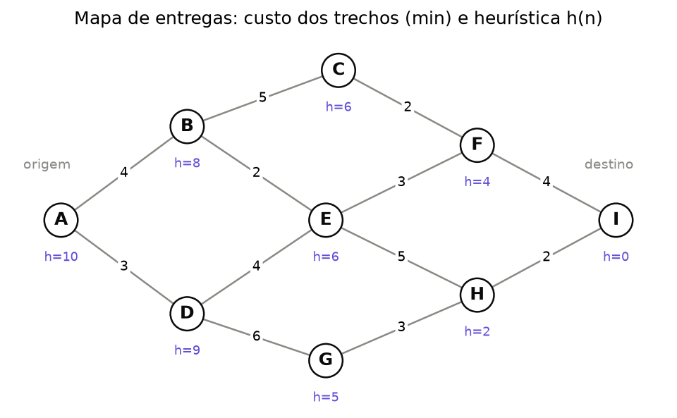

Código e experimentos: `src/q10_buscas/` (módulos `q10_problema.py` e `q10_algoritmos.py`, testes em `test_q10_buscas.py` e notebook `q10_buscas.ipynb`). Todas as tabelas de trace deste documento foram impressas pela função `tabela_trace` do código, sem edição manual.

### 1. Formulação do problema

| Componente | Definição |
| --- | --- |
| Estados | A localidade em que o entregador se encontra: \(S = \{A, B, C, D, E, F, G, H, I\}\) |
| Estado inicial | \(A\) |
| Ações | \(\text{ACOES}(s)\) = { ir para \(x\) : \(x\) é vizinho de \(s\) no grafo } |
| Função de transição | \(\text{RESULTADO}(s, \text{ir para } x) = x\) |
| Teste de objetivo | \(s = I\) |
| Custo do passo | \(c(s, \text{ir para } x, x) = w(s, x)\), o tempo do trecho \(s\)–\(x\) |
| Custo do caminho | \(g = \sum w\) dos trechos percorridos (aditivo, todos os custos positivos) |

Na implementação, `ProblemaRota` segue a interface do AIMA (`acoes`, `resultado`, `custo_acao`, `eh_objetivo`). As ações de um estado saem em ordem alfabética do vizinho; por exemplo, \(\text{ACOES}(E)\) = [ir para B, ir para D, ir para F, ir para H], com custos 2, 4, 3 e 5.

### 2. A heurística dada é admissível e consistente?

Antes de rodar o A*, conferimos as duas propriedades. O custo ótimo real \(h^*(n)\) de cada nó até I foi calculado com Dijkstra a partir de I; como o grafo é não direcionado, a distância de I até n é igual à de n até I.

| n | A | B | C | D | E | F | G | H | I |
| --- | --- | --- | --- | --- | --- | --- | --- | --- | --- |
| h(n) | 10 | 8 | 6 | 9 | 6 | 4 | 5 | 2 | 0 |
| h*(n) | 13 | 9 | 6 | 11 | 7 | 4 | 5 | 2 | 0 |
| h*(n) − h(n) | 3 | 1 | 0 | 2 | 1 | 0 | 0 | 0 | 0 |

Conferência à mão de alguns valores: \(h^*(H) = 2\) (trecho H–I); \(h^*(E) = \min(3 + 4,\ 5 + 2) = 7\); \(h^*(B) = 2 + 7 = 9\); \(h^*(A) = \min(4 + 9,\ 3 + 11) = 13\).

**Admissibilidade.** \(h(n) \le h^*(n)\) em todos os nós. A heurística é exata em C, F, G, H e I e subestima mais em A (3 minutos) e D (2 minutos).

**Consistência.** É preciso \(h(n) \le c(n, n') + h(n')\) para todo par de vizinhos, nos dois sentidos de cada trecho (24 desigualdades). Nenhuma é violada. As que valem com igualdade (folga zero) são:

| n → n' | h(n) | c(n, n') | h(n') | c + h(n') − h(n) |
| --- | --- | --- | --- | --- |
| B → E | 8 | 2 | 6 | 0 |
| C → F | 6 | 2 | 4 | 0 |
| F → I | 4 | 4 | 0 | 0 |
| G → H | 5 | 3 | 2 | 0 |
| H → I | 2 | 2 | 0 | 0 |

A menor folga entre as demais é 1 (por exemplo, E → F: 3 + 4 − 6 = 1). Como nenhuma condição falha, o A* em busca em grafo (com conjunto de explorados) é ótimo com essa heurística. Com h consistente, f nunca diminui ao longo de um caminho, e por isso o primeiro caminho que retira um nó da fronteira já é o de menor g até ele; descartar reaberturas não perde soluções. Se a heurística fosse só admissível, a versão em grafo poderia fechar um nó com g maior que o ótimo e devolver uma rota pior, a menos que se permitisse reabrir nós explorados.

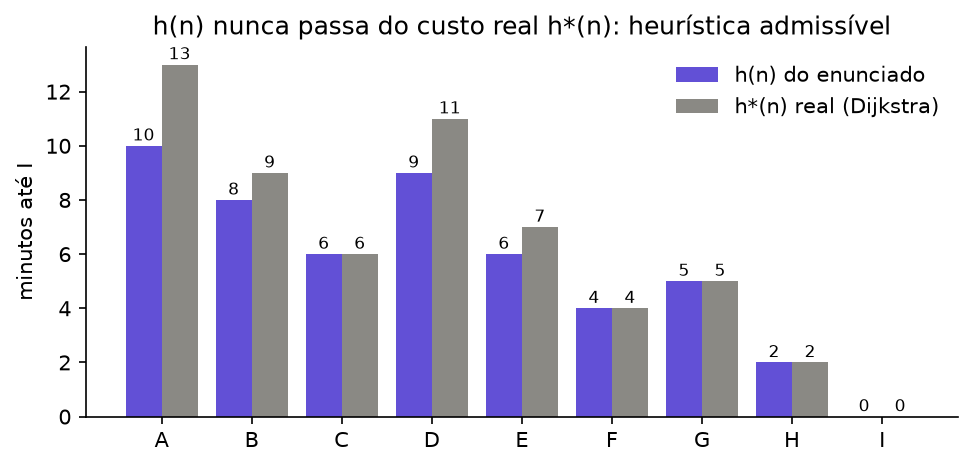

A função `verificar_heuristica` faz as duas checagens em qualquer problema. Ela também detecta violações: nos testes, trocar h(E) por 12 faz a função apontar E como não admissível (12 > 7) e acusar arestas inconsistentes.

### 3. Convenções de execução

O resultado de uma busca feita à mão depende de escolhas que o enunciado não fixa. As adotadas aqui foram:

1. **Busca em grafo**, como na figura 3.7 do AIMA (3ª ed.): os nós expandidos vão para o conjunto de explorados, e um filho só entra na fronteira se o estado não estiver nem na fronteira nem nos explorados.
2. **Ordem dos sucessores**: alfabética.
3. **Teste de objetivo**: a BFS testa quando o filho é gerado (figura 3.11 do AIMA), o que economiza uma camada. DFS, UCS e A* testam quando o nó sai da fronteira. Para UCS e A* esse é o único jeito de garantir a otimalidade: o primeiro caminho a gerar I não é necessariamente o mais barato.
4. **DFS**: os filhos são empilhados em ordem inversa, de modo que o primeiro em ordem alfabética fique no topo.
5. **UCS e A***: se um estado que já está na fronteira for alcançado com g menor, a entrada é substituída. Explorados não são reabertos.
6. **Desempate** na fila de prioridade: ordem de inserção (FIFO). Uma entrada substituída conta como inserida de novo. A seção 5.1 mostra o efeito de outro critério.

Leitura das tabelas: `X[g]` em "Sucessores gerados" é um filho com seu custo acumulado, seguido do que aconteceu com ele (entrou na fronteira, foi descartado por já estar explorado ou na fronteira, ou atualizou uma entrada). Na fronteira, a UCS mostra `X(g)` e o A* mostra `X(f)`; BFS e DFS mostram só o estado. Os elementos aparecem na ordem em que sairiam.

Contagens: "expandidos" são os nós cujos sucessores foram gerados; o objetivo, quando sai da fronteira, encerra a busca sem ser expandido. "Gerados" conta a raiz mais todos os sucessores produzidos, inclusive os descartados.

### 4. Busca não informada

O enunciado pede "Busca em Profundidade (BFS)". A sigla BFS (*breadth-first search*) é de busca em largura; busca em profundidade é DFS (*depth-first search*). Como o nome e a sigla apontam para algoritmos diferentes, executamos os dois.

#### 4.1 BFS (busca em largura)

| Passo | Retirado | g | Sucessores gerados | Fronteira depois | Explorados |
| --- | --- | --- | --- | --- | --- |
| 1 | A | 0 | B[4], D[3] | B D | A |
| 2 | B | 4 | A[8] explorado, C[9], E[6] | D C E | A, B |
| 3 | D | 3 | A[6] explorado, E[7] já na fronteira, G[9] | C E G | A, B, D |
| 4 | C | 9 | B[14] explorado, F[11] | E G F | A, B, D, C |
| 5 | E | 6 | B[8] explorado, D[10] explorado, F[9] já na fronteira, H[11] | G F H | A, B, D, C, E |
| 6 | G | 9 | D[15] explorado, H[12] já na fronteira | F H | A, B, D, C, E, G |
| 7 | F | 11 | C[13] explorado, E[14] explorado, I[15] objetivo | H I | A, B, D, C, E, G, F |

| Ordem de expansão | Rota | Custo | Expandidos | Gerados |
| --- | --- | --- | --- | --- |
| A, B, D, C, E, G, F | A → B → C → F → I | 15 | 7 | 20 |

I é gerado no passo 7, a partir de F, e a busca para ali. A BFS acha uma rota com o menor número de trechos (4), mas os trechos não têm o mesmo custo, e essa rota leva 15 minutos. Repare em F: ele entrou na fronteira no passo 4, filho de C com g = 11; no passo 5, E também chega a F com g = 9, mas a BFS não compara custos e mantém o pai C. Se o teste de objetivo fosse feito na expansão, a BFS expandiria também H (8 expansões) e terminaria na mesma rota.

#### 4.2 DFS (busca em profundidade)

| Passo | Retirado | g | Sucessores gerados | Fronteira depois | Explorados |
| --- | --- | --- | --- | --- | --- |
| 1 | A | 0 | B[4], D[3] | B D | A |
| 2 | B | 4 | A[8] explorado, C[9], E[6] | C E D | A, B |
| 3 | C | 9 | B[14] explorado, F[11] | F E D | A, B, C |
| 4 | F | 11 | C[13] explorado, E[14] já na fronteira, I[15] | I E D | A, B, C, F |
| 5 | I | 15 | objetivo, para | E D | A, B, C, F |

| Ordem de expansão | Rota | Custo | Expandidos | Gerados |
| --- | --- | --- | --- | --- |
| A, B, C, F (I sai da pilha como objetivo) | A → B → C → F → I | 15 | 4 | 11 |

A DFS desce pelo primeiro vizinho em ordem alfabética e encontra I na primeira descida. Ela empata com a BFS na rota, e isso é coincidência da ordem alfabética: com a ordem alfabética invertida, a mesma DFS seguiria A → D → G → H → I (14 minutos, 4 expansões).

#### 4.3 UCS (busca de custo uniforme)

| Passo | Retirado | g | Sucessores gerados | Fronteira depois | Explorados |
| --- | --- | --- | --- | --- | --- |
| 1 | A | 0 | B[4], D[3] | D(3) B(4) | A |
| 2 | D | 3 | A[6] explorado, E[7], G[9] | B(4) E(7) G(9) | A, D |
| 3 | B | 4 | A[8] explorado, C[9], E[6] atualizado (g 7→6) | E(6) G(9) C(9) | A, D, B |
| 4 | E | 6 | B[8] explorado, D[10] explorado, F[9], H[11] | G(9) C(9) F(9) H(11) | A, D, B, E |
| 5 | G | 9 | D[15] explorado, H[12] já na fronteira | C(9) F(9) H(11) | A, D, B, E, G |
| 6 | C | 9 | B[14] explorado, F[11] já na fronteira | F(9) H(11) | A, D, B, E, G, C |
| 7 | F | 9 | C[11] explorado, E[12] explorado, I[13] | H(11) I(13) | A, D, B, E, G, C, F |
| 8 | H | 11 | E[16] explorado, G[14] explorado, I[13] já na fronteira | I(13) | A, D, B, E, G, C, F, H |
| 9 | I | 13 | objetivo, para | ∅ | A, D, B, E, G, C, F, H |

| Ordem de expansão | Rota | Custo | Expandidos | Gerados |
| --- | --- | --- | --- | --- |
| A, D, B, E, G, C, F, H (I sai como objetivo) | A → B → E → F → I | 13 | 8 | 23 |

Três momentos do trace explicam o comportamento da UCS:

- No passo 3, E já estava na fronteira com g = 7 (via D) e é alcançado via B com g = 6. A entrada é substituída, e é por isso que a rota final passa por B e não por D.
- Depois do passo 4, G, C e F empatam com g = 9. O desempate FIFO retira G primeiro (inserido no passo 2), depois C e por último F.
- I é gerado com g = 13 no passo 7, mas só vira solução no passo 9, quando sai da fronteira. Antes disso a UCS expande H (g = 11), que também chega a I com 13 e não melhora a entrada. Se o teste fosse na geração, a resposta neste mapa seria a mesma, mas sem garantia: um caminho gerado antes pode ser mais caro do que outro ainda não gerado.

O mapa tem duas rotas ótimas de 13 minutos: A → B → E → F → I e A → B → E → H → I. A UCS devolve a primeira por causa do desempate.

### 5. Busca informada: A*

O A* ordena a fronteira por \(f(n) = g(n) + h(n)\). Na tabela abaixo, g, h e f são os do nó retirado em cada passo, e a fronteira mostra o f de cada entrada.

| Passo | Retirado | g | h | f | Sucessores gerados | Fronteira depois | Explorados |
| --- | --- | --- | --- | --- | --- | --- | --- |
| 1 | A | 0 | 10 | 10 | B[4], D[3] | B(12) D(12) | A |
| 2 | B | 4 | 8 | 12 | A[8] explorado, C[9], E[6] | D(12) E(12) C(15) | A, B |
| 3 | D | 3 | 9 | 12 | A[6] explorado, E[7] já na fronteira, G[9] | E(12) G(14) C(15) | A, B, D |
| 4 | E | 6 | 6 | 12 | B[8] explorado, D[10] explorado, F[9], H[11] | F(13) H(13) G(14) C(15) | A, B, D, E |
| 5 | F | 9 | 4 | 13 | C[11] já na fronteira, E[12] explorado, I[13] | H(13) I(13) G(14) C(15) | A, B, D, E, F |
| 6 | H | 11 | 2 | 13 | E[16] explorado, G[14] já na fronteira, I[13] já na fronteira | I(13) G(14) C(15) | A, B, D, E, F, H |
| 7 | I | 13 | 0 | 13 | objetivo, para | G(14) C(15) | A, B, D, E, F, H |

| Ordem de expansão | Rota | Custo | Expandidos | Gerados |
| --- | --- | --- | --- | --- |
| A, B, D, E, F, H (I sai como objetivo) | A → B → E → F → I | 13 | 6 | 19 |

Valores de g, h e f dos nós relevantes, no momento em que cada um saiu da fronteira:

| Nó | g(n) | h(n) | f(n) | Observação |
| --- | --- | --- | --- | --- |
| A | 0 | 10 | 10 | raiz |
| B | 4 | 8 | 12 | empata com D em f = 12; sai antes por ter sido inserido antes |
| D | 3 | 9 | 12 | expandido, mas o caminho via D até E (g = 7) perde para o via B (g = 6) |
| E | 6 | 6 | 12 | f = 12 = custo da rota ótima menos 1, porque h(E) = 6 < h*(E) = 7 |
| F | 9 | 4 | 13 | gera I com g = 13 |
| H | 11 | 2 | 13 | empata com I em f = 13 e sai antes (FIFO); não melhora I |
| I | 13 | 0 | 13 | objetivo |
| G | 9 | 5 | 14 | nunca expandido |
| C | 9 | 6 | 15 | nunca expandido |

A sequência de f dos nós retirados é 10, 12, 12, 12, 13, 13, 13, sem nenhuma queda, como se espera de uma heurística consistente. O A* deixa de expandir G e C, cujos f (14 e 15) passam do custo ótimo, e termina com 6 expansões contra 8 da UCS.

#### 5.1 Efeito do desempate

Quando há empate em f, preferir o nó com menor h (o mais perto do objetivo pela estimativa) é um critério comum. Com desempate (f, h, inserção):

| Passo | Retirado | g | h | f | Sucessores gerados | Fronteira depois | Explorados |
| --- | --- | --- | --- | --- | --- | --- | --- |
| 1 | A | 0 | 10 | 10 | B[4], D[3] | B(12) D(12) | A |
| 2 | B | 4 | 8 | 12 | A[8] explorado, C[9], E[6] | E(12) D(12) C(15) | A, B |
| 3 | E | 6 | 6 | 12 | B[8] explorado, D[10] já na fronteira, F[9], H[11] | D(12) H(13) F(13) C(15) | A, B, E |
| 4 | D | 3 | 9 | 12 | A[6] explorado, E[7] explorado, G[9] | H(13) F(13) G(14) C(15) | A, B, E, D |
| 5 | H | 11 | 2 | 13 | E[16] explorado, G[14] já na fronteira, I[13] | I(13) F(13) G(14) C(15) | A, B, E, D, H |
| 6 | I | 13 | 0 | 13 | objetivo, para | F(13) G(14) C(15) | A, B, E, D, H |

A rota muda para a outra ótima, A → B → E → H → I, com os mesmos 13 minutos e 5 expansões. O desempate não afeta a otimalidade; ele decide entre rotas de mesmo custo e altera quantos nós com f igual ao ótimo são expandidos.

#### 5.2 A* com h = 0

Com \(h(n) = 0\) para todo n, \(f = g\) e o A* vira a UCS. O código confirma: a ordem de expansão de `a_estrela(P, h_nula)` é idêntica à da UCS (A, D, B, E, G, C, F, H, I), com a mesma rota e as mesmas 8 expansões.

### 6. Comparação

| Algoritmo | Rota | Custo | Expandidos | Gerados | Completo? | Ótimo? |
| --- | --- | --- | --- | --- | --- | --- |
| BFS | A → B → C → F → I | 15 | 7 | 20 | Sim (fator de ramificação finito) | Só se todos os custos forem iguais |
| DFS | A → B → C → F → I | 15 | 4 | 11 | Sim em grafo finito com explorados; não em árvore com ciclos ou espaço infinito | Não |
| UCS | A → B → E → F → I | 13 | 8 | 23 | Sim (custos ≥ ε > 0) | Sim |
| A* | A → B → E → F → I | 13 | 6 | 19 | Sim (custos ≥ ε > 0) | Sim, pois h é consistente |
| A* (desempate por h) | A → B → E → H → I | 13 | 5 | 16 | Sim | Sim |

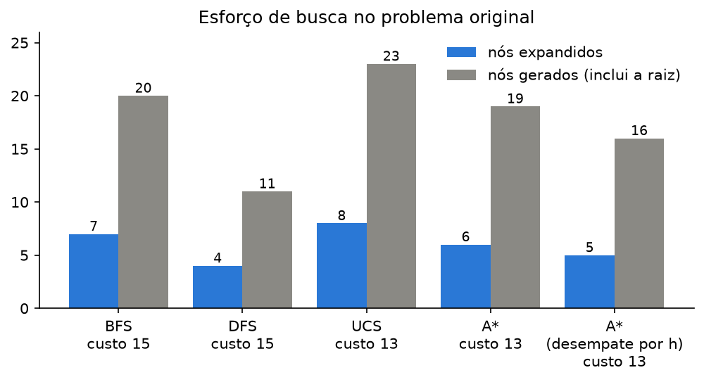

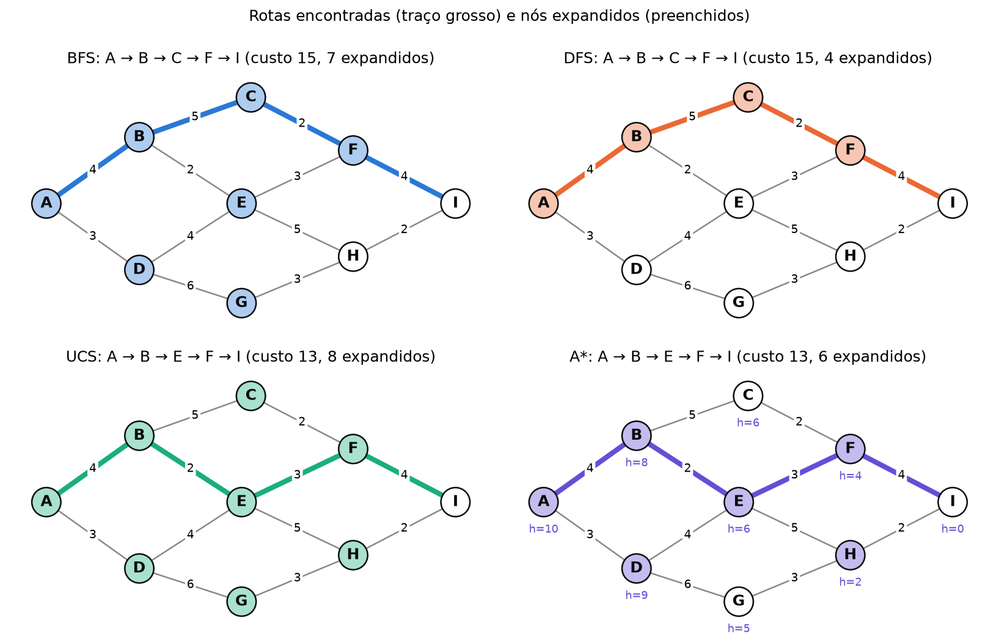

**Custo da solução.** UCS e A* acham uma rota de 13 minutos, que é o ótimo (\(h^*(A) = 13\)). BFS e DFS devolvem 15 minutos, 2 a mais (cerca de 15%).

**Nós expandidos.** A DFS expandiu menos (4), mas esse número reflete a ordem alfabética, sem relação com a estrutura de custos. Entre os algoritmos ótimos, o A* expandiu 6 nós contra 8 da UCS: a heurística evitou G e C. A diferença é pequena porque o grafo é pequeno e h subestima bastante perto da origem (h(A) = 10 contra 13 reais), o que deixa D e H entrarem antes do objetivo.

**Completude.** As quatro buscas são completas neste problema, que tem espaço de estados finito e custos positivos. A DFS em grafo é completa em espaços finitos graças ao conjunto de explorados; a versão em árvore pode ficar presa em ciclos como A–B–E–D–A.

**Otimalidade.** BFS é ótima só quando todos os passos custam o mesmo, o que não é o caso. DFS não tem garantia nenhuma. UCS é ótima com custos positivos. A* em busca em grafo é ótimo com heurística consistente, que foi verificada na seção 2.

### 7. Variante: visitar D e F antes de chegar a I

#### 7.1 Nova representação de estados

Só a localidade não basta: chegar a E depois de passar por D não é a mesma situação que chegar a E sem ter passado. O estado precisa guardar o que já foi cumprido:

\[
s = (n,\ v_D,\ v_F), \quad n \in \{A, \dots, I\},\ v_D, v_F \in \{0, 1\}
\]

| Componente | Definição |
| --- | --- |
| Estados | \((n, v_D, v_F)\): 9 × 2 × 2 = 36 estados, dos quais 32 são alcançáveis a partir de A ((D, 0, ·) e (F, ·, 0) não existem, porque estar em D ou F já marca a visita) |
| Estado inicial | \((A, 0, 0)\) |
| Ações | Ir para cada vizinho de \(n\), as mesmas do problema original |
| Transição | \(\text{RESULTADO}((n, v_D, v_F), \text{ir para } x) = (x,\ v_D \lor [x = D],\ v_F \lor [x = F])\) |
| Teste de objetivo | \(n = I\), \(v_D = 1\) e \(v_F = 1\) |
| Custo do passo | \(w(n, x)\), igual ao original |

A ordem entre D e F fica livre porque os dois indicadores são independentes. Passar por I antes de cumprir as paradas é permitido; o estado (I, 0, 1), por exemplo, não é objetivo e a busca continua a partir dele. Neste mapa isso não muda a rota ótima. Implementação: classe `ProblemaRotaDF`.

#### 7.2 Heurística para o espaço aumentado

A primeira opção é reaproveitar a heurística do enunciado olhando só a localidade, \(h_1(n, v_D, v_F) = h(n)\). Ela continua admissível e consistente: toda rota válida no espaço aumentado também é um caminho de n até I no grafo, logo custa pelo menos \(h^*(n) \ge h(n)\), e as transições têm os mesmos custos do grafo original. O problema de \(h_1\) é ignorar as paradas pendentes. Em (I, 0, 0), por exemplo, ela vale 0, mas ainda faltam 22 minutos.

Propomos:

\[
h_{DF}(n, v_D, v_F) = \max\Big(h(n),\ \ [v_D = 0]\cdot\big(\delta(n, D) + h(D)\big),\ \ [v_F = 0]\cdot\big(\delta(n, F) + h(F)\big)\Big)
\]

em que \(\delta(n, m)\) é a menor distância no grafo entre n e a parada m, obtida com um Dijkstra a partir de D e outro a partir de F (pré-processamento feito uma vez). Os termos de paradas já visitadas são omitidos.

| n | A | B | C | D | E | F | G | H | I |
| --- | --- | --- | --- | --- | --- | --- | --- | --- | --- |
| δ(n, D) | 3 | 6 | 9 | 0 | 4 | 7 | 6 | 9 | 11 |
| δ(n, F) | 9 | 5 | 2 | 7 | 3 | 0 | 9 | 6 | 4 |

Na origem, \(h_{DF}(A, 0, 0) = \max(10,\ 3 + 9,\ 9 + 4) = 13\).

**Prova de admissibilidade.** Seja m uma parada pendente no estado s = (n, v_D, v_F). Qualquer rota válida a partir de s precisa chegar a m e, depois, a I. O primeiro trecho custa pelo menos \(\delta(n, m)\), e o segundo custa pelo menos \(h^*(m) \ge h(m)\), porque h é admissível no grafo original. Então \(\delta(n, m) + h(m) \le h^*(s)\). O termo \(h(n)\) também é limite inferior, pelo argumento dado para \(h_1\). O máximo de limites inferiores é limite inferior, logo \(h_{DF}(s) \le h^*(s)\).

**Prova de consistência.** Considere uma transição de s = (n, ·) para s' = (n', ·) com custo c. Basta mostrar que cada termo de \(h_{DF}(s)\) é ≤ \(c + h_{DF}(s')\):

- termo \(h(n)\): \(h(n) \le c + h(n') \le c + h_{DF}(s')\), pela consistência de h (seção 2);
- termo de uma parada m que continua pendente em s': \(\delta(n, m) \le c + \delta(n', m)\) pela desigualdade triangular, então \(\delta(n, m) + h(m) \le c + \delta(n', m) + h(m) \le c + h_{DF}(s')\);
- termo de uma parada m visitada justamente nessa transição (n' = m): \(\delta(n, m) \le c\), então \(\delta(n, m) + h(m) \le c + h(m) = c + h(n') \le c + h_{DF}(s')\).

Como \(h_{DF}(I, 1, 1) = h(I) = 0\), a heurística é consistente e, portanto, também admissível.

**Verificação numérica.** `verificar_heuristica` calculou \(h^*\) de cada um dos 32 estados alcançáveis com UCS e testou as desigualdades em todas as transições: \(h_1\) e \(h_{DF}\) são admissíveis e consistentes. A tabela mostra \(h_1\) / \(h_{DF}\) / \(h^*\) por estado; as colunas são \((v_D, v_F)\).

| n | (0, 0) | (0, 1) | (1, 0) | (1, 1) |
| --- | --- | --- | --- | --- |
| A | 10 / 13 / 14 | 10 / 12 / 14 | 10 / 13 / 13 | 10 / 10 / 13 |
| B | 8 / 15 / 17 | 8 / 15 / 17 | 8 / 9 / 9 | 8 / 8 / 9 |
| C | 6 / 18 / 20 | 6 / 18 / 20 | 6 / 6 / 6 | 6 / 6 / 6 |
| D | inalcançável | inalcançável | 9 / 11 / 11 | 9 / 9 / 11 |
| E | 6 / 13 / 15 | 6 / 13 / 15 | 6 / 7 / 7 | 6 / 6 / 7 |
| F | inalcançável | 4 / 16 / 18 | inalcançável | 4 / 4 / 4 |
| G | 5 / 15 / 17 | 5 / 15 / 17 | 5 / 13 / 13 | 5 / 5 / 5 |
| H | 2 / 18 / 20 | 2 / 18 / 20 | 2 / 10 / 10 | 2 / 2 / 2 |
| I | 0 / 20 / 22 | 0 / 20 / 22 | 0 / 8 / 8 | 0 / 0 / 0 |

\(h_{DF}\) acerta o valor exato em 13 dos 32 estados e erra em média 1,12 minuto, contra 7,12 de \(h_1\). Em todos os estados com D já visitado e F pendente ela é exata, porque nesse caso o melhor caminho é ir até F pelo menor caminho e de lá para I, e h(F) = h*(F).

#### 7.3 UCS no espaço aumentado

<details>
<summary>Trace completo da UCS (21 retiradas da fronteira)</summary>

| Passo | Retirado | g | Sucessores gerados | Fronteira depois | Explorados |
| --- | --- | --- | --- | --- | --- |
| 1 | (A,0,0) | 0 | (B,0,0)[4], (D,1,0)[3] | (D,1,0)(3) (B,0,0)(4) | (A,0,0) |
| 2 | (D,1,0) | 3 | (A,1,0)[6], (E,1,0)[7], (G,1,0)[9] | (B,0,0)(4) (A,1,0)(6) (E,1,0)(7) (G,1,0)(9) | (A,0,0), (D,1,0) |
| 3 | (B,0,0) | 4 | (A,0,0)[8] explorado, (C,0,0)[9], (E,0,0)[6] | (A,1,0)(6) (E,0,0)(6) (E,1,0)(7) (G,1,0)(9) (C,0,0)(9) | (A,0,0), (D,1,0), (B,0,0) |
| 4 | (A,1,0) | 6 | (B,1,0)[10], (D,1,0)[9] explorado | (E,0,0)(6) (E,1,0)(7) (G,1,0)(9) (C,0,0)(9) (B,1,0)(10) | (A,0,0), (D,1,0), (B,0,0), (A,1,0) |
| 5 | (E,0,0) | 6 | (B,0,0)[8] explorado, (D,1,0)[10] explorado, (F,0,1)[9], (H,0,0)[11] | (E,1,0)(7) (G,1,0)(9) (C,0,0)(9) (F,0,1)(9) (B,1,0)(10) (H,0,0)(11) | (A,0,0), (D,1,0), (B,0,0), (A,1,0), (E,0,0) |
| 6 | (E,1,0) | 7 | (B,1,0)[9] atualizado (g 10→9), (D,1,0)[11] explorado, (F,1,1)[10], (H,1,0)[12] | (G,1,0)(9) (C,0,0)(9) (F,0,1)(9) (B,1,0)(9) (F,1,1)(10) (H,0,0)(11) (H,1,0)(12) | (A,0,0), (D,1,0), (B,0,0), (A,1,0), (E,0,0), (E,1,0) |
| 7 | (G,1,0) | 9 | (D,1,0)[15] explorado, (H,1,0)[12] já na fronteira | (C,0,0)(9) (F,0,1)(9) (B,1,0)(9) (F,1,1)(10) (H,0,0)(11) (H,1,0)(12) | (A,0,0), (D,1,0), (B,0,0), (A,1,0), (E,0,0), (E,1,0), (G,1,0) |
| 8 | (C,0,0) | 9 | (B,0,0)[14] explorado, (F,0,1)[11] já na fronteira | (F,0,1)(9) (B,1,0)(9) (F,1,1)(10) (H,0,0)(11) (H,1,0)(12) | (A,0,0), (D,1,0), (B,0,0), (A,1,0), (E,0,0), (E,1,0), (G,1,0), (C,0,0) |
| 9 | (F,0,1) | 9 | (C,0,1)[11], (E,0,1)[12], (I,0,1)[13] | (B,1,0)(9) (F,1,1)(10) (H,0,0)(11) (C,0,1)(11) (H,1,0)(12) (E,0,1)(12) (I,0,1)(13) | (A,0,0), (D,1,0), (B,0,0), (A,1,0), (E,0,0), (E,1,0), (G,1,0), (C,0,0), (F,0,1) |
| 10 | (B,1,0) | 9 | (A,1,0)[13] explorado, (C,1,0)[14], (E,1,0)[11] explorado | (F,1,1)(10) (H,0,0)(11) (C,0,1)(11) (H,1,0)(12) (E,0,1)(12) (I,0,1)(13) (C,1,0)(14) | (A,0,0), (D,1,0), (B,0,0), (A,1,0), (E,0,0), (E,1,0), (G,1,0), (C,0,0), (F,0,1), (B,1,0) |
| 11 | (F,1,1) | 10 | (C,1,1)[12], (E,1,1)[13], (I,1,1)[14] | (H,0,0)(11) (C,0,1)(11) (H,1,0)(12) (E,0,1)(12) (C,1,1)(12) (I,0,1)(13) (E,1,1)(13) (C,1,0)(14) (I,1,1)(14) | (A,0,0), (D,1,0), (B,0,0), (A,1,0), (E,0,0), (E,1,0), (G,1,0), (C,0,0), (F,0,1), (B,1,0), (F,1,1) |
| 12 | (H,0,0) | 11 | (E,0,0)[16] explorado, (G,0,0)[14], (I,0,0)[13] | (C,0,1)(11) (H,1,0)(12) (E,0,1)(12) (C,1,1)(12) (I,0,1)(13) (E,1,1)(13) (I,0,0)(13) (C,1,0)(14) (I,1,1)(14) (G,0,0)(14) | (A,0,0), (D,1,0), (B,0,0), (A,1,0), (E,0,0), (E,1,0), (G,1,0), (C,0,0), (F,0,1), (B,1,0), (F,1,1), (H,0,0) |
| 13 | (C,0,1) | 11 | (B,0,1)[16], (F,0,1)[13] explorado | (H,1,0)(12) (E,0,1)(12) (C,1,1)(12) (I,0,1)(13) (E,1,1)(13) (I,0,0)(13) (C,1,0)(14) (I,1,1)(14) (G,0,0)(14) (B,0,1)(16) | (A,0,0), (D,1,0), (B,0,0), (A,1,0), (E,0,0), (E,1,0), (G,1,0), (C,0,0), (F,0,1), (B,1,0), (F,1,1), (H,0,0), (C,0,1) |
| 14 | (H,1,0) | 12 | (E,1,0)[17] explorado, (G,1,0)[15] explorado, (I,1,0)[14] | (E,0,1)(12) (C,1,1)(12) (I,0,1)(13) (E,1,1)(13) (I,0,0)(13) (C,1,0)(14) (I,1,1)(14) (G,0,0)(14) (I,1,0)(14) (B,0,1)(16) | (A,0,0), (D,1,0), (B,0,0), (A,1,0), (E,0,0), (E,1,0), (G,1,0), (C,0,0), (F,0,1), (B,1,0), (F,1,1), (H,0,0), (C,0,1), (H,1,0) |
| 15 | (E,0,1) | 12 | (B,0,1)[14] atualizado (g 16→14), (D,1,1)[16], (F,0,1)[15] explorado, (H,0,1)[17] | (C,1,1)(12) (I,0,1)(13) (E,1,1)(13) (I,0,0)(13) (C,1,0)(14) (I,1,1)(14) (G,0,0)(14) (I,1,0)(14) (B,0,1)(14) (D,1,1)(16) (H,0,1)(17) | (A,0,0), (D,1,0), (B,0,0), (A,1,0), (E,0,0), (E,1,0), (G,1,0), (C,0,0), (F,0,1), (B,1,0), (F,1,1), (H,0,0), (C,0,1), (H,1,0), (E,0,1) |
| 16 | (C,1,1) | 12 | (B,1,1)[17], (F,1,1)[14] explorado | (I,0,1)(13) (E,1,1)(13) (I,0,0)(13) (C,1,0)(14) (I,1,1)(14) (G,0,0)(14) (I,1,0)(14) (B,0,1)(14) (D,1,1)(16) (H,0,1)(17) (B,1,1)(17) | (A,0,0), (D,1,0), (B,0,0), (A,1,0), (E,0,0), (E,1,0), (G,1,0), (C,0,0), (F,0,1), (B,1,0), (F,1,1), (H,0,0), (C,0,1), (H,1,0), (E,0,1), (C,1,1) |
| 17 | (I,0,1) | 13 | (F,0,1)[17] explorado, (H,0,1)[15] atualizado (g 17→15) | (E,1,1)(13) (I,0,0)(13) (C,1,0)(14) (I,1,1)(14) (G,0,0)(14) (I,1,0)(14) (B,0,1)(14) (H,0,1)(15) (D,1,1)(16) (B,1,1)(17) | (A,0,0), (D,1,0), (B,0,0), (A,1,0), (E,0,0), (E,1,0), (G,1,0), (C,0,0), (F,0,1), (B,1,0), (F,1,1), (H,0,0), (C,0,1), (H,1,0), (E,0,1), (C,1,1), (I,0,1) |
| 18 | (E,1,1) | 13 | (B,1,1)[15] atualizado (g 17→15), (D,1,1)[17] já na fronteira, (F,1,1)[16] explorado, (H,1,1)[18] | (I,0,0)(13) (C,1,0)(14) (I,1,1)(14) (G,0,0)(14) (I,1,0)(14) (B,0,1)(14) (H,0,1)(15) (B,1,1)(15) (D,1,1)(16) (H,1,1)(18) | (A,0,0), (D,1,0), (B,0,0), (A,1,0), (E,0,0), (E,1,0), (G,1,0), (C,0,0), (F,0,1), (B,1,0), (F,1,1), (H,0,0), (C,0,1), (H,1,0), (E,0,1), (C,1,1), (I,0,1), (E,1,1) |
| 19 | (I,0,0) | 13 | (F,0,1)[17] explorado, (H,0,0)[15] explorado | (C,1,0)(14) (I,1,1)(14) (G,0,0)(14) (I,1,0)(14) (B,0,1)(14) (H,0,1)(15) (B,1,1)(15) (D,1,1)(16) (H,1,1)(18) | (A,0,0), (D,1,0), (B,0,0), (A,1,0), (E,0,0), (E,1,0), (G,1,0), (C,0,0), (F,0,1), (B,1,0), (F,1,1), (H,0,0), (C,0,1), (H,1,0), (E,0,1), (C,1,1), (I,0,1), (E,1,1), (I,0,0) |
| 20 | (C,1,0) | 14 | (B,1,0)[19] explorado, (F,1,1)[16] explorado | (I,1,1)(14) (G,0,0)(14) (I,1,0)(14) (B,0,1)(14) (H,0,1)(15) (B,1,1)(15) (D,1,1)(16) (H,1,1)(18) | (A,0,0), (D,1,0), (B,0,0), (A,1,0), (E,0,0), (E,1,0), (G,1,0), (C,0,0), (F,0,1), (B,1,0), (F,1,1), (H,0,0), (C,0,1), (H,1,0), (E,0,1), (C,1,1), (I,0,1), (E,1,1), (I,0,0), (C,1,0) |
| 21 | (I,1,1) | 14 | objetivo, para | (G,0,0)(14) (I,1,0)(14) (B,0,1)(14) (H,0,1)(15) (B,1,1)(15) (D,1,1)(16) (H,1,1)(18) | (A,0,0), (D,1,0), (B,0,0), (A,1,0), (E,0,0), (E,1,0), (G,1,0), (C,0,0), (F,0,1), (B,1,0), (F,1,1), (H,0,0), (C,0,1), (H,1,0), (E,0,1), (C,1,1), (I,0,1), (E,1,1), (I,0,0), (C,1,0) |

</details>

Ordem de expansão: (A,0,0), (D,1,0), (B,0,0), (A,1,0), (E,0,0), (E,1,0), (G,1,0), (C,0,0), (F,0,1), (B,1,0), (F,1,1), (H,0,0), (C,0,1), (H,1,0), (E,0,1), (C,1,1), (I,0,1), (E,1,1), (I,0,0), (C,1,0), e por fim (I,1,1) sai como objetivo. São 20 expansões e 56 nós gerados.

A UCS passa por I duas vezes antes de terminar: (I,0,1) no passo 17 e (I,0,0) no passo 19. Nesses estados o entregador está no destino sem ter cumprido as paradas, então a busca continua. O estado (I,1,1) é gerado no passo 11 com g = 14 e só sai da fronteira no passo 21, depois que todos os estados com g < 14 foram expandidos.

#### 7.4 A* no espaço aumentado

Com \(h_{DF}\):

| Passo | Retirado | g | h | f | Sucessores gerados | Fronteira depois | Explorados |
| --- | --- | --- | --- | --- | --- | --- | --- |
| 1 | (A,0,0) | 0 | 13 | 13 | (B,0,0)[4], (D,1,0)[3] | (D,1,0)(14) (B,0,0)(19) | (A,0,0) |
| 2 | (D,1,0) | 3 | 11 | 14 | (A,1,0)[6], (E,1,0)[7], (G,1,0)[9] | (E,1,0)(14) (B,0,0)(19) (A,1,0)(19) (G,1,0)(22) | (A,0,0), (D,1,0) |
| 3 | (E,1,0) | 7 | 7 | 14 | (B,1,0)[9], (D,1,0)[11] explorado, (F,1,1)[10], (H,1,0)[12] | (F,1,1)(14) (B,1,0)(18) (B,0,0)(19) (A,1,0)(19) (G,1,0)(22) (H,1,0)(22) | (A,0,0), (D,1,0), (E,1,0) |
| 4 | (F,1,1) | 10 | 4 | 14 | (C,1,1)[12], (E,1,1)[13], (I,1,1)[14] | (I,1,1)(14) (B,1,0)(18) (C,1,1)(18) (B,0,0)(19) (A,1,0)(19) (E,1,1)(19) (G,1,0)(22) (H,1,0)(22) | (A,0,0), (D,1,0), (E,1,0), (F,1,1) |
| 5 | (I,1,1) | 14 | 0 | 14 | objetivo, para | (B,1,0)(18) (C,1,1)(18) (B,0,0)(19) (A,1,0)(19) (E,1,1)(19) (G,1,0)(22) (H,1,0)(22) | (A,0,0), (D,1,0), (E,1,0), (F,1,1) |

O A* com \(h_{DF}\) expande apenas os quatro estados da rota ótima. A partir de (D, 1, 0) a heurística é exata (11, 7, 4, 0 ao longo do caminho), e o f de todos os nós retirados depois da raiz fica em 14. O único ponto em que ela subestima é a raiz: \(h_{DF}(A,0,0) = 13\) contra \(h^* = 14\).

Com \(h_1\) (a heurística original), o A* também chega ao ótimo, mas expande 12 estados, entre eles (I,0,1) e (I,0,0), que \(h_1\) avalia com h = 0 por ignorar as paradas:

<details>
<summary>Trace do A* com h1</summary>

| Passo | Retirado | g | h | f | Sucessores gerados | Fronteira depois | Explorados |
| --- | --- | --- | --- | --- | --- | --- | --- |
| 1 | (A,0,0) | 0 | 10 | 10 | (B,0,0)[4], (D,1,0)[3] | (B,0,0)(12) (D,1,0)(12) | (A,0,0) |
| 2 | (B,0,0) | 4 | 8 | 12 | (A,0,0)[8] explorado, (C,0,0)[9], (E,0,0)[6] | (D,1,0)(12) (E,0,0)(12) (C,0,0)(15) | (A,0,0), (B,0,0) |
| 3 | (D,1,0) | 3 | 9 | 12 | (A,1,0)[6], (E,1,0)[7], (G,1,0)[9] | (E,0,0)(12) (E,1,0)(13) (G,1,0)(14) (C,0,0)(15) (A,1,0)(16) | (A,0,0), (B,0,0), (D,1,0) |
| 4 | (E,0,0) | 6 | 6 | 12 | (B,0,0)[8] explorado, (D,1,0)[10] explorado, (F,0,1)[9], (H,0,0)[11] | (E,1,0)(13) (F,0,1)(13) (H,0,0)(13) (G,1,0)(14) (C,0,0)(15) (A,1,0)(16) | (A,0,0), (B,0,0), (D,1,0), (E,0,0) |
| 5 | (E,1,0) | 7 | 6 | 13 | (B,1,0)[9], (D,1,0)[11] explorado, (F,1,1)[10], (H,1,0)[12] | (F,0,1)(13) (H,0,0)(13) (G,1,0)(14) (F,1,1)(14) (H,1,0)(14) (C,0,0)(15) (A,1,0)(16) (B,1,0)(17) | (A,0,0), (B,0,0), (D,1,0), (E,0,0), (E,1,0) |
| 6 | (F,0,1) | 9 | 4 | 13 | (C,0,1)[11], (E,0,1)[12], (I,0,1)[13] | (H,0,0)(13) (I,0,1)(13) (G,1,0)(14) (F,1,1)(14) (H,1,0)(14) (C,0,0)(15) (A,1,0)(16) (B,1,0)(17) (C,0,1)(17) (E,0,1)(18) | (A,0,0), (B,0,0), (D,1,0), (E,0,0), (E,1,0), (F,0,1) |
| 7 | (H,0,0) | 11 | 2 | 13 | (E,0,0)[16] explorado, (G,0,0)[14], (I,0,0)[13] | (I,0,1)(13) (I,0,0)(13) (G,1,0)(14) (F,1,1)(14) (H,1,0)(14) (C,0,0)(15) (A,1,0)(16) (B,1,0)(17) (C,0,1)(17) (E,0,1)(18) (G,0,0)(19) | (A,0,0), (B,0,0), (D,1,0), (E,0,0), (E,1,0), (F,0,1), (H,0,0) |
| 8 | (I,0,1) | 13 | 0 | 13 | (F,0,1)[17] explorado, (H,0,1)[15] | (I,0,0)(13) (G,1,0)(14) (F,1,1)(14) (H,1,0)(14) (C,0,0)(15) (A,1,0)(16) (B,1,0)(17) (C,0,1)(17) (H,0,1)(17) (E,0,1)(18) (G,0,0)(19) | (A,0,0), (B,0,0), (D,1,0), (E,0,0), (E,1,0), (F,0,1), (H,0,0), (I,0,1) |
| 9 | (I,0,0) | 13 | 0 | 13 | (F,0,1)[17] explorado, (H,0,0)[15] explorado | (G,1,0)(14) (F,1,1)(14) (H,1,0)(14) (C,0,0)(15) (A,1,0)(16) (B,1,0)(17) (C,0,1)(17) (H,0,1)(17) (E,0,1)(18) (G,0,0)(19) | (A,0,0), (B,0,0), (D,1,0), (E,0,0), (E,1,0), (F,0,1), (H,0,0), (I,0,1), (I,0,0) |
| 10 | (G,1,0) | 9 | 5 | 14 | (D,1,0)[15] explorado, (H,1,0)[12] já na fronteira | (F,1,1)(14) (H,1,0)(14) (C,0,0)(15) (A,1,0)(16) (B,1,0)(17) (C,0,1)(17) (H,0,1)(17) (E,0,1)(18) (G,0,0)(19) | (A,0,0), (B,0,0), (D,1,0), (E,0,0), (E,1,0), (F,0,1), (H,0,0), (I,0,1), (I,0,0), (G,1,0) |
| 11 | (F,1,1) | 10 | 4 | 14 | (C,1,1)[12], (E,1,1)[13], (I,1,1)[14] | (H,1,0)(14) (I,1,1)(14) (C,0,0)(15) (A,1,0)(16) (B,1,0)(17) (C,0,1)(17) (H,0,1)(17) (E,0,1)(18) (C,1,1)(18) (G,0,0)(19) (E,1,1)(19) | (A,0,0), (B,0,0), (D,1,0), (E,0,0), (E,1,0), (F,0,1), (H,0,0), (I,0,1), (I,0,0), (G,1,0), (F,1,1) |
| 12 | (H,1,0) | 12 | 2 | 14 | (E,1,0)[17] explorado, (G,1,0)[15] explorado, (I,1,0)[14] | (I,1,1)(14) (I,1,0)(14) (C,0,0)(15) (A,1,0)(16) (B,1,0)(17) (C,0,1)(17) (H,0,1)(17) (E,0,1)(18) (C,1,1)(18) (G,0,0)(19) (E,1,1)(19) | (A,0,0), (B,0,0), (D,1,0), (E,0,0), (E,1,0), (F,0,1), (H,0,0), (I,0,1), (I,0,0), (G,1,0), (F,1,1), (H,1,0) |
| 13 | (I,1,1) | 14 | 0 | 14 | objetivo, para | (I,1,0)(14) (C,0,0)(15) (A,1,0)(16) (B,1,0)(17) (C,0,1)(17) (H,0,1)(17) (E,0,1)(18) (C,1,1)(18) (G,0,0)(19) (E,1,1)(19) | (A,0,0), (B,0,0), (D,1,0), (E,0,0), (E,1,0), (F,0,1), (H,0,0), (I,0,1), (I,0,0), (G,1,0), (F,1,1), (H,1,0) |

</details>

#### 7.5 Resultado da variante

| Algoritmo | Rota (localidades) | Custo | Expandidos | Gerados |
| --- | --- | --- | --- | --- |
| UCS | A → D → E → F → I | 14 | 20 | 56 |
| A* com \(h_1 = h(n)\) | A → D → E → F → I | 14 | 12 | 35 |
| A* com \(h_{DF}\) | A → D → E → F → I | 14 | 4 | 13 |
| BFS (referência) | A → D → E → F → I | 14 | 12 | 35 |
| DFS (referência) | A → B → C → F → C → B → A → D → A → B → C → F → I | 43 | 12 | 31 |

A rota de menor custo que passa por D e por F é **A → D → E → F → I, com 14 minutos** (estado final (I, 1, 1)). É só um minuto a mais que a rota ótima sem restrição. A conta à mão confirma: depois de visitar D, o menor caminho de D até F é D → E → F (7 minutos) e de F até I são mais 4, totalizando 3 + 7 + 4 = 14; visitando F primeiro, o melhor seria A → B → E → F (9), depois F → E → D (7) e D → E → F → I ou D → G → H → I (11), num total de 27.

A BFS acerta a rota aqui por coincidência, já que a rota ótima também tem o menor número de trechos. A DFS mostra o que acontece quando os custos são ignorados num espaço de estados maior: como estados com indicadores diferentes são distintos, ela pode voltar a localidades já visitadas e acaba com 12 trechos e 43 minutos.

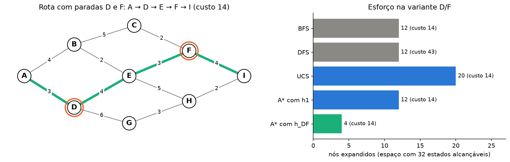

### Reprodução

```bash
.venv/bin/python -m pytest src/q10_buscas -q
cd src/q10_buscas && ../../.venv/bin/jupyter nbconvert --to notebook --execute --inplace q10_buscas.ipynb
```

### Referências (Q10)

1. RUSSELL, Stuart J.; NORVIG, Peter. *Inteligência Artificial: uma abordagem moderna*. 3. ed. Rio de Janeiro: Elsevier / Campus, 2013. Capítulo 3 (resolução de problemas por meio de busca).
2. HART, Peter E.; NILSSON, Nils J.; RAPHAEL, Bertram. A Formal Basis for the Heuristic Determination of Minimum Cost Paths. *IEEE Transactions on Systems Science and Cybernetics*, v. 4, n. 2, p. 100–107, 1968.
3. DIJKSTRA, Edsger W. A note on two problems in connexion with graphs. *Numerische Mathematik*, v. 1, p. 269–271, 1959.

---

## Questão 11: Agentes clássicos (AIMA Cap. 2) versus agentes baseados em LLM

Esta questão apresenta uma comparação entre os agentes inteligentes descritos por Russell e Norvig no Capítulo 2 do livro *Artificial Intelligence: A Modern Approach* (AIMA, 3ª edição) e os agentes construídos com base em grandes modelos de linguagem (LLMs).

Para fazer essa comparação, consideramos um problema de organização de atividades acadêmicas. Nele, um agente precisa interpretar as solicitações de um professor, considerar os prazos e as prioridades de cada tarefa e montar uma programação que respeite os horários disponíveis. A partir desse exemplo, analisamos como cada abordagem lida com o planejamento e quais são suas limitações.

### 1. Concepção clássica de agente inteligente (AIMA, Capítulo 2)

No Capítulo 2, Russell e Norvig definem um **agente** como uma entidade capaz de perceber o ambiente por meio de sensores e executar ações sobre ele por meio de atuadores. O comportamento do agente é representado pela **função do agente**, que relaciona as sequências de percepções recebidas às ações que devem ser executadas. Já o **programa do agente** corresponde à implementação dessa função em um sistema computacional.

Um **agente racional** é aquele que escolhe as ações que, considerando as informações disponíveis, têm maior expectativa de contribuir para sua medida de desempenho. Isso não significa que ele conheça todas as informações do ambiente ou que sempre consiga encontrar a melhor solução possível. Sua decisão depende das percepções recebidas, do conhecimento que possui e das alternativas disponíveis naquele momento.

Para organizar o projeto de um agente, os autores apresentam o modelo **PEAS**, que permite descrever o ambiente de tarefa a partir de quatro elementos:

| Elemento | Significado |
| :--- | :--- |
| **P** (*Performance*) | Medida de desempenho: critérios utilizados para avaliar o sucesso do agente |
| **E** (*Environment*) | Ambiente no qual o agente atua |
| **A** (*Actuators*) | Atuadores: mecanismos utilizados para executar ações no ambiente |
| **S** (*Sensors*) | Sensores: meios pelos quais o agente recebe informações do ambiente |

Além desses elementos, as características do ambiente influenciam diretamente o tipo de agente mais adequado. Entre elas estão a observabilidade, o determinismo, a organização episódica ou sequencial, o comportamento estático ou dinâmico, a natureza discreta ou contínua e a presença de um ou mais agentes.

O capítulo também apresenta diferentes arquiteturas de agentes, organizadas de acordo com a complexidade de suas decisões:

1. **Agente reativo simples:** escolhe uma ação com base apenas na percepção atual, utilizando regras condicionais.
2. **Agente reativo baseado em modelo:** mantém uma representação interna do ambiente para considerar informações que não estão disponíveis na percepção atual.
3. **Agente baseado em objetivos:** considera estados desejados e escolhe ações que possam conduzi-lo até eles.
4. **Agente baseado em utilidade:** avalia diferentes resultados por meio de uma função de utilidade, permitindo comparar alternativas quando existem objetivos conflitantes.
5. **Agente com aprendizado:** utiliza a experiência para melhorar seu desempenho ao longo do tempo.

No problema de organização acadêmica apresentado nesta questão, a abordagem mais adequada é a de um **agente baseado em objetivos**, pois ele precisa concluir determinadas atividades e respeitar compromissos. A utilização de uma função de **utilidade** complementa essa estrutura, permitindo priorizar tarefas e escolher entre diferentes planos possíveis quando não há tempo suficiente para realizar tudo.

### 2. Agentes baseados em LLM

Um agente baseado em LLM também recebe informações do ambiente e executa ações, mas utiliza um modelo de linguagem como parte central do processo de interpretação e tomada de decisão.

Em uma aplicação típica, o funcionamento pode ser dividido em algumas etapas:

1. Receber uma solicitação escrita em linguagem natural.
2. Identificar os objetivos, as restrições e as preferências presentes na mensagem.
3. Elaborar um plano de execução ou selecionar ferramentas que possam ajudar a realizar a tarefa.
4. Executar as ações necessárias por meio de ferramentas, como calendário, e-mail, banco de dados ou APIs.
5. Apresentar o resultado ao usuário em linguagem natural.

Apesar de ambos seguirem a lógica de perceber o ambiente e agir sobre ele, existem diferenças importantes entre a abordagem clássica e a baseada em LLM:

| Dimensão | Agente clássico (AIMA Cap. 2) | Agente baseado em LLM |
| :--- | :--- | :--- |
| Representação | Estados, ações e objetivos definidos explicitamente | Conhecimento representado principalmente nos parâmetros do modelo e no contexto recebido |
| Interpretação da entrada | Geralmente trabalha com informações estruturadas ou previamente formalizadas | Interpreta solicitações em linguagem natural, inclusive quando são ambíguas ou incompletas |
| Racionalidade | Pode ser analisada em relação a uma medida de desempenho definida | Não possui garantia formal de que a resposta maximize uma função de utilidade |
| Tratamento de restrições | Pode utilizar regras, busca ou problemas de satisfação de restrições (CSP) | Pode interpretar restrições em texto, mas precisa de mecanismos de verificação para garantir seu cumprimento |
| Interação com ferramentas | Definida diretamente na implementação do agente | Frequentemente realizada por meio de *function calling* ou *tool use* |
| Explicação | Pode apresentar o caminho percorrido, as regras aplicadas e as decisões tomadas | Consegue produzir explicações em linguagem natural, mas elas precisam corresponder ao processo realmente executado |
| Adaptação | Mudanças no domínio podem exigir alterações na modelagem ou no programa | Consegue lidar com novas solicitações e contextos sem necessariamente modificar o modelo |

Uma das principais vantagens dos LLMs está na flexibilidade para interpretar solicitações e lidar com diferentes formas de comunicação. Entretanto, essa flexibilidade não significa que todas as decisões estejam corretas. Sem mecanismos adicionais, o modelo pode propor horários incompatíveis, ignorar uma restrição importante ou apresentar como viável um plano que não cabe no tempo disponível.

### 3. Problema de aplicação: assistente de organização acadêmica

Para comparar as duas abordagens, utilizamos um cenário em que um professor precisa organizar suas atividades entre **14h e 18h**, totalizando quatro horas disponíveis.

A solicitação envolve preparar uma aula de Inteligência Artificial, corrigir trabalhos e participar de uma reunião de pesquisa. As atividades possuem durações, prioridades e prazos diferentes, conforme apresentado na tabela:

| Atividade | Duração | Prioridade | Prazo |
| :--- | ---: | :--- | :--- |
| A — Preparar aula de IA | 90 min | Alta | Hoje |
| B — Corrigir trabalhos | 120 min | Média | Amanhã |
| C — Reunião de pesquisa | 60 min | Alta | Hoje, às 16h |
| D — Revisar artigo | 60 min | Baixa | Próxima semana |

Além das informações da tabela, o agente precisa considerar as seguintes condições:

- A reunião **C** deve acontecer obrigatoriamente das **16h às 17h**.
- Nenhuma atividade pode ocupar o mesmo intervalo de outra.
- Uma atividade iniciada deve ser concluída, exceto quando o plano indicar explicitamente que ela será dividida.
- As atividades mais urgentes devem receber prioridade, sem comprometer os compromissos fixos.
- Quando uma tarefa não puder ser realizada, o agente deve apresentar uma justificativa.
- O objetivo é respeitar as restrições e aproveitar o tempo disponível da melhor maneira possível.

#### 3.1. Descrição PEAS do ambiente de tarefa

Aplicando o modelo PEAS ao cenário, temos:

| Elemento | Descrição neste problema |
| :--- | :--- |
| **Desempenho (P)** | Cumprir os compromissos fixos, concluir tarefas urgentes dentro do prazo, aproveitar o tempo disponível e justificar atividades adiadas |
| **Ambiente (E)** | Agenda do professor, tarefas com duração, prioridade e prazo, além da janela disponível entre 14h e 18h |
| **Atuadores (A)** | Criar ou alterar eventos na agenda, apresentar o planejamento e registrar atividades adiadas e suas justificativas |
| **Sensores (S)** | Solicitação do professor, informações das tarefas, calendário atual e horário corrente |

Também é possível classificar as propriedades desse ambiente com base no vocabulário do AIMA:

- **Observável:** pode ser considerado totalmente observável se o agente tiver acesso à agenda e a todas as informações das tarefas.
- **Determinístico:** as durações e o horário da reunião são conhecidos, de modo que o resultado do planejamento pode ser previsto, desconsiderando imprevistos externos.
- **Sequencial:** a ordem das atividades influencia o resultado, pois uma decisão pode limitar as opções disponíveis posteriormente.
- **Estático:** durante a elaboração do plano, o ambiente pode ser considerado estático. Entretanto, novas solicitações ou alterações na agenda podem torná-lo dinâmico.
- **Discreto:** as atividades e os intervalos de tempo são tratados como unidades definidas.
- **Monoagente:** o planejamento é realizado por um único agente, embora outras pessoas e sistemas possam interagir com ele posteriormente.

### 4. Solução clássica: planejamento explícito com objetivos e utilidade

Na abordagem clássica, a solicitação do professor precisa ser transformada em uma representação estruturada do problema. Diferentemente de um LLM, o agente não interpreta diretamente uma frase em linguagem natural. As tarefas, os horários e as restrições devem ser previamente organizados para que o algoritmo consiga trabalhar com essas informações.

#### 4.1. Modelo do problema

O planejamento pode ser representado pelos seguintes elementos:

- **Estado:** cada atividade recebe um intervalo de início e fim dentro da janela de 14h às 18h ou é marcada como adiada. Também deve existir uma indicação de quais atividades podem ser divididas.
- **Ações:** alocar uma atividade em um intervalo livre, adiar uma tarefa com justificativa ou dividir uma atividade quando isso estiver explicitamente autorizado.
- **Restrições obrigatórias:** a reunião C deve permanecer entre 16h e 17h; não pode haver sobreposição; as durações precisam ser respeitadas; e uma divisão só pode ocorrer quando estiver prevista no plano.
- **Preferências:** priorizar atividades urgentes, cumprir os prazos e aproveitar o tempo restante para realizar as demais tarefas.

Para representar a preferência entre diferentes resultados, podemos utilizar uma função de utilidade simplificada:

\[
U = 5\cdot\mathbb{I}(A) + 3\cdot f(B) + 5\cdot\mathbb{I}(C) + 1\cdot\mathbb{I}(D) - 10\cdot\mathbb{I}(\text{violação de C}) - 4\cdot\mathbb{I}(A\text{ fora de hoje})
\]

Nessa expressão, \(\mathbb{I}\) representa uma função indicadora, que assume valor 1 quando a condição é verdadeira e 0 caso contrário. A função \(f(B)\) representa a fração da atividade B concluída, variando entre 0 e 1 quando sua divisão estiver autorizada. Caso contrário, B só pode ser considerada concluída ou não concluída.

Os pesos atribuídos às atividades representam suas prioridades no exemplo. A preparação da aula e a reunião recebem valores maiores por terem prioridade alta e prazo para o mesmo dia. A correção dos trabalhos possui peso intermediário, enquanto a revisão do artigo recebe um valor menor por ter prazo mais distante.

Assim, o agente combina dois critérios: alcançar os objetivos definidos e escolher, entre os planos possíveis, aquele que oferece maior utilidade.

#### 4.2. Análise da janela de tempo

Antes de elaborar o plano, é necessário verificar quanto tempo realmente está disponível.

Como a reunião C ocupa obrigatoriamente o intervalo das 16h às 17h, a janela de quatro horas fica dividida em dois períodos livres:

- **14:00–16:00:** 120 minutos disponíveis.
- **17:00–18:00:** 60 minutos disponíveis.

Isso representa 180 minutos para as atividades que podem ser organizadas livremente. Entretanto, as tarefas A, B e D somam 270 minutos:

\[
90 + 120 + 60 = 270 \text{ minutos}
\]

Portanto, não é possível concluir todas as atividades flexíveis no mesmo dia. O agente precisa decidir quais tarefas serão realizadas, quais poderão ser parcialmente executadas e quais deverão ser adiadas.

#### 4.3. Plano proposto pelo agente clássico

Para este exemplo, consideramos que a divisão da atividade B está autorizada, desde que seja indicada explicitamente no planejamento. Dessa forma, é possível antecipar parte da correção dos trabalhos sem comprometer a preparação da aula ou a reunião.

| Horário | Atividade | Observação |
| :--- | :--- | :--- |
| 14:00–15:30 | A — Preparar aula de IA | Alta prioridade; prazo hoje; atividade concluída em 90 minutos |
| 15:30–16:00 | Reserva / folga operacional | Intervalo de 30 minutos, insuficiente para concluir B ou D |
| 16:00–17:00 | C — Reunião de pesquisa | Compromisso fixo |
| 17:00–18:00 | B — Corrigir trabalhos (parte 1/2) | Divisão explícita: 60 dos 120 minutos necessários |
| Amanhã (a definir) | B — Corrigir trabalhos (parte 2/2) | 60 minutos restantes, dentro do prazo |
| Adiada | D — Revisar artigo | Prioridade baixa; prazo na próxima semana |

A preparação da aula é realizada integralmente antes da reunião, garantindo o cumprimento de uma atividade de alta prioridade. A reunião permanece no horário estabelecido e, após seu término, uma hora é destinada à correção dos trabalhos.

A atividade B não é concluída no mesmo dia, mas sua divisão permite adiantar metade do trabalho e finalizar o restante no dia seguinte. Já a revisão do artigo é adiada porque possui menor prioridade e um prazo mais distante.

Caso a divisão de tarefas não fosse permitida, o planejamento precisaria ser diferente. Nesse cenário, seria possível realizar A das 14h às 15h30 e manter C das 16h às 17h, mas não haveria um intervalo contínuo de 120 minutos para concluir B. Assim, a correção dos trabalhos seria adiada integralmente para o dia seguinte, com justificativa baseada na disponibilidade de tempo.

A solução pode ser obtida por diferentes técnicas, como busca com verificação de restrições, programação por restrições (CSP/CP) ou algoritmos de escalonamento. Essas abordagens permitem avaliar as combinações possíveis e descartar aquelas que violam as condições definidas para o problema.

### 5. Solução com agente baseado em LLM

Na abordagem baseada em LLM, o processo começa com a solicitação do professor em linguagem natural. O modelo precisa identificar as atividades mencionadas, extrair suas durações, prioridades e prazos e reconhecer que a reunião das 16h é um compromisso fixo.

A partir dessas informações, o agente pode elaborar um plano e, caso tenha acesso a ferramentas externas, consultar ou modificar a agenda. Algumas chamadas possíveis seriam:

- `listar_eventos(data=hoje)`
- `criar_evento(titulo, inicio, fim)`
- `consultar_carga_trabalhos()`

O resultado esperado seria um planejamento semelhante ao apresentado na abordagem clássica: reservar o horário da reunião, realizar a preparação da aula antes dela e organizar a correção dos trabalhos de acordo com o tempo restante.

A principal diferença está na forma como o modelo recebe e interpreta as informações. Em vez de depender exclusivamente de uma estrutura previamente preenchida, o LLM consegue compreender solicitações escritas de maneira informal, identificar informações relevantes e interagir com o usuário para resolver dúvidas.

Entre as vantagens dessa abordagem, podemos destacar:

- Interpretar solicitações incompletas ou pouco estruturadas, como "organize minhas atividades da melhor maneira possível".
- Identificar informações ausentes e pedir esclarecimentos, por exemplo, perguntando se a correção dos trabalhos pode ser dividida.
- Apresentar o planejamento em linguagem natural, explicando as escolhas realizadas.
- Adaptar o plano quando o professor acrescentar novas atividades ou alterar alguma condição.

Entretanto, essas capacidades não eliminam os riscos. O modelo pode interpretar incorretamente uma duração, esquecer um compromisso fixo ou sugerir atividades em horários que já estão ocupados. Também pode dividir uma tarefa sem autorização ou apresentar uma justificativa convincente para uma programação que, na prática, não é viável.

Por isso, uma solução mais confiável combina o LLM com mecanismos tradicionais de planejamento. O modelo pode interpretar a solicitação e propor alternativas, enquanto um verificador de restrições confere os horários, as durações e as possíveis sobreposições antes de qualquer alteração na agenda. Um algoritmo de otimização também pode avaliar os planos gerados e selecionar aquele que melhor atende aos critérios definidos.

### 6. Comparação lado a lado no mesmo problema

A aplicação das duas abordagens ao mesmo cenário permite observar diferenças na maneira como as decisões são tomadas:

| Aspecto | Abordagem clássica | Abordagem LLM |
| :--- | :--- | :--- |
| Entrada | Informações estruturadas, como tabelas de tarefas e restrições | Texto livre, que pode ser convertido em estruturas por meio da interpretação do modelo |
| Interpretação dos objetivos | Definida durante a modelagem do problema | Realizada pelo modelo a partir de cada solicitação |
| Respeito à reunião das 16h | Pode ser garantido quando a restrição é aplicada pelo algoritmo | Pode ser interpretado corretamente, mas precisa de verificação para oferecer garantia |
| Maximização da utilidade | Utiliza uma função de utilidade explícita | Depende da avaliação gerada pelo modelo, sem garantia formal de otimização |
| Justificativas | Podem ser relacionadas diretamente às restrições e aos critérios de utilidade | São apresentadas em linguagem natural, mas precisam corresponder às decisões efetivamente tomadas |
| Interação com ferramentas | Implementada diretamente no programa do agente | Pode ocorrer por meio de *tool use* e chamadas de funções |
| Mudança de política | Exige atualizar as regras ou restrições do modelo | Pode ser informada em linguagem natural, mas o plano precisa ser reavaliado |

No exemplo, a abordagem clássica oferece maior controle sobre as restrições, pois elas fazem parte da própria representação do problema. Já o LLM facilita a interação com o professor e a adaptação a novas solicitações, mas precisa de mecanismos adicionais para garantir que o planejamento seja válido.

### 7. Quando o LLM oferece vantagens e o que ainda depende de mecanismos explícitos

#### 7.1. Situações em que o agente LLM tende a ser vantajoso

1. **Interpretação de solicitações em linguagem natural:** o professor pode descrever suas atividades em texto corrido, sem precisar preencher previamente uma estrutura rígida. O modelo consegue extrair as informações necessárias e organizá-las para o planejamento.

2. **Diálogo e negociação:** quando existe alguma informação ausente ou uma decisão que depende da preferência do usuário, o agente pode fazer perguntas e apresentar alternativas. No exemplo, poderia perguntar se a correção dos trabalhos pode ser dividida em dois períodos.

3. **Integração com diferentes ferramentas:** o modelo pode interagir com calendário, e-mail, ambiente virtual de aprendizagem e outros sistemas, reunindo informações que seriam consultadas separadamente.

4. **Adaptação a mudanças:** novas solicitações podem ser incorporadas durante a conversa. Se o professor informar que precisa conversar com a coordenação por 15 minutos após a reunião, o agente pode considerar essa alteração e propor um novo planejamento.

5. **Comunicação dos resultados:** além de elaborar o plano, o LLM consegue explicar as decisões, resumir as atividades realizadas e produzir mensagens ou relatórios para o usuário.

#### 7.2. Capacidades que ainda dependem de raciocínio, planejamento e verificação explícitos

1. **Cumprimento de restrições obrigatórias:** horários fixos, durações e ausência de sobreposição precisam ser verificados por mecanismos confiáveis. Não basta que o modelo reconheça essas condições no texto.

2. **Otimização da utilidade:** quando o objetivo é maximizar uma função de utilidade definida, é necessário utilizar critérios explícitos para comparar os planos e identificar qual apresenta o melhor resultado.

3. **Consistência e reprodutibilidade:** em sistemas institucionais, é importante que as mesmas informações e restrições produzam resultados consistentes, que possam ser analisados posteriormente.

4. **Segurança na execução de ferramentas:** antes de criar ou alterar eventos, o sistema precisa verificar se a operação é válida e se não existem conflitos com a agenda real.

5. **Planejamento de problemas maiores:** quando há muitas atividades, restrições e combinações possíveis, algoritmos de busca e técnicas como CSP oferecem mecanismos mais adequados para explorar e validar as alternativas.

6. **Justificativa das decisões:** as explicações precisam estar relacionadas a critérios verificáveis. No exemplo, dizer que B foi parcialmente realizada porque não havia um intervalo contínuo de 120 minutos disponível é uma justificativa mais consistente do que simplesmente afirmar que a tarefa foi menos importante.

A comparação mostra que os agentes clássicos e os agentes baseados em LLM apresentam características diferentes. O Capítulo 2 do AIMA fornece os fundamentos para estruturar um agente racional, definindo como ele percebe o ambiente, escolhe ações e avalia seu desempenho. Já os LLMs ampliam as possibilidades de interação, principalmente pela capacidade de interpretar linguagem natural e lidar com solicitações variadas.

No problema apresentado, o LLM facilita a comunicação com o professor e a elaboração inicial do planejamento. Entretanto, garantir que a reunião ocorra no horário correto, que as atividades não se sobreponham e que as durações sejam respeitadas exige mecanismos de verificação mais precisos.

Por isso, a combinação das duas abordagens apresenta uma solução mais adequada: o LLM pode interpretar as solicitações, interagir com o usuário e sugerir planos, enquanto algoritmos de planejamento e verificadores de restrições ficam responsáveis por avaliar a viabilidade das decisões antes de executá-las.

### Referências

1. RUSSELL, Stuart J.; NORVIG, Peter. *Inteligência Artificial: uma abordagem moderna*. 3. ed. Rio de Janeiro: Elsevier / Campus, 2013. Cap. 2 (Agentes inteligentes).
2. RUSSELL, Stuart J.; NORVIG, Peter. *Inteligência Artificial: uma abordagem moderna*. 3. ed. Rio de Janeiro: Elsevier / Campus, 2013. Cap. 3 (Resolução de problemas por meio de busca).

---

## Questão 12: Assistente de agenda acadêmica baseado em LLM

**Dupla:** Bruno Gomes de Barros Filho (21111360); Antônio Rodrigo Lima de Andrade Tenório (23210707)
**Disciplina:** ECOM031: Inteligência Artificial
**Professor:** Evandro de Barros Costa
**Período:** 2026.2

> Especifique e desenvolva uma aplicação, de sua escolha, de sistema de agente baseado em LLM, incluindo
> componentes de interface de usuário em linguagem natural, inferência e explicabilidade.

A aplicação é um assistente que organiza o dia de um professor a partir de um pedido em texto livre,
generalizando o cenário da Q11 (aula, correção, reunião e revisão de artigo entre 14h e 18h). A resposta
da Q11 (`docs/q11_agentes_classicos_vs_llm.md`) concluiu que o LLM é bom para interpretar pedidos em
linguagem natural e redigir respostas, e que restrições, planejamento e verificação devem ficar em
mecanismos explícitos. Este trabalho implementa essa arquitetura híbrida: um LLM conversa com o
professor e chama ferramentas (por padrão o Gemini `gemini-3.5-flash-lite`, com `gemini-3.1-flash-lite`
como reserva; o Claude `claude-opus-5-5` é a alternativa); um planejador exato em Python decide os horários; um
verificador independente confere o plano; e as justificativas que o modelo apresenta vêm prontas das
ferramentas.

## 1. Arquivos

| Arquivo | Conteúdo |
| :--- | :--- |
| `planejador.py` | Modelo do problema, função de utilidade, busca exata com poda e verificador de restrições |
| `explicacao.py` | Resumo estruturado do plano: justificativas, contrafactuais, ociosidade, restrições ativas, 2ª melhor alternativa |
| `agente.py` | Ferramentas (schemas estritos), estado da agenda, loop de uso de ferramentas e cliente da API do Claude |
| `cliente_gemini.py` | Cliente do Gemini (Google AI Studio): tradução do histórico, modelo principal e de reserva |
| `agente_cli.py` | Interface de chat em linha de comando |
| `simulacao.py` | Cliente roteirizado (mesmo formato das mensagens da API, sem modelo) e roteiro do cenário da Q11 |
| `gantt.py` | Gráfico de Gantt do plano |
| `q12_agente_llm.ipynb` | Notebook executado com o cenário da Q11, variações, verificador e o agente |
| `test_q12_planejador.py`, `test_q12_verificador.py`, `test_q12_agente.py`, `test_q12_cliente_gemini.py` | Testes (447 casos) |
| `figures/` | Gantt do cenário da Q11, das variações e do replanejamento (PNG e PDF) |

## 2. Especificação

### 2.1 Requisitos

Funcionais:

1. Receber pedidos em português livre, inclusive o texto da Q11, e extrair atividades (nome, duração,
   prioridade, prazo, horário fixo, prazo com horário, permissão para dividir) e a janela disponível.
2. Perguntar ao professor quando faltar um dado essencial, em vez de inventá-lo.
3. Calcular o plano de maior utilidade que respeite as restrições: janela, compromissos fixos, nenhuma
   sobreposição, atividade não divisível executada sem interrupção, blocos mínimos das divisíveis e prazos
   com horário.
4. Conferir o plano com um verificador independente e avaliar planos propostos pelo próprio professor.
5. Explicar o resultado: por que cada atividade está naquele horário, por que cada atividade ficou de
   fora ou incompleta, quais restrições pesaram, qual é a segunda melhor alternativa e quanto ela perde.
6. Manter a conversa: pedidos novos ("surgiu uma orientação de TCC") alteram a agenda e disparam
   replanejamento.

Não funcionais:

- Toda afirmação sobre horários e utilidades deve vir de código determinístico e testado.
- Funcionar sem chave de API para demonstração e testes (cliente do LLM injetável).
- Erros de ferramenta e da API não podem corromper o estado da conversa.

### 2.2 PEAS do agente

| Elemento | Descrição |
| :--- | :--- |
| Medida de desempenho | Utilidade do plano (prioridade x urgência x fração concluída), zero violações de restrição, explicações fiéis ao que foi calculado |
| Ambiente | Agenda do dia do professor: janela, atividades, compromissos fixos, prazos; parcialmente observável (só sabe o que o professor diz) e dinâmico entre turnos |
| Atuadores | Mensagens ao professor; chamadas de ferramentas que alteram a agenda (`definir_janela`, `registrar_atividades`, `remover_atividade`) |
| Sensores | Texto digitado pelo professor; resultados das ferramentas (`planejar_agenda`, `avaliar_plano`) |

Na classificação do AIMA, o conjunto é um agente baseado em utilidade: o LLM faz o papel de percepção
(transforma texto em estado estruturado) e de comunicação, e a escolha da ação usa uma função de utilidade
explícita.

### 2.3 Arquitetura

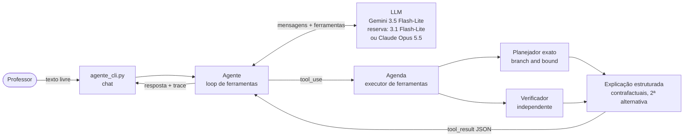

Fluxo de um turno:

1. O professor escreve o pedido.
2. O agente envia histórico, prompt de sistema e as cinco ferramentas ao LLM.
3. O LLM responde com chamadas de ferramenta (blocos `tool_use`) (por exemplo `definir_janela` e `registrar_atividades` em
   paralelo). O agente executa cada um e devolve todos os `tool_result` numa única mensagem de usuário,
   com `is_error: true` quando a ferramenta falha.
4. O LLM chama `planejar_agenda`. O executor roda o planejador, o verificador e o gerador de explicações
   e devolve um JSON com o plano e as justificativas.
5. O LLM redige a resposta final a partir desse JSON. A CLI mostra a resposta e o trace das ferramentas.

## 3. Componentes

### 3.1 Interface em linguagem natural

`agente_cli.py` é um chat de terminal. O professor escreve o que quiser; `/agenda` mostra o estado
estruturado atual (o que o agente entendeu) e `sair` encerra. Depois de cada resposta a CLI imprime o
trace das ferramentas chamadas, com entradas e resultados resumidos, para que o professor veja o que foi
extraído do texto dele.

A interpretação fica com o Claude. O prompt de sistema (em `agente.py`) define as convenções de extração
(hoje = 0 dias, amanhã = 1, próxima semana = 7; dividir só com permissão explícita), manda perguntar
quando faltar duração e proíbe calcular horários ou utilidades por conta própria.

As cinco ferramentas usam `strict: true`, com `additionalProperties: false` e todos os campos em
`required` (campos opcionais aceitam `null`). Assim os argumentos sempre seguem o schema. Mesmo assim o
executor valida tudo de novo em Python (formato HH:MM, durações positivas, prioridades conhecidas,
compromissos fora da janela, compromissos sobrepostos), porque a entrada do modelo é tratada como dado
não confiável. Uma validação que falha vira `tool_result` com `is_error: true` e a mensagem do erro, e o
modelo pode corrigir a chamada.

### 3.2 Inferência: planejador exato

Utilidade (mesma estrutura da Q11):

$$U = \sum_a \text{peso}(\text{prioridade}_a)\cdot\text{urg}(\text{prazo}_a)\cdot\frac{\text{minutos feitos}_a}{\text{duração}_a},\qquad \text{urg}(d) = 1 + \frac{2}{1+d}$$

Pesos: alta 3, média 2, baixa 1. Urgência: hoje 3, amanhã 2, uma semana 1,25. A fração final é o $f(B)$ da
Q11: uma atividade divisível feita pela metade rende metade do valor; uma não divisível rende tudo ou
nada. Compromissos fixos são restrições rígidas e sempre entram.

Busca (`planejar` em `planejador.py`): profundidade sobre agendas justificadas à esquerda. Em cada
instante livre o planejador começa uma atividade não divisível, executa um bloco de uma divisível
(comprimentos múltiplos de 15 min a partir do bloco mínimo, mais o bloco que esgota o intervalo ou a
atividade) ou fica ocioso até o próximo compromisso fixo. Ficar ocioso e começar algo depois, antes do
próximo compromisso, nunca é necessário: qualquer agenda viável pode ser deslocada para a esquerda sem
violar restrições, e terminar mais cedo só facilita os prazos. A poda usa como limite superior a mochila
fracionária do tempo livre restante; um ramo com limite abaixo da melhor utilidade encontrada é
descartado. Empates de utilidade são resolvidos terminando antes o que vale mais e, depois, com menos
blocos.

Por que busca exata: um dia de trabalho tem poucas atividades. No cenário da Q11 a busca visita 13 nós
(47 com B divisível). Com isso o agente pode afirmar que o plano é ótimo para a utilidade declarada e
calcular contrafactuais exatos. A seção 7 mostra onde essa escolha deixa de valer.

Verificador (`verificar`): código separado, que não reaproveita nada da busca. Recebe uma lista de blocos e
confere janela, sobreposição, horário exato dos compromissos fixos, não interrupção, blocos mínimos,
prazos com horário e mínimos exigidos. Roda sobre todo plano devolvido pelo planejador e sobre planos
propostos de fora (ferramenta `avaliar_plano`).

### 3.3 Explicabilidade

`explicacao.explicar` devolve, junto com o plano:

- `justificativa` de cada atividade: como o valor foi calculado e o que delimita cada bloco ("logo após o
  fim de C; termina no fim da janela").
- `contrafactual` de cada atividade fora do plano ou incompleta: o planejador roda de novo exigindo essa
  atividade e informa a nova utilidade, a perda e o que teria de sair. Se nem assim houver plano viável,
  informa o motivo (por exemplo, nenhum intervalo contínuo comporta a atividade).
- `ociosidade`: cada intervalo sem uso e o motivo de nada caber nele.
- `restricoes_ativas`: janela, compromissos, intervalos livres, demanda contra tempo disponível,
  atividades não divisíveis e prazos.
- `segunda_melhor_alternativa`: o melhor dos contrafactuais, ou seja, o melhor plano que muda a decisão
  sobre alguma atividade.
- `verificacao`: resultado do verificador independente.

Divisão de trabalho e risco de alucinação. O Claude escreve a resposta final, mas só depois de receber
esse JSON, e o prompt pede que use somente fatos vindos das ferramentas. Isso reduz bastante o espaço para
alucinação: o modelo não precisa somar minutos nem comparar planos, só reescrever números que estão no
contexto. O risco não desaparece. O modelo ainda pode copiar um horário errado, omitir uma atividade ou
dar um motivo que não está no JSON. Três coisas limitam o estrago:

1. O trace mostrado na CLI e o comando `/agenda` deixam o professor conferir o que foi extraído e
   calculado.
2. `texto_explicacao` gera uma explicação só com código, a partir do mesmo resumo; ela é usada no modo
   de demonstração e serve de referência para comparar com o texto do modelo.
3. Se o modelo alterar a agenda e tentar responder sem chamar `planejar_agenda`, o agente devolve um
   lembrete e pede o replanejamento antes da resposta (com `tool_choice: auto` não há garantia de
   chamada; veja 3.4).

A extração também pode errar, e esse erro o verificador não pega: se o modelo registrar a correção com 90
minutos em vez de 120, o plano será ótimo para dados errados. Por isso o trace mostra as entradas das
ferramentas, e o prompt manda listar as suposições feitas na interpretação.

### 3.4 Loop do agente e uso da API

O loop (`Agente.processar`) trabalha com mensagens em blocos (`text`, `tool_use`, `tool_result`) e recebe o
cliente do LLM por injeção: qualquer objeto com o método `criar_mensagem(system, tools, messages)` serve.
Há dois clientes reais.

**Gemini (padrão), `cliente_gemini.py`.**

- Modelo principal `gemini-3.5-flash-lite` e reserva `gemini-3.1-flash-lite`, os dois na camada gratuita do
  Google AI Studio. Se o principal devolver 404, 429 ou 5xx (modelo indisponível, cota esgotada, falha do
  servidor) ou der erro de conexão, a mesma requisição vai para a reserva. Erros do próprio pedido (400) e
  de chave (401/403) não tentam a reserva, porque falhariam do mesmo jeito.
- Tradução nos dois sentidos: os schemas das ferramentas viram `FunctionDeclaration` com
  `parameters_json_schema`; o histórico vira `Content` com papéis `user`/`model`; cada `tool_result` vira um
  `FunctionResponse` com o nome e o id da chamada correspondente (`{"resultado": ...}` ou `{"erro": ...}`).
  As respostas voltam como blocos `tool_use`/`text`, e o `finish_reason` vira `stop_reason`
  (`SAFETY`/`PROHIBITED_CONTENT` → `refusal`, `MAX_TOKENS` → `max_tokens`).
- As partes originais da resposta do Gemini são guardadas no histórico e reenviadas sem alteração. Os
  modelos Gemini 3 exigem isso: cada chamada de função carrega uma `thought_signature` que precisa voltar
  no turno seguinte.
- A execução automática de funções do SDK fica desligada; quem executa as ferramentas é o agente.
- A chave é lida de `GEMINI_API_KEY`. A CLI e o notebook carregam o arquivo `.env` da raiz do repositório,
  que está no `.gitignore`; a chave não aparece em código, saídas ou commits.

**Claude, `ClienteAnthropic` em `agente.py`** (alternativa, `--provedor claude`):

- Modelo `claude-opus-5-5`. O thinking é sempre ligado nesse modelo; o código não envia `thinking`
  (equivale a adaptativo) nem `budget_tokens`. A profundidade é controlada por
  `output_config={"effort": "medium"}`, ajustável com `--esforco` na CLI.
- `tool_choice` fica no padrão `auto`, porque forçar ferramenta (`any`/`tool`) retorna erro 400 nesse
  modelo. A orientação para usar ferramentas está no prompt e os schemas são estritos.
- Loop manual: enquanto `stop_reason == "tool_use"`, o agente executa as ferramentas e devolve todos os
  `tool_result` numa única mensagem. A resposta do assistente entra inteira no histórico
  (`response.content`, incluindo blocos de thinking), o que mantém o prefixo idêntico entre chamadas.
  `pause_turn` é reenviado; `end_turn` encerra o turno.
- `stop_reason` é checado antes de usar o conteúdo. Em `refusal` (mostra `stop_details.category`) ou
  `max_tokens`, o turno é desfeito: histórico e agenda voltam ao estado anterior.
- Fallback de recusa no servidor: a chamada usa `client.beta.messages.create` com
  `betas=["server-side-fallback-2026-07-01"]` e `fallbacks="default"`. Se os classificadores do Opus 5.5
  recusarem o pedido, a API refaz a requisição no modelo de fallback recomendado dentro da mesma chamada.
  Para um assistente de agenda uma recusa é improvável, mas sem essa opção um falso positivo pararia a
  conversa. Se o fallback rodar, os turnos seguintes ficam sem os blocos de thinking do Opus 5.5, o que
  não afeta este agente, já que o estado relevante está nas ferramentas.
- Erros do SDK são convertidos em `ErroLLM` com mensagem clara, na ordem de especificidade:
  `AuthenticationError`, `PermissionDeniedError`, `RateLimitError`, `BadRequestError`, `APIStatusError`,
  `APIConnectionError`. O SDK já faz novas tentativas automáticas em 429 e 5xx. Em erro o turno é
  desfeito.
- O cliente do LLM é um protocolo de um método (`criar_mensagem`). `ClienteAnthropic` usa a API real;
  `ClienteRoteirizado` (em `simulacao.py`) devolve respostas pré-escritas com os tipos do SDK
  (`BetaMessage`, `BetaToolUseBlock`, `BetaTextBlock`).

## 4. Como executar

Dependências (todas já estão no `.venv` do repositório): `google-genai` (testado com 3.0.0), `anthropic`
(testado com 2.6.0), `matplotlib`, `pandas`, `pytest`, `jupyter`/`nbconvert` para o notebook. Em outro
ambiente:

```bash
pip install "google-genai>=3.0" "anthropic>=2.6" matplotlib pandas pytest jupyter
```

Os comandos abaixo partem desta pasta (`src/q12_agente_llm`).

Sem chave de API:

```bash
python agente_cli.py --demo        # conversa roteirizada da Q11 (2 turnos); planejador real, sem LLM
python -m pytest -q                # 447 testes
jupyter nbconvert --to notebook --execute --inplace q12_agente_llm.ipynb
```

Com chave de API. Crie o arquivo `.env` na raiz do repositório (ele já está no `.gitignore`) com a chave
gratuita do Google AI Studio:

```bash
echo "GEMINI_API_KEY=sua-chave" > ../../.env
python agente_cli.py                     # chat com o Gemini (3.5 Flash-Lite, reserva 3.1 Flash-Lite)
python agente_cli.py --provedor claude   # chat com o Claude (precisa de ANTHROPIC_API_KEY no .env ou no ambiente)
```

Com a chave definida, a seção 6.3 do notebook também chama o Gemini de verdade. Sem ela, a célula é
pulada e avisa isso.

## 5. Resultados

Todos os números abaixo foram calculados pelo planejador (notebook, seções 2 a 6).

| Cenário | Plano ótimo | U | Fora ou incompleta | 2ª alternativa |
| :--- | :--- | :---: | :--- | :--- |
| Q11, 14h-18h, sem divisão | A 14:00-15:30, C 16:00-17:00, D 17:00-18:00 | 19,25 | B | forçar B: 14,25 |
| B divisível (blocos >= 30 min) | A 14:00-15:30, B 15:30-16:00, C 16:00-17:00, B 17:00-18:00 | 21,00 | B parcial (90/120), D | forçar D: 20,25 |
| Janela 14h-19h | A 14:00-15:30, C 16:00-17:00, B 17:00-19:00 | 22,00 | D | forçar D: 19,25 |
| Pedido novo: orientação de TCC (E), 30 min, alta, hoje | E 14:00-14:30, A 14:30-16:00, C 16:00-17:00, D 17:00-18:00 | 28,25 | B | forçar B: 22,00 |


Saída do modo `--demo` para o pedido da Q11 (explicação gerada por `texto_explicacao`, sem LLM):

```text
Plano para 14:00-18:00 (utilidade 19,25; 23,25 se tudo coubesse):
  14:00-15:30  A  Preparar aula de IA
  16:00-17:00  C  Reunião de pesquisa
  17:00-18:00  D  Revisar artigo
Por que algo ficou de fora ou incompleto:
  - B (Corrigir trabalhos): exigir B levaria a utilidade a 14,25 (perda de 5,00), com as trocas A 90->0 min, B 0->120 min.
Tempo livre não usado 15:30-16:00 (30 min): B precisa de 120 min contínuos.
Segunda melhor alternativa: forçar B dá utilidade 14,25, 5,00 abaixo do plano escolhido.
Verificador independente: nenhuma violação.
```

Comparação com os planos feitos à mão na Q11, usando o verificador (`avaliar_plano`):

| Plano | Válido | U | U ótima | O que faltou |
| :--- | :---: | :---: | :---: | :--- |
| Q11 sem divisão (A, C; B e D adiadas) | sim | 18,00 | 19,25 | D cabia em 17h-18h |
| Q11 com divisão (A, C, B 17h-18h) | sim | 20,00 | 21,00 | os 30 min antes da reunião podiam adiantar B |
| B 14h-16h, A 16h-17h30, C 16h-17h | não | - | 19,25 | sobreposição de A com a reunião |

Os planos manuais da Q11 eram válidos, mas deixavam utilidade para trás. O terceiro é o tipo de plano que
um LLM sem ferramentas pode escrever, e o verificador o rejeita apontando a sobreposição.

No replanejamento, a orientação de TCC entra às 14h e ocupa o tempo que estava ocioso antes da reunião; a
aula passa para 14h30-16h. E e A têm o mesmo valor (9), então as duas ordens têm a mesma utilidade, e o
desempate termina antes a atividade que acaba mais cedo.


### Execução real com o Gemini

A seção 6.3 do notebook roda o agente com o Gemini nos mesmos dois turnos da simulação (pedido da Q11 e,
depois, a orientação de TCC). Na execução salva, o `gemini-3.5-flash-lite` respondeu sozinho (a reserva não
foi necessária), cada turno levou cerca de 8 segundos e a sequência de ferramentas foi a esperada:
`definir_janela` e `registrar_atividades` em paralelo, depois `planejar_agenda`. O plano final foi o ótimo
do planejador (utilidade 19,25 no primeiro turno e 28,25 depois do replanejamento), e a resposta trouxe a
tabela, o motivo de B ficar de fora e a segunda melhor alternativa, tudo tirado do JSON da ferramenta.

O que muda entre execuções é a interpretação do pedido, e isso confirma a divisão de trabalho da Q11:

- Numa execução de teste, o modelo marcou a correção (B) como divisível, contrariando a instrução do prompt
  ("na dúvida, use false"). O planejador então dividiu B em dois blocos, e a resposta declarou a suposição.
- Na execução salva, B ficou indivisível, mas o modelo registrou B com prioridade alta. O texto do pedido
  não diz a prioridade da correção (a tabela da Q11 diz "média"), então a escolha é defensável, mas muda a
  utilidade da segunda alternativa (16,25 em vez de 14,25).

Nos dois casos o plano foi ótimo para os dados que o modelo registrou, e o trace e a lista de suposições
deixam o professor ver e corrigir a interpretação. O verificador garante as restrições; ele não garante que
a extração esteja certa.

## 6. Testes

- `test_q12_planejador.py`: planos e utilidades dos três cenários da Q11; explicações e contrafactuais;
  prazos com horário; instâncias mal definidas; um caso em que o ótimo exige um bloco menor que o máximo
  possível; ótimo igual ao de uma força bruta em 120 instâncias aleatórias pequenas (toda atribuição de
  horários em slots de 30 min, filtrada pelo verificador); busca com poda igual à busca sem poda em 200
  instâncias maiores; plano sempre aprovado pelo verificador em 60 instâncias.
- `test_q12_verificador.py`: cada tipo de violação é detectado; `avaliar_plano` compara com o ótimo.
- `test_q12_agente.py`: com o cliente roteirizado, o loop executa as ferramentas, devolve os `tool_result`
  com os ids certos numa única mensagem, marca `is_error` em entrada inválida e ferramenta desconhecida,
  para em `end_turn`, guarda blocos de thinking no histórico, insiste uma vez quando o modelo não replaneja,
  desfaz o turno em recusa, `max_tokens`, erro de API e excesso de iterações, e mantém o estado entre
  turnos. Com um transporte HTTP falso, confere que a requisição real leva `claude-opus-5-5`, o header
  `server-side-fallback-2026-07-01`, `fallbacks: "default"`, `output_config.effort`, ferramentas estritas
  e nenhum `tool_choice` ou `thinking`, e que respostas 400, 401, 429 e 529 viram `ErroLLM`.
- `test_q12_cliente_gemini.py`: com um cliente falso que devolve objetos reais do SDK `google-genai`,
  confere a tradução de chamadas de função e de motivos de parada, a ligação de cada `FunctionResponse` à
  chamada certa (nome e id), a preservação da parte original com `thought_signature`, a queda para o modelo
  de reserva em 404/429/5xx, a ausência de reserva em 400/401/403 e um turno completo do agente.

Para checar se os testes pegam erros de verdade, introduzimos três defeitos no planejador (remover a
opção de ficar ocioso, testar só o maior bloco possível, podar com folga de 0,5). Os três foram
detectados.

## 7. Limitações

- Custo da busca: até seis atividades numa janela de 8 horas a busca leva menos de 0,1 s. Com sete
  atividades, várias delas divisíveis, passa de um milhão de nós (cerca de 7 s no notebook), e oito
  levaram cerca de um minuto nos nossos testes. O crescimento vem das muitas formas de fatiar atividades
  divisíveis com a mesma utilidade, que a poda não elimina. Para agendas maiores, programação dinâmica
  sobre o estado (instante, minutos feitos por atividade) ou um resolvedor como o CP-SAT seriam o próximo
  passo.
- Horário discretizado: blocos de atividades divisíveis variam em passos de 15 minutos.
- A função de utilidade é uma escolha nossa. Com B divisível, a segunda melhor alternativa perde só 0,75;
  mudar um pouco os pesos inverte a decisão entre B e D. O agente explica a escolha, mas não descobre as
  preferências reais do professor.
- Um único dia. Não há dependências entre atividades, deslocamento, pausas, nem a parte de B que fica
  para amanhã é agendada.
- A extração depende do LLM. Se ele entender errado uma duração, o plano será ótimo para dados errados;
  o trace e o `/agenda` existem para o professor conferir.
- O Gemini foi testado contra a API real (seção 6.3 do notebook). O caminho do Claude não foi: não havia
  chave da Anthropic, e a forma das requisições foi verificada com transporte HTTP falso.
- A extração varia entre execuções (seção 5, "Execução real com o Gemini"): o mesmo pedido já gerou atividades com divisibilidade e
  prioridade diferentes. Um passo de confirmação ("entendi isto; posso planejar?") reduziria o risco.

## 8. Custos e latência

Com o Gemini, o uso cabe na camada gratuita do Google AI Studio, que tem limite de requisições por minuto e
por dia; a queda para o modelo de reserva cobre o caso de a cota de um modelo acabar. Na execução salva cada
turno levou cerca de 8 segundos (três chamadas sequenciais). A estimativa abaixo é para o Claude.


Cada turno típico faz três chamadas ao modelo (extração, planejamento, resposta). O prompt de sistema tem
cerca de 1,4 mil caracteres, as definições das ferramentas cerca de 2,9 mil e o resultado de
`planejar_agenda` no cenário da Q11 cerca de 3,6 mil, o que dá algo como 6 a 8 mil tokens de entrada
somando as três chamadas. A saída (chamadas de ferramenta, resposta e thinking com esforço `medium`)
deve ficar entre 1 e 3 mil tokens. Ao preço do Opus 5.5 (US$ 4 por milhão de tokens de entrada e US$ 20
por milhão de saída), isso dá na ordem de US$ 0,05 a 0,10 por turno. A latência é dominada pelas três
chamadas sequenciais, provavelmente de 10 a 30 segundos por turno; o planejador leva menos de 1 ms no
cenário da Q11. `--esforco low` reduz custo e tempo. Como o prompt de sistema e as ferramentas não mudam
entre chamadas, cache de prompt é uma otimização direta caso o uso cresça.

## 9. Referências

- RUSSELL, S.; NORVIG, P. *Inteligência Artificial*. 3. ed. Rio de Janeiro: Elsevier, 2013. Cap. 2
  (agentes, PEAS, agentes baseados em utilidade), cap. 6 (problemas de satisfação de restrições) e
  cap. 10/11 (planejamento e escalonamento).
- YAO, S. et al. ReAct: Synergizing Reasoning and Acting in Language Models. ICLR, 2023.
- SCHICK, T. et al. Toolformer: Language Models Can Teach Themselves to Use Tools. NeurIPS, 2023.
- KAMBHAMPATI, S. et al. LLMs Can't Plan, But Can Help Planning in LLM-Modulo Frameworks. ICML, 2024.
- Google. Documentação da Gemini API (Google AI Studio): function calling e thought signatures.
  https://ai.google.dev/gemini-api/docs
- Anthropic. Documentação da Messages API: uso de ferramentas, strict tool use, thinking adaptativo,
  effort e fallback de recusa no servidor. https://platform.claude.com/docs
- Questão 11 desta lista: `docs/q11_agentes_classicos_vs_llm.md`.

---

## Questão 13: Ensaio sobre a arquitetura Transformer

**Vídeo indicado no enunciado:** implementitatai, *Encoders vs Decoders Explained: How Transformers Really Work (With Real Attention Math)*, https://youtu.be/bVVm68KTD2M  
**Código e experimentos:** `src/q13_transformers/` (mini-Transformer em numpy, notebook executado, testes)

O vídeo recomendado foi o ponto de partida. Ele compara encoders e decoders e faz as contas da atenção com números. Seguimos a mesma ideia: em vez de descrever o Transformer só com diagramas, escrevemos um bloco decoder-only em numpy puro e acompanhamos a frase **"o gato sentou no tapete"** por todas as etapas, com as matrizes que o código de fato produziu. Na última parte treinamos um modelo minúsculo para ver a atenção aprender algo que dá para interpretar.

### 1. O problema que o Transformer resolveu

Antes de 2017, o padrão para processar texto eram as redes recorrentes (RNNs). Uma RNN lê a frase uma palavra por vez e mantém um vetor de estado $h_t = f(h_{t-1}, x_t)$ que resume tudo o que foi lido até ali. Isso traz dois problemas. O primeiro é de otimização: o gradiente que liga a palavra 20 à palavra 1 passa por 19 multiplicações sucessivas e tende a sumir ou explodir. A LSTM (Hochreiter e Schmidhuber, 1997) ameniza isso com portas que controlam o que entra e o que sai da memória, mas não elimina. O segundo problema é de computação: para calcular $h_{20}$ é preciso ter $h_{19}$, então o processamento de uma frase não pode ser paralelizado ao longo do tempo, e as GPUs ficam subutilizadas.

Na tradução automática, o modelo seq2seq (Sutskever, Vinyals e Le, 2014) usava uma RNN codificadora para comprimir a frase de origem num único vetor e uma RNN decodificadora para gerar a tradução a partir dele. Frases longas não cabem bem num vetor de tamanho fixo. Bahdanau, Cho e Bengio (2015) resolveram esse gargalo com a **atenção**: a cada palavra gerada, o decodificador calcula pesos sobre todos os estados do codificador e usa a média ponderada deles. Ao gerar "mat" em "the cat sat on the mat", o decodificador pode olhar diretamente para o estado de "tapete", sem depender de que essa informação tenha sobrevivido no vetor final.

Vaswani et al. (2017) deram o passo seguinte no artigo *Attention Is All You Need*: se a atenção já permite que qualquer posição consulte qualquer outra, a recorrência pode ser removida. O Transformer processa todos os tokens da frase ao mesmo tempo, e cada camada deixa cada token atualizar sua representação olhando para os demais (autoatenção). O caminho entre duas palavras quaisquer passa a ter comprimento 1, em vez de crescer com a distância entre elas, e o cálculo vira multiplicação de matrizes, que as GPUs fazem bem. O artigo mostrou o modelo em tradução inglês-alemão e inglês-francês, e a mesma arquitetura acabou servindo de base para o BERT, a família GPT e praticamente todos os LLMs atuais.

### 2. Visão geral da arquitetura

O Transformer original tem duas pilhas de blocos. O **encoder** lê a frase de origem inteira, e cada posição pode olhar para todas as outras, inclusive as que vêm depois. O **decoder** gera a frase de destino um token por vez. Ele tem autoatenção com máscara causal (cada posição só vê as anteriores) e uma camada de **atenção cruzada** (*cross-attention*), em que as consultas vêm do decoder e as chaves e os valores vêm da saída do encoder. É nessa camada que o decoder "consulta" a frase de origem, como na atenção de Bahdanau.

Os modelos atuais costumam usar só uma das metades:

| Variante | Atenção | Objetivo de treino típico | Exemplos |
| :--- | :--- | :--- | :--- |
| Só encoder | Bidirecional (sem máscara) | Prever palavras mascaradas (MLM) | BERT |
| Só decoder | Causal | Prever a próxima palavra | GPT-2, GPT-3, Llama |
| Encoder-decoder | Bidirecional no encoder, causal + cruzada no decoder | Gerar a saída dada a entrada | Transformer original, T5 |

O nosso código implementa um bloco **decoder-only**, que é o tipo usado pelos LLMs de chat. O caminho de um token pelo modelo é o seguinte:

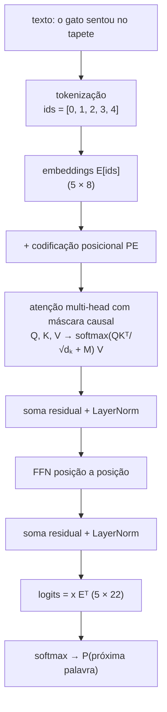

Num modelo real, o bloco do meio (atenção, residual, FFN) se repete dezenas de vezes. O Transformer base do artigo tinha 6 camadas no encoder e 6 no decoder, $d_{model}=512$, 8 cabeças com $d_k=64$ e FFN com 2048 neurônios. O nosso usa uma camada, $d_{model}=8$, 2 cabeças com $d_k=4$ e FFN com 32 neurônios, pequeno o bastante para imprimir todas as matrizes. Os pesos são aleatórios (semente 0). Nas seções 3.1 a 3.9 o objetivo é ver as contas; o significado das previsões só aparece depois do treino (seção 5).

### 3. Exemplo completo: "o gato sentou no tapete"

#### 3.1 Tokenização

O modelo não lê caracteres. O texto é quebrado em tokens e cada token vira um inteiro. Usamos tokenização por palavra sobre um vocabulário de 22 palavras (o do corpus de brinquedo da seção 5):

| token | o | gato | sentou | no | tapete |
| :--- | :---: | :---: | :---: | :---: | :---: |
| id | 0 | 1 | 2 | 3 | 4 |

Modelos reais usam subpalavras, com algoritmos como BPE ou WordPiece, para não ter palavras fora do vocabulário. O GPT-2, por exemplo, tem 50.257 tokens, e uma palavra rara é quebrada em pedaços menores. Para o resto da arquitetura isso não muda nada: a entrada é uma sequência de ids.

#### 3.2 Embeddings

Cada id seleciona uma linha da matriz de embeddings $E$ (22 × 8). No início do treino essas linhas são aleatórias; com o treino, palavras que aparecem em contextos parecidos ficam com vetores parecidos.

| $E[\text{ids}]$ | d0 | d1 | d2 | d3 | d4 | d5 | d6 | d7 |
| :--- | ---: | ---: | ---: | ---: | ---: | ---: | ---: | ---: |
| o | 0,13 | -0,13 | 0,64 | 0,10 | -0,54 | 0,36 | 1,30 | 0,95 |
| gato | -0,70 | -1,27 | -0,62 | 0,04 | -2,33 | -0,22 | -1,25 | -0,73 |
| sentou | -0,54 | -0,32 | 0,41 | 1,04 | -0,13 | 1,37 | -0,67 | 0,35 |
| no | 0,90 | 0,09 | -0,74 | -0,92 | -0,46 | 0,22 | -1,01 | -0,21 |
| tapete | -0,16 | 0,54 | 0,21 | 0,36 | -0,65 | -0,13 | 0,78 | 1,49 |

(O artigo original multiplica os embeddings por $\sqrt{d_{model}}$ antes de somar a posição. Como inicializamos $E$ com variância 1, o efeito é o mesmo e omitimos essa multiplicação.)

#### 3.3 Codificação posicional

A atenção, como veremos, trata a entrada como um conjunto: se trocarmos a ordem das palavras, as saídas só trocam de lugar. Sem alguma informação de posição, "o gato sentou no tapete" e "tapete no sentou gato o" seriam a mesma coisa para o modelo. O notebook confirma isso numericamente (seção 8 do notebook e teste `test_equivariancia_a_permutacao_sem_posicao_e_sem_mascara`).

O artigo original soma a cada embedding um vetor fixo que depende só da posição:

$$PE_{(pos,\,2i)} = \sin\!\left(\frac{pos}{10000^{2i/d_{model}}}\right), \qquad PE_{(pos,\,2i+1)} = \cos\!\left(\frac{pos}{10000^{2i/d_{model}}}\right)$$

Cada par de dimensões é uma senoide com frequência diferente. As primeiras dimensões oscilam rápido e distinguem posições vizinhas; as últimas oscilam devagar e distinguem posições distantes, como os ponteiros de um relógio. Os autores escolheram senoides porque $PE_{pos+k}$ é uma função linear de $PE_{pos}$, o que deveria facilitar ao modelo aprender a atender por posição relativa.

| PE | d0 | d1 | d2 | d3 | d4 | d5 | d6 | d7 |
| :--- | ---: | ---: | ---: | ---: | ---: | ---: | ---: | ---: |
| pos 0 | 0,00 | 1,00 | 0,00 | 1,00 | 0,00 | 1,00 | 0,00 | 1,00 |
| pos 1 | 0,84 | 0,54 | 0,10 | 1,00 | 0,01 | 1,00 | 0,00 | 1,00 |
| pos 2 | 0,91 | -0,42 | 0,20 | 0,98 | 0,02 | 1,00 | 0,00 | 1,00 |
| pos 3 | 0,14 | -0,99 | 0,30 | 0,96 | 0,03 | 1,00 | 0,00 | 1,00 |
| pos 4 | -0,76 | -0,65 | 0,39 | 0,92 | 0,04 | 1,00 | 0,00 | 1,00 |

Na posição 1, por exemplo, $d0 = \sin(1) = 0{,}84$ e $d1 = \cos(1) = 0{,}54$. A figura mostra o padrão para 50 posições e 64 dimensões:

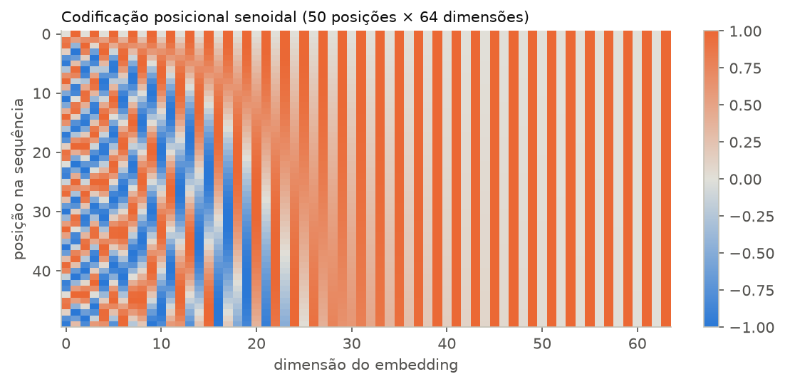

A entrada do bloco é $x_0 = E[\text{ids}] + PE$. Para "tapete" (posição 4), $x_0 = [-0{,}92;\ -0{,}11;\ 0{,}60;\ 1{,}28;\ -0{,}61;\ 0{,}87;\ 0{,}79;\ 2{,}49]$.

Há alternativas. O BERT e o GPT-2 aprendem um vetor de posição para cada índice, como se fosse outro embedding. Muitos LLMs recentes, como a família Llama, usam o **RoPE** (Su et al., 2021), que em vez de somar um vetor gira os pares de coordenadas de $Q$ e $K$ por um ângulo proporcional à posição. Com isso, o produto $q_m \cdot k_n$ passa a depender só da diferença $m-n$, e a posição relativa aparece diretamente no score de atenção.

#### 3.4 Consultas, chaves e valores

A autoatenção começa projetando $x_0$ em três matrizes com pesos aprendidos: $Q = x_0 W_Q$, $K = x_0 W_K$ e $V = x_0 W_V$. Uma forma de pensar nelas: a **consulta** $q_i$ descreve o que o token $i$ está procurando, a **chave** $k_j$ descreve o que o token $j$ oferece, e o **valor** $v_j$ é a informação que $j$ repassa a quem prestar atenção nele. Separar chave e valor permite que o critério para escolher um token seja diferente do conteúdo que ele transmite.

Com 2 cabeças, cada matriz 5 × 8 é dividida em duas de 5 × 4. Na cabeça 1:

| token | $Q$ | $K$ | $V$ |
| :--- | :--- | :--- | :--- |
| o | [0,47; 1,15; -1,77; 1,23] | [-0,33; 0,56; -1,66; 0,09] | [-0,81; -0,09; 1,19; -0,47] |
| gato | [0,31; -2,03; -1,42; -1,49] | [1,29; 1,24; 1,05; 0,07] | [-0,63; 1,34; -1,55; 0,69] |
| sentou | [0,39; -0,53; -2,90; 2,43] | [0,52; 0,57; -1,03; 0,61] | [-0,95; -0,04; -0,41; -1,26] |
| no | [0,00; -0,27; -1,64; -0,08] | [1,15; 0,11; 0,49; -0,02] | [-0,75; 0,84; -0,73; -0,19] |
| tapete | [1,45; 0,67; -1,26; 0,06] | [-0,68; 1,19; -2,03; 0,75] | [-1,50; 1,11; 0,83; -0,40] |

#### 3.5 Scores e o fator $\sqrt{d_k}$

A atenção scaled dot-product é

$$\text{Attention}(Q, K, V) = \text{softmax}\!\left(\frac{QK^T}{\sqrt{d_k}} + M\right) V$$

onde $M$ é a máscara (seção 3.6). O produto $QK^T$ dá uma matriz 5 × 5 em que a entrada $(i, j)$ mede o quanto a consulta de $i$ combina com a chave de $j$. Para a consulta de "tapete" e a chave de "o":

$$q_{tapete} \cdot k_{o} = 1{,}45 \cdot (-0{,}33) + 0{,}67 \cdot 0{,}56 + (-1{,}26)(-1{,}66) + 0{,}06 \cdot 0{,}09 \approx 2{,}00$$

e, dividindo por $\sqrt{d_k} = \sqrt{4} = 2$, o score é 1,00. A matriz completa da cabeça 1:

| consulta \ chave | o | gato | sentou | no | tapete |
| :--- | ---: | ---: | ---: | ---: | ---: |
| o | 1,76 | 0,12 | 1,74 | -0,12 | 2,78 |
| gato | 0,49 | -1,86 | -0,22 | -0,26 | -0,43 |
| sentou | 2,29 | -1,53 | 2,19 | -0,55 | 3,42 |
| no | 1,28 | -1,04 | 0,74 | -0,42 | 1,47 |
| tapete | 1,00 | 0,68 | 1,24 | 0,56 | 1,21 |

A divisão por $\sqrt{d_k}$ tem uma razão estatística. Se as componentes de $q$ e $k$ têm média 0 e variância 1, o produto $q \cdot k = \sum_{i=1}^{d_k} q_i k_i$ é uma soma de $d_k$ termos de variância 1 e tem variância $d_k$. Com $d_k = 64$, como no artigo, os scores teriam desvio padrão 8. A softmax de números tão espalhados fica quase *one-hot*: um token recebe praticamente todo o peso e os demais ficam perto de zero. Nessa região a derivada da softmax é quase nula e o gradiente que chega a $W_Q$ e $W_K$ desaparece. Dividir por $\sqrt{d_k}$ traz a variância de volta para 1 qualquer que seja a dimensão. A seção 4 mede esse efeito.

#### 3.6 Máscara causal

Num decoder, a posição $i$ está tentando prever o token $i+1$. Se ela pudesse olhar para $i+1$, a tarefa ficaria trivial durante o treino e impossível de reproduzir na geração, quando o futuro ainda não existe. A máscara causal soma $-\infty$ a todo score com $j > i$:

$$M_{ij} = \begin{cases} 0 & j \le i \\ -\infty & j > i \end{cases}$$

Como $e^{-\infty} = 0$, esses pares recebem peso exatamente zero depois da softmax. "o" só vê a si mesmo, "gato" vê "o" e "gato", e assim por diante até "tapete", que vê a frase toda.

#### 3.7 Softmax e pesos de atenção

Cada linha dos scores mascarados passa pela softmax, $w_{ij} = e^{s_{ij}} / \sum_{j'} e^{s_{ij'}}$. Para a linha de "tapete" a conta é:

| | o | gato | sentou | no | tapete |
| :--- | ---: | ---: | ---: | ---: | ---: |
| score $s$ | 1,00 | 0,68 | 1,24 | 0,56 | 1,21 |
| $e^{s - \max s}$ | 0,79 | 0,58 | 1,00 | 0,51 | 0,97 |
| peso $w$ (divide pela soma 3,85) | **0,21** | **0,15** | **0,26** | **0,13** | **0,25** |

A saída da cabeça para "tapete" é a média dos valores ponderada por esses pesos:

$$z_{tapete} = 0{,}21\, v_{o} + 0{,}15\, v_{gato} + 0{,}26\, v_{sentou} + 0{,}13\, v_{no} + 0{,}25\, v_{tapete} = [-0{,}98;\ 0{,}57;\ 0{,}02;\ -0{,}45]$$

O notebook refaz essa conta à mão e confere com a saída da função `attention`. A figura mostra as três etapas para a cabeça 1: (a) scores, (b) scores com a máscara e (c) pesos depois da softmax.

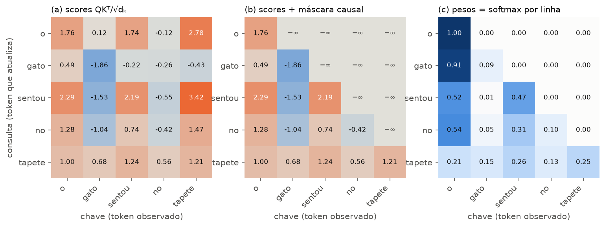

Os pesos da cabeça 1 ficaram assim (cada linha soma 1):

| consulta \ chave | o | gato | sentou | no | tapete |
| :--- | ---: | ---: | ---: | ---: | ---: |
| o | 1,00 | 0 | 0 | 0 | 0 |
| gato | 0,91 | 0,09 | 0 | 0 | 0 |
| sentou | 0,52 | 0,01 | 0,47 | 0 | 0 |
| no | 0,54 | 0,05 | 0,31 | 0,10 | 0 |
| tapete | 0,21 | 0,15 | 0,26 | 0,13 | 0,25 |

Como os pesos são aleatórios, não há interpretação linguística aqui. "gato" pôr 0,91 em "o" é coincidência da inicialização. O que importa é a forma: triangular inferior, linhas somando 1, e a saída de cada posição sendo uma mistura dos valores das posições que ela pode ver.

#### 3.8 Várias cabeças

Uma única cabeça produz uma única distribuição de pesos por posição. Com várias cabeças, cada uma tem suas próprias $W_Q$, $W_K$, $W_V$ e pode aprender um tipo diferente de relação (concordância, vizinho anterior, sujeito do verbo etc.). As saídas das $h$ cabeças são concatenadas e projetadas por $W_O$:

$$\text{MultiHead}(x) = \text{Concat}(\text{head}_1, \dots, \text{head}_h)\, W_O$$

Como cada cabeça trabalha em dimensão $d_{model}/h$, o custo total é parecido com o de uma cabeça só em dimensão cheia. No exemplo, a cabeça 2 distribui o peso de outro jeito: a linha de "tapete" fica [0,12; 0,01; 0,47; 0,12; 0,28], com quase metade em "sentou".

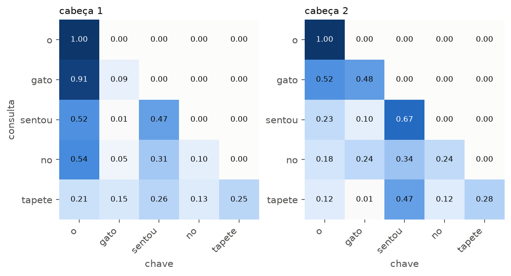

Para "tapete", a concatenação das duas cabeças é $[-0{,}98;\ 0{,}57;\ 0{,}02;\ -0{,}45;\ 1{,}26;\ -0{,}32;\ -0{,}67;\ 0{,}42]$ e, depois de $W_O$, a saída da subcamada de atenção é $[0{,}78;\ -0{,}04;\ -1{,}23;\ 1{,}18;\ -0{,}79;\ -0{,}31;\ -0{,}23;\ 0{,}59]$.

#### 3.9 Conexão residual, LayerNorm e FFN

A saída da atenção é somada à própria entrada (conexão residual, a mesma ideia da ResNet de He et al., 2016). Assim cada camada aprende uma correção sobre a representação anterior, e o gradiente tem um caminho direto até as camadas iniciais. Em seguida vem a **LayerNorm** (Ba, Kiros e Hinton, 2016), que normaliza cada vetor para média 0 e desvio 1 e depois aplica uma escala $\gamma$ e um deslocamento $\beta$ aprendidos:

$$\text{LN}(x) = \gamma \odot \frac{x - \mu}{\sqrt{\sigma^2 + \epsilon}} + \beta$$

Para "tapete": $x_0 + \text{atenção} = [-0{,}14;\ -0{,}15;\ -0{,}63;\ 2{,}46;\ -1{,}40;\ 0{,}56;\ 0{,}56;\ 3{,}09]$, com média 0,54 e desvio 1,42. Depois da LayerNorm (com $\gamma=1$ e $\beta=0$ na inicialização) fica $x_1 = [-0{,}48;\ -0{,}49;\ -0{,}82;\ 1{,}35;\ -1{,}36;\ 0{,}01;\ 0{,}01;\ 1{,}78]$, com média 0 e desvio 1.

A segunda subcamada é a rede feed-forward, aplicada a cada posição separadamente e com os mesmos pesos para todas:

$$\text{FFN}(x) = \max(0,\ xW_1 + b_1)\, W_2 + b_2$$

Ela expande o vetor para $d_{ff}$ dimensões (32 no nosso caso, 2048 no artigo, em geral $4 \times d_{model}$), aplica ReLU e volta para $d_{model}$. A divisão de trabalho costuma ser descrita assim: a atenção move informação entre posições, e a FFN processa a informação dentro de cada posição. BERT e GPT trocaram a ReLU pela GELU. Para "tapete", 17 dos 32 neurônios ficaram ativos, e a saída do bloco depois da segunda soma residual e da segunda LayerNorm é $x_2 = [-1{,}10;\ -0{,}35;\ -0{,}48;\ 0{,}88;\ -1{,}65;\ 1{,}40;\ 0{,}41;\ 0{,}90]$.

O nosso bloco segue o artigo original, que aplica a LayerNorm depois da soma (pós-LN). O GPT-2 passou a LayerNorm para a entrada de cada subcamada (pré-LN), $x + \text{Subcamada}(\text{LN}(x))$, o que deixa o treino de modelos profundos mais estável. Hoje essa é a escolha mais comum.

#### 3.10 Projeção para o vocabulário e softmax

O último passo transforma $x_2$ em uma distribuição sobre as 22 palavras. Multiplicamos por $E^T$, a transposta da própria matriz de embeddings (o artigo também compartilha esses pesos), e obtemos um *logit* por palavra. A softmax converte os logits em probabilidades. A linha de cada posição é a previsão do token seguinte:

| após | 1ª mais provável | 2ª | 3ª |
| :--- | :--- | :--- | :--- |
| "o" | cama 0,314 | sofá 0,199 | cachorro 0,179 |
| "gato" | cama 0,756 | gato 0,113 | cachorro 0,061 |
| "tapete" | cama 0,255 | gato 0,144 | gata 0,142 |

Com pesos aleatórios a previsão é lixo, como esperado: após "o gato" o modelo aposta em "cama". O mecanismo, porém, já está completo. Treinar significa ajustar $E$, $W_Q$, $W_K$, $W_V$, $W_O$, $W_1$, $W_2$, $\gamma$ e $\beta$ até que essas distribuições concentrem probabilidade nas palavras certas.

### 4. Experimento: o efeito de $\sqrt{d_k}$

Para medir o argumento da seção 3.5, sorteamos 2000 vezes uma consulta e 8 chaves com componentes $\mathcal{N}(0, 1)$ e calculamos a softmax dos scores com e sem a divisão por $\sqrt{d_k}$. A norma do jacobiano da softmax, $\lVert \text{diag}(w) - ww^T \rVert$, indica quanto gradiente consegue passar por ela.

| $d_k$ | desvio dos scores (sem / com) | peso máximo médio (sem / com) | entropia média (sem / com) | norma do jacobiano (sem / com) |
| ---: | :---: | :---: | :---: | :---: |
| 4 | 2,00 / 1,00 | 0,52 / 0,34 | 1,29 / 1,75 | 0,34 / 0,36 |
| 16 | 4,03 / 1,01 | 0,75 / 0,36 | 0,67 / 1,73 | 0,25 / 0,36 |
| 64 | 8,01 / 1,00 | 0,87 / 0,36 | 0,32 / 1,73 | 0,15 / 0,37 |
| 256 | 15,87 / 0,99 | 0,94 / 0,36 | 0,15 / 1,73 | 0,08 / 0,37 |
| 1024 | 31,85 / 1,00 | 0,97 / 0,36 | 0,08 / 1,72 | 0,04 / 0,37 |

O desvio padrão dos scores sem escala cresce como $\sqrt{d_k}$ (2, 4, 8, 16, 32), como previsto. Com $d_k = 64$ o maior peso já leva 87% da atenção, a entropia cai para 0,32 (o máximo com 8 chaves é $\ln 8 = 2{,}08$) e a norma do jacobiano é menos da metade do valor com escala. Em $d_k = 1024$ a softmax é praticamente um *argmax* e passa 9 vezes menos gradiente. Com a divisão, as quatro medidas ficam constantes, independentemente da dimensão.

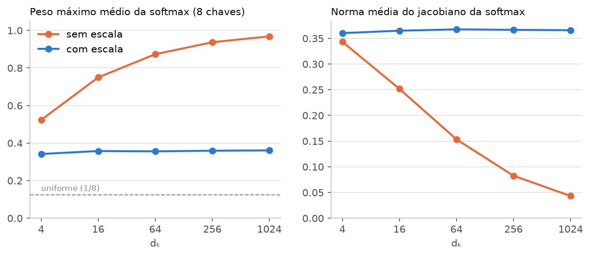

### 5. Treinamento

#### 5.1 Objetivos

Um modelo decoder-only é treinado para **prever a próxima palavra**. Para uma frase $t_1, \dots, t_n$, a perda é a entropia cruzada média $-\frac{1}{n-1}\sum_i \log P(t_{i+1} \mid t_1, \dots, t_i)$. A máscara causal permite calcular as $n-1$ previsões numa única passada, porque cada posição só enxerga o que veio antes dela. Durante o treino, a entrada de cada posição é o prefixo verdadeiro do texto, e não o que o modelo teria gerado; isso é o *teacher forcing*. Não é preciso rótulo humano: qualquer texto serve como dado de treino, e é isso que permite treinar em corpora enormes.

O BERT (Devlin et al., 2019), que é só encoder, usa outro objetivo, o **modelo de linguagem mascarado** (MLM): 15% dos tokens da entrada são escolhidos, a maioria deles é trocada por `[MASK]`, e o modelo precisa recuperá-los usando o contexto dos dois lados. Isso produz boas representações para classificação e extração, mas o modelo não gera texto da esquerda para a direita. O Transformer original, encoder-decoder, era treinado com pares de frases traduzidas, prevendo a próxima palavra da tradução dado o texto de origem.

#### 5.2 Experimento: a atenção aprendendo a achar o sujeito

Para ver a atenção aprender algo interpretável, montamos um corpus de 96 frases com o molde

> [o gato | a gata | o cachorro | a cadela | o menino | a menina] [sentou | deitou] [no tapete | no sofá | na cadeira | na cama] e depois [ele | ela] [dormiu | saiu]

O pronome depende do gênero do sujeito, que está cinco palavras antes de "depois". As palavras mais próximas, "no/na" e o lugar, também têm gênero, mas variam independentemente do sujeito; quem copiar o gênero delas acerta só metade das vezes. Separamos 72 frases para treino e 24 para teste.

O modelo é uma versão reduzida do bloco da seção 3: uma camada, uma cabeça, $d = 16$, codificação posicional senoidal, máscara causal e conexão residual, sem FFN e sem LayerNorm. Tiramos essas duas peças para poder escrever o gradiente à mão em `treino.py`, em cerca de 20 linhas. O teste `test_gradiente_manual_bate_com_diferencas_finitas` confere esse gradiente contra derivadas numéricas para todos os parâmetros. O otimizador é o Adam, com 1500 passos em lote completo.

Dá para calcular a menor perda possível nesse corpus. Depois do artigo há 3 substantivos possíveis ($\ln 3$); depois do substantivo, do verbo, de "no/na" e do pronome há 2 opções equiprováveis ($\ln 2$ cada); o resto é determinístico. Isso dá $(\ln 3 + 4 \ln 2)/8 \approx 0{,}48$ por posição. Um modelo que não descobriu o pronome perde mais $\ln 2/8$ e fica em 0,57.

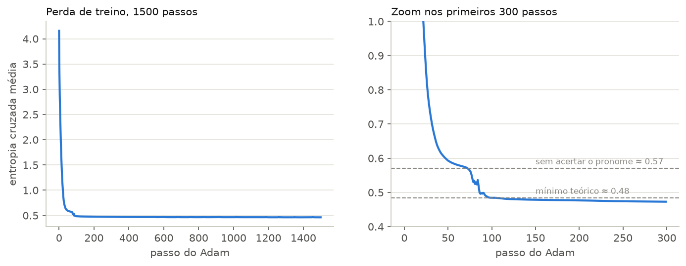

A curva tem dois degraus. Nos primeiros 60 passos o modelo aprende o que dá para aprender olhando só a palavra atual (depois de "e" vem "depois", depois de "tapete" vem "e") e para num platô perto de 0,57. Por volta do passo 80 a perda cai de novo para o mínimo de 0,48. É nesse momento que a atenção aprende a buscar o sujeito. Os números da semente 0:

| | antes do treino | depois do treino |
| :--- | :---: | :---: |
| perda de treino | 4,16 | 0,46 |
| acurácia do pronome (treino) | 50% | 100% |
| acurácia do pronome (teste) | 50% | 100% |
| peso da posição "depois" sobre o artigo "o/a" | 0,18 | 0,58 |
| peso da posição "depois" sobre si mesma | 0,06 | 0,41 |

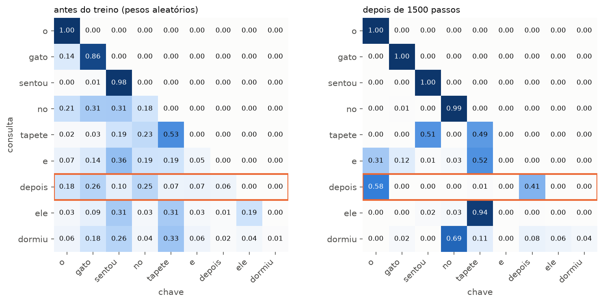

Na figura, a linha destacada é a da consulta "depois". Antes do treino o peso está espalhado (0,18; 0,26; 0,10; 0,25; ...). Depois, 58% vai para o artigo "o", que carrega o gênero do sujeito, e quase todo o resto fica na própria posição. "no" e "tapete", os distratores com gênero, recebem 0 e 0,01. Nas 24 frases de teste, nunca vistas no treino, o modelo põe probabilidade acima de 0,99 no pronome certo em todas. Na geração gulosa, partindo de "a cadela deitou no sofá e depois", o modelo completa com "ela saiu"; partindo de "o menino sentou na cama e depois", com "ele dormiu".

Nas outras linhas, as quatro primeiras posições olham para si mesmas, porque a palavra atual basta para prever a seguinte. As linhas "ele" e "dormiu" têm pesos concentrados em "tapete" e "no", mas isso não significa nada: depois de "ele" vem "dormiu" ou "saiu" com 50% de chance qualquer que seja o contexto, e depois de "dormiu" a frase acaba, então a perda não orienta essas linhas.

#### 5.3 O que o experimento não mostra

Repetimos o treino com 10 sementes diferentes:

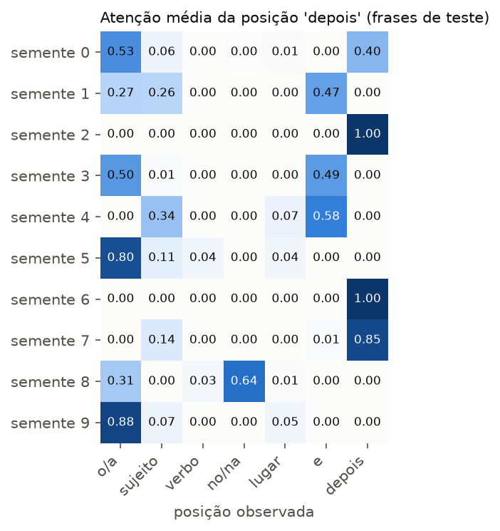

Sete sementes chegam a 100% no teste. Duas (2 e 6) ficam presas num mínimo local em que a posição "depois" olha só para si mesma, com perda 0,55 e acurácia de 50%, ou seja, chute. A semente 7 chega a 75%. Entre as que funcionam, o lugar para onde a atenção olha varia: o artigo (sementes 0, 3, 5, 9), o substantivo (semente 4) ou os dois (semente 1). Várias delas também põem quase metade do peso em "e", uma posição que não carrega gênero, e funciona como uma espécie de "lugar neutro" para estacionar atenção.

O caso mais curioso é a semente 8. Ela acerta 100% mesmo pondo 0,64 do peso em "no/na", justamente o distrator. Os 0,31 que vão para o artigo bastam porque $W_V$, $W_O$ e a matriz de saída podem simplesmente ignorar a direção do espaço em que "no/na" codifica gênero. Peso de atenção alto não quer dizer que aquela posição está sendo usada, e é por isso que a literatura recomenda cuidado ao ler mapas de atenção como explicação (Jain e Wallace, 2019).

Há outras limitações. O modelo treinado não tem FFN nem LayerNorm e tem uma só camada e uma só cabeça. O corpus é artificial e minúsculo, e a perda de teste (0,83) fica bem acima da de treino (0,46): nas posições em que a resposta é aleatória (qual verbo segue cada sujeito, por exemplo), o modelo se ajustou às frequências das 72 frases de treino, que não são exatamente as do teste. Isso não afeta o pronome, mas mostra que o modelo está longe de generalizar como um modelo de linguagem de verdade. O experimento serve para mostrar o mecanismo: com gradiente e uma perda de próxima palavra, as matrizes $W_Q$ e $W_K$ se ajustam para que a consulta de uma posição encontre a chave que tem a informação de que ela precisa.

### 6. Inferência: gerando texto

Depois de treinado, o modelo gera texto de forma **autorregressiva**. Ele recebe o prompt, calcula a distribuição da próxima palavra na última posição, escolhe um token, acrescenta esse token à entrada e repete. A escolha pode ser gulosa (sempre o mais provável, como no nosso `generate`) ou por amostragem, com temperatura ou restrita aos $k$ tokens mais prováveis (*top-k*) ou ao menor conjunto que soma probabilidade $p$ (*top-p*). A amostragem dá respostas mais variadas, e a escolha gulosa é determinística mas tende a repetir trechos.

Recalcular a frase inteira a cada token novo seria um desperdício. Com a máscara causal, a chegada de um token no fim não altera as representações das posições anteriores, então as chaves e os valores delas podem ser guardados. Essa é a ideia do **KV cache**, discutida na Questão 5 (`docs/q05_inferencia_llm.md`): na fase de *prefill* o modelo processa o prompt inteiro de uma vez e preenche o cache, e na fase de *decode* cada passo calcula $q$, $k$ e $v$ só do token novo e faz a atenção dele contra as chaves e os valores guardados. O notebook verifica as duas propriedades com o exemplo. A saída do prefixo "o gato sentou no" é idêntica com ou sem "tapete" no fim, e a atenção de "tapete" calculada com 4 linhas de K e V em cache mais a linha nova é igual à da passada completa (`np.allclose` dá `True` nos dois casos). O teste `test_mudar_o_futuro_nao_muda_o_passado` cobre o mesmo ponto.

### 7. Custo computacional

A matriz de scores tem $n \times n$ entradas. Para uma sequência de $n$ tokens, a autoatenção custa $O(n^2 \cdot d)$ em tempo e $O(n^2)$ em memória para os pesos. O artigo original compara isso com uma camada recorrente, que custa $O(n \cdot d^2)$ mas exige $O(n)$ passos sequenciais, contra $O(1)$ da autoatenção. Quando $n$ é menor que $d$, que era o caso típico em tradução de frases, a atenção é até mais barata, além de paralelizável. Com contextos de dezenas de milhares de tokens, o termo $n^2$ domina: dobrar o contexto quadruplica a matriz de atenção. Na geração com KV cache, cada token novo custa $O(n \cdot d)$ por camada, mas o cache ocupa memória proporcional a $n$ multiplicado pelo número de camadas e de cabeças, e é ele que costuma limitar quantas requisições cabem numa GPU (de novo, a Questão 5).

Há várias linhas de trabalho para contornar o custo quadrático. A atenção esparsa (Child et al., 2019) e o Longformer (Beltagy, Peters e Cohan, 2020) restringem cada token a olhar uma janela local e algumas posições globais. O FlashAttention (Dao et al., 2022) calcula a atenção exata, mas em blocos que cabem na memória rápida da GPU, sem materializar a matriz $n \times n$ inteira, o que reduz a memória para linear em $n$ e acelera bastante na prática, embora o número de operações continue quadrático.

### 8. Variantes e usos

A arquitetura se espalhou além do texto. Os principais ramos:

- **Só encoder**, como o BERT: bom para tarefas em que a entrada inteira está disponível, como classificação de sentimento, reconhecimento de entidades e busca semântica.
- **Só decoder**, como o GPT-2 (Radford et al., 2019) e seus sucessores: o mesmo bloco da seção 3 empilhado dezenas de vezes e treinado com a perda de próxima palavra. Com escala suficiente, um modelo desse tipo resolve tarefas variadas só a partir de instruções no prompt, e é a base dos LLMs de chat.
- **Encoder-decoder**, como o Transformer original e o T5 (Raffel et al., 2020): continua comum em tradução e sumarização.
- **Outras modalidades**: o Vision Transformer (Dosovitskiy et al., 2021) corta a imagem em blocos de 16 × 16 pixels e trata cada bloco como um token.

### 9. Considerações finais

Acompanhando "o gato sentou no tapete" pelo código, o Transformer se resume a poucas operações: somar posição ao embedding, comparar consultas com chaves por produto escalar, normalizar com softmax, misturar valores, somar o resultado à entrada e passar por uma rede pequena aplicada a cada posição. A divisão por $\sqrt{d_k}$ mantém a softmax longe da saturação, como o experimento da seção 4 mostrou, e a máscara causal permite treinar todas as posições em paralelo e, na geração, reaproveitar o KV cache. O treino minúsculo mostrou que uma única cabeça aprende a buscar o sujeito a cinco palavras de distância e a ignorar distratores. Também mostrou que o resultado depende da inicialização e que o peso de atenção nem sempre diz qual posição o modelo está de fato usando.

### Referências (Q13)

1. VASWANI, A. et al. Attention Is All You Need. In: *Advances in Neural Information Processing Systems 30 (NeurIPS)*, 2017.
2. IMPLEMENTITATAI. *Encoders vs Decoders Explained: How Transformers Really Work (With Real Attention Math)*. YouTube. Disponível em: https://youtu.be/bVVm68KTD2M. Acesso em: 7 nov. 2026.
3. ALAMMAR, J. *The Illustrated Transformer*. 2018. Disponível em: https://jalammar.github.io/illustrated-transformer/.
4. BAHDANAU, D.; CHO, K.; BENGIO, Y. Neural Machine Translation by Jointly Learning to Align and Translate. In: *ICLR*, 2015.
5. SUTSKEVER, I.; VINYALS, O.; LE, Q. V. Sequence to Sequence Learning with Neural Networks. In: *NeurIPS*, 2014.
6. HOCHREITER, S.; SCHMIDHUBER, J. Long Short-Term Memory. *Neural Computation*, v. 9, n. 8, 1997.
7. DEVLIN, J. et al. BERT: Pre-training of Deep Bidirectional Transformers for Language Understanding. In: *NAACL-HLT*, 2019.
8. RADFORD, A. et al. *Language Models are Unsupervised Multitask Learners*. OpenAI, 2019 (GPT-2).
9. BA, J. L.; KIROS, J. R.; HINTON, G. E. Layer Normalization. arXiv:1607.06450, 2016.
10. HE, K. et al. Deep Residual Learning for Image Recognition. In: *CVPR*, 2016.
11. SU, J. et al. RoFormer: Enhanced Transformer with Rotary Position Embedding. arXiv:2104.09864, 2021.
12. RAFFEL, C. et al. Exploring the Limits of Transfer Learning with a Unified Text-to-Text Transformer. *Journal of Machine Learning Research*, v. 21, 2020 (T5).
13. DOSOVITSKIY, A. et al. An Image is Worth 16x16 Words: Transformers for Image Recognition at Scale. In: *ICLR*, 2021.
14. CHILD, R. et al. Generating Long Sequences with Sparse Transformers. arXiv:1904.10509, 2019.
15. BELTAGY, I.; PETERS, M. E.; COHAN, A. Longformer: The Long-Document Transformer. arXiv:2004.05150, 2020.
16. DAO, T. et al. FlashAttention: Fast and Memory-Efficient Exact Attention with IO-Awareness. In: *NeurIPS*, 2022.
17. JAIN, S.; WALLACE, B. C. Attention is not Explanation. In: *NAACL-HLT*, 2019.
18. RUSSELL, S. J.; NORVIG, P. *Inteligência Artificial*. 3. ed. Rio de Janeiro: Elsevier, 2013.

---

## Questão 14: Grafos de conhecimento: representação, inferência e aprendizagem

Na Questão 1 comparamos ontologias e grafos de conhecimento (KGs): hipótese de mundo aberto e fechado, raciocinadores de Lógica de Descrição, grafos de propriedades no Neo4j e o mapeamento de OWL para LPG. Esta questão parte dali e entra nos mecanismos. Primeiro, como um KG representa fatos, esquema, identidade e contexto. Depois, as duas famílias de inferência que convivem nesses sistemas: a dedutiva, que tira conclusões garantidas a partir de axiomas e regras, e a indutiva, que aprende padrões estatísticos do grafo e propõe fatos prováveis. Em seguida comentamos uma aplicação real (Hetionet, usado para reposicionamento de fármacos) e mostramos a aplicação que implementamos, um KG sobre arboviroses no Brasil com materialização RDFS/OWL, consultas SPARQL e Cypher e embeddings TransE.

Código e experimentos: `src/q14_knowledge_graph/` (notebook `q14_knowledge_graph.ipynb`).

### 1. Representação de conhecimento em KGs

Hogan et al. (2021) definem um grafo de conhecimento como um grafo de dados que acumula e transmite conhecimento do mundo real, em que os nós representam entidades e as arestas representam relações entre elas. A definição é propositalmente ampla. Na prática, dois modelos de dados dominam.

#### 1.1 Triplas RDF e grafos de propriedades

No RDF, todo fato é uma tripla `(sujeito, predicado, objeto)`. Sujeitos e predicados são IRIs, identificadores globais; o objeto pode ser outra IRI ou um literal (texto, número, data). Um conjunto de triplas forma um grafo dirigido e rotulado. Em Turtle, o fato "a dengue é causada pelo DENV" fica assim:

```turtle
@prefix arbo: <https://example.org/arbo#> .
arbo:Dengue arbo:causadaPor arbo:DENV ;
            rdfs:label "Dengue"@pt .
```

O modelo é mínimo e uniforme: o próprio esquema (classes, propriedades, axiomas) também é escrito em triplas, e por isso dados e esquema podem ser consultados juntos com SPARQL.

No grafo de propriedades (LPG), usado pelo Neo4j, nós e arestas têm rótulos e carregam pares chave-valor. Uma aresta pode ter atributos próprios, o que no RDF clássico exige um recurso intermediário. Em compensação, o LPG não tem identificadores globais nem uma semântica formal padronizada para o esquema; quem garante o significado é a aplicação.

#### 1.2 Esquema e ontologia

Um KG pode existir sem esquema, mas quase sempre tem algum. O RDFS oferece o mínimo: `rdfs:subClassOf`, `rdfs:subPropertyOf`, `rdfs:domain` e `rdfs:range`. O OWL 2 acrescenta características de propriedades (inversa, transitiva, simétrica, funcional), cadeias de propriedades, equivalência, disjunção e restrições de classe. O perfil OWL 2 RL foi desenhado para ser implementado por regras, com raciocínio em tempo polinomial no tamanho dos dados, e é o fragmento que usamos na implementação.

Há um ponto que costuma confundir. Domínio e alcance em RDFS não são restrições de validação; são regras de inferência. Se `temVetor` tem alcance `Vetor` e alguém escreve `DENV temVetor AedesAegypti`, o raciocinador conclui que *Aedes aegypti* é um `Vetor`. Ele não acusa erro. Para validar dados contra um formato esperado, o W3C padronizou o SHACL (2017), que lê o grafo em mundo fechado e devolve violações.

#### 1.3 Identidade de entidades

Como o RDF não assume nomes únicos, a mesma entidade pode aparecer com IRIs diferentes em fontes diferentes. O `owl:sameAs` declara que duas IRIs denotam o mesmo indivíduo, e a partir daí tudo o que se diz de uma vale para a outra. Em KGs grandes, decidir quando dois registros são a mesma entidade (*entity resolution*) é um problema em si, resolvido com regras, similaridade de atributos ou aprendizado. O Wikidata atribui a cada item um identificador estável (Q-ID) e mantém propriedades que ligam o item a identificadores externos, o que facilita a integração com outras bases (Vrandečić; Krötzsch, 2014).

#### 1.4 Contexto, qualificadores e reificação

Muitos fatos só são verdadeiros com contexto: desde quando, segundo qual fonte, com que confiança. No nosso grafo, "a febre do Nilo Ocidental ocorre no Piauí" ganha sentido com o qualificador "primeiro caso humano em 2014". Há quatro formas comuns de representar isso:

1. Reificação RDF: cria-se um recurso do tipo `rdf:Statement` com `rdf:subject`, `rdf:predicate` e `rdf:object`, e os qualificadores ficam nesse recurso. Funciona, mas quadruplica o número de triplas e separa o qualificador do fato.
2. Relações n-árias: o fato vira um nó (por exemplo, um "registro de ocorrência") ligado à doença, ao lugar e ao ano.
3. Grafos nomeados: o fato fica num grafo identificado por uma IRI, e os metadados descrevem esse grafo. É a solução usual para procedência.
4. RDF-star: permite usar uma tripla como sujeito de outra, `<< arbo:FebreDoNiloOcidental arbo:ocorreEm arbo:Piaui >> arbo:primeiroCasoHumano 2014 .` A proposta deu origem ao trabalho do W3C no RDF 1.2.

O Wikidata usa um modelo próprio de *statements* com qualificadores e referências, e o LPG resolve o caso direto com propriedades na aresta. No nosso script Cypher o qualificador é só `SET r.primeiroCasoHumano = 2014`.

### 2. Inferência em grafos de conhecimento

#### 2.1 Inferência dedutiva

A inferência dedutiva tira do grafo conclusões que valem em todo modelo que satisfaz os axiomas. Para RDFS e OWL 2 RL, ela se escreve como regras do tipo Datalog. Exemplos, na notação das especificações:

- rdfs9: se `C subClassOf D` e `x type C`, então `x type D`;
- prp-trp: se `p` é transitiva, `x p y` e `y p z`, então `x p z`;
- prp-spo2 (cadeia): se `p ≡ p1 ∘ p2`, `x p1 y` e `y p2 z`, então `x p z`.

Há duas maneiras de usar essas regras. Na materialização (encadeamento para frente), aplicam-se as regras até que nada novo apareça, o chamado ponto fixo, e o fecho fica armazenado. As consultas ficam simples e rápidas, ao custo de espaço e de manutenção quando os dados mudam. Na reescrita de consultas (encadeamento para trás), a consulta é expandida para cobrir o que as regras implicariam. Em SPARQL 1.1 os *property paths* fazem parte desse trabalho: `?x rdf:type/rdfs:subClassOf* arbo:Inseto` encontra instâncias de qualquer subclasse de `Inseto` sem materializar nada. O Wikidata Query Service depende desse padrão (`wdt:P31/wdt:P279*`) porque a base não é materializada.

Regras do domínio entram no mesmo mecanismo. Podem ser escritas em SWRL, como regras SHACL ou, como fizemos, como consultas SPARQL `CONSTRUCT` cujo resultado é adicionado ao grafo. A única exigência para que o ponto fixo seja único é que as regras sejam monotônicas: nenhuma conclusão pode depender da ausência de um fato. Uma regra com `FILTER NOT EXISTS` quebra essa garantia, porque o resultado passa a depender da ordem de aplicação.

Consultas de caminho também são uma forma de inferência sobre a estrutura: caminho mais curto, alcançabilidade e padrões de caminho de tamanho variável (`[:PARTE_DE*0..]` em Cypher). Elas não têm a semântica formal do OWL, mas respondem perguntas como "por quais entidades a febre do Nilo Ocidental se liga ao Oropouche?".

#### 2.2 Inferência indutiva: previsão de links

Todo KG real é incompleto. A dedução só explicita o que já estava implícito nos axiomas; se o grafo não diz qual é o vetor de um vírus, nenhuma regra vai descobrir. A inferência indutiva aprende regularidades das triplas conhecidas e atribui um escore de plausibilidade a triplas candidatas. A tarefa padrão é a previsão de links: dada a consulta `(h, r, ?)`, ordenar todas as entidades pela plausibilidade de completar a tripla.

A avaliação usual retira um conjunto de triplas de teste e mede o posto da resposta certa. O MRR é a média de `1/posto`, e Hits@k é a fração de consultas em que a resposta certa ficou entre as k primeiras. No protocolo filtrado, outras respostas verdadeiras conhecidas saem da disputa antes de calcular o posto. Dois cuidados aparecem na literatura. Toutanova e Chen (2015) e Dettmers et al. (2018) mostraram que os conjuntos FB15k e WN18 vazavam informação: muitas triplas de teste tinham a inversa no treino, e um modelo trivial já ia bem. E Ali et al. (2021) discutem como tratar empates no posto, porque a escolha otimista infla resultados de modelos que dão o mesmo escore a muitas candidatas.

#### 2.3 Regras aprendidas

Entre os dois extremos está a mineração de regras. O AMIE (Galárraga et al., 2013) busca regras de Horn como `casadoCom(x, y) ∧ moraEm(y, z) ⇒ moraEm(x, z)` e mede sua confiança sob uma hipótese de completude parcial, adequada a KGs incompletos. O AnyBURL (Meilicke et al., 2019) amostra caminhos do grafo para gerar regras rapidamente, e o Neural LP (Yang; Yang; Cohen, 2017) aprende regras de forma diferenciável. As regras aprendidas são induzidas dos dados, mas depois de aceitas podem ser aplicadas dedutivamente, e cada previsão vem com a regra que a justifica.

### 3. Aprendizagem em grafos de conhecimento

#### 3.1 Embeddings

Os modelos de embedding representam entidades e relações como vetores e definem uma função de escore.

| Modelo | Escore de `(h, r, t)` | O que consegue modelar |
| --- | --- | --- |
| TransE (Bordes et al., 2013) | `-‖h + r - t‖` | composição e inversão; falha em simetria e em relações 1-N e N-1 |
| DistMult (Yang et al., 2015) | `⟨h, r, t⟩` (produto trilinear) | só relações simétricas, porque o escore é igual nos dois sentidos |
| ComplEx (Trouillon et al., 2016) | `Re⟨h, r, conj(t)⟩` em ℂ | simetria e antissimetria |
| RotatE (Sun et al., 2019) | `-‖h ∘ r - t‖` com `|rᵢ| = 1` em ℂ | simetria, antissimetria, inversão e composição |

O TransE trata cada relação como uma translação: espera-se `h + r ≈ t`. A ideia é simples e tem consequências geométricas claras. Se uma doença tem oito sintomas, os oito precisam ficar perto do mesmo ponto `h + r`. Se `r` é simétrica, `h + r ≈ t` e `t + r ≈ h` só valem juntas com `r ≈ 0`. O RotatE troca a translação por uma rotação no plano complexo, e uma rotação de 180° é sua própria inversa, o que resolve a simetria.

O treino usa amostragem negativa: corrompe-se a cabeça ou a cauda de uma tripla verdadeira e minimiza-se uma perda que separa o escore da tripla positiva do da negativa. Como o KG está em mundo aberto, uma tripla "negativa" pode ser verdadeira e só estar ausente, e esse ruído faz parte do método.

#### 3.2 Redes neurais em grafos

As GNNs calculam a representação de um nó agregando as mensagens dos vizinhos, camada por camada. O R-GCN (Schlichtkrull et al., 2018) usa pesos diferentes para cada tipo de relação e foi proposto para KGs, tanto para classificar entidades quanto, com um decodificador como o DistMult, para prever links. A vantagem sobre embeddings rasos é que a representação depende da vizinhança, e por isso pode generalizar para entidades que apareceram depois do treino.

#### 3.3 Completação e construção de KGs

A completação de KG combina as peças anteriores: embeddings, GNNs ou regras propõem triplas candidatas, que são aceitas por limiar ou passam por curadoria. A construção a partir de texto encadeia reconhecimento de entidades, ligação a entidades do KG (*entity linking*) e extração de relações. A supervisão distante (Mintz et al., 2009) usa o próprio KG para rotular frases automaticamente: toda frase que cita duas entidades relacionadas no KG vira exemplo positivo daquela relação. Rotmensch et al. (2017) construíram um KG de saúde ligando doenças e sintomas a partir de prontuários eletrônicos. Modelos de linguagem passaram a ser usados como extratores, e a saída deles precisa da mesma validação que qualquer extração automática.

O survey de Ji et al. (2022) organiza essas linhas em representação, aquisição (completação, extração) e aplicações.

### 4. Aplicação real: Hetionet e o reposicionamento de fármacos

Hetionet (Himmelstein et al., 2017) é um KG biomédico heterogêneo que integra dezenas de bases públicas. Os nós são de onze tipos (compostos, doenças, genes, anatomia, processos biológicos, efeitos colaterais, entre outros) e as arestas, de 24 tipos, como `Compound–binds–Gene`, `Gene–associates–Disease` e `Compound–treats–Disease`. O grafo tem dezenas de milhares de nós e mais de dois milhões de arestas.

A pergunta do projeto (chamado Rephetio) era quais compostos já aprovados poderiam tratar doenças para as quais não são indicados. A inferência foi feita sobre caminhos tipados, os metacaminhos. Um exemplo é `Compound–binds–Gene–associates–Disease`: um composto que se liga a genes associados a uma doença tem alguma evidência de efeito sobre ela. Para cada par (composto, doença), os autores contaram os caminhos de cada metacaminho, com pesos que reduzem a influência de nós muito conectados (o DWPC, *degree-weighted path count*). Essas contagens viraram atributos de uma regressão logística treinada com as indicações conhecidas, e o modelo atribuiu a cada par uma probabilidade de tratamento. As previsões foram comparadas com indicações em ensaios clínicos que não estavam no treino.

O caso mostra as duas inferências trabalhando juntas. O esquema tipado e as consultas de caminho são a parte estrutural; a regressão sobre contagens de caminhos é a parte indutiva. A explicação de cada previsão também sai do grafo: os metacaminhos com maior peso indicam por que o modelo associa aquele composto àquela doença, e um farmacologista consegue conferir os genes envolvidos.

O Google Knowledge Graph, anunciado em 2012 com o lema "things, not strings" (Singhal, 2012), segue a mesma lógica em outra escala. A busca reconhece que o texto da consulta se refere a uma entidade e o painel lateral mostra fatos dessa entidade e de entidades ligadas. Os detalhes de como o Google infere fatos novos não foram publicados com o mesmo nível de detalhe do Hetionet. O Wikidata, ao contrário, é aberto: a inferência mais comum ali é a consulta com caminhos sobre `P31` (instância de) e `P279` (subclasse de), e as restrições de propriedades apontam inconsistências para os editores.

### 5. A aplicação da dupla: KG de arboviroses

#### 5.1 Domínio e modelagem

Escolhemos as arboviroses porque o domínio tem estrutura que gera inferência interessante: taxonomia viral com vários níveis, vetores com papéis principais e secundários, sintomas compartilhados entre doenças e uma geografia hierárquica (município, estado, região, país). As sete doenças são dengue, Zika, chikungunya, febre amarela, Oropouche, Mayaro e Nilo Ocidental. Os fatos são uma simplificação didática, montada pela dupla a partir do conhecimento corrente sobre essas doenças, e não servem para decisão clínica.

O grafo assertado tem 381 triplas: 120 de esquema (30 classes, 20 propriedades de objeto, axiomas OWL), 78 rótulos, 26 tipos declarados, 156 fatos relacionais entre os 78 indivíduos e um `owl:sameAs`. Os fatos mais frequentes são `temSintoma` (46), `ocorreEm` (17), `diagnosticadaPor` (16) e `podeEvoluirPara` (12).

Tomamos uma decisão de modelagem que define o resto do experimento: as classes de papel (`Vetor`, `Arbovirus`, `Arbovirose`) não aparecem nos dados. *Aedes aegypti* está declarado como `Mosquito`, que é subclasse de `Inseto`. Ele só passa a ser `Vetor` porque aparece no alcance de `temVetor`. Isso reflete o domínio: nem todo mosquito transmite vírus, e ser vetor é uma relação com um patógeno.

Os axiomas OWL usados são:

- inversas: `causadaPor`/`causa` e `temVetor`/`vetorDe`;
- transitivas: `pertenceATaxon` (vírus, gênero, família) e `parteDe` (Maceió, Alagoas, Nordeste, Brasil, América do Sul);
- simétrica: `diagnosticoDiferencialCom`;
- cadeias: `transmitidaPor ≡ causadaPor ∘ temVetor` e `ocorreEm ∘ parteDe ⊑ ocorreEm`;
- subpropriedades: `vetorPrincipal` e `vetorSecundario` de `temVetor`; `temSintoma` e `podeEvoluirPara` de `temManifestacao`; `temVacina` de `prevenidaPor`.

Duas regras do domínio foram escritas como SPARQL `CONSTRUCT`. A R1 diz que uma medida que combate o vetor principal de um vírus previne a doença causada por ele. Restringimos ao vetor principal de propósito: *Aedes aegypti* é vetor secundário da febre amarela (o ciclo urbano), e não queríamos concluir que eliminar criadouros urbanos previne a forma silvestre. A R2 coloca no diagnóstico diferencial duas arboviroses que compartilham pelo menos cinco sintomas. As duas são monotônicas.

Para testar identidade, o gênero do vírus chikungunya só aparece numa "fonte B" que usa outra IRI (`arbo:VirusChikungunya owl:sameAs arbo:CHIKV`).

#### 5.2 Inferência dedutiva

A função `materializar` aplica as 13 regras em laço até o ponto fixo e registra qual regra derivou cada tripla nova. Foram quatro iterações (+214, +118, +10, +21) e o grafo passou de 381 para 744 triplas. Os fatos relacionais entre indivíduos passaram de 156 para 338. Reaplicar o procedimento sobre o fecho acrescenta 0 triplas, e inverter a ordem das regras produz o mesmo fecho; os dois casos estão nos testes.

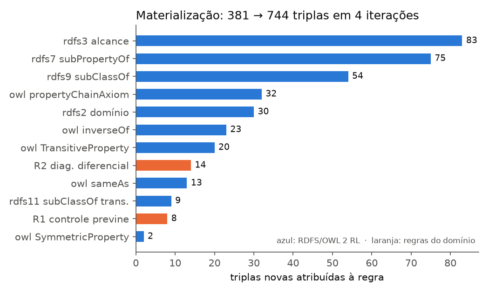

O alcance (83 triplas) e a herança de subpropriedades (75) dominam, o que é esperado num esquema em que os tipos vêm quase todos de domínio e alcance. A cadeia de propriedades gerou 32 triplas: 14 de `transmitidaPor` e 18 de `ocorreEm` herdado das regiões maiores. As 14 triplas da R2 só aparecem na quarta iteração, porque a regra exige que as doenças já estejam tipadas como `Arbovirose`, e esse tipo vem da cadeia seguida do domínio de `transmitidaPor` (terceira iteração).

Para conferir a implementação, rodamos o `owlrl` (implementação de OWL 2 RL em Python) sobre o mesmo grafo, sem R1 e R2. Restritos ao vocabulário do domínio e sem as triplas reflexivas que o `owlrl` também gera (`C subClassOf C`, `x sameAs x`), os dois fechos têm 550 triplas e são idênticos.

A tabela mostra consultas SPARQL escritas por quem conhece só o esquema.

| Consulta | Grafo assertado | Grafo materializado | Respostas depois da inferência |
| --- | ---: | ---: | --- |
| C1 arboviroses | 0 | 7 | as sete doenças |
| C2 vírus da família *Flaviviridae* | 0 | 4 | DENV, WNV, YFV, ZIKV |
| C3 doenças transmitidas por insetos | 0 | 7 | as sete doenças |
| C4 doenças que ocorrem no Nordeste | 2 | 5 | chikungunya, dengue, Nilo Ocidental, Oropouche, Zika |
| C5 medidas que previnem o Oropouche | 0 | 1 | manejo de matéria orgânica (R1) |
| C6 vírus da família *Togaviridae* | 0 | 2 | CHIKV (via `sameAs`), MAYV |
| C7 diagnóstico diferencial do Mayaro | 0 | 3 | chikungunya, dengue, Zika (R2) |
| C8 vetores | 0 | 7 | os sete artrópodes |
| C9 arboviroses sem vacina no grafo | 0 | 4 | Mayaro, Nilo Ocidental, Oropouche, Zika |

A C4 depende de uma cadeia de quatro saltos: a dengue está assertada em Maceió e a chikungunya em Alagoas, e só a cadeia `ocorreEm ∘ parteDe` as leva até o Nordeste. As versões das consultas C2, C3 e C4 com *property paths* (`pertenceATaxon+`, `parteDe*`, `a/rdfs:subClassOf*`) dão a resposta certa já no grafo assertado. A diferença é onde fica o conhecimento: na materialização, as regras estão no esquema e valem para qualquer consulta; nos caminhos, quem escreve a consulta precisa saber quais regras se aplicam.

A C9 usa `FILTER NOT EXISTS` e, portanto, raciocina em mundo fechado. Para as quatro doenças da resposta, de fato não há vacina licenciada para uso humano no Brasil, mas o grafo não tem como garantir isso; ele só não registra vacina. É o problema de OWA e CWA que a Questão 1 discutiu, agora numa consulta concreta.

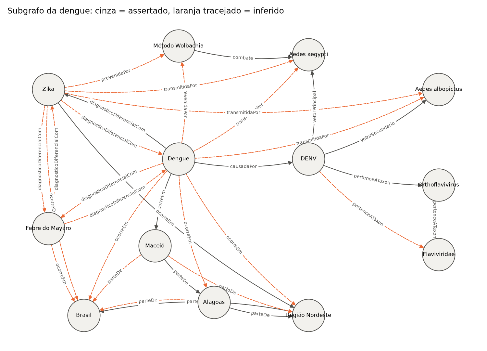

No recorte em torno da dengue, 20 das 32 arestas foram inferidas.

#### 5.3 Aprendizagem: TransE e previsão de links

Implementamos o TransE em numpy, com perda de margem, uma corrupção de cabeça ou cauda por positivo (quatro negativos por tripla em cada época), normalização das entidades a cada época, como no artigo original, e SGD em minilotes. O protocolo:

- os 156 fatos relacionais assertados são divididos em treino e teste (15%) com 10 sementes; triplas de teste cujas entidades não aparecem no treino voltam para o treino, e o teste ficou com 15 a 21 triplas (17,4 em média);
- cada tripla de teste gera duas consultas, de cabeça e de cauda, ranqueadas contra as 78 entidades no modo filtrado, com o fecho do grafo completo como filtro (assim, prever `ocorreEm Brasil` não conta como erro);
- empates contam pela média entre o posto otimista e o pessimista;
- baselines: escores aleatórios e frequência (a entidade mais comum naquela posição da relação, no treino).

O TransE foi treinado em duas versões. A primeira usa só os fatos assertados de treino. A segunda usa o fecho do grafo de treino, materializado de novo em cada divisão sem as triplas de teste, para que nada do teste vaze por inferência. Quando o raciocinador consegue deduzir uma tripla de teste a partir do treino, ela é contada e retirada do treino materializado.

A dimensão e a margem foram escolhidas numa validação tirada do treino (sementes 100 a 102), sem olhar o teste:

| Dimensão | margem 0,5 | margem 1,0 | margem 2,0 |
| ---: | ---: | ---: | ---: |
| 16 | 0,459 | 0,615 | 0,582 |
| 32 | 0,478 | 0,602 | 0,560 |
| 64 | 0,449 | **0,637** | 0,538 |

A configuração final foi dimensão 64, margem 1,0, taxa 0,01 e 300 épocas. Resultados no teste (média ± desvio padrão em 10 divisões):

| Modelo | Triplas de treino | MRR | Hits@1 | Hits@3 | Hits@10 | MR |
| --- | ---: | ---: | ---: | ---: | ---: | ---: |
| Aleatório | | 0,062 ± 0,014 | 0,006 | 0,043 | 0,131 | 37,6 |
| Frequência | 138,6 | 0,506 ± 0,070 | 0,361 | 0,571 | 0,688 | 14,0 |
| TransE, assertado | 138,6 | 0,602 ± 0,040 | 0,431 | 0,700 | 0,980 | 3,2 |
| TransE, materializado | 284,9 | 0,600 ± 0,063 | 0,407 | 0,743 | 0,988 | 3,1 |

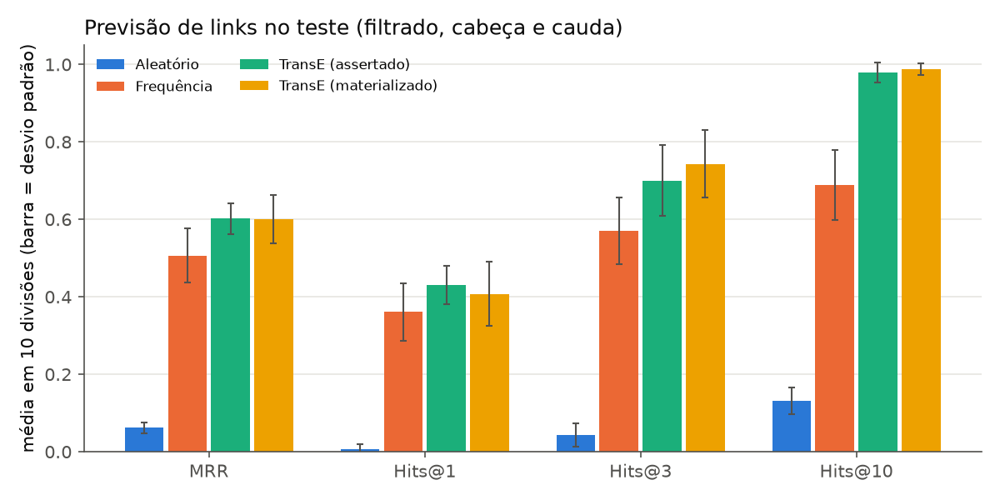

O baseline de frequência é forte porque o grafo é muito repetitivo: febre, cefaleia e mialgia aparecem em quase todas as doenças, e RT-qPCR serve para todas. O TransE ganha dele em todas as métricas e coloca a resposta certa entre as 10 primeiras em 98% das consultas, contra 69% da frequência. A diferença está nas relações em que a resposta depende da entidade da consulta, e não da popularidade.

Treinar no grafo materializado praticamente dobrou o número de triplas de treino e não mudou o MRR (0,602 contra 0,600). O Hits@3 subiu de 0,700 para 0,743 e o Hits@1 caiu de 0,431 para 0,407, mas as duas diferenças ficam dentro do desvio entre divisões. Com cerca de 35 consultas por divisão, este experimento não detecta efeitos dessa ordem. Em 2 das 10 divisões o raciocinador recuperou sozinho uma tripla de teste, nos dois casos pela regra R2 (dengue e Zika, dengue e chikungunya). Nessas triplas a dedução acerta com certeza, enquanto o modelo só atribui um escore.

O desempenho por relação, no TransE treinado com fatos assertados, mostra as limitações geométricas da seção 3.1:

| Relação | Consultas | MRR | Hits@10 |
| --- | ---: | ---: | ---: |
| combate | 2 | 1,000 | 1,000 |
| diagnosticadaPor | 30 | 0,967 | 1,000 |
| diagnosticoDiferencialCom | 8 | 0,875 | 1,000 |
| temSintoma | 116 | 0,767 | 1,000 |
| hospedeiroAmplificador | 24 | 0,684 | 1,000 |
| vetorSecundario | 12 | 0,590 | 1,000 |
| ambiente | 8 | 0,589 | 0,875 |
| podeEvoluirPara | 16 | 0,568 | 1,000 |
| vetorPrincipal | 26 | 0,412 | 0,885 |
| ocorreEm | 40 | 0,404 | 1,000 |
| parteDe | 20 | 0,353 | 0,950 |
| pertenceATaxon | 20 | 0,320 | 0,900 |
| causadaPor | 26 | 0,204 | 1,000 |

`causadaPor` é a pior relação. Ela é 1-para-1 e cada vírus tem poucas outras arestas, então, sem a tripla de teste, DENV e ZIKV ficam quase indistinguíveis (mesmo gênero, mesmos vetores, mesmo hospedeiro). As relações hierárquicas (`parteDe`, `pertenceATaxon`) também vão mal: são N-para-1 e transitivas, e uma única translação não representa uma hierarquia de vários níveis. O diagnóstico diferencial foi bem apesar de ser simétrico, mas com 8 consultas o número diz pouco.

Depois de treinar com todo o fecho, pedimos ao modelo triplas que não estão no grafo:

- para `(FebreOropouche, temSintoma, ?)`, os sete sintomas assertados ficaram no topo, e as melhores candidatas novas foram exantema, icterícia e dor retro-orbital. O exantema é relatado em parte dos casos de Oropouche; os outros dois vêm da semelhança com dengue e febre amarela e precisariam ser conferidos;
- para `(FebreOropouche, diagnosticadaPor, ?)`, a primeira candidata nova foi sorologia IgM, o que é plausível;
- para `(FebreMayaro, vetorSecundario, ?)`, as duas primeiras candidatas novas foram doenças (chikungunya e Zika), e a dengue aparece logo depois de *Aedes albopictus*. O TransE não conhece tipos, e uma restrição de alcance aplicada às candidatas eliminaria essas respostas. É um exemplo de onde o esquema dedutivo pode corrigir o modelo indutivo.

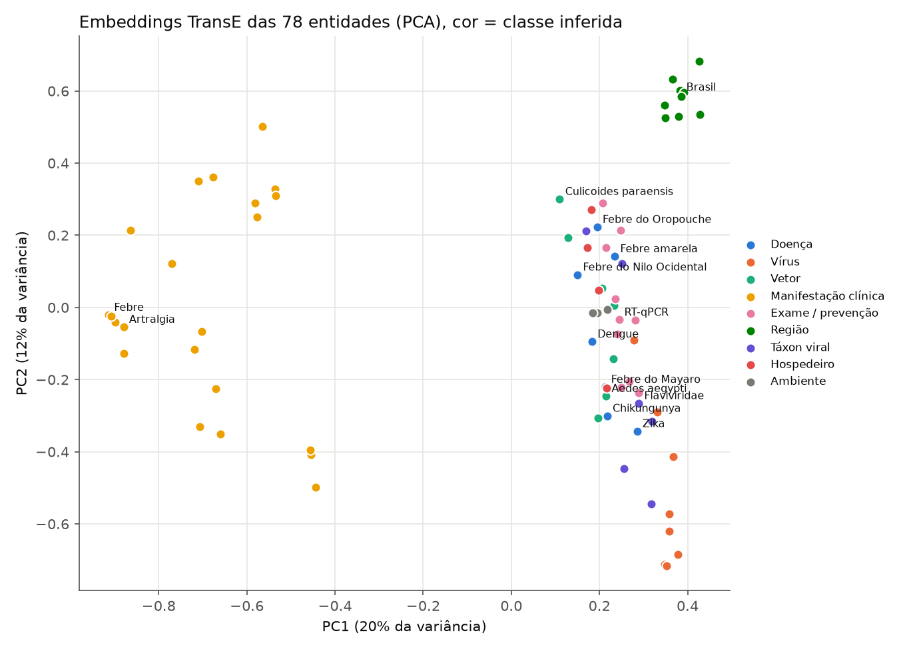

Na projeção por PCA (os dois componentes explicam 32% da variância), as regiões formam um grupo isolado, as manifestações clínicas ficam à esquerda e os vírus embaixo, à direita. Doenças, vetores e intervenções se misturam no centro. O coeficiente de silhueta das classes no espaço completo de 64 dimensões é 0,442. As cores vêm das classes inferidas na seção 5.2, já que quase nenhuma entidade tem tipo declarado.

#### 5.4 Neo4j

O script `neo4j/arboviroses.cypher` é gerado do grafo assertado. Cada indivíduo vira um nó `:Entidade` com o tipo declarado como rótulo extra, cada propriedade de objeto vira um tipo de relação (`causadaPor` vira `CAUSADA_POR`) e a hierarquia de classes vira nós `:Classe` ligados por `:SUBCLASSE_DE`, porque o Neo4j não raciocina sobre `subClassOf`. Em `consultas.cypher`, cada consulta embute a regra que o raciocinador aplicaria. A C3, por exemplo:

```cypher
MATCH (d:Entidade)-[:CAUSADA_POR]->(:Entidade)-[:VETOR_PRINCIPAL|VETOR_SECUNDARIO]->(v:Entidade)
      -[:INSTANCIA_DE]->(:Classe)-[:SUBCLASSE_DE*0..]->(:Classe {nome: 'Inseto'})
RETURN collect(DISTINCT d.rotulo);
```

A R1 aparece como materialização em Cypher, com `MERGE (d)-[:PREVENIDA_POR]->(m)`, e a R2 como agregação com `count(DISTINCT s) >= 5`. Validamos tudo num container `neo4j:5.26-community` temporário (script `neo4j/validar_neo4j.sh`). O grafo carregou com 78 entidades, 29 classes e 206 relações, e as oito consultas comparáveis (C1 a C7 e C9) devolveram os mesmos conjuntos que o SPARQL sobre o grafo materializado. O caminho mais curto entre a febre do Nilo Ocidental e o Oropouche passa por um sintoma em comum (náusea, no resultado registrado; há outros caminhos do mesmo tamanho). O qualificador do primeiro caso humano no Piauí ficou como propriedade da aresta.

A comparação resume as duas abordagens da Questão 1 na prática. No RDF, as regras ficam declaradas no esquema e qualquer consulta se beneficia delas. No Neo4j, as mesmas conclusões saem de padrões de caminho e agregações, e cada consulta precisa repetir a regra.

#### 5.5 Limitações

O grafo tem 78 entidades e 156 fatos. Os números de previsão de links servem para comparar modelos dentro deste experimento, não para estimar o desempenho do TransE em KGs biomédicos reais. O materializador é ingênuo (reaplica todas as regras a cada iteração); levou cerca de 0,15 s aqui, mas um grafo grande pediria avaliação seminaive ou um raciocinador dedicado. A cadeia de propriedades aceita apenas tamanho 2, que é o que o esquema usa. A regra R2 usa um limiar fixo de cinco sintomas, escolhido por nós.

### Referências (Q14)

1. ALI, Mehdi et al. Bringing light into the dark: a large-scale evaluation of knowledge graph embedding models under a unified framework. *IEEE Transactions on Pattern Analysis and Machine Intelligence*, 2021.
2. BORDES, Antoine et al. Translating embeddings for modeling multi-relational data. In: *Advances in Neural Information Processing Systems (NeurIPS)*, 2013.
3. DETTMERS, Tim et al. Convolutional 2D knowledge graph embeddings. In: *AAAI Conference on Artificial Intelligence*, 2018.
4. GALÁRRAGA, Luis et al. AMIE: association rule mining under incomplete evidence in ontological knowledge bases. In: *International World Wide Web Conference (WWW)*, 2013.
5. HIMMELSTEIN, Daniel S. et al. Systematic integration of biomedical knowledge prioritizes drugs for repurposing. *eLife*, v. 6, e26726, 2017.
6. HOGAN, Aidan et al. Knowledge graphs. *ACM Computing Surveys*, v. 54, n. 4, 2021.
7. JI, Shaoxiong et al. A survey on knowledge graphs: representation, acquisition, and applications. *IEEE Transactions on Neural Networks and Learning Systems*, v. 33, n. 2, 2022.
8. MEILICKE, Christian et al. Anytime bottom-up rule learning for knowledge graph completion. In: *International Joint Conference on Artificial Intelligence (IJCAI)*, 2019.
9. MINTZ, Mike et al. Distant supervision for relation extraction without labeled data. In: *Annual Meeting of the ACL*, 2009.
10. ROTMENSCH, Maya et al. Learning a health knowledge graph from electronic medical records. *Scientific Reports*, v. 7, 2017.
11. SCHLICHTKRULL, Michael et al. Modeling relational data with graph convolutional networks. In: *Extended Semantic Web Conference (ESWC)*, 2018.
12. SINGHAL, Amit. Introducing the Knowledge Graph: things, not strings. *Google Blog*, maio 2012.
13. SUN, Zhiqing et al. RotatE: knowledge graph embedding by relational rotation in complex space. In: *International Conference on Learning Representations (ICLR)*, 2019.
14. TOUTANOVA, Kristina; CHEN, Danqi. Observed versus latent features for knowledge base and text inference. In: *Workshop on Continuous Vector Space Models and their Compositionality*, 2015.
15. TROUILLON, Théo et al. Complex embeddings for simple link prediction. In: *International Conference on Machine Learning (ICML)*, 2016.
16. VRANDEČIĆ, Denny; KRÖTZSCH, Markus. Wikidata: a free collaborative knowledgebase. *Communications of the ACM*, v. 57, n. 10, 2014.
17. W3C. *OWL 2 Web Ontology Language Profiles*. Recomendação W3C, 2012.
18. W3C. *RDF 1.1 Concepts and Abstract Syntax*; *RDF Schema 1.1*; *SPARQL 1.1 Query Language*; *Shapes Constraint Language (SHACL)*. Recomendações W3C, 2013 a 2017.
19. YANG, Bishan et al. Embedding entities and relations for learning and inference in knowledge bases. In: *International Conference on Learning Representations (ICLR)*, 2015.
20. YANG, Fan; YANG, Zhilin; COHEN, William W. Differentiable learning of logical rules for knowledge base reasoning. In: *Advances in Neural Information Processing Systems (NeurIPS)*, 2017.
21. RUSSELL, Stuart J.; NORVIG, Peter. *Inteligência Artificial: uma abordagem moderna*. 3. ed. Rio de Janeiro: Elsevier, 2013.

---

## Questão 15: Aplicação de ontologia OWL 2.0 e raciocínio no Protégé


A aplicação desta questão reutiliza a ontologia OWL 2 de atividades físicas desenvolvida na Questão 9 (`src/q09_q15_ontologia/`). Abaixo estão a representação, o raciocínio com HermiT/Pellet, a comparação de reasoners e o roteiro no Protégé.

> Apresente e discuta um exemplo de aplicação de sua escolha que faça uso de ontologia com OWL 2.0,
> enfatizando a representação do conhecimento e raciocínio. Para isso, utilize a ferramenta protégé
> (ou alguma outra de sua preferência) e alguma máquina de inferência embutida nela.

### 15.1 Aplicação e ferramentas

A aplicação é a ontologia de atividades físicas da Questão 9. O arquivo `.owl` abre no Protégé 5 e o
passo a passo para raciocinar com o HermiT dentro do Protégé está na seção "Como abrir no Protégé". Como
a interface gráfica não pode ser registrada num notebook, o notebook da Q15 reproduz cada operação em
Python com o HermiT empacotado no owlready2 (versão 1.3.8; o Protégé 5.6 traz a 1.4.3, do mesmo grupo de
Oxford e com o mesmo algoritmo de hipertableau) e com o Pellet 2.3.1, que também existe como plugin do
Protégé.

### 15.2 Representação: Lógica de Descrição e Manchester Syntax

A ontologia está em OWL 2 DL, cuja semântica é a da Lógica de Descrição SROIQ(D). O conhecimento se
divide em TBox (definições de classes), RBox (propriedades e relações entre elas) e ABox (fatos sobre
indivíduos). O módulo `sintaxe_owl.py` converte os axiomas do arquivo nas duas notações:

| DL | Manchester Syntax |
| :--- | :--- |
| `AtividadeVigorosa ≡ AtividadeFisica ⊓ ∃gastoMET.decimal[≥ 6.0]` | `Class: AtividadeVigorosa EquivalentTo: AtividadeFisica and (gastoMET some decimal[>= 6.0])` |
| `AtividadeVigorosa ⊑ ∃sobrecarrega.{sistema_cardiovascular}` | `Class: AtividadeVigorosa SubClassOf: sobrecarrega value sistema_cardiovascular` |
| `AtividadeAdequadaParaIdoso ≡ AtividadeFisica ⊓ ∃temImpacto.{impacto_baixo} ⊓ ∃gastoMET.decimal[< 6.0]` | `Class: AtividadeAdequadaParaIdoso EquivalentTo: AtividadeFisica and (temImpacto value impacto_baixo) and (gastoMET some decimal[< 6.0])` |
| `UsuarioSemCondicaoDeSaude ≡ Usuario ⊓ ≤0 temCondicao.CondicaoDeSaude` | `Class: UsuarioSemCondicaoDeSaude EquivalentTo: Usuario and (temCondicao max 0 CondicaoDeSaude)` |
| `NivelDeImpacto ≡ {impacto_baixo, impacto_moderado, impacto_alto}` | `Class: NivelDeImpacto EquivalentTo: {impacto_baixo, impacto_moderado, impacto_alto}` |
| `AtividadeFisica ⊑ =1 temImpacto.NivelDeImpacto` | `Class: AtividadeFisica SubClassOf: temImpacto exactly 1 NivelDeImpacto` |
| `Disj(AtividadeAerobica, AtividadeDeForca, AtividadeDeFlexibilidade, Esporte)` | `DisjointClasses: AtividadeAerobica, AtividadeDeForca, AtividadeDeFlexibilidade, Esporte` |
| `temCondicao ∘ contraindica ⊑ naoDevePraticar` | `ObjectProperty: naoDevePraticar SubPropertyChain: temCondicao o contraindica` |
| `parteDe ∘ parteDe ⊑ parteDe` | `ObjectProperty: parteDe Characteristics: Transitive` |
| `contraindica ≡ contraindicadaPara⁻` | `ObjectProperty: contraindica InverseOf: contraindicadaPara` |
| `⊤ ⊑ ≤1 temImpacto.⊤` | `ObjectProperty: temImpacto Characteristics: Functional` |

Na ABox, a corrida é descrita por fatos como `AtividadeAerobica(corrida)`, `temImpacto(corrida,
impacto_alto)`, `gastoMET(corrida, 9.8)` e `sobrecarrega(corrida, joelho)`.

Cada letra de SROIQ(D) aparece em algum axioma: S (base ALC mais papéis transitivos: `parteDe`), R
(inclusões e cadeias de papéis), O (nominais: `{impacto_baixo}`), I (inversas), Q (cardinalidade
qualificada: `=1 temImpacto.NivelDeImpacto`) e (D) (tipos de dados com facetas: `decimal[≥ 6.0]`).

### 15.3 Tarefas de raciocínio

Consistência. A ontologia principal é consistente para os dois reasoners. Na cópia inconsistente, os dois
detectam o problema e o Pellet explica com quatro axiomas: `temImpacto` funcional, `temImpacto(corrida,
impacto_alto)`, `corrida ∈ ∃temImpacto.{impacto_baixo}` e `DifferentIndividuals(impacto_alto,
impacto_baixo, impacto_moderado)`. Sem a última declaração não haveria contradição: OWL não adota a
hipótese de nomes únicos e o reasoner concluiria que os dois níveis são o mesmo indivíduo.

Satisfatibilidade de classes. A cópia `_insatisfazivel.owl` define
`AtividadeSuaveDeAltoImpacto ≡ AtividadeDeBaixoImpacto ⊓ AtividadeDeAltoImpacto`. A ontologia continua
consistente, porque ninguém é instância dessa classe, mas HermiT e Pellet a apontam como equivalente a
`owl:Nothing`, com a mesma justificativa da funcionalidade. Ao criar um indivíduo nessa classe, a
ontologia passa a ser inconsistente (demonstrado no notebook).

Subsunção e classificação. As classes definidas foram declaradas só como subclasses de `AtividadeFisica`
ou `Usuario`. O HermiT encontrou 5 subsunções novas:

| Subclasse | Superclasse inferida |
| :--- | :--- |
| `AtividadeAdequadaParaIdoso` | `AtividadeAdequadaParaSedentario` |
| `AtividadeAdequadaParaIdoso` | `AtividadeDeBaixoImpacto` |
| `AtividadeAdequadaParaObesidade` | `AtividadeDeBaixoImpacto` |
| `AtividadeLeve` | `AtividadeAdequadaParaSedentario` |
| `AtividadeModerada` | `AtividadeAdequadaParaSedentario` |

A primeira vale porque as duas definições exigem `gastoMET < 6` e a de idoso ainda exige baixo impacto.
`AtividadeAdequadaParaObesidade` não é subclasse de `AtividadeAdequadaParaSedentario` porque não limita o
MET por cima; o ciclismo na orla (8 MET, baixo impacto) é adequado para obesidade e não para sedentários.


Realização. 21 indivíduos ganharam tipos que não estavam declarados, 111 tipos novos ao todo. A caminhada,
por exemplo, foi declarada só como `AtividadeAerobica` e terminou com 10 tipos, entre eles
`AtividadeModerada`, `AtividadeGratuita` e `AtividadeAdequadaParaIdoso`.

Relações entre indivíduos. O HermiT deduziu 15 pares `naoDevePraticar` e completou `sobrecarrega` pela
transitividade: o CrossFit, declarado como sobrecarregando coluna lombar, joelho e ombro, termina com
coluna vertebral, tronco, membros inferior e superior e sistema cardiovascular.

### 15.4 Hipótese de mundo aberto

Carla e Lucas não têm condição de saúde cadastrada. A consulta SPARQL com `FILTER NOT EXISTS` (mundo
fechado sobre os dados) devolve os dois. O HermiT classifica só Lucas como `UsuarioSemCondicaoDeSaude`,
porque para Lucas existe o axioma de fechamento `temCondicao max 0 CondicaoDeSaude`; para Carla, a falta do
fato significa apenas que não se sabe. Acrescentando o mesmo axioma a Carla, ela passa a ser classificada.

O segundo exemplo mostra que cardinalidade não é restrição de integridade. Uma atividade nova, `remo_indoor`,
sem local cadastrado, não viola `AtividadeFisica ⊑ ≥1 realizadaEm.Local`: o reasoner supõe um local
desconhecido. Ela é classificada como `AtividadeVigorosa` e `AtividadeAdequadaParaObesidade`, mas nem como
ao ar livre nem como fechada. Quando se declara `realizadaEm max 0 Local`, aí sim a ontologia fica
inconsistente.

O recomendador da Q9 usa essa distinção: "nenhuma condição" vira axioma de fechamento; "prefiro não
informar" não vira nada, e o relatório avisa que nenhuma contraindicação pôde ser deduzida.

### 15.5 HermiT e Pellet

Cada reasoner rodou 5 vezes sobre os mesmos arquivos (tempo de parede, incluindo iniciar a JVM; valores da
execução salva no notebook, que variam alguns centésimos entre execuções):

| Reasoner | Tarefa | Média (s) | Desvio (s) |
| :--- | :--- | ---: | ---: |
| HermiT | classificação + realização (principal) | 0,880 | 0,057 |
| Pellet | classificação + realização (principal) | 1,085 | 0,045 |
| HermiT | consistência (cópia inconsistente) | 0,452 | 0,037 |
| Pellet | consistência (cópia inconsistente) | 0,696 | 0,053 |


Os resultados coincidiram: mesma hierarquia para as 39 classes, mesmos tipos para os 66 indivíduos (211
pares indivíduo/classe), mesma classe insatisfazível e mesmo veredito de consistência nos três arquivos. O
Pellet também justificou os 5 pares `naoDevePraticar` de Maria deduzidos pelo HermiT e não justificou
`maria naoDevePraticar caminhada`, usado como controle negativo. Com uma ontologia deste tamanho, os
tempos medem sobretudo a inicialização da JVM e a leitura do arquivo; não dizem qual algoritmo é mais
rápido. Na prática, o HermiT foi mais simples de usar pelo owlready2 e o Pellet foi mais útil pelas
explicações.

Uma observação de ambiente: o `sync_reasoner_pellet` do owlready2 0.51 falha com Java 21, porque três
classes do jar `jena-arq-fixed` que acompanha o pacote foram compiladas para Java 25. O Pellet foi chamado
pela linha de comando com `--loader OWLAPIv3`, que não usa essas classes. Por esse caminho ele faz
consistência, classificação, realização e explicações, mas não exporta em lote os valores de propriedades
inferidos; por isso a comparação das relações deduzidas foi feita fato a fato com
`explain --property-value`.

### 15.6 Limites

Decidibilidade. Raciocinar em SROIQ(D) é decidível, com complexidade N2ExpTime no pior caso. Para manter a
decidibilidade, OWL 2 DL impõe restrições globais: as cadeias precisam formar uma hierarquia regular e
propriedades não simples (transitivas ou definidas por cadeia) não podem aparecer em restrições de
cardinalidade. O notebook tenta definir `AtividadeFisica and (sobrecarrega max 1 ParteDoCorpo)` e o HermiT
recusa a ontologia com `Non-simple property 'sobrecarrega' [...] appears in the cardinality restriction`
(ele reescreve `max 1` como a negação de `min 2`, por isso a mensagem fala em `ObjectMinCardinality(2 ...)`).

Sem aritmética. OWL compara um valor com constantes (`gastoMET ≥ 6`), mas não calcula IMC nem compara o
custo de uma atividade com o orçamento de um usuário.

Sem regras com variáveis compartilhadas. "Se o usuário é idoso e a atividade é adequada a idosos, recomende"
seria, em SWRL, `UsuarioIdoso(?u) ∧ AtividadeAdequadaParaIdoso(?a) → recomendavelPara(?a, ?u)`. Não usei
SWRL: regras gerais tornam o raciocínio indecidível e os reasoners só tratam a forma DL-safe. As cadeias de
propriedades resolveram os casos que são composição de relações (`temCondicao ∘ contraindica`); a junção
perfil/tipo de atividade ficou na anotação lida pelo código.

Mundo aberto como custo. Domínios, imagens e cardinalidades produzem inferências, não erros. Validar o
cadastro (toda atividade tem local?) pede SPARQL ou SHACL.

---

## Como abrir no Protégé e rodar o HermiT

O Protégé não pôde ser aberto no ambiente em que este trabalho foi executado; o arquivo foi validado
relendo-o com owlready2 e rdflib e raciocinando sobre ele com HermiT e Pellet. Os passos abaixo seguem a
interface do Protégé 5.6, que já traz o HermiT 1.4.3 (o Pellet pode ser instalado em
*File → Check for plugins*). Os resultados esperados são os mesmos obtidos nos notebooks.

1. *File → Open...* e escolha `ontologia_atividades_fisicas.owl`. Na aba *Active Ontology* aparecem a IRI
   `http://ic.ufal.br/ecom031/lista2/atividades-fisicas`, o rótulo e o comentário com os nomes da dupla.
2. Opcional: *View → Render by label (rdfs:label)* mostra os nomes em português com acento.
3. Na aba *Entities → Classes*, a hierarquia declarada tem as 9 classes de topo. As classes definidas (como
   `AtividadeVigorosa`) mostram o ícone de equivalência e, em *Description*, a definição em Manchester
   Syntax igual à da seção 15.2.
4. *Reasoner → HermiT 1.4.3* e depois *Reasoner → Start reasoner*. Para ver também as relações deduzidas
   entre indivíduos, antes de iniciar abra *Reasoner → Configure...* (ou *File → Preferences → Reasoner*) e
   marque *Object property assertions* em *Displayed inferences*.
5. No seletor da hierarquia de classes, troque de *Asserted* para *Inferred*. `AtividadeAdequadaParaIdoso`
   aparece sob `AtividadeAdequadaParaSedentario` e sob `AtividadeDeBaixoImpacto`; `AtividadeLeve` e
   `AtividadeModerada` aparecem sob `AtividadeAdequadaParaSedentario` (as 5 subsunções da seção 15.3).
6. Em *Entities → Individuals*, selecione `maria`. Em *Types* aparecem em amarelo `UsuarioIdoso`,
   `UsuarioSedentario`, `UsuarioIniciante` e `UsuarioComCondicaoArticular`. Em *Object property assertions*
   aparecem em amarelo os `naoDevePraticar` (corrida, zumba, CrossFit, futebol society, vôlei de praia) e
   os `temAtividadeCandidata`. O botão "?" ao lado de cada inferência abre a explicação, que deve listar os
   mesmos fatos e axiomas mostrados pelo Pellet no notebook.
7. Selecione `spinning`: entre os tipos inferidos estão `AtividadeVigorosa` e `AtividadeAdequadaParaObesidade`.
   Selecione `carla` e `lucas` para comparar o efeito do axioma de fechamento (só Lucas é
   `UsuarioSemCondicaoDeSaude`).
8. Na aba *DL Query* (com o reasoner ativo, marcando *Instances*), experimente:
   `AtividadeFisica and temImpacto value impacto_baixo and gastoMET some xsd:decimal[< 6.0]` (9 atividades)
   e `inverse (naoDevePraticar) value joao` (as 8 atividades vigorosas).
9. Abra `ontologia_atividades_fisicas_inconsistente.owl` e inicie o reasoner: o Protégé abre a janela de
   ontologia inconsistente com a explicação (funcionalidade de `temImpacto`, os dois valores da corrida e
   `DifferentIndividuals`).
10. Abra `ontologia_atividades_fisicas_insatisfazivel.owl` e inicie o reasoner: `AtividadeSuaveDeAltoImpacto`
    fica em vermelho, sob `owl:Nothing` na hierarquia inferida.

## Roteiro para o vídeo/apresentação

Duração sugerida: 8 a 10 minutos.

1. (1 min) Problema e domínio: recomendar atividade física com segurança; mostrar o enunciado e a figura
   `q09_grafo_propriedades.png`.
2. (2 min) Protégé, ontologia declarada: classes de topo, uma classe definida (`AtividadeVigorosa`), as
   propriedades com cadeia (`naoDevePraticar`) e os fatos da corrida.
3. (2 min) Protégé, HermiT: *Start reasoner*, trocar para a hierarquia inferida e mostrar as subsunções
   novas; abrir `maria` e mostrar tipos e `naoDevePraticar` em amarelo; clicar no "?" de
   `maria naoDevePraticar zumba`.
4. (1 min) Consistência: abrir a cópia inconsistente e a cópia insatisfazível.
5. (2 min) Recomendador: rodar `python recomendador_atividades.py` com o perfil de Dona Lúcia (68 anos,
   72 kg, 1,60 m, 40 min, 0 meses, objetivos 5 e 7, condição 1, R$ 200, ar livre) e comentar perfis,
   contraindicações, ranking e descartadas.
6. (1 min) Mundo aberto: repetir com condição em branco e com "0" e mostrar o aviso e a classificação
   `UsuarioSemCondicaoDeSaude`.
7. (1 min) Fechamento: tabela HermiT x Pellet e limites (sem aritmética, sem SWRL, cardinalidade não valida
   dados).

## Referências

* Ainsworth, B. E. et al. 2011 Compendium of Physical Activities. *Medicine & Science in Sports & Exercise*, 43(8), 2011.
* Baader, F. et al. *The Description Logic Handbook*. Cambridge University Press, 2003.
* Glimm, B. et al. HermiT: An OWL 2 Reasoner. *Journal of Automated Reasoning*, 53, 2014.
* Horrocks, I.; Kutz, O.; Sattler, U. The Even More Irresistible SROIQ. KR 2006.
* Lamy, J.-B. Owlready: Ontology-oriented programming in Python with automatic classification and high level constructs for biomedical ontologies. *Artificial Intelligence in Medicine*, 80, 2017.
* Sirin, E. et al. Pellet: A practical OWL-DL reasoner. *Journal of Web Semantics*, 5(2), 2007.
* W3C. OWL 2 Web Ontology Language: Manchester Syntax e Structural Specification, 2ª edição, 2012.
* World Health Organization. *Guidelines on physical activity and sedentary behaviour*, 2020.

---


## Referências

1. RUSSELL, Stuart J.; NORVIG, Peter. *Inteligência Artificial: uma abordagem moderna*. 3. ed. Rio de Janeiro: Elsevier / Campus, 2013.
2. CARVALHO, André C. P. L. F. et al. *Inteligência Artificial: Uma Abordagem de Aprendizado de Máquina*. Rio de Janeiro: LTC, 2011.
3. LUGER, George F. *Artificial Intelligence: Structures and Strategies for Complex Problem Solving*. 6. ed. Boston: Pearson, 2009.
4. TENÓRIO, Antônio Rodrigo L. A.; GOMES, Bruno B. F. *Lista de Exercícios 1: Inteligência Artificial*. Notebook `Lista_IA.ipynb`, UFAL, 2026.
5. WEIZENBAUM, Joseph. ELIZA: a computer program for the study of natural language communication between man and machine. *Communications of the ACM*, v. 9, n. 1, p. 36–45, 1966.
6. COLBY, Kenneth M.; WEBER, Sylvia; HILF, Franklin D. Artificial paranoia. *Artificial Intelligence*, v. 2, n. 1, p. 1–25, 1971/1972.
7. WALLACE, Richard S. The anatomy of A.L.I.C.E. In: EPSTEIN, R.; ROBERTS, G.; BEBER, G. (eds.). *Parsing the Turing Test*. Dordrecht: Springer, 2009. p. 181–210.
8. IBM Technology. *What is LLM Inference? How AI Models Generate Response*. YouTube, 2025. Disponível em: https://www.youtube.com/watch?v=615-yWyS1n0. Acesso em: 6 nov. 2026.
9. VASWANI, Ashish et al. Attention Is All You Need. In: *NeurIPS*, 2017.
10. AAMODT, Agnar; PLAZA, Enric. Case-based reasoning: foundational issues, methodological variations, and system approaches. *AI Communications*, v. 7, n. 1, p. 39–59, 1994.
11. HOGAN, Aidan et al. Knowledge graphs. *ACM Computing Surveys*, v. 54, n. 4, 2021.
12. W3C. *OWL 2 Web Ontology Language*. Recomendação W3C, 2012.
