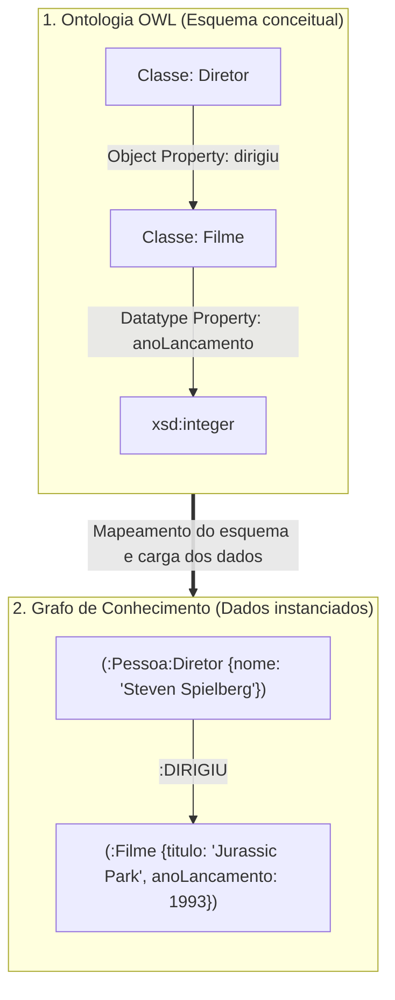
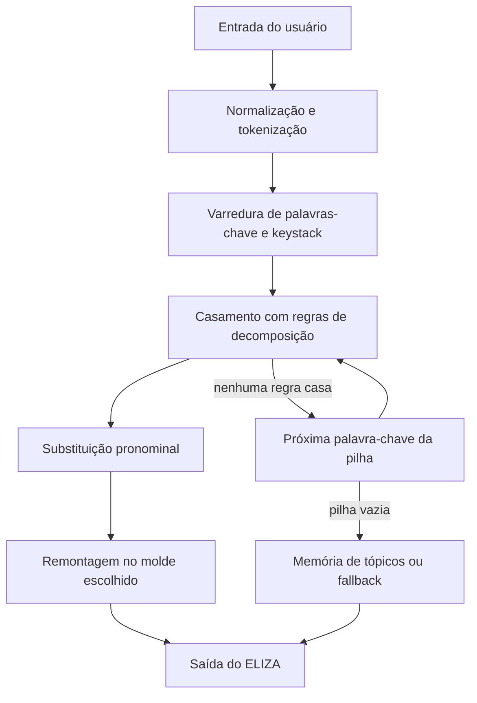
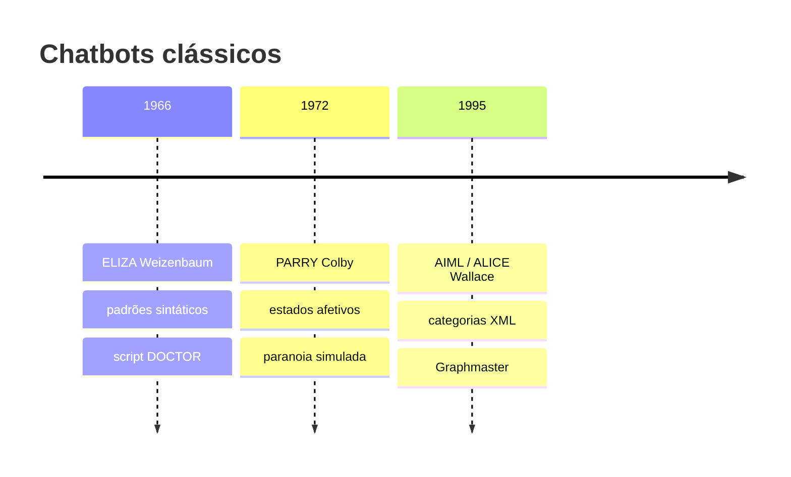
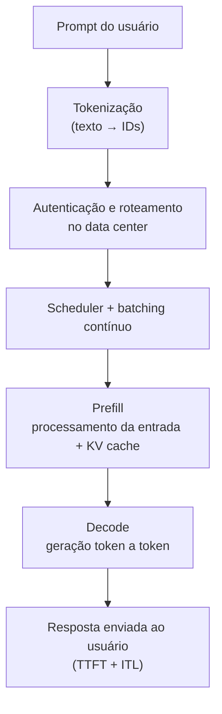

# Lista de Exercícios 2: Inteligência Artificial

**Universidade Federal de Alagoas (UFAL)**  
**Instituto de Computação / Engenharia de Computação**  
**Componente curricular:** ECOM031 (Graduação / PPGI)

**Dupla:** Bruno Gomes de Barros Filho (21111360); Antonio Rodrigo Lima de Andrade Tenório (23210707)  
**Professor:** Evandro de Barros Costa  
**Período:** 2026.2

---

## Sumário

1. [Questão 1: Ontologias versus grafos de conhecimento](#questão-1-ontologias-versus-grafos-de-conhecimento)
2. [Questão 2: Classificador dos K-Vizinhos Mais Próximos (KNN)](#questão-2-classificador-dos-k-vizinhos-mais-próximos-knn)
3. [Questão 3: Chatbot ELIZA, diálogo, algoritmo e evoluções](#questão-3-chatbot-eliza-diálogo-algoritmo-e-evoluções-parry-e-aimlalice)
4. [Questão 5: Resumo estendido — Inferência em LLMs](#questão-5-resumo-estendido--inferência-em-llms)
5. [Referências](#referências)

---


## Questão 1: Ontologias versus grafos de conhecimento

Ontologias e grafos de conhecimento são duas formas de representar informações e relacionamentos entre diferentes entidades. Apesar de utilizarem estruturas semelhantes, com nós, relações e propriedades, cada abordagem possui características próprias e atende a necessidades diferentes. Enquanto as ontologias dão maior atenção à definição formal dos conceitos e às regras que relacionam esses conceitos, os grafos de conhecimento priorizam a organização das informações e as conexões entre os dados.

Para entender melhor essas diferenças, é importante observar como cada abordagem representa o conhecimento, realiza inferências e lida com grandes volumes de informação.

### Comparativo: principais diferenças entre as abordagens

A diferença entre ontologias e grafos de conhecimento vai além da maneira como os dados são organizados. Ela também está relacionada à interpretação das informações, às regras utilizadas e ao tipo de consulta que cada modelo permite realizar.

#### 1. Formalismo lógico e hipótese de mundo

As ontologias utilizam como fundamento as Lógicas de Descrição (*Description Logics*), que fornecem uma base matemática para definir conceitos, propriedades e restrições. Um exemplo de padrão baseado nessa abordagem é o OWL 2. Nele, os elementos do domínio são descritos por meio de axiomas, permitindo estabelecer relações e regras que podem ser verificadas automaticamente.

Uma característica importante é a Hipótese de Mundo Aberto (*Open World Assumption*, OWA). Nessa abordagem, quando uma informação não está registrada, não significa necessariamente que ela seja falsa. O sistema considera que aquele dado pode simplesmente não ser conhecido ou ainda não ter sido informado.

Outro aspecto é a ausência da pressuposição de nomes únicos (*Non-Unique Name Assumption*). Isso significa que duas entidades com identificadores diferentes podem representar o mesmo indivíduo. Por exemplo, dois registros de uma pessoa podem ser considerados equivalentes por meio de uma relação como `owl:sameAs`, desde que existam informações que justifiquem essa equivalência.

Já nos grafos de conhecimento, especialmente nos modelos de propriedades rotuladas (*Labeled Property Graphs*, LPG), como os utilizados pelo Neo4j, o foco costuma estar na consulta e na navegação entre as informações armazenadas. Em aplicações que seguem a Hipótese de Mundo Fechado (*Closed World Assumption*, CWA), considera-se que os dados não encontrados na base não estão disponíveis para aquela consulta.

É importante destacar que essa diferença depende da tecnologia utilizada. Grafos baseados em RDF, por exemplo, também podem seguir a semântica de mundo aberto. Portanto, não se pode afirmar que todo grafo de conhecimento utiliza obrigatoriamente a hipótese de mundo fechado.

#### 2. Mecanismos de inferência: dedução e navegação

Outra diferença importante está na maneira como cada abordagem trabalha com as informações.

Nas ontologias, a inferência é baseada em deduções lógicas. Para isso, são utilizados programas chamados *reasoners*, como HermiT, Pellet e FaCT++, que analisam os axiomas definidos no modelo. Esses mecanismos conseguem identificar relações que não foram cadastradas diretamente, verificar inconsistências e classificar automaticamente os indivíduos de acordo com as regras existentes.

Entre as principais tarefas realizadas estão:

- **Verificação de consistência:** identifica se existem informações contraditórias na ontologia.
- **Classificação:** organiza automaticamente as classes de acordo com as relações de especialização e generalização.
- **Subsunção:** verifica se uma classe está contida em outra, ou seja, se todos os seus indivíduos também pertencem a uma classe mais abrangente.
- **Instanciação:** identifica a quais classes um indivíduo pertence, inclusive quando essa relação pode ser deduzida a partir dos axiomas.

Nos grafos de conhecimento, o trabalho geralmente está mais relacionado à consulta e à análise das conexões entre os dados. Em ferramentas como o Neo4j, é possível utilizar a linguagem Cypher para percorrer relacionamentos, encontrar caminhos entre entidades e identificar informações conectadas.

Além disso, existem técnicas que permitem descobrir relações que ainda não foram registradas explicitamente. Entre elas estão os *embeddings* de grafos, como TransE e RotatE, e as Redes Neurais em Grafos (*Graph Neural Networks*, GNNs). Esses métodos podem ser utilizados para prever conexões que provavelmente existem entre duas entidades, tarefa conhecida como *link prediction*.

Assim, enquanto as ontologias se destacam pela aplicação de regras lógicas para deduzir informações, os grafos oferecem recursos para explorar relacionamentos e identificar padrões presentes na rede.

#### 3. Escalabilidade e custo de processamento

O nível de formalização das ontologias também influencia o custo de processamento. Quanto mais complexas forem as regras e relações definidas, maior pode ser o esforço necessário para realizar as inferências.

Em fragmentos expressivos do OWL 2 DL, alguns problemas de raciocínio apresentam complexidade computacional elevada, podendo chegar a níveis como NEXPTIME e 2EXPTIME. Por isso, executar inferências complexas sobre bases com centenas de milhões de instâncias pode exigir muitos recursos e não ser adequado para consultas em tempo real.

Nos grafos de propriedades, a estrutura de relacionamentos permite percorrer conexões diretamente, sem precisar analisar toda a base a cada consulta. No Neo4j, por exemplo, o conceito de *index-free adjacency* permite que os nós mantenham referências diretas aos seus relacionamentos, facilitando a navegação entre entidades conectadas.

Isso pode tornar consultas locais bastante eficientes, especialmente quando o objetivo é encontrar caminhos ou relacionamentos próximos. Entretanto, o desempenho também depende da quantidade de conexões percorridas, da estrutura do grafo e da complexidade da consulta.

Na prática, a escolha entre as abordagens depende do objetivo da aplicação: quando a prioridade é validar regras e realizar deduções formais, as ontologias oferecem recursos adequados. Quando o objetivo é explorar grandes redes de relacionamentos e consultar conexões entre entidades, os grafos de conhecimento podem ser mais convenientes.

| Dimensão de análise | Sistemas baseados em ontologias | Sistemas baseados em grafos de conhecimento |
| :--- | :--- | :--- |
| Núcleo teórico | Lógicas de Descrição (DL) e semântica formal | Teoria dos grafos e propriedades rotuladas (LPG) |
| Ferramentas comuns | OWL 2, Protégé, HermiT e Pellet | Neo4j, Cypher, Amazon Neptune e RDF/SPARQL |
| Hipótese de mundo | Geralmente Mundo Aberto (OWA) | Depende da tecnologia; LPGs frequentemente utilizam Mundo Fechado (CWA) |
| Tipo de inferência | Dedução lógica baseada em axiomas | Navegação, análise de caminhos e métodos estatísticos |
| Principal desafio | Custo computacional de inferências complexas | Manutenção da consistência e qualidade dos relacionamentos |

### Exemplo prático: catálogo e recomendação de filmes

Para visualizar melhor como essas abordagens funcionam, podemos considerar um sistema de recomendação de filmes. A ideia é utilizar informações sobre diretores, atores, gêneros e produções para sugerir títulos de acordo com os interesses de cada usuário.

#### Abordagem por ontologia: conceitos e regras

Na construção da ontologia, inicialmente são definidas as classes que representam os elementos do domínio. Por exemplo:

- `Pessoa`, representando pessoas envolvidas na produção cinematográfica.
- `Diretor` e `Ator`, como subclasses de `Pessoa`, declaradas disjuntas entre si.
- `Filme`, representando as produções cinematográficas.
- `dirigiu`, uma propriedade que relaciona um indivíduo da classe `Diretor` a um indivíduo da classe `Filme`.

Também podem ser definidas restrições para garantir que determinadas relações sejam utilizadas corretamente. Por exemplo, uma pessoa não pode ser classificada simultaneamente como `Diretor` e `Ator` caso o modelo tenha estabelecido essas classes como disjuntas.

A partir dessas definições, o *reasoner* consegue deduzir novas informações. Se a base receber o fato de que `Christopher Nolan dirigiu Oppenheimer` e a propriedade `dirigiu` tiver domínio definido como `Diretor` e alcance definido como `Filme`, o sistema poderá inferir que Christopher Nolan pertence à classe `Diretor` e que Oppenheimer pertence à classe `Filme`.

Como `Diretor` é uma subclasse de `Pessoa`, também será possível concluir que Nolan pertence à classe `Pessoa`, sem que essa informação precise ser cadastrada diretamente.

Por outro lado, se a base registrar que `Inception` é o responsável por dirigir `Tenet`, o sistema poderá identificar uma inconsistência caso `Inception` esteja classificado como `Filme` e a propriedade exija que seu domínio seja `Diretor`. Nesse caso, o modelo identifica a incompatibilidade lógica, embora a detecção não signifique necessariamente que o registro será automaticamente rejeitado pelo sistema de armazenamento.

Dessa forma, a ontologia permite estabelecer regras sobre o domínio e verificar se as informações cadastradas estão de acordo com elas.

#### Abordagem por grafo de conhecimento: conexões e consultas

No grafo de conhecimento, a representação é feita por meio de entidades concretas e dos relacionamentos existentes entre elas.

Por exemplo, podemos cadastrar:

- `Steven Spielberg`, como um nó que representa uma pessoa.
- `Jurassic Park`, como um nó que representa um filme.
- `Ficção Científica`, como um nó que representa um gênero cinematográfico.

Esses elementos são conectados por arestas direcionadas, como:

- `(:Pessoa)-[:DIRIGIU]->(:Filme)`
- `(:Filme)-[:GENERO]->(:Tema)`

Com essa estrutura, o sistema consegue percorrer os relacionamentos e encontrar filmes que compartilham características com outros títulos.

Por exemplo, quando um usuário demonstra interesse em `Jurassic Park`, podemos executar uma consulta Cypher para localizar outros filmes dirigidos pela mesma pessoa ou que possuam gêneros e características em comum.

Nesse caso, o sistema pode encontrar títulos como `Tubarão` e `E.T.`, também dirigidos por Steven Spielberg. A recomendação acontece a partir das conexões existentes no grafo, sem a necessidade de utilizar um mecanismo de dedução lógica como o empregado nas ontologias.

### Mapeamento: da ontologia para o grafo de propriedades

Na prática, também é possível utilizar as duas abordagens em conjunto. Uma possibilidade é desenvolver inicialmente o modelo conceitual no Protégé, utilizando OWL, e depois transportar sua estrutura para um banco de grafos, como o Neo4j.

Essa conversão exige alguns cuidados, pois nem todas as características de uma ontologia possuem uma representação direta em um grafo de propriedades.

De maneira geral, o processo pode ser dividido em quatro etapas:

1. **Classes se tornam rótulos de nós (*labels*).**

   Cada classe definida na ontologia pode ser representada por um rótulo no grafo. Por exemplo, as classes `Diretor` e `Pessoa` podem ser utilizadas como *labels* de um mesmo nó, indicando que aquela entidade pertence às duas categorias.

   As hierarquias definidas por `subClassOf` também podem ser representadas dessa maneira, desde que a aplicação mantenha corretamente as relações entre as classes.

2. **Propriedades de objeto se tornam relacionamentos.**

   As propriedades que representam relações entre entidades são convertidas em arestas direcionadas. Por exemplo, a propriedade `dirigiu`, que relaciona um diretor a um filme, pode ser representada no grafo como `[:DIRIGIU]`.

3. **Propriedades de dados se tornam atributos dos nós.**

   Informações como ano de lançamento, orçamento e título não precisam ser representadas como nós separados. Elas podem ser armazenadas diretamente como atributos da entidade correspondente.

   Assim, um filme pode possuir propriedades como `titulo`, `anoLancamento` e `orcamento`.

4. **Axiomas e restrições precisam ser adaptados.**

   Uma diferença importante é que bancos de grafos de propriedades não oferecem, nativamente, o mesmo mecanismo de raciocínio lógico das ontologias OWL. Algumas restrições podem ser representadas por *constraints*, como regras de unicidade, enquanto outras precisam ser verificadas pela aplicação antes que os dados sejam armazenados.

   Por exemplo, regras de disjunção entre classes e determinadas restrições de cardinalidade precisam de validações adicionais para preservar a semântica do modelo original.

O fluxo abaixo apresenta um exemplo simplificado dessa conversão, mostrando como as classes e propriedades definidas na ontologia podem ser representadas por nós, atributos e relacionamentos em um grafo de conhecimento.



Como podemos observar, a ontologia fornece a estrutura conceitual e as regras que definem o domínio, enquanto o grafo representa as entidades e suas conexões de maneira adequada para consultas e exploração dos relacionamentos.

Portanto, as duas abordagens não precisam ser utilizadas de forma isolada. Em determinadas aplicações, a combinação das duas permite aproveitar a organização formal e a capacidade de inferência das ontologias, juntamente com a facilidade de navegação e consulta dos grafos de conhecimento.

---

## Questão 2: Classificador dos K-Vizinhos Mais Próximos (KNN)

### Base de dados e configuração do experimento

O algoritmo dos K-Vizinhos Mais Próximos (*K-Nearest Neighbors*, KNN) foi aplicado à mesma base de 30 instâncias de risco de crédito utilizada na Lista de Exercícios 1. A base tem como ponto de partida um exemplo apresentado no livro de Luger e foi ampliada na Questão 1 daquela lista, passando a contar com seis atributos categóricos e 30 exemplos, identificados de E1 a E30.

Os atributos utilizados para fazer as previsões são História de Crédito, Dívida, Garantia, Renda, Emprego e Imóvel. A variável que o modelo deve classificar é o risco de crédito, dividido em três categorias: Alto, Moderado e Baixo.

Como o KNN trabalha com medidas de distância numéricas, foi necessário transformar os atributos categóricos antes de aplicar o algoritmo. Para isso, utilizamos *one-hot encoding* (`get_dummies`), seguindo a mesma estratégia adotada no CART da Lista 1. Com essa transformação, cada categoria passou a ser representada por uma coluna binária, resultando em um conjunto de 14 dimensões com valores 0 ou 1.

Nesse formato, a distância euclidiana permite comparar os exemplos contando, de forma indireta, as diferenças entre suas categorias. Como todas as variáveis passaram a ter a mesma escala binária, não foi necessário aplicar normalização min-max.

Código e experimentos: `src/q02_knn/q02_knn.ipynb`.

### As 30 instâncias utilizadas no experimento

A tabela apresenta a base completa utilizada na Lista 1, que também serviu de entrada para este experimento.

| Ex. | História | Dívida | Garantia | Renda | Emprego | Imóvel | Risco |
| --- | --- | --- | --- | --- | --- | --- | --- |
| E1 | Ruim | Alta | Nenhuma | 0–15 | Instável | Alugado | Alto |
| E2 | Desconhecida | Alta | Nenhuma | 15–35 | Instável | Alugado | Alto |
| E3 | Desconhecida | Baixa | Nenhuma | 15–35 | Estável | Alugado | Moderado |
| E4 | Desconhecida | Baixa | Nenhuma | 0–15 | Instável | Alugado | Alto |
| E5 | Desconhecida | Baixa | Nenhuma | >35 | Estável | Próprio | Baixo |
| E6 | Desconhecida | Baixa | Adequada | >35 | Estável | Próprio | Baixo |
| E7 | Ruim | Baixa | Nenhuma | 0–15 | Instável | Alugado | Alto |
| E8 | Ruim | Baixa | Adequada | >35 | Estável | Alugado | Moderado |
| E9 | Boa | Baixa | Nenhuma | >35 | Estável | Próprio | Baixo |
| E10 | Boa | Alta | Adequada | >35 | Estável | Próprio | Baixo |
| E11 | Boa | Alta | Nenhuma | 0–15 | Instável | Alugado | Alto |
| E12 | Boa | Alta | Nenhuma | 15–35 | Estável | Alugado | Moderado |
| E13 | Boa | Alta | Nenhuma | >35 | Estável | Alugado | Baixo |
| E14 | Ruim | Alta | Nenhuma | 15–35 | Instável | Alugado | Alto |
| E15 | Boa | Baixa | Adequada | 15–35 | Estável | Próprio | Baixo |
| E16 | Boa | Baixa | Nenhuma | 15–35 | Estável | Próprio | Baixo |
| E17 | Desconhecida | Baixa | Adequada | >35 | Instável | Próprio | Moderado |
| E18 | Ruim | Alta | Nenhuma | >35 | Estável | Alugado | Moderado |
| E19 | Desconhecida | Alta | Nenhuma | 0–15 | Estável | Alugado | Alto |
| E20 | Boa | Baixa | Adequada | >35 | Estável | Alugado | Baixo |
| E21 | Ruim | Baixa | Nenhuma | 15–35 | Estável | Alugado | Moderado |
| E22 | Boa | Alta | Adequada | 15–35 | Estável | Próprio | Moderado |
| E23 | Ruim | Alta | Adequada | 0–15 | Instável | Próprio | Alto |
| E24 | Desconhecida | Baixa | Nenhuma | 15–35 | Instável | Próprio | Moderado |
| E25 | Boa | Baixa | Nenhuma | 0–15 | Estável | Próprio | Moderado |
| E26 | Ruim | Baixa | Nenhuma | >35 | Instável | Alugado | Alto |
| E27 | Desconhecida | Alta | Adequada | >35 | Estável | Próprio | Baixo |
| E28 | Ruim | Alta | Nenhuma | 15–35 | Estável | Alugado | Alto |
| E29 | Boa | Baixa | Nenhuma | >35 | Instável | Próprio | Baixo |
| E30 | Desconhecida | Baixa | Nenhuma | 0–15 | Estável | Alugado | Alto |

A distribuição das classes na base ficou relativamente equilibrada: são 11 exemplos de risco Alto, 9 de Moderado e 10 de Baixo.


### Funcionamento do algoritmo KNN

O KNN é um algoritmo de aprendizado baseado em instâncias, também conhecido como *lazy learner*. Diferentemente de outros classificadores, ele não constrói um modelo explícito durante o treinamento. Em vez disso, mantém os exemplos disponíveis e utiliza a distância entre eles para classificar uma nova instância.

O processo de classificação pode ser dividido em três etapas:

1. **Cálculo das distâncias.** Para uma instância de teste \(\mathbf{q} \in \mathbb{R}^p\), o algoritmo calcula a distância euclidiana em relação a cada exemplo do conjunto de treinamento:

\[
d(\mathbf{q}, \mathbf{x}_i) = \sqrt{\sum_{j=1}^{p} (q_j - x_{ij})^2}
\]

2. **Seleção dos \(k\) vizinhos mais próximos.** Depois de calcular as distâncias, os exemplos são ordenados do menor para o maior valor. Os \(k\) primeiros são selecionados para participar da classificação:

\[
\mathcal{N}_k(\mathbf{q}) = \operatorname{arg\,min}_{S \subset D,\ |S|=k} \sum_{\mathbf{x}_i \in S} d(\mathbf{q}, \mathbf{x}_i)
\]

3. **Votação das classes.** Cada vizinho selecionado contribui com sua classe, e a previsão corresponde à categoria que aparece com maior frequência:

\[
\hat{y} = \operatorname{arg\,max}_{c \in C} \sum_{\mathbf{x}_i \in \mathcal{N}_k(\mathbf{q})} \mathbb{I}(y_i = c)
\]

Caso duas ou mais classes tenham a mesma quantidade de votos, é necessário utilizar um critério de desempate. Isso pode ser feito, por exemplo, considerando a distância dos vizinhos ou a distribuição das classes no conjunto de treinamento.

### Seleção do hiperparâmetro \(k\) via Leave-One-Out (LOO-CV)

Um dos pontos importantes na configuração do KNN é a escolha do valor de \(k\), que determina quantos vizinhos serão considerados em cada previsão. Para definir esse parâmetro, utilizamos a validação cruzada *Leave-One-Out* (LOO-CV).

Como a base possui apenas 30 instâncias, esse método permite aproveitar todos os exemplos na avaliação. O procedimento consiste em retirar uma instância da base para utilizá-la como teste e treinar o classificador com as outras 29. Isso é repetido até que cada uma das 30 instâncias tenha sido utilizada uma vez como teste.

Foram avaliados os valores ímpares \(k \in \{1, 3, 5, 7, 9\}\). A escolha de valores ímpares ajuda a diminuir a ocorrência de empates na votação, embora não elimine essa possibilidade em classificações com três classes.

| Valor de \(k\) | Acertos (/30) | Acurácia LOO-CV (%) |
| --- | ---: | ---: |
| \(k = 1\) | 18 | 60,00% |
| \(k = 3\) | 19 | 63,33% |
| **\(k = 5\)** | **21** | **70,00%** |
| \(k = 7\) | 19 | 63,33% |
| \(k = 9\) | 18 | 60,00% |

O melhor resultado foi obtido com \(k = 5\), que acertou 21 das 30 classificações, alcançando 70% de acurácia. Com \(k = 1\), a decisão depende de apenas um exemplo, o que pode tornar o resultado mais sensível a casos específicos da base. Por outro lado, valores maiores de \(k\) ampliam a quantidade de exemplos considerados na votação. Neste experimento, a partir de \(k = 7\), o desempenho voltou a cair, indicando que a inclusão de mais vizinhos não melhorou a separação entre as classes.


### Resultados e análise de desempenho

Após a escolha de \(k = 5\), avaliamos as previsões obtidas pelo procedimento *Leave-One-Out*. As métricas de classificação estão apresentadas na tabela:

| Classe | Precisão | Revocação | F1-Score | Suporte |
| --- | ---: | ---: | ---: | ---: |
| Alto | 0,71 | 0,91 | 0,80 | 11 |
| Baixo | 0,71 | 1,00 | 0,83 | 10 |
| Moderado | 0,50 | 0,11 | 0,18 | 9 |
| **Acurácia global** | | | **70,00%** | **30** |
| Média macro | 0,64 | 0,67 | 0,61 | 30 |
| Média ponderada | 0,65 | 0,70 | 0,63 | 30 |


Os resultados mostram que o classificador teve um desempenho melhor nas classes Alto e Baixo. Foram identificados corretamente 10 dos 11 exemplos de risco Alto e todos os 10 exemplos de risco Baixo.

A maior dificuldade apareceu na classe Moderado: apenas um dos nove exemplos foi classificado corretamente. Os demais foram confundidos com as classes Alto ou Baixo. Esse resultado indica que o KNN teve dificuldade para separar os casos intermediários dos extremos. Como a base é pequena, a posição de poucos exemplos no espaço de atributos pode influenciar bastante a votação dos vizinhos.

Um exemplo que ajuda a entender o funcionamento do algoritmo é a classificação da instância E1, cujo risco verdadeiro é Alto. Seus cinco vizinhos mais próximos são E7, E11, E14, E2 e E4. Todos pertencem à classe Alto. Dessa forma, a votação é unânime e o algoritmo classifica E1 corretamente.


---

## Questão 3: Chatbot ELIZA, diálogo, algoritmo e evoluções (PARRY e AIML/ALICE)
**Disciplina:** ECOM031: Inteligência Artificial (UFAL)  
**Equipe:** Bruno Gomes de Barros Filho e Antonio Rodrigo Lima de Andrade Tenório  
**Professor:** Evandro de Barros Costa

### 1. O chatbot ELIZA e o script DOCTOR

O ELIZA foi desenvolvido por Joseph Weizenbaum, no MIT Artificial Intelligence Laboratory, entre 1964 e 1966. O programa foi criado para simular uma conversa em inglês utilizando regras de reconhecimento e substituição de padrões. A proposta não era fazer com que o computador realmente compreendesse o significado das frases, mas demonstrar como um conjunto relativamente simples de regras poderia levar uma pessoa a acreditar que estava conversando com um sistema inteligente e capaz de demonstrar empatia. Esse comportamento ficou conhecido como efeito ELIZA.

Um dos scripts mais conhecidos do programa é o DOCTOR, que simula uma conversa com um psicoterapeuta da abordagem centrada na pessoa, desenvolvida por Carl Rogers. Essa escolha não foi por acaso. Nesse tipo de abordagem, o terapeuta costuma ouvir o paciente, fazer perguntas e retomar partes do que foi dito, sem necessariamente apresentar opiniões ou soluções. Isso facilita a simulação, pois o programa não precisa ter um conhecimento aprofundado sobre o assunto discutido. Basta identificar determinadas palavras e construir respostas que mantenham a conversa.

#### Principais funcionalidades

1. **Reconhecimento de padrões (*pattern matching*):** o programa analisa a frase enviada pelo usuário e procura palavras-chave e estruturas que correspondam às regras cadastradas. Para isso, utiliza curingas, como `*`, que representam trechos variáveis da frase.
2. **Montagem das respostas (*reassembly*):** depois de identificar um padrão, o ELIZA utiliza partes da frase original para construir uma resposta. Nesse processo, também realiza substituições de pronomes, como `I` e `my` por `you` e `your`.
3. **Prioridade das palavras-chave (*keystack*):** cada palavra-chave possui um nível de prioridade. Quando mais de uma é identificada na mesma frase, o programa tenta processar primeiro aquela que possui maior prioridade.
4. **Memória de tópicos:** algumas informações mencionadas pelo usuário, principalmente frases que contêm o possessivo `my`, podem ser armazenadas para serem utilizadas posteriormente, especialmente quando a conversa não encontra um novo caminho.
5. **Respostas alternativas (*fallback*):** quando nenhuma palavra-chave ou regra consegue produzir uma resposta específica, o programa utiliza frases genéricas, como *"Please go on"* ou *"What does that suggest to you?"*, para evitar que a conversa seja interrompida.

### 2. Trecho de diálogo e análise técnica

O diálogo a seguir é uma adaptação para o português de uma interação clássica apresentada por Weizenbaum (1966), utilizando o script DOCTOR. As falas foram organizadas para mostrar como o programa reage a diferentes tipos de frases e quais regras podem estar envolvidas na construção de suas respostas.

```text
[U1] Homens são todos iguais.
[E1] DE QUE MANEIRA?

[U2] Eles estão sempre nos incomodando por causa de alguma coisa.
[E2] VOCÊ CONSEGUE PENSAR EM UM EXEMPLO ESPECÍFICO?

[U3] Bem, meu namorado me fez vir aqui.
[E3] SEU NAMORADO FEZ VOCÊ VIR AQUI?

[U4] Ele disse que eu fico deprimida quase o tempo todo.
[E4] SINTO MUITO EM OUVIR QUE VOCÊ FICA DEPRIMIDA.

[U5] É verdade. Eu sou infeliz.
[E5] VOCÊ ACHA QUE VIR AQUI VAI TE AJUDAR A NÃO SER INFELIZ?

[U6] Eu preciso de um pouco de ajuda, isso é certo.
[E6] O QUE SIGNIFICARIA PARA VOCÊ SE VOCÊ CONSEGUISSE UM POUCO DE AJUDA?

[U7] Talvez eu pudesse aprender a me dar bem com minha mãe.
[E7] FALE-ME MAIS SOBRE A SUA FAMÍLIA.

[U8] Você não gosta de mim.
[E8] O QUE FAZ VOCÊ PENSAR QUE EU NÃO GOSTO DE VOCÊ?

[U9] Você não é uma pessoa de verdade, você é um computador.
[E9] IMPORTA SE EU SOU UM COMPUTADOR?
```

#### Analisando algumas respostas do ELIZA

Algumas trocas desse diálogo ajudam a entender melhor como o programa funciona na prática.

- **[U3] → [E3].** Na frase, o usuário menciona que seu namorado o fez ir até ali. A palavra `my` (meu), no script original, está associada a uma regra que permite capturar o restante da informação e reutilizá-la na resposta. O programa também troca os pronomes para adaptar a frase ao ponto de vista do interlocutor. Assim, transforma a declaração em uma pergunta: *"Seu namorado fez você vir aqui?"*. Embora pareça uma demonstração de atenção ao que foi dito, o processo consiste basicamente em reconhecer e reorganizar partes da frase.

- **[U4] → [E4].** Quando o usuário menciona que está deprimido, o programa identifica uma palavra relacionada a esse estado emocional e utiliza uma resposta previamente definida. Nesse caso, a frase transmite uma ideia de acolhimento, mas o ELIZA não reconhece ou compreende o sentimento da pessoa. Ele apenas seleciona um modelo de resposta associado à palavra identificada.

- **[U7] → [E7].** Ao mencionar a mãe, o usuário aciona uma regra relacionada ao contexto familiar. Em vez de repetir diretamente a frase, o programa amplia o assunto e pergunta sobre a família. Isso demonstra que as regras não servem apenas para repetir palavras, mas também podem direcionar a conversa para temas previamente definidos no script.

- **[U2] → [E2].** A palavra `always` (sempre) está associada a uma regra que incentiva o usuário a apresentar um exemplo específico. A resposta segue o estilo de uma conversa terapêutica, na qual o interlocutor é levado a explicar melhor o que acabou de dizer.

#### Limitações observadas no diálogo

Apesar de conseguir manter uma conversa aparentemente coerente, o ELIZA apresenta algumas limitações quando analisamos o funcionamento do programa.

- **Pouca compreensão do contexto entre as mensagens:** o programa não constrói uma representação completa da história contada pelo usuário. Mesmo que consiga armazenar alguns tópicos, não consegue relacionar informações de maneira semelhante a uma pessoa. Por exemplo, se o usuário mencionasse um problema com o pai depois de falar sobre a mãe, o ELIZA não seria capaz de compreender as relações familiares a partir dessas duas informações.

- **Dificuldade para interpretar negações:** frases como *"Eu não acho que estou infeliz"* podem acionar a mesma regra utilizada para a palavra `infeliz`. Nesse caso, o programa pode gerar uma resposta inadequada, pois identifica a palavra-chave sem necessariamente considerar o sentido da frase inteira.

- **Dificuldade com perguntas sobre o próprio funcionamento:** na última troca, o usuário afirma que está conversando com um computador. O ELIZA responde com outra pergunta, utilizando um padrão previamente programado. Ele não consegue explicar o que é ou como funciona, apenas tenta manter a interação.

- **Coerência limitada entre as respostas:** em [E5], por exemplo, o programa pergunta se estar ali poderia ajudar o usuário a deixar de ser infeliz. Essa resposta parece dar continuidade à conversa, mas não necessariamente representa uma conclusão baseada nas mensagens anteriores. O sistema seleciona um modelo associado à palavra `unhappy` (infeliz), sem construir um raciocínio sobre a situação apresentada.

### 3. Como o ELIZA funciona: regras e algoritmo

O funcionamento do ELIZA é baseado em uma sequência de etapas que seguem regras previamente definidas. O programa recebe a mensagem, identifica as palavras-chave, procura padrões correspondentes e, a partir disso, monta uma resposta.

No script DOCTOR original, essas regras são escritas em inglês e utilizam estruturas como `(* I REMEMBER *)`. O exemplo apresentado nesta seção ajuda a entender essa lógica, enquanto o diálogo anterior mostra uma adaptação das interações para o português.



#### 3.1. Pré-processamento e identificação das palavras-chave

Primeiramente, a mensagem recebida passa por um processo de normalização. O programa remove ou ajusta elementos como pontuação e diferenças entre letras maiúsculas e minúsculas. Em seguida, divide a frase em unidades menores, chamadas *tokens*.

Cada palavra é consultada no dicionário do script para verificar se corresponde a alguma palavra-chave cadastrada. Quando existe uma correspondência, o programa considera a prioridade associada a ela.

Alguns exemplos de palavras-chave utilizadas no DOCTOR são:

| Palavra-chave | Prioridade aproximada | Função |
| :--- | :---: | :--- |
| `always` | 1 | Solicitar um exemplo específico |
| `what` | 2 | Gerar uma pergunta relacionada à fala |
| `mother` / `family` | 4 | Introduzir assuntos familiares |
| `remember` | 5 | Produzir uma resposta reflexiva |
| `my` | Alta | Capturar informações e possibilitar o armazenamento de tópicos |

Quando encontra mais de uma palavra-chave, o ELIZA organiza essas ocorrências em uma estrutura chamada *keystack*. Dessa forma, consegue definir qual delas será processada primeiro, considerando sua prioridade.

#### 3.2. Decomposição da frase

Depois de identificar a palavra-chave, o programa procura uma regra que corresponda à estrutura da mensagem. Essas regras utilizam curingas para identificar e separar diferentes partes da frase.

Um exemplo clássico é o padrão:

- **Padrão:** `(* I REMEMBER *)`
- **Entrada:** *"Well, I remember when we lived in Maceió"*
- **Partes identificadas:** (1) `"Well,"` · (2) `"I remember"` · (3) `"when we lived in Maceió"`

Nesse exemplo, o programa consegue separar a introdução da frase e o trecho que será utilizado posteriormente na resposta. Isso permite aproveitar partes da mensagem original sem precisar compreender seu significado.

#### 3.3. Substituição pronominal

Após a decomposição, os trechos capturados podem passar por um processo de substituição de pronomes e outras palavras. O objetivo é adaptar a perspectiva da frase para que a resposta pareça ter sido construída pelo outro interlocutor.

Algumas substituições utilizadas no script original são:

- `I` → `you`
- `me` → `you`
- `my` → `your`
- `am` → `are`
- `myself` → `yourself`

No diálogo traduzido para o português, podemos observar uma lógica semelhante nas substituições de `meu` por `seu`, `me` por `você` e `eu` por `você`.

#### 3.4. Remontagem da resposta

Com os trechos já identificados e ajustados, o programa utiliza um conjunto de modelos de resposta, chamados *templates*. Cada padrão de decomposição pode possuir várias alternativas, que são utilizadas de maneira circular para evitar que a mesma resposta seja repetida em todas as ocasiões.

Para o padrão `I REMEMBER`, por exemplo, algumas possibilidades de resposta são:

1. `(DO YOU OFTEN THINK OF (3)?)`
2. `(DOES THINKING OF (3) BRING ANYTHING ELSE TO MIND?)`
3. `(WHY DO YOU REMEMBER (3) JUST NOW?)`

Considerando o primeiro modelo e o trecho identificado como componente (3), o programa produziria uma resposta semelhante a: *"DO YOU OFTEN THINK OF WHEN WE LIVED IN MACEIO?"*.

Caso nenhuma regra corresponda à frase, o ELIZA tenta processar a próxima palavra-chave da pilha. Se todas as possibilidades forem esgotadas, pode recorrer à memória de tópicos ou utilizar uma resposta genérica para continuar a conversa.

### 4. Como o ELIZA responde a cada sentença do diálogo

Para relacionar o funcionamento do algoritmo com o exemplo apresentado anteriormente, a tabela abaixo reúne as mensagens do usuário, as palavras-chave ou regras envolvidas e as transformações realizadas pelo programa.

| Turno | Entrada (resumo) | Gatilho ou regra | Transformação realizada | Resposta |
| :--- | :--- | :--- | :--- | :--- |
| U1 → E1 | "Homens são todos iguais." | Padrão genérico de generalização ou ausência de palavra-chave específica | Utiliza uma pergunta genérica | "De que maneira?" |
| U2 → E2 | "...sempre nos incomodando..." | `sempre` / `always` | Identifica a generalização e solicita um exemplo | "Você consegue pensar em um exemplo específico?" |
| U3 → E3 | "Meu namorado me fez vir aqui" | `meu` / `my` | Captura o trecho e realiza a substituição dos pronomes | "Seu namorado fez você vir aqui?" |
| U4 → E4 | "...eu fico deprimida..." | Palavra-chave relacionada ao estado emocional | Insere o estado mencionado em um modelo de resposta | "Sinto muito em ouvir que você fica deprimida." |
| U5 → E5 | "Eu sou infeliz." | `infeliz` / `unhappy` | Seleciona um modelo de resposta relacionado à infelicidade | "Você acha que vir aqui vai te ajudar a não ser infeliz?" |
| U6 → E6 | "Eu preciso de um pouco de ajuda..." | `preciso` / `need` e `ajuda` / `help` | Reorganiza o pedido em uma pergunta hipotética | "O que significaria para você se você conseguisse um pouco de ajuda?" |
| U7 → E7 | "...com minha mãe." | `mãe` / `mother` | Direciona a conversa para o assunto família | "Fale-me mais sobre a sua família." |
| U8 → E8 | "Você não gosta de mim." | Padrão de acusação ao interlocutor | Transforma a afirmação em uma pergunta reflexiva | "O que faz você pensar que eu não gosto de você?" |
| U9 → E9 | "...você é um computador." | Padrão relacionado à identificação do sistema | Utiliza uma pergunta que questiona a afirmação do usuário | "Importa se eu sou um computador?" |

Ao observar os exemplos, fica mais fácil perceber que o ELIZA não precisa compreender o significado completo de cada mensagem para produzir respostas que parecem adequadas. Seu funcionamento depende principalmente da identificação de palavras-chave e da aplicação de regras previamente estabelecidas.

É justamente essa combinação que torna o diálogo interessante: mesmo sem compreender o que está sendo discutido, o programa consegue manter uma sequência de respostas que, em determinadas situações, pode ser interpretada pelo usuário como uma conversa com alguém que está prestando atenção.

### 5. Evoluções de funcionalidade: ELIZA (1966), PARRY (1972) e AIML/ALICE (1995–2000)



#### 5.1. PARRY (Kenneth Colby, Stanford, 1972)

Alguns anos depois do ELIZA, Kenneth Colby desenvolveu o PARRY, um programa criado para simular o comportamento de uma pessoa com esquizofrenia paranoica. A principal diferença entre os dois está na forma como as respostas são construídas. Enquanto o ELIZA trabalha principalmente com padrões de texto, o PARRY utiliza variáveis internas que representam determinados estados emocionais e influenciam o comportamento do programa durante a conversa.

Entre suas principais características estão:

1. **Variáveis de estado emocional:** o programa trabalha com fatores como medo (*fear*), raiva (*anger*) e desconfiança (*mistrust*). Esses valores podem variar conforme o andamento da conversa.
2. **Respostas influenciadas pelo estado interno:** uma mesma pergunta pode gerar respostas diferentes dependendo dos níveis dessas variáveis. Quando os níveis de medo e raiva estão baixos, por exemplo, o PARRY pode falar mais sobre suas preocupações, como a máfia das corridas. Quando esses níveis aumentam, suas respostas podem se tornar mais hostis, evasivas ou até interromper o assunto.
3. **Avaliação por psiquiatras:** Colby realizou experimentos nos quais médicos receberam transcrições de conversas do PARRY e de pacientes reais, sem saber previamente quais eram humanas e quais haviam sido produzidas pelo programa. Em algumas avaliações, os profissionais tiveram dificuldade para distinguir as conversas.

A principal evolução em relação ao ELIZA foi a introdução de um estado interno capaz de influenciar as respostas. Assim, o PARRY não se limita a identificar palavras e aplicar modelos de frases: ele também considera variáveis que representam o comportamento que pretende simular.

#### 5.2. AIML e A.L.I.C.E. (Richard Wallace, 1995–2000)

Outra evolução importante aconteceu com a criação da AIML (*Artificial Intelligence Markup Language*), uma linguagem baseada em XML desenvolvida para organizar regras e respostas de chatbots. Um dos programas mais conhecidos que utilizam essa linguagem é o A.L.I.C.E. (*Artificial Linguistic Internet Computer Entity*), desenvolvido por Richard Wallace. O chatbot ganhou destaque e venceu o Prêmio Loebner em mais de uma edição.

A principal contribuição da AIML foi facilitar a organização e a manutenção das regras de conversação. Em vez de manter toda a lógica concentrada em um único script, as respostas passaram a ser estruturadas em categorias, tornando a base de conhecimento mais organizada e fácil de expandir.

Entre os recursos mais importantes estão:

1. **Categorias declarativas em XML:** cada categoria define um padrão de entrada e a resposta correspondente. Isso permite adicionar novas possibilidades de interação sem precisar alterar diretamente o funcionamento do motor do chatbot.

```xml
<category>
  <pattern>EU GOSTO DE *</pattern>
  <template>
    Há quanto tempo você gosta de <star/>?
  </template>
</category>
```

2. **Normalização com `<srai>`:** esse recurso permite encaminhar diferentes formas de uma mesma pergunta para uma categoria principal. Dessa maneira, não é necessário cadastrar uma resposta diferente para cada variação de frase.

```xml
<category>
  <pattern>COMO VAI VOCE</pattern>
  <template><srai>OLA</srai></template>
</category>
```

3. **Controle de contexto com `<that>` e `<topic>`:** essas tags permitem que a resposta considere uma mensagem anterior do próprio chatbot ou um assunto que esteja sendo discutido. Isso ajuda a manter uma continuidade maior entre as mensagens.

4. **Graphmaster:** é a estrutura utilizada para organizar e localizar os padrões cadastrados. Funciona como uma árvore de busca (*trie*), permitindo encontrar correspondências de forma eficiente mesmo quando a base possui milhares de categorias.

#### 5.3. Comparação entre as três gerações

Ao comparar os três modelos, podemos perceber que cada um trouxe mudanças na maneira de organizar as informações e construir as respostas.

| Critério | ELIZA (1966) | PARRY (1972) | AIML / ALICE (1995) |
| :--- | :--- | :--- | :--- |
| Arquitetura | Script com padrões e regras de substituição | Regras associadas a estados emocionais | Categorias XML organizadas pelo Graphmaster |
| Modelo interno | Pouco desenvolvido, baseado no reconhecimento de padrões | Variáveis que representam estados emocionais | Base de conhecimento organizada hierarquicamente |
| Contexto | Memória simples de tópicos | Histórico influenciado pelo estado interno | Recursos como `<that>` e `<topic>` |
| Variações de frases | Regras fixas de decomposição | Heurísticas associadas ao comportamento simulado | Normalização e encaminhamento com `<srai>` |
| Domínio | Conversa no estilo de uma sessão terapêutica | Simulação de comportamento paranoico | Agente conversacional de domínio mais amplo |

Observando essa evolução, percebemos que o ELIZA demonstrou como regras simples de reconhecimento de padrões poderiam produzir uma conversa aparentemente natural. O PARRY avançou nesse aspecto ao introduzir variáveis internas que influenciavam o comportamento do programa. Posteriormente, a AIML e o A.L.I.C.E. contribuíram para tornar a construção de chatbots mais organizada, permitindo trabalhar com bases de regras maiores e recursos de controle de contexto.

Apesar dessas diferenças, os três sistemas ainda apresentam limitações quando comparados a modelos capazes de interpretar linguagem de maneira mais profunda. Nenhum deles possui compreensão semântica semelhante à humana. O que muda de uma geração para outra é principalmente a capacidade de armazenar informações, considerar o contexto da conversa, controlar o comportamento das respostas e organizar uma quantidade maior de regras.

---

## Questão 5: Resumo estendido — Inferência em LLMs

**Fonte:** vídeo *What is LLM Inference? How AI Models Generate Response*  
**Link:** https://www.youtube.com/watch?v=615-yWyS1n0

Este resumo apresenta os principais conceitos abordados no vídeo indicado no enunciado da Lista 2. O conteúdo explica o que acontece entre o envio de um *prompt* e a geração de uma resposta por um modelo de linguagem de grande porte (*Large Language Model*, LLM). Ao longo da explicação, são apresentados o papel da inferência, os motores responsáveis por executar os modelos e as etapas que influenciam o tempo de resposta percebido pelo usuário.

### 1. Treino versus inferência: do modelo treinado à geração de respostas

O vídeo começa explicando a diferença entre treinar um modelo de linguagem e utilizá-lo depois que o treinamento foi concluído. O treinamento de modelos de grande porte exige uma infraestrutura computacional significativa, pode levar meses e envolver investimentos de centenas de milhões de dólares. Ao final desse processo, o modelo possui um conjunto de parâmetros numéricos, chamados de pesos (*weights*), que armazenam o conhecimento aprendido durante o treinamento.

Esses pesos, por si só, não representam um sistema pronto para conversar ou responder a perguntas. É necessário executar o modelo para que ele processe uma entrada e produza uma saída. Esse processo é chamado de inferência.

Enquanto o treinamento é realizado em etapas específicas do desenvolvimento e da atualização do modelo, a inferência acontece continuamente, sempre que uma aplicação envia uma nova solicitação. É ela que permite o funcionamento de chatbots, assistentes de programação e outras aplicações baseadas em LLMs.

O vídeo também chama atenção para o impacto financeiro dessa etapa. Embora o treinamento tenha um custo inicial muito elevado, a inferência é executada repetidamente a cada solicitação recebida. Quando um modelo passa a ser utilizado por milhões de pessoas, o custo acumulado de execução pode superar o investimento realizado no treinamento. Por isso, reduzir o tempo e o custo de cada inferência é um dos principais desafios para disponibilizar esses modelos em larga escala.

### 2. O motor de inferência (*inference engine*)

Para que um modelo treinado possa atender às solicitações dos usuários, é necessário um componente de software responsável por coordenar sua execução: o motor de inferência (*inference engine*).

Ele atua como uma camada intermediária entre o modelo e a aplicação que o utiliza. Em vez de simplesmente carregar os pesos e executar cálculos, precisa organizar as requisições recebidas, controlar o uso das GPUs e distribuir o processamento de maneira eficiente.

Entre suas principais responsabilidades estão:

- Receber e organizar as requisições enviadas pelas aplicações;
- Gerenciar a utilização da memória e das GPUs;
- Definir quais solicitações serão processadas em conjunto;
- Coordenar a geração e o envio dos tokens de resposta.

O vídeo apresenta ferramentas como **vLLM**, **Ollama** e **llama.cpp** como exemplos de soluções utilizadas para executar modelos localmente ou em servidores.

Outro aspecto importante é a compatibilidade com APIs. Alguns motores oferecem endpoints compatíveis com o formato da API da OpenAI. Isso permite que uma aplicação utilize diferentes modelos ou servidores sem precisar modificar toda a implementação responsável pelo envio das requisições. Assim, a integração entre o modelo e o sistema que o consome fica mais simples.

### 3. Do texto aos identificadores numéricos: tokenização

Antes de ser processado pelo modelo, o texto enviado pelo usuário precisa passar por uma etapa chamada **tokenização**. Nela, a mensagem é dividida em unidades menores, conhecidas como *tokens*.

Um token pode representar uma palavra inteira, parte de uma palavra, um número ou até mesmo um sinal de pontuação. Cada unidade é associada a um identificador numérico, chamado de ID. É essa sequência de números que será utilizada pelo modelo durante o processamento, e não o texto original da maneira como aparece para o usuário.

A quantidade de tokens gerada depende do texto e do vocabulário utilizado pelo modelo. Por isso, duas mensagens com o mesmo número de caracteres podem resultar em quantidades diferentes de tokens.

Essa etapa também tem impacto no custo e no desempenho da inferência. Em muitos serviços, o consumo é contabilizado com base na quantidade de tokens de entrada e saída. Além disso, o número de tokens do *prompt* influencia o volume de informações que o modelo precisará processar.

O tamanho do vocabulário também merece atenção. Um vocabulário maior pode permitir que determinadas palavras sejam representadas com menos tokens, mas aumenta a quantidade de possibilidades que o modelo precisa considerar na etapa de previsão. Portanto, não significa necessariamente que um vocabulário maior resulte em uma inferência mais rápida.

### 4. Autenticação, roteamento e processamento de múltiplas requisições

Depois da tokenização, a solicitação segue para a infraestrutura responsável por executar o modelo. Em serviços disponibilizados pela internet, essa etapa pode envolver autenticação por meio de uma chave de API, utilizada para verificar se a aplicação tem autorização para acessar o serviço.

Em seguida, mecanismos de roteamento direcionam a requisição para os recursos computacionais disponíveis. Essa decisão pode considerar fatores como o tamanho da entrada, o modelo solicitado e a capacidade dos servidores naquele momento.

Um ponto importante apresentado no vídeo é que os servidores normalmente precisam atender várias requisições ao mesmo tempo. Processar cada solicitação isoladamente poderia deixar parte da capacidade das GPUs sem utilização. Para explicar esse problema, o vídeo utiliza a comparação com uma padaria que ligasse um forno industrial para assar apenas um pão por vez.

Uma das soluções para aproveitar melhor esses recursos é o **agrupamento de requisições (*batching*)**. Nesse processo, várias solicitações são reunidas para que o hardware consiga processá-las de maneira mais eficiente.

O vídeo também apresenta o *continuous batching*, ou agrupamento contínuo. Nesse modelo, novas requisições podem ocupar os espaços liberados por aquelas que já terminaram, sem que seja necessário esperar todo o grupo finalizar para iniciar outro processamento.

Um componente chamado *scheduler* coordena essa distribuição, organizando quais requisições serão executadas e em que momento. O objetivo é manter os recursos computacionais ocupados de forma eficiente, sem comprometer excessivamente o tempo de resposta de cada usuário.

### 5. As duas fases da inferência: *prefill* e *decode*

A geração de uma resposta por um LLM não acontece de uma única vez. O processo é dividido em duas fases principais: *prefill* e *decode*. Cada uma possui características próprias e exige os recursos computacionais de maneiras diferentes.

#### 5.1. Prefill e o KV cache

Na fase de *prefill*, o modelo processa os tokens que compõem o *prompt* enviado pelo usuário. Durante esse processamento, são calculadas e armazenadas informações intermediárias chamadas de *key-value cache* (KV cache).

O KV cache guarda os valores de *keys* e *values* produzidos pelas camadas de atenção do modelo para os tokens já processados. Essas informações são reutilizadas durante a geração da resposta, evitando que o modelo precise recalcular tudo a cada novo token.

Isso é especialmente importante em conversas longas. Sem esse mecanismo, o processamento dos tokens seguintes exigiria repetir parte significativa dos cálculos relacionados ao contexto anterior, aumentando o custo da geração.

O *prefill* costuma ser uma etapa limitada pela capacidade de processamento (*compute-bound*), pois envolve operações matemáticas que podem ser executadas em paralelo sobre os tokens de entrada. Seu desempenho depende, entre outros fatores, da capacidade computacional disponível e do tamanho do *prompt*.

#### 5.2. Decode: geração token a token

Depois que o *prefill* termina, começa a fase de *decode*. É nesse momento que o modelo passa a produzir a resposta, gerando um token por vez.

Em cada etapa, o modelo utiliza os tokens anteriores e as informações armazenadas no KV cache para calcular uma distribuição de probabilidades sobre os possíveis próximos tokens. Com base nessa distribuição e na estratégia de geração configurada, um token é selecionado e adicionado à sequência. O processo se repete até que a resposta seja concluída.

Como cada novo token depende dos anteriores, a geração ocorre de maneira sequencial. O KV cache é atualizado durante esse processo para armazenar as informações necessárias aos próximos passos.

Diferentemente do *prefill*, o *decode* costuma ser limitado pela largura de banda da memória (*memory-bandwidth bound*). Isso acontece porque, a cada passo, é necessário acessar os pesos do modelo e as informações armazenadas em memória. Assim, a velocidade de geração depende bastante da rapidez com que esses dados podem ser disponibilizados para o processamento.

De forma simplificada, as duas fases apresentam gargalos diferentes: o *prefill* exige maior capacidade de cálculo sobre a entrada, enquanto o *decode* depende bastante da velocidade de acesso à memória para gerar os tokens seguintes.

### 6. Latência na prática: TTFT e ITL

Para avaliar o desempenho de um sistema de inferência, não basta observar apenas quanto tempo ele leva para gerar uma resposta completa. Também é importante entender quanto tempo o usuário espera pelo início da resposta e qual é a velocidade com que os próximos tokens são enviados.

O vídeo apresenta duas métricas utilizadas para analisar esses aspectos:

| Métrica | Significado | Relação com as fases |
| :--- | :--- | :--- |
| **TTFT** (*Time to First Token*) | Tempo entre o envio da solicitação e o recebimento do primeiro token da resposta. | É influenciado principalmente pelo processamento do *prefill*, além de etapas anteriores, como roteamento e agendamento. |
| **ITL** (*Inter-Token Latency*) | Intervalo de tempo entre o recebimento de tokens consecutivos. | Está relacionado principalmente à velocidade da fase de *decode*. |

As duas métricas ajudam a entender a experiência do usuário durante uma interação com um LLM. Um sistema pode apresentar um TTFT baixo, fazendo com que a resposta comece rapidamente, mas ainda assim gerar os tokens seguintes de forma lenta. Da mesma maneira, pode demorar para iniciar a resposta, mas apresentar uma geração rápida depois que o primeiro token é entregue.

Por isso, analisar TTFT e ITL separadamente permite identificar melhor em qual etapa está o principal gargalo de desempenho.

### 7. Síntese do caminho entre o *prompt* e a resposta

Com base nas etapas apresentadas no vídeo, é possível organizar o funcionamento da inferência na seguinte sequência:

1. O usuário envia uma mensagem para um *endpoint*, que pode utilizar um formato compatível com a API da OpenAI.
2. O texto é convertido em uma sequência de IDs por meio da tokenização.
3. A solicitação passa pelos mecanismos de autenticação e roteamento da infraestrutura.
4. O *scheduler* organiza as requisições e utiliza técnicas de *batching* e *continuous batching* para aproveitar melhor as GPUs.
5. Na fase de *prefill*, o modelo processa os tokens de entrada e constrói o KV cache.
6. Na fase de *decode*, a resposta é gerada token a token, utilizando as informações armazenadas no KV cache.
7. Durante a geração, o desempenho pode ser observado por métricas como TTFT e ITL, que representam o tempo até o primeiro token e o intervalo entre os tokens seguintes.

O fluxo pode ser representado pelo seguinte diagrama:



### 8. Considerações finais

O vídeo apresenta a inferência sob uma perspectiva de engenharia de sistemas, concentrando-se no que acontece para que um modelo já treinado consiga responder às solicitações dos usuários em tempo real. Em vez de abordar como um LLM aprende durante o treinamento, a explicação mostra como seus parâmetros são utilizados na prática e quais componentes tornam possível executar o modelo em escala.

Nesse processo, os motores de inferência organizam o uso dos recursos computacionais e o atendimento das requisições. A tokenização transforma o texto em uma representação numérica, enquanto as fases de *prefill* e *decode* realizam o processamento necessário para gerar a resposta. O KV cache evita a repetição de cálculos sobre o contexto anterior, e métricas como TTFT e ITL ajudam a avaliar a velocidade percebida pelo usuário.

Um dos principais pontos que ficam da explicação é que o desempenho de um LLM não depende somente do tamanho ou da qualidade do modelo. A infraestrutura utilizada para executá-lo também tem papel fundamental. Em aplicações reais, é necessário equilibrar velocidade, custo e capacidade de atendimento, especialmente quando muitas pessoas utilizam o serviço simultaneamente.

### Referência do vídeo

IBM Technology. *What is LLM Inference? How AI Models Generate Response*. YouTube, 2025. Disponível em: https://www.youtube.com/watch?v=615-yWyS1n0. Acesso em: 6 nov. 2026.

---

## Referências

1. RUSSELL, Stuart J.; NORVIG, Peter. *Inteligência Artificial: uma abordagem moderna*. 3. ed. Rio de Janeiro: Elsevier / Campus, 2013.
2. CARVALHO, André C. P. L. F. et al. *Inteligência Artificial: Uma Abordagem de Aprendizado de Máquina*. Rio de Janeiro: LTC, 2011.
3. LUGER, George F. *Artificial Intelligence: Structures and Strategies for Complex Problem Solving*. 6. ed. Boston: Pearson, 2009.
4. TENÓRIO, Antonio Rodrigo L. A.; GOMES, Bruno B. F. *Lista de Exercícios 1: Inteligência Artificial*. Notebook `Lista_IA.ipynb`, UFAL, 2026.
5. WEIZENBAUM, Joseph. ELIZA: a computer program for the study of natural language communication between man and machine. *Communications of the ACM*, v. 9, n. 1, p. 36–45, 1966.
6. COLBY, Kenneth M.; WEBER, Sylvia; HILF, Franklin D. Artificial paranoia. *Artificial Intelligence*, v. 2, n. 1, p. 1–25, 1971/1972.
7. WALLACE, Richard S. The anatomy of A.L.I.C.E. In: EPSTEIN, R.; ROBERTS, G.; BEBER, G. (eds.). *Parsing the Turing Test*. Dordrecht: Springer, 2009. p. 181–210.
8. IBM Technology. *What is LLM Inference? How AI Models Generate Response*. YouTube, 2025. Disponível em: https://www.youtube.com/watch?v=615-yWyS1n0. Acesso em: 6 nov. 2026.
