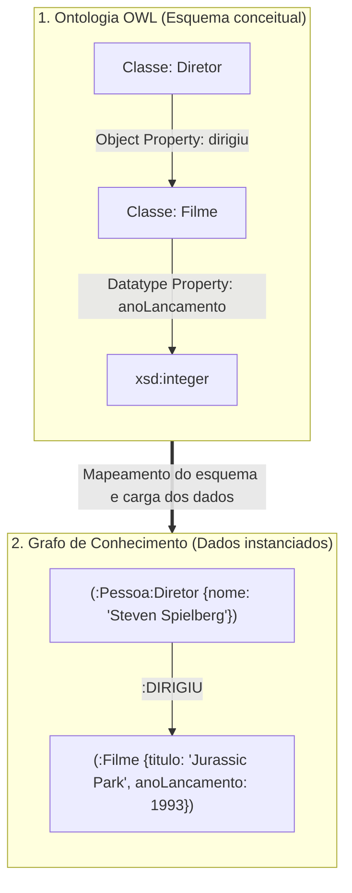

# Lista 2 - Inteligência Artificial

**Dupla:** Bruno Gomes de Barros Filho (21111360); Antônio Rodrigo Lima de Andrade Tenório (23210707)  
**Disciplina:** ECOM031: Inteligência Artificial  
**Professor:** Evandro de Barros Costa  
**Período:** 2026.2

## Questão 1

Ontologias e grafos de conhecimento são duas formas de representar informações e relacionamentos entre diferentes entidades. Apesar de utilizarem estruturas semelhantes, com nós, relações e propriedades, cada abordagem possui características próprias e atende a necessidades diferentes. Enquanto as ontologias dão maior atenção à definição formal dos conceitos e às regras que relacionam esses conceitos, os grafos de conhecimento priorizam a organização das informações e as conexões entre os dados.

Para entender melhor essas diferenças, é importante observar como cada abordagem representa o conhecimento, realiza inferências e lida com grandes volumes de informação.

### Comparativo: principais diferenças entre as abordagens

A diferença entre ontologias e grafos de conhecimento vai além da maneira como os dados são organizados. Ela também está relacionada à interpretação das informações, às regras utilizadas e ao tipo de consulta que cada modelo permite realizar.

#### 1. Formalismo lógico e hipótese de mundo

As ontologias utilizam como fundamento as Lógicas de Descrição (*Description Logics*), que fornecem uma base matemática para definir conceitos, propriedades e restrições. Um exemplo de padrão baseado nessa abordagem é o OWL 2. Nele, os elementos do domínio são descritos por meio de axiomas, permitindo estabelecer relações e regras que podem ser verificadas automaticamente.

Uma característica importante é a Hipótese de Mundo Aberto (*Open World Assumption*, OWA). Nessa abordagem, quando uma informação não está registrada, não significa necessariamente que ela seja falsa. O sistema considera que aquele dado pode simplesmente não ser conhecido ou ainda não ter sido informado.

Outro aspecto é a ausência da pressuposição de nomes únicos (*Non-Unique Name Assumption*). Isso significa que duas entidades com identificadores diferentes podem representar o mesmo indivíduo. Por exemplo, dois registros de uma pessoa podem ser considerados equivalentes por meio de uma relação como `owl:sameAs`, desde que existam informações que justifiquem essa equivalência.

Já nos grafos de conhecimento, especialmente nos modelos de propriedades rotuladas (*Labeled Property Graphs*, LPG), como os utilizados pelo Neo4j, o foco costuma estar na consulta e na navegação entre as informações armazenadas. Em aplicações que seguem a Hipótese de Mundo Fechado (*Closed World Assumption*, CWA), considera-se que os dados não encontrados na base não estão disponíveis para aquela consulta.

É importante destacar que essa diferença depende da tecnologia utilizada. Grafos baseados em RDF, por exemplo, também podem seguir a semântica de mundo aberto. Portanto, não se pode afirmar que todo grafo de conhecimento utiliza obrigatoriamente a hipótese de mundo fechado.

#### 2. Mecanismos de inferência: dedução e navegação

Outra diferença importante está na maneira como cada abordagem trabalha com as informações.

Nas ontologias, a inferência é baseada em deduções lógicas. Para isso, são utilizados programas chamados *reasoners*, como HermiT, Pellet e FaCT++, que analisam os axiomas definidos no modelo. Esses mecanismos conseguem identificar relações que não foram cadastradas diretamente, verificar inconsistências e classificar automaticamente os indivíduos de acordo com as regras existentes.

Entre as principais tarefas realizadas estão:

- **Verificação de consistência:** identifica se existem informações contraditórias na ontologia.
- **Classificação:** organiza automaticamente as classes de acordo com as relações de especialização e generalização.
- **Subsunção:** verifica se uma classe está contida em outra, ou seja, se todos os seus indivíduos também pertencem a uma classe mais abrangente.
- **Instanciação:** identifica a quais classes um indivíduo pertence, inclusive quando essa relação pode ser deduzida a partir dos axiomas.

Nos grafos de conhecimento, o trabalho geralmente está mais relacionado à consulta e à análise das conexões entre os dados. Em ferramentas como o Neo4j, é possível utilizar a linguagem Cypher para percorrer relacionamentos, encontrar caminhos entre entidades e identificar informações conectadas.

Além disso, existem técnicas que permitem descobrir relações que ainda não foram registradas explicitamente. Entre elas estão os *embeddings* de grafos, como TransE e RotatE, e as Redes Neurais em Grafos (*Graph Neural Networks*, GNNs). Esses métodos podem ser utilizados para prever conexões que provavelmente existem entre duas entidades, tarefa conhecida como *link prediction*.

Assim, enquanto as ontologias se destacam pela aplicação de regras lógicas para deduzir informações, os grafos oferecem recursos para explorar relacionamentos e identificar padrões presentes na rede.

#### 3. Escalabilidade e custo de processamento

O nível de formalização das ontologias também influencia o custo de processamento. Quanto mais complexas forem as regras e relações definidas, maior pode ser o esforço necessário para realizar as inferências.

Em fragmentos expressivos do OWL 2 DL, alguns problemas de raciocínio apresentam complexidade computacional elevada, podendo chegar a níveis como NEXPTIME e 2EXPTIME. Por isso, executar inferências complexas sobre bases com centenas de milhões de instâncias pode exigir muitos recursos e não ser adequado para consultas em tempo real.

Nos grafos de propriedades, a estrutura de relacionamentos permite percorrer conexões diretamente, sem precisar analisar toda a base a cada consulta. No Neo4j, por exemplo, o conceito de *index-free adjacency* permite que os nós mantenham referências diretas aos seus relacionamentos, facilitando a navegação entre entidades conectadas.

Isso pode tornar consultas locais bastante eficientes, especialmente quando o objetivo é encontrar caminhos ou relacionamentos próximos. Entretanto, o desempenho também depende da quantidade de conexões percorridas, da estrutura do grafo e da complexidade da consulta.

Na prática, a escolha entre as abordagens depende do objetivo da aplicação: quando a prioridade é validar regras e realizar deduções formais, as ontologias oferecem recursos adequados. Quando o objetivo é explorar grandes redes de relacionamentos e consultar conexões entre entidades, os grafos de conhecimento podem ser mais convenientes.

| Dimensão de análise | Sistemas baseados em ontologias | Sistemas baseados em grafos de conhecimento |
| :--- | :--- | :--- |
| Núcleo teórico | Lógicas de Descrição (DL) e semântica formal | Teoria dos grafos e propriedades rotuladas (LPG) |
| Ferramentas comuns | OWL 2, Protégé, HermiT e Pellet | Neo4j, Cypher, Amazon Neptune e RDF/SPARQL |
| Hipótese de mundo | Geralmente Mundo Aberto (OWA) | Depende da tecnologia; LPGs frequentemente utilizam Mundo Fechado (CWA) |
| Tipo de inferência | Dedução lógica baseada em axiomas | Navegação, análise de caminhos e métodos estatísticos |
| Principal desafio | Custo computacional de inferências complexas | Manutenção da consistência e qualidade dos relacionamentos |

### Exemplo prático: catálogo e recomendação de filmes

Para visualizar melhor como essas abordagens funcionam, podemos considerar um sistema de recomendação de filmes. A ideia é utilizar informações sobre diretores, atores, gêneros e produções para sugerir títulos de acordo com os interesses de cada usuário.

#### Abordagem por ontologia: conceitos e regras

Na construção da ontologia, inicialmente são definidas as classes que representam os elementos do domínio. Por exemplo:

- `Pessoa`, representando pessoas envolvidas na produção cinematográfica.
- `Diretor` e `Ator`, como subclasses de `Pessoa`, declaradas disjuntas entre si.
- `Filme`, representando as produções cinematográficas.
- `dirigiu`, uma propriedade que relaciona um indivíduo da classe `Diretor` a um indivíduo da classe `Filme`.

Também podem ser definidas restrições para garantir que determinadas relações sejam utilizadas corretamente. Por exemplo, uma pessoa não pode ser classificada simultaneamente como `Diretor` e `Ator` caso o modelo tenha estabelecido essas classes como disjuntas.

A partir dessas definições, o *reasoner* consegue deduzir novas informações. Se a base receber o fato de que `Christopher Nolan dirigiu Oppenheimer` e a propriedade `dirigiu` tiver domínio definido como `Diretor` e alcance definido como `Filme`, o sistema poderá inferir que Christopher Nolan pertence à classe `Diretor` e que Oppenheimer pertence à classe `Filme`.

Como `Diretor` é uma subclasse de `Pessoa`, também será possível concluir que Nolan pertence à classe `Pessoa`, sem que essa informação precise ser cadastrada diretamente.

Por outro lado, se a base registrar que `Inception` é o responsável por dirigir `Tenet`, o sistema poderá identificar uma inconsistência caso `Inception` esteja classificado como `Filme` e a propriedade exija que seu domínio seja `Diretor`. Nesse caso, o modelo identifica a incompatibilidade lógica, embora a detecção não signifique necessariamente que o registro será automaticamente rejeitado pelo sistema de armazenamento.

Dessa forma, a ontologia permite estabelecer regras sobre o domínio e verificar se as informações cadastradas estão de acordo com elas.

#### Abordagem por grafo de conhecimento: conexões e consultas

No grafo de conhecimento, a representação é feita por meio de entidades concretas e dos relacionamentos existentes entre elas.

Por exemplo, podemos cadastrar:

- `Steven Spielberg`, como um nó que representa uma pessoa.
- `Jurassic Park`, como um nó que representa um filme.
- `Ficção Científica`, como um nó que representa um gênero cinematográfico.

Esses elementos são conectados por arestas direcionadas, como:

- `(:Pessoa)-[:DIRIGIU]->(:Filme)`
- `(:Filme)-[:GENERO]->(:Tema)`

Com essa estrutura, o sistema consegue percorrer os relacionamentos e encontrar filmes que compartilham características com outros títulos.

Por exemplo, quando um usuário demonstra interesse em `Jurassic Park`, podemos executar uma consulta Cypher para localizar outros filmes dirigidos pela mesma pessoa ou que possuam gêneros e características em comum.

Nesse caso, o sistema pode encontrar títulos como `Tubarão` e `E.T.`, também dirigidos por Steven Spielberg. A recomendação acontece a partir das conexões existentes no grafo, sem a necessidade de utilizar um mecanismo de dedução lógica como o empregado nas ontologias.

### Mapeamento: da ontologia para o grafo de propriedades

Na prática, também é possível utilizar as duas abordagens em conjunto. Uma possibilidade é desenvolver inicialmente o modelo conceitual no Protégé, utilizando OWL, e depois transportar sua estrutura para um banco de grafos, como o Neo4j.

Essa conversão exige alguns cuidados, pois nem todas as características de uma ontologia possuem uma representação direta em um grafo de propriedades.

De maneira geral, o processo pode ser dividido em quatro etapas:

1. **Classes se tornam rótulos de nós (*labels*).**

   Cada classe definida na ontologia pode ser representada por um rótulo no grafo. Por exemplo, as classes `Diretor` e `Pessoa` podem ser utilizadas como *labels* de um mesmo nó, indicando que aquela entidade pertence às duas categorias.

   As hierarquias definidas por `subClassOf` também podem ser representadas dessa maneira, desde que a aplicação mantenha corretamente as relações entre as classes.

2. **Propriedades de objeto se tornam relacionamentos.**

   As propriedades que representam relações entre entidades são convertidas em arestas direcionadas. Por exemplo, a propriedade `dirigiu`, que relaciona um diretor a um filme, pode ser representada no grafo como `[:DIRIGIU]`.

3. **Propriedades de dados se tornam atributos dos nós.**

   Informações como ano de lançamento, orçamento e título não precisam ser representadas como nós separados. Elas podem ser armazenadas diretamente como atributos da entidade correspondente.

   Assim, um filme pode possuir propriedades como `titulo`, `anoLancamento` e `orcamento`.

4. **Axiomas e restrições precisam ser adaptados.**

   Uma diferença importante é que bancos de grafos de propriedades não oferecem, nativamente, o mesmo mecanismo de raciocínio lógico das ontologias OWL. Algumas restrições podem ser representadas por *constraints*, como regras de unicidade, enquanto outras precisam ser verificadas pela aplicação antes que os dados sejam armazenados.

   Por exemplo, regras de disjunção entre classes e determinadas restrições de cardinalidade precisam de validações adicionais para preservar a semântica do modelo original.

O fluxo abaixo apresenta um exemplo simplificado dessa conversão, mostrando como as classes e propriedades definidas na ontologia podem ser representadas por nós, atributos e relacionamentos em um grafo de conhecimento.

Como podemos observar, a ontologia fornece a estrutura conceitual e as regras que definem o domínio, enquanto o grafo representa as entidades e suas conexões de maneira adequada para consultas e exploração dos relacionamentos.

Portanto, as duas abordagens não precisam ser utilizadas de forma isolada. Em determinadas aplicações, a combinação das duas permite aproveitar a organização formal e a capacidade de inferência das ontologias, juntamente com a facilidade de navegação e consulta dos grafos de conhecimento.