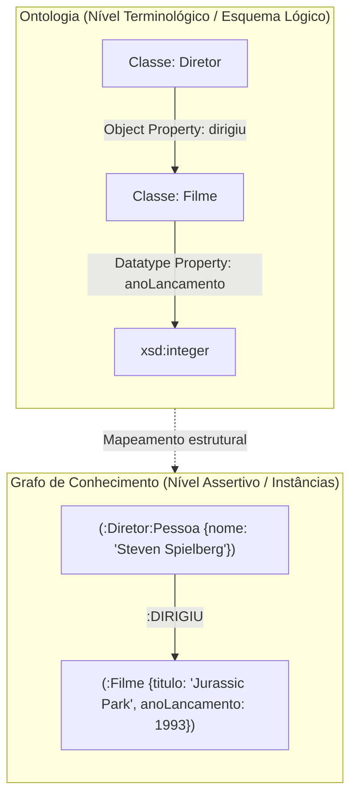

# Lista 2 - Inteligência Artificial
**Dupla:** Bruno Gomes e Renato Coca

## Questão 1

Sistemas baseados em Ontologias e Sistemas baseados em Grafos de Conhecimento representam abordagens complementares para estruturar e inferir informação em Inteligência Artificial. Embora ambos organizem entidades e relacionamentos em redes conceituais, eles partem de fundamentos teóricos e objetivos operacionais distintos.

### Comparativo entre Ontologias e Grafos de Conhecimento

A distinção central reside na formalidade lógica, na suposição de mundo e na finalidade computacional:

1. Fundamentação teórica e semântica
As ontologias derivam da lógica formal, em particular das Lógicas de Descrição (Description Logics, base da linguagem OWL da W3C). Elas formalizam um domínio por meio de axiomas rigorosos, definindo o que pode existir e quais regras governam essas entidades. Operam sob a Hipótese de Mundo Aberto (Open World Assumption, OWA): a ausência de uma informação não implica que ela seja falsa, apenas desconhecida. Já os Grafos de Conhecimento (Knowledge Graphs, KGs) têm origem na união da Web Semântica (triplas RDF) com bancos de dados em grafo (modelos de propriedades rotuladas, como Neo4j). Eles priorizam a conectividade direta entre instâncias do mundo real e costumam operar sob a Hipótese de Mundo Fechado (Closed World Assumption, CWA), em que fatos não registrados são tratados como inexistentes para fins de consulta.

2. Mecanismos de raciocínio e inferência
Em sistemas ontológicos, a inferência é dedutiva. Motores de raciocínio lógico (reasoners como HermiT ou Pellet, baseados no algoritmo de Tableau) verificam a consistência da base, calculam a classificação taxonômica automática e deduzem novos fatos estritamente a partir dos axiomas declarados. Em contrapartida, em Grafos de Conhecimento a inferência é predominantemente estrutural, algorítmica ou indutiva. Utilizam-se consultas de casamento de padrões (SPARQL, Cypher), métricas de teoria dos grafos (centralidade, caminhos mínimos) e técnicas de aprendizado de máquina sobre grafos (embeddings de nós e arestas, redes neurais em grafo) para prever elos ausentes e clusterizar entidades.

3. Escalabilidade e desempenho computacional
O raciocínio ontológico formal sobre lógicas expressivas (como OWL 2 DL) possui alta complexidade computacional no pior caso, o que impõe barreiras ao processamento de dezenas de milhões de instâncias em tempo real. Os Grafos de Conhecimento foram projetados para alta performance de leitura e travessia sobre volumes massivos de dados (bilhões de nós e arestas), sacrificando expressividade lógica em prol de velocidade de consulta e indexação física eficiente.

| Dimensão | Sistemas baseados em Ontologias | Sistemas baseados em Grafos de Conhecimento |
| :--- | :--- | :--- |
| Paradigma principal | Lógica de Descrição e semântica formal | Estrutura de dados em grafo e conectividade |
| Padrão / Tecnologia comum | W3C OWL 2, Protégé, HermiT, Pellet | Labeled Property Graph (Neo4j), RDF Triplestores |
| Suposição de mundo | Mundo Aberto (OWA) | Mundo Fechado (CWA) ou completude pragmática |
| Tipo de inferência | Dedução lógica formal via tableau | Travessia de grafos, Cypher/SPARQL, embeddings |
| Foco primário | Validação de consistência e classificação | Consultas rápidas de relacionamento e escalabilidade |

### Exemplo de Aplicação: Sistema de Recomendação de Filmes

Considere um sistema inteligente para catálogo e recomendação cinematográfica.

Na abordagem ontológica, o foco está na especificação conceitual do domínio e em suas regras formais (o componente TBox, terminológico):
- Classes e hierarquias: define-se que `Diretor` e `Ator` são subclasses de `Pessoa`, e que as classes `Pessoa` e `Filme` são mutuamente disjuntas.
- Restrições de domínio e imagem: a propriedade `dirigiu` possui domínio `Diretor` e imagem `Filme`.
- Inferência dedutiva: caso uma nova instância `Christopher Nolan` seja associada pela relação `dirigiu` a `Oppenheimer`, o reasoner infere automaticamente que `Christopher Nolan` pertence à classe `Diretor` e, por conseguinte, à classe `Pessoa`, sem necessidade de declaração explícita. Se alguém tentar declarar que um `Filme` dirigiu outro `Filme`, o reasoner aponta inconsistência imediata.

Na abordagem por Grafo de Conhecimento, o foco está na navegação sobre a rede de instâncias e relacionamentos do catálogo (o grafo instanciado):
- Entidades reais são nós: nós específicos para Steven Spielberg, Jurassic Park, Ficção Científica e Jeff Goldblum.
- Relações são arestas direcionadas: arestas do tipo `:DIRIGIU`, `:ATUOU_EM`, `:PERTENCE_AO_GENERO`.
- Recomendação prática: o sistema calcula a similaridade entre itens buscando caminhos compartilhados no grafo. Um usuário que assistiu `Jurassic Park` recebe a recomendação de `Tubarão` porque ambos compartilham a aresta `:DIRIGIU` conectada ao mesmo nó diretor e pertencem aos mesmos agrupamentos de gênero, cálculo executado em poucos milissegundos por meio de travessia de vizinhança.

### Mapeamento de Ontologia para Grafo de Conhecimento

Para transferir o conhecimento formalizado de uma ontologia OWL para um Grafo de Conhecimento em modelo de Grafo de Propriedades Rotuladas (Labeled Property Graph, padrão do Neo4j), adota-se o seguinte processo de conversão:

1. Classes ontológicas são mapeadas para rótulos de nós (Labels). A hierarquia de herança (`subClassOf`) pode ser tratada adicionando múltiplos rótulos ao mesmo nó (por exemplo, um nó com rótulos `:Pessoa` e `:Diretor`) ou mantendo nós de metadados ligados por arestas de hierarquia.
2. Propriedades de objeto (Object Properties) tornam-se arestas direcionadas tipadas entre os nós que representam os indivíduos envolvidos (por exemplo, a propriedade `dirigiu` vira a aresta `[:DIRIGIU]`).
3. Propriedades de tipo de dados (Datatype Properties) tornam-se pares de chave e valor armazenados internamente no nó ou na aresta (por exemplo, `anoLancamento: 1993` guardado no próprio nó do filme).
4. Axiomas e restrições formais (como restrições de cardinalidade ou disjunções) não são executados por motores de grafo comuns. Eles são convertidos em constraints de integridade do banco (restrições de unicidade e campos obrigatórios) ou validados na camada de serviço antes da inserção dos dados.

O diagrama a seguir sintetiza a correspondência entre o esquema lógico da ontologia e a estrutura instanciada no grafo:

