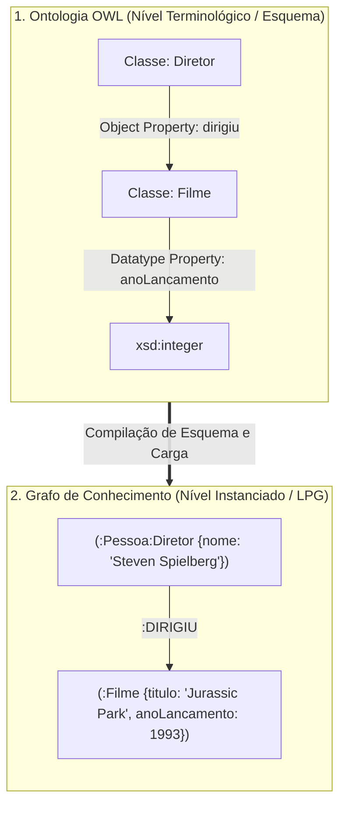

# Lista 2 - Inteligência Artificial
**Dupla:** Bruno Gomes e Renato Coca

## Questão 1

Ontologias e grafos de conhecimento organizam entidades e relacionamentos em rede, mas resolvem problemas diferentes. Confundi-los é comum na literatura, embora cada modelo tenha semântica, hipótese de mundo e custo de consulta próprios.

### Comparativo: onde as abordagens divergem

A diferença principal não é o desenho de nós e arestas. Está na semântica formal, na hipótese sobre o mundo e no custo computacional de cada consulta.

#### 1. Formalismo lógico e premissa de mundo
Ontologias se apoiam em Lógicas de Descrição (Description Logics), base matemática de padrões como OWL 2. Cada conceito é amarrado por axiomas. O sistema opera sob a Hipótese de Mundo Aberto (Open World Assumption, OWA): se uma informação não foi declarada, o modelo trata essa informação como desconhecida, e não como falsa.

Nos grafos de conhecimento comerciais (KGs em Labeled Property Graphs como o Neo4j, ou triplestores RDF), a premissa se inverte. Eles adotam a Hipótese de Mundo Fechado (Closed World Assumption, CWA). O que não está no banco não existe para o mecanismo de consulta. A prioridade deixa de ser demonstrar teoremas e passa a ser a conectividade rápida entre instâncias reais.

#### 2. Mecanismos de inferência: dedução e travessia
O modo de raciocinar deixa a diferença mais clara.

Nas ontologias, a inferência é dedutiva. A base conceitual é processada por raciocinadores automáticos baseados no algoritmo de Tableau (HermiT, Pellet). O reasoner valida a consistência do modelo, calcula hierarquias implícitas e classifica indivíduos sem anotação manual.

Em um grafo de conhecimento, inferência quase nunca significa provar lógica formal. Significa navegar na topologia da rede: consultas em Cypher ou SPARQL, métricas de centralidade, caminhos mínimos e modelos estatísticos sobre grafos, como embeddings de nós (TransE, RotatE) e Graph Neural Networks (GNNs). O uso típico é preditivo.

#### 3. Escalabilidade e custo de processamento
A expressividade lógica tem custo alto.

O raciocínio ontológico sobre fragmentos expressivos de OWL 2 DL chega, no pior caso, a complexidades entre NEXPTIME e 2EXPTIME. Rodar um reasoner de Tableau com inferência arbitrária em tempo real sobre centenas de milhões de instâncias costuma ser inviável.

Grafos de propriedade abrem mão de boa parte do rigor dedutivo para travessar arestas com custo quase linear, usando indexação física por adjacência direta (index-free adjacency). Em troca, processam volumes grandes de arestas com latência baixa.

Na prática, a escolha costuma ser entre velocidade de busca e rigor formal.

| Dimensão de análise | Sistemas baseados em ontologias | Sistemas baseados em grafos de conhecimento |
| :--- | :--- | :--- |
| Núcleo teórico | Lógicas de Descrição (DL), semântica formal | Teoria dos grafos, propriedades rotuladas (LPG) |
| Stack típica | W3C OWL 2, Protégé, HermiT, Pellet | Neo4j, Cypher, Amazon Neptune, RDF SPARQL |
| Assunção de mundo | Mundo Aberto (OWA) e ausência de nomes únicos | Mundo Fechado (CWA) e identidades explícitas |
| Tipo de inferência | Dedução axiomática via Tableau | Travessia de vizinhança, caminhos e embeddings |
| Gargalo crítico | Explosão combinatória no raciocínio complexo | Integridade semântica mantida em grande parte à mão |

### Exemplo prático: catálogo e recomendação de filmes

Para ver o contraste na prática, considere um sistema de recomendação cinematográfica.

#### Abordagem por ontologia (esquema e regras)
No TBox, desenha-se a estrutura conceitual do domínio:
* as classes `Diretor` e `Ator` como subclasses disjuntas de `Pessoa`;
* a propriedade de objeto `dirigiu` com domínio em `Diretor` e imagem em `Filme`;
* a regra de consistência de que nada pode ser ao mesmo tempo `Filme` e `Pessoa`.

Na carga de dados, o poder dedutivo aparece. Se o sistema recebe o fato `Christopher Nolan dirigiu Oppenheimer`, o reasoner conclui que Nolan pertence à classe `Diretor` e, portanto, à classe `Pessoa`, sem cadastro manual dessas classes. Se uma fonte corrompida tentar registrar que `Inception dirigiu Tenet`, o motor detecta a violação de domínio e rejeita a inserção. A ontologia funciona como fiscal lógico da base.

#### Abordagem por grafo de conhecimento (conexões e consulta)
No grafo, a prioridade é a malha de dados instanciada:
* `Steven Spielberg`, `Jurassic Park` e `Ficção Científica` são nós concretos;
* as conexões são arestas direcionadas: `(:Pessoa)-[:DIRIGIU]->(:Filme)` e `(:Filme)-[:GENERO]->(:Tema)`.

Para recomendar um filme a quem assistiu `Jurassic Park`, não se chama um provador de teoremas. Roda-se uma consulta Cypher buscando filmes dirigidos pela mesma pessoa ou que compartilhem elenco e clusters de gênero a dois ou três saltos. O banco percorre os ponteiros em milissegundos e devolve títulos como `Tubarão` ou `E.T.`.

### Mapeamento: da ontologia ao grafo de propriedades

Na engenharia de software, é comum modelar o domínio no Protégé (OWL) e depois levar esse esquema a um banco de grafos (por exemplo, Neo4j). Essa transição costuma seguir quatro passos:

1. **Classes viram labels de nós.**
   Cada classe ontológica vira um rótulo no grafo. Hierarquias (`subClassOf`) podem ser resolvidas atribuindo vários labels ao mesmo nó: a entidade recebe `:Diretor` e `:Pessoa`.
2. **Propriedades de objeto viram arestas tipadas.**
   Relações conceituais entre classes viram arestas direcionadas entre os nós equivalentes. A propriedade `dirigiu` torna-se a aresta `[:DIRIGIU]`.
3. **Propriedades de tipo de dados viram atributos internos.**
   Atributos literais não precisam virar nós separados. `anoLancamento` ou `orcamento` ficam como pares chave-valor dentro do nó `(:Filme)`, o que reduz memória e acelera a leitura.
4. **Axiomas e restrições viram constraints e código de aplicação.**
   Motores como o Neo4j não avaliam axiomas lógicos em tempo de execução. Restrições de unicidade viram `UNIQUE CONSTRAINT`; regras de cardinalidade ou disjunção precisam ser validadas na camada de serviço da API antes de gravar.

O fluxo abaixo resume a conversão do modelo terminológico em instâncias de grafo:

