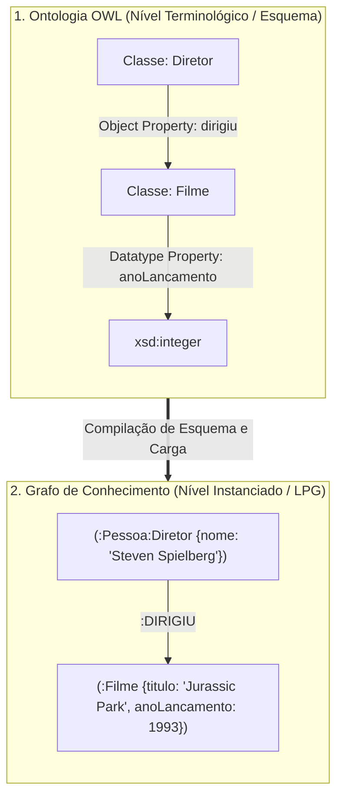

# Lista 2 - Inteligência Artificial
**Dupla:** Bruno Gomes e Renato Coca

## Questão 1

Tratar ontologias e grafos de conhecimento como se fossem a mesma coisa é um erro comum na literatura. Não são. Embora os dois modelos organizem entidades e relacionamentos em rede, cada um resolve um gargalo computacional completamente diferente.

### Comparativo Direto: Onde as Abordagens Divergem

A divergência real não está no desenho visual de nós e arestas. Está na semântica formal, na hipótese sobre o mundo e no custo computacional de cada consulta.

#### 1. Formalismo Lógico e Premissa de Mundo
Ontologias se apoiam em Lógicas de Descrição (Description Logics, a base matemática de padrões como OWL 2). Aqui, cada conceito é amarrado por axiomas estritos. O sistema opera sob a Hipótese de Mundo Aberto (Open World Assumption, OWA). O princípio é simples: se uma informação não foi explicitamente declarada, o modelo assume que ela é desconhecida, jamais falsa.

Nos grafos de conhecimento comerciais (KGs baseados em Labeled Property Graphs como o Neo4j, ou triplestores RDF), a premissa se inverte. Eles adotam a Hipótese de Mundo Fechado (Closed World Assumption, CWA). O que não está gravado no banco de dados simplesmente não existe para o mecanismo de consulta. A prioridade não é demonstrar teoremas lógicos. O objetivo é viabilizar conectividade imediata entre instâncias reais.

#### 2. Mecanismos de Inferência: Dedução vs. Travessia
O modo de raciocinar expõe a ruptura entre as duas arquiteturas.

Nas ontologias, a inferência é dedutiva e exata. Você alimenta a base conceitual e entrega o processamento para raciocinadores automáticos baseados no algoritmo de Tableau (como HermiT ou Pellet). O reasoner valida a consistência do modelo, calcula hierarquias implícitas e infere novas classificações sem intervenção manual.

Em um grafo de conhecimento, inferência raramente significa provar lógica formal. Significa navegar na topologia da rede. Você extrai novos conhecimentos usando consultas estruturadas em Cypher ou SPARQL, métricas de centralidade, caminhos mínimos e modelos estatísticos de aprendizado de máquina sobre grafos, a exemplo de embeddings de nós (TransE, RotatE) e Graph Neural Networks (GNNs).

O foco é puramente preditivo.

#### 3. Escalabilidade e Custo de Processamento
A expressividade lógica cobra um preço alto.

O raciocínio ontológico sobre fragmentos expressivos de OWL 2 DL possui alta complexidade computacional no pior caso (variando entre NEXPTIME e 2EXPTIME). Tente rodar um reasoner de Tableau sobre cem milhões de instâncias com inferência arbitrária em tempo real: a máquina trava. O gargalo é matemático.

Grafos de propriedade nasceram para contornar essa barreira. Eles abrem mão da maior parte do rigor dedutivo para entregar travessias de arestas com custo quase linear, tirando proveito de indexação física por adjacência direta (index-free adjacency). Processam bilhões de arestas em frações de segundo.

A escolha é pragmática: velocidade de busca ou rigor formal.

| Dimensão de Análise | Sistemas Baseados em Ontologias | Sistemas Baseados em Grafos de Conhecimento |
| :--- | :--- | :--- |
| **Núcleo Teórico** | Lógicas de Descrição (DL), semântica formal | Teoria dos grafos, propriedades rotuladas (LPG) |
| **Stack Típica** | W3C OWL 2, Protégé, HermiT, Pellet | Neo4j, Cypher, Amazon Neptune, RDF SPARQL |
| **Assunção de Mundo** | Mundo Aberto (OWA) e ausência de nomes únicos | Mundo Fechado (CWA) e identidades explícitas |
| **Tipo de Inferência** | Dedução axiomática formal via Tableau | Travessia de vizinhança, caminhos e embeddings |
| **Gargalo Crítico** | Explosão combinatória no raciocínio complexo | Integridade semântica mantida manualmente |

---

### Exemplo Prático: Catálogo e Recomendação de Filmes

Para enxergar o contraste no chão de fábrica, considere a arquitetura de um sistema inteligente de recomendação cinematográfica.

#### Abordagem por Ontologia (Foco no Esquema e nas Regras)
Aqui trabalhamos no TBox, desenhando a estrutura conceitual do domínio:
* Declaram-se as classes `Diretor` e `Ator` como subclasses disjuntas de `Pessoa`.
* Define-se a propriedade de objeto `dirigiu` com domínio estrito em `Diretor` e imagem em `Filme`.
* Declara-se a regra de consistência: nada pode ser simultaneamente `Filme` e `Pessoa`.

O poder dedutivo entra em ação na carga de dados. Se o sistema recebe o fato bruto `Christopher Nolan dirigiu Oppenheimer`, o reasoner infere instantaneamente duas coisas: Nolan pertence à classe `Diretor` e, consequentemente, à classe `Pessoa`. Ninguém precisou cadastrar isso manualmente. Mais: se uma fonte de dados corrompida tentar registrar que `Inception dirigiu Tenet`, o motor detecta a violação de domínio na raiz e rejeita a inserção. A ontologia atua como um fiscal lógico inflexível.

#### Abordagem por Grafo de Conhecimento (Foco nas Conexões e no Consumo)
No grafo, a prioridade muda para a malha de dados instanciada:
* `Steven Spielberg`, `Jurassic Park` e `Ficção Científica` são nós concretos.
* As conexões são arestas direcionadas: `(:Pessoa)-[:DIRIGIU]->(:Filme)` e `(:Filme)-[:GENERO]->(:Tema)`.

Quer recomendar um filme para quem assistiu `Jurassic Park`? Não chamamos um provador de teoremas. Rodamos uma consulta Cypher simples buscando filmes dirigidos pela mesma pessoa ou compartilhando elenco e clusters de gênero a dois ou três saltos de distância. O banco percorre os ponteiros em milissegundos e devolve `Tubarão` ou `E.T.`. Rápido. Direto ao ponto.

---

### Mapeamento: Transformando a Ontologia em Grafo de Propriedades

Na prática da engenharia de software, é comum modelar o domínio conceitual no Protégé (OWL) e depois migrar essa inteligência para um banco de grafos (como o Neo4j). Esse pipeline de transição segue quatro passos bem definidos:

1. **Classes viram Labels de Nós.**
   Cada classe ontológica se converte em um rótulo no grafo. Hierarquias (`subClassOf`) são resolvidas atribuindo múltiplos labels ao mesmo nó: uma entidade recebe tanto `:Diretor` quanto `:Pessoa`.
2. **Propriedades de Objeto viram Arestas Tipadas.**
   Relações conceituais entre classes viram arestas direcionadas entre os nós equivalentes. A propriedade `dirigiu` torna-se a aresta `[:DIRIGIU]`.
3. **Propriedades de Tipo de Dados viram Atributos Internos.**
   Atributos literais não viram nós separados. `anoLancamento` ou `orcamento` são gravados diretamente como pares chave-valor dentro do nó `(:Filme)`. Isso poupa memória e acelera a leitura.
4. **Axiomas e Restrições viram Constraints e Código de Aplicação.**
   Motores como o Neo4j não avaliam axiomas em tempo de execução. Logo, restrições de unicidade viram `UNIQUE CONSTRAINT`, enquanto regras de cardinalidade ou disjunções devem ser validadas na camada de serviço da API antes de persistir a escrita.

O fluxo abaixo resume a conversão do modelo terminológico em instâncias de grafo:

