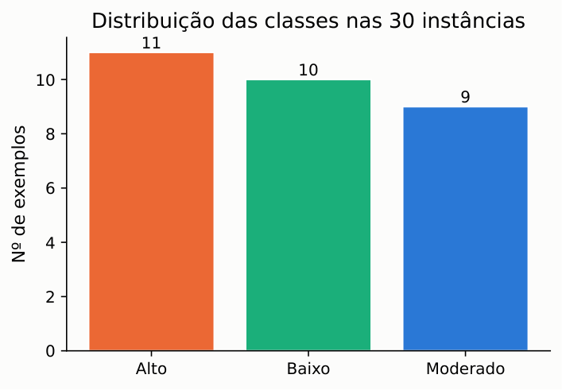
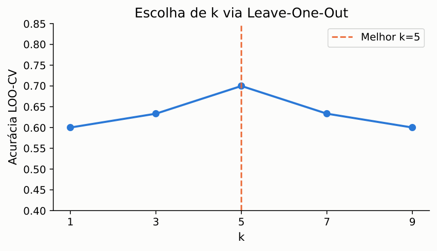
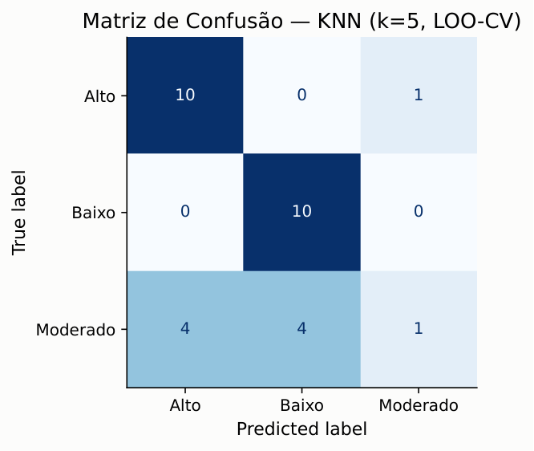
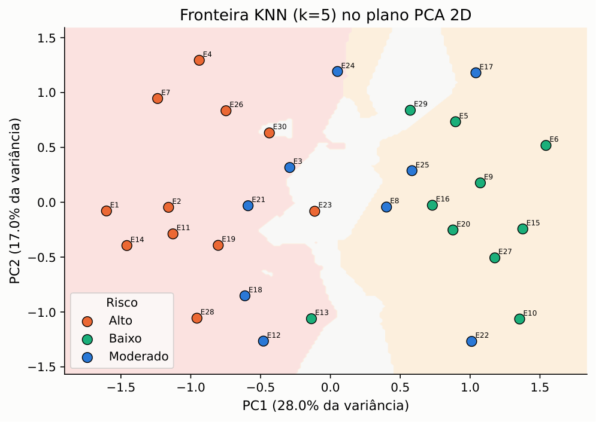
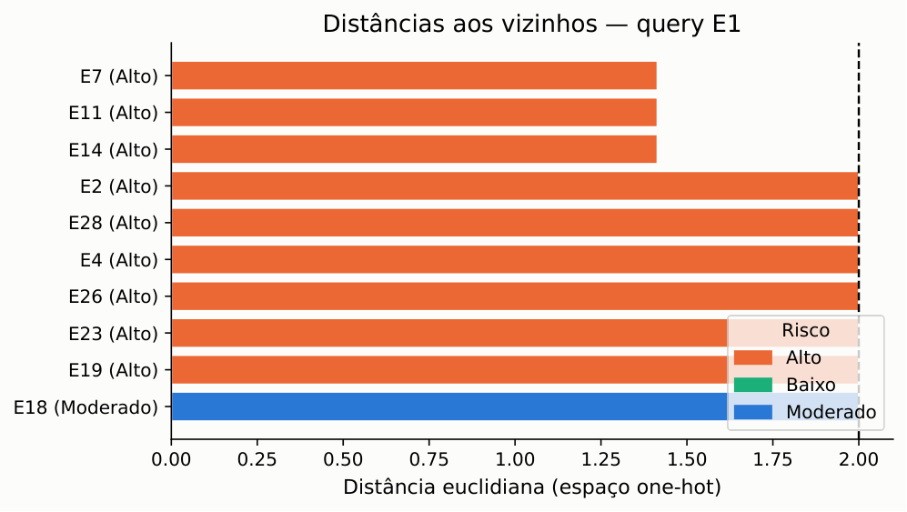

# Lista 2 — Inteligência Artificial

**Dupla:** Bruno Gomes de Barros Filho (21111360); Antonio Rodrigo Lima de Andrade Tenório (23210707)  
**Disciplina:** ECOM031 — Inteligência Artificial  
**Professor:** Evandro de Barros Costa  
**Período:** 2026.2

## Questão 2 — Classificador dos K-Vizinhos Mais Próximos (KNN)

### Base de Dados e Configuração do Experimento

O algoritmo dos K-Vizinhos Mais Próximos (K-Nearest Neighbors — KNN) foi avaliado sobre as mesmas 30 instâncias de risco de crédito usadas na Lista de Exercícios 1. A base parte do exemplo clássico do livro de Luger e foi ampliada na Questão 1 daquela lista para 6 atributos categóricos e 30 exemplos (E1 a E30).

Os atributos preditores são História de Crédito, Dívida, Garantia, Renda, Emprego e Imóvel. A variável-alvo é o risco de crédito, com três classes:

- **Alto**
- **Moderado**
- **Baixo**

Como o KNN trabalha com distância numérica e todos os atributos são categóricos, cada atributo foi convertido em colunas binárias por one-hot encoding (`get_dummies`), a mesma estratégia usada no CART da Lista 1. O espaço resultante tem 14 dimensões com valores em {0, 1}, de modo que a distância euclidiana entre dois exemplos conta, na prática, quantas categorias diferem. Não foi necessária normalização min-max.

Código e experimentos: [`src/q02_knn/q02_knn.ipynb`](../src/q02_knn/q02_knn.ipynb).

### As 30 Instâncias Utilizadas no Experimento

A tabela abaixo reproduz a base completa da Lista 1.

| Ex. | História | Dívida | Garantia | Renda | Emprego | Imóvel | Risco |
| --- | --- | --- | --- | --- | --- | --- | --- |
| E1 | Ruim | Alta | Nenhuma | 0–15 | Instável | Alugado | Alto |
| E2 | Desconhecida | Alta | Nenhuma | 15–35 | Instável | Alugado | Alto |
| E3 | Desconhecida | Baixa | Nenhuma | 15–35 | Estável | Alugado | Moderado |
| E4 | Desconhecida | Baixa | Nenhuma | 0–15 | Instável | Alugado | Alto |
| E5 | Desconhecida | Baixa | Nenhuma | >35 | Estável | Próprio | Baixo |
| E6 | Desconhecida | Baixa | Adequada | >35 | Estável | Próprio | Baixo |
| E7 | Ruim | Baixa | Nenhuma | 0–15 | Instável | Alugado | Alto |
| E8 | Ruim | Baixa | Adequada | >35 | Estável | Alugado | Moderado |
| E9 | Boa | Baixa | Nenhuma | >35 | Estável | Próprio | Baixo |
| E10 | Boa | Alta | Adequada | >35 | Estável | Próprio | Baixo |
| E11 | Boa | Alta | Nenhuma | 0–15 | Instável | Alugado | Alto |
| E12 | Boa | Alta | Nenhuma | 15–35 | Estável | Alugado | Moderado |
| E13 | Boa | Alta | Nenhuma | >35 | Estável | Alugado | Baixo |
| E14 | Ruim | Alta | Nenhuma | 15–35 | Instável | Alugado | Alto |
| E15 | Boa | Baixa | Adequada | 15–35 | Estável | Próprio | Baixo |
| E16 | Boa | Baixa | Nenhuma | 15–35 | Estável | Próprio | Baixo |
| E17 | Desconhecida | Baixa | Adequada | >35 | Instável | Próprio | Moderado |
| E18 | Ruim | Alta | Nenhuma | >35 | Estável | Alugado | Moderado |
| E19 | Desconhecida | Alta | Nenhuma | 0–15 | Estável | Alugado | Alto |
| E20 | Boa | Baixa | Adequada | >35 | Estável | Alugado | Baixo |
| E21 | Ruim | Baixa | Nenhuma | 15–35 | Estável | Alugado | Moderado |
| E22 | Boa | Alta | Adequada | 15–35 | Estável | Próprio | Moderado |
| E23 | Ruim | Alta | Adequada | 0–15 | Instável | Próprio | Alto |
| E24 | Desconhecida | Baixa | Nenhuma | 15–35 | Instável | Próprio | Moderado |
| E25 | Boa | Baixa | Nenhuma | 0–15 | Estável | Próprio | Moderado |
| E26 | Ruim | Baixa | Nenhuma | >35 | Instável | Alugado | Alto |
| E27 | Desconhecida | Alta | Adequada | >35 | Estável | Próprio | Baixo |
| E28 | Ruim | Alta | Nenhuma | 15–35 | Estável | Alugado | Alto |
| E29 | Boa | Baixa | Nenhuma | >35 | Instável | Próprio | Baixo |
| E30 | Desconhecida | Baixa | Nenhuma | 0–15 | Estável | Alugado | Alto |

A distribuição ficou com 11 exemplos de risco **Alto**, 9 de **Moderado** e 10 de **Baixo**.

### Funcionamento do Algoritmo KNN

O KNN é um algoritmo de aprendizado baseado em instâncias (*lazy learner*): ele não constrói uma função de generalização explícita na fase de treino. O processamento acontece no momento da predição:

1. **Cálculo de distância.** Para uma instância de teste \(\mathbf{q} \in \mathbb{R}^p\), calcula-se a distância euclidiana para cada ponto \(\mathbf{x}_i\) do conjunto de treino:

\[
d(\mathbf{q}, \mathbf{x}_i) = \sqrt{\sum_{j=1}^{p} (q_j - x_{ij})^2}
\]

2. **Seleção dos \(k\) vizinhos.** Ordenam-se as distâncias em ordem crescente e ficam os \(k\) pontos mais próximos:

\[
\mathcal{N}_k(\mathbf{q}) = \operatorname{arg\,min}_{S \subset D,\ |S|=k} \sum_{\mathbf{x}_i \in S} d(\mathbf{q}, \mathbf{x}_i)
\]

3. **Voto majoritário.** A classe predita \(\hat{y}\) é a mais frequente entre os \(k\) vizinhos:

\[
\hat{y} = \operatorname{arg\,max}_{c \in C} \sum_{\mathbf{x}_i \in \mathcal{N}_k(\mathbf{q})} \mathbb{I}(y_i = c)
\]

Em caso de empate, usam-se critérios determinísticos de desempate (por exemplo, menor distância média ou classe majoritária a priori).

### Seleção do Hiperparâmetro \(k\) via Leave-One-Out (LOO-CV)

Com \(N = 30\), Leave-One-Out é a validação natural: a cada rodada, um exemplo fica de fora para teste e os outros 29 treinam o modelo. Foram avaliados valores ímpares \(k \in \{1, 3, 5, 7, 9\}\) para reduzir empates no voto.

| Valor de \(k\) | Acertos (/30) | Acurácia LOO-CV (%) |
| --- | ---: | ---: |
| \(k = 1\) | 18 | 60,00% |
| \(k = 3\) | 19 | 63,33% |
| **\(k = 5\)** | **21** | **70,00%** |
| \(k = 7\) | 19 | 63,33% |
| \(k = 9\) | 18 | 60,00% |

O melhor valor foi **\(k = 5\)**, com 21 acertos em 30 (70,00%). Com \(k = 1\) o classificador fica sensível a vizinhos isolados; com \(k \ge 7\) a votação começa a misturar exemplos de classes vizinhas e a acurácia cai de novo.

### Resultados e Análise de Desempenho

Com \(k = 5\), as predições Leave-One-Out geram as métricas abaixo.

| Classe | Precisão | Revocação | F1-Score | Suporte |
| --- | ---: | ---: | ---: | ---: |
| Alto | 0,71 | 0,91 | 0,80 | 11 |
| Baixo | 0,71 | 1,00 | 0,83 | 10 |
| Moderado | 0,50 | 0,11 | 0,18 | 9 |
| **Acurácia global** | | | **70,00%** | **30** |
| Média macro | 0,64 | 0,67 | 0,61 | 30 |
| Média ponderada | 0,65 | 0,70 | 0,63 | 30 |

O classificador acerta bem as classes extremas: recupera 10 dos 11 exemplos `Alto` e todos os 10 `Baixo`. A dificuldade fica em `Moderado`, que no Leave-One-Out é confundida com Alto ou Baixo (apenas 1 acerto em 9). Isso faz sentido na base: o risco moderado ocupa uma região intermediária do espaço de atributos e, com poucos exemplos, os vizinhos tendem a puxar o voto para uma das extremidades.

Como exemplo passo a passo, o caso E1 (risco real Alto) tem como cinco vizinhos mais próximos E7, E11, E14, E2 e E4, todos da classe Alto. O voto é unânime e a predição coincide com o rótulo verdadeiro.

### Referências (Q2)

1. RUSSELL, Stuart J.; NORVIG, Peter. *Inteligência Artificial: uma abordagem moderna*. 3. ed. Rio de Janeiro: Elsevier / Campus, 2013.
2. CARVALHO, André C. P. L. F. et al. *Inteligência Artificial: Uma Abordagem de Aprendizado de Máquina*. Rio de Janeiro: LTC, 2011.
3. LUGER, George F. *Artificial Intelligence: Structures and Strategies for Complex Problem Solving*. 6. ed. Boston: Pearson, 2009.
4. TENÓRIO, Antonio Rodrigo L. A.; GOMES, Bruno B. F. *Lista de Exercícios 1 — Inteligência Artificial*. Notebook `Lista_IA.ipynb`, UFAL, 2026.
