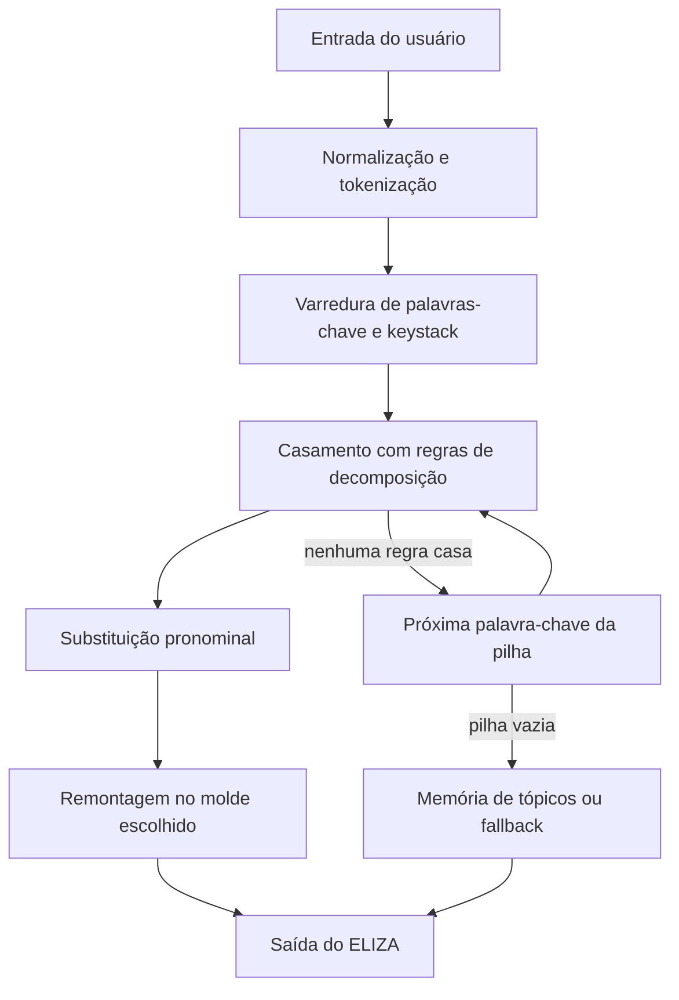
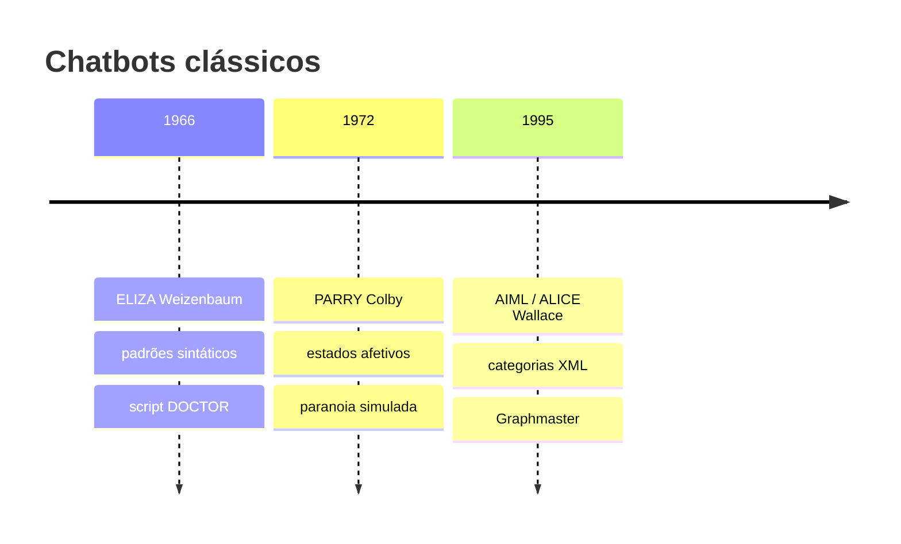

# Questão 3: Chatbot ELIZA, diálogo, algoritmo e evoluções (PARRY e AIML/ALICE)

**Disciplina:** ECOM031: Inteligência Artificial (UFAL)  
**Equipe:** Bruno Gomes de Barros Filho e Antônio Rodrigo Lima de Andrade Tenório  
**Professor:** Evandro de Barros Costa

## 1. O chatbot ELIZA e o script DOCTOR

O ELIZA foi desenvolvido por Joseph Weizenbaum, no MIT Artificial Intelligence Laboratory, entre 1964 e 1966. O programa foi criado para simular uma conversa em inglês utilizando regras de reconhecimento e substituição de padrões. A proposta não era fazer com que o computador realmente compreendesse o significado das frases, mas demonstrar como um conjunto relativamente simples de regras poderia levar uma pessoa a acreditar que estava conversando com um sistema inteligente e capaz de demonstrar empatia. Esse comportamento ficou conhecido como efeito ELIZA.

Um dos scripts mais conhecidos do programa é o DOCTOR, que simula uma conversa com um psicoterapeuta da abordagem centrada na pessoa, desenvolvida por Carl Rogers. Essa escolha não foi por acaso. Nesse tipo de abordagem, o terapeuta costuma ouvir o paciente, fazer perguntas e retomar partes do que foi dito, sem necessariamente apresentar opiniões ou soluções. Isso facilita a simulação, pois o programa não precisa ter um conhecimento aprofundado sobre o assunto discutido. Basta identificar determinadas palavras e construir respostas que mantenham a conversa.

### Principais funcionalidades

1. **Reconhecimento de padrões (*pattern matching*):** o programa analisa a frase enviada pelo usuário e procura palavras-chave e estruturas que correspondam às regras cadastradas. Para isso, utiliza curingas, como `*`, que representam trechos variáveis da frase.
2. **Montagem das respostas (*reassembly*):** depois de identificar um padrão, o ELIZA utiliza partes da frase original para construir uma resposta. Nesse processo, também realiza substituições de pronomes, como `I` e `my` por `you` e `your`.
3. **Prioridade das palavras-chave (*keystack*):** cada palavra-chave possui um nível de prioridade. Quando mais de uma é identificada na mesma frase, o programa tenta processar primeiro aquela que possui maior prioridade.
4. **Memória de tópicos:** algumas informações mencionadas pelo usuário, principalmente frases que contêm o possessivo `my`, podem ser armazenadas para serem utilizadas posteriormente, especialmente quando a conversa não encontra um novo caminho.
5. **Respostas alternativas (*fallback*):** quando nenhuma palavra-chave ou regra consegue produzir uma resposta específica, o programa utiliza frases genéricas, como *"Please go on"* ou *"What does that suggest to you?"*, para evitar que a conversa seja interrompida.

## 2. Trecho de diálogo e análise técnica

O diálogo a seguir é uma adaptação para o português de uma interação clássica apresentada por Weizenbaum (1966), utilizando o script DOCTOR. As falas foram organizadas para mostrar como o programa reage a diferentes tipos de frases e quais regras podem estar envolvidas na construção de suas respostas.

```text
[U1] Homens são todos iguais.
[E1] DE QUE MANEIRA?

[U2] Eles estão sempre nos incomodando por causa de alguma coisa.
[E2] VOCÊ CONSEGUE PENSAR EM UM EXEMPLO ESPECÍFICO?

[U3] Bem, meu namorado me fez vir aqui.
[E3] SEU NAMORADO FEZ VOCÊ VIR AQUI?

[U4] Ele disse que eu fico deprimida quase o tempo todo.
[E4] SINTO MUITO EM OUVIR QUE VOCÊ FICA DEPRIMIDA.

[U5] É verdade. Eu sou infeliz.
[E5] VOCÊ ACHA QUE VIR AQUI VAI TE AJUDAR A NÃO SER INFELIZ?

[U6] Eu preciso de um pouco de ajuda, isso é certo.
[E6] O QUE SIGNIFICARIA PARA VOCÊ SE VOCÊ CONSEGUISSE UM POUCO DE AJUDA?

[U7] Talvez eu pudesse aprender a me dar bem com minha mãe.
[E7] FALE-ME MAIS SOBRE A SUA FAMÍLIA.

[U8] Você não gosta de mim.
[E8] O QUE FAZ VOCÊ PENSAR QUE EU NÃO GOSTO DE VOCÊ?

[U9] Você não é uma pessoa de verdade, você é um computador.
[E9] IMPORTA SE EU SOU UM COMPUTADOR?
```

### Analisando algumas respostas do ELIZA

Algumas trocas desse diálogo ajudam a entender melhor como o programa funciona na prática.

- **[U3] → [E3].** Na frase, o usuário menciona que seu namorado o fez ir até ali. A palavra `my` (meu), no script original, está associada a uma regra que permite capturar o restante da informação e reutilizá-la na resposta. O programa também troca os pronomes para adaptar a frase ao ponto de vista do interlocutor. Assim, transforma a declaração em uma pergunta: *"Seu namorado fez você vir aqui?"*. Embora pareça uma demonstração de atenção ao que foi dito, o processo consiste basicamente em reconhecer e reorganizar partes da frase.

- **[U4] → [E4].** Quando o usuário menciona que está deprimido, o programa identifica uma palavra relacionada a esse estado emocional e utiliza uma resposta previamente definida. Nesse caso, a frase transmite uma ideia de acolhimento, mas o ELIZA não reconhece ou compreende o sentimento da pessoa. Ele apenas seleciona um modelo de resposta associado à palavra identificada.

- **[U7] → [E7].** Ao mencionar a mãe, o usuário aciona uma regra relacionada ao contexto familiar. Em vez de repetir diretamente a frase, o programa amplia o assunto e pergunta sobre a família. Isso demonstra que as regras não servem apenas para repetir palavras, mas também podem direcionar a conversa para temas previamente definidos no script.

- **[U2] → [E2].** A palavra `always` (sempre) está associada a uma regra que incentiva o usuário a apresentar um exemplo específico. A resposta segue o estilo de uma conversa terapêutica, na qual o interlocutor é levado a explicar melhor o que acabou de dizer.

### Limitações observadas no diálogo

Apesar de conseguir manter uma conversa aparentemente coerente, o ELIZA apresenta algumas limitações quando analisamos o funcionamento do programa.

- **Pouca compreensão do contexto entre as mensagens:** o programa não constrói uma representação completa da história contada pelo usuário. Mesmo que consiga armazenar alguns tópicos, não consegue relacionar informações de maneira semelhante a uma pessoa. Por exemplo, se o usuário mencionasse um problema com o pai depois de falar sobre a mãe, o ELIZA não seria capaz de compreender as relações familiares a partir dessas duas informações.

- **Dificuldade para interpretar negações:** frases como *"Eu não acho que estou infeliz"* podem acionar a mesma regra utilizada para a palavra `infeliz`. Nesse caso, o programa pode gerar uma resposta inadequada, pois identifica a palavra-chave sem necessariamente considerar o sentido da frase inteira.

- **Dificuldade com perguntas sobre o próprio funcionamento:** na última troca, o usuário afirma que está conversando com um computador. O ELIZA responde com outra pergunta, utilizando um padrão previamente programado. Ele não consegue explicar o que é ou como funciona, apenas tenta manter a interação.

- **Coerência limitada entre as respostas:** em [E5], por exemplo, o programa pergunta se estar ali poderia ajudar o usuário a deixar de ser infeliz. Essa resposta parece dar continuidade à conversa, mas não necessariamente representa uma conclusão baseada nas mensagens anteriores. O sistema seleciona um modelo associado à palavra `unhappy` (infeliz), sem construir um raciocínio sobre a situação apresentada.

## 3. Como o ELIZA funciona: regras e algoritmo

O funcionamento do ELIZA é baseado em uma sequência de etapas que seguem regras previamente definidas. O programa recebe a mensagem, identifica as palavras-chave, procura padrões correspondentes e, a partir disso, monta uma resposta.

No script DOCTOR original, essas regras são escritas em inglês e utilizam estruturas como `(* I REMEMBER *)`. O exemplo apresentado nesta seção ajuda a entender essa lógica, enquanto o diálogo anterior mostra uma adaptação das interações para o português.



### 3.1. Pré-processamento e identificação das palavras-chave

Primeiramente, a mensagem recebida passa por um processo de normalização. O programa remove ou ajusta elementos como pontuação e diferenças entre letras maiúsculas e minúsculas. Em seguida, divide a frase em unidades menores, chamadas *tokens*.

Cada palavra é consultada no dicionário do script para verificar se corresponde a alguma palavra-chave cadastrada. Quando existe uma correspondência, o programa considera a prioridade associada a ela.

Alguns exemplos de palavras-chave utilizadas no DOCTOR são:

| Palavra-chave | Prioridade aproximada | Função |
| :--- | :---: | :--- |
| `always` | 1 | Solicitar um exemplo específico |
| `what` | 2 | Gerar uma pergunta relacionada à fala |
| `mother` / `family` | 4 | Introduzir assuntos familiares |
| `remember` | 5 | Produzir uma resposta reflexiva |
| `my` | Alta | Capturar informações e possibilitar o armazenamento de tópicos |

Quando encontra mais de uma palavra-chave, o ELIZA organiza essas ocorrências em uma estrutura chamada *keystack*. Dessa forma, consegue definir qual delas será processada primeiro, considerando sua prioridade.

### 3.2. Decomposição da frase

Depois de identificar a palavra-chave, o programa procura uma regra que corresponda à estrutura da mensagem. Essas regras utilizam curingas para identificar e separar diferentes partes da frase.

Um exemplo clássico é o padrão:

- **Padrão:** `(* I REMEMBER *)`
- **Entrada:** *"Well, I remember when we lived in Maceió"*
- **Partes identificadas:** (1) `"Well,"` · (2) `"I remember"` · (3) `"when we lived in Maceió"`

Nesse exemplo, o programa consegue separar a introdução da frase e o trecho que será utilizado posteriormente na resposta. Isso permite aproveitar partes da mensagem original sem precisar compreender seu significado.

### 3.3. Substituição pronominal

Após a decomposição, os trechos capturados podem passar por um processo de substituição de pronomes e outras palavras. O objetivo é adaptar a perspectiva da frase para que a resposta pareça ter sido construída pelo outro interlocutor.

Algumas substituições utilizadas no script original são:

- `I` → `you`
- `me` → `you`
- `my` → `your`
- `am` → `are`
- `myself` → `yourself`

No diálogo traduzido para o português, podemos observar uma lógica semelhante nas substituições de `meu` por `seu`, `me` por `você` e `eu` por `você`.

### 3.4. Remontagem da resposta

Com os trechos já identificados e ajustados, o programa utiliza um conjunto de modelos de resposta, chamados *templates*. Cada padrão de decomposição pode possuir várias alternativas, que são utilizadas de maneira circular para evitar que a mesma resposta seja repetida em todas as ocasiões.

Para o padrão `I REMEMBER`, por exemplo, algumas possibilidades de resposta são:

1. `(DO YOU OFTEN THINK OF (3)?)`
2. `(DOES THINKING OF (3) BRING ANYTHING ELSE TO MIND?)`
3. `(WHY DO YOU REMEMBER (3) JUST NOW?)`

Considerando o primeiro modelo e o trecho identificado como componente (3), o programa produziria uma resposta semelhante a: *"DO YOU OFTEN THINK OF WHEN WE LIVED IN MACEIO?"*.

Caso nenhuma regra corresponda à frase, o ELIZA tenta processar a próxima palavra-chave da pilha. Se todas as possibilidades forem esgotadas, pode recorrer à memória de tópicos ou utilizar uma resposta genérica para continuar a conversa.

## 4. Como o ELIZA responde a cada sentença do diálogo

Para relacionar o funcionamento do algoritmo com o exemplo apresentado anteriormente, a tabela abaixo reúne as mensagens do usuário, as palavras-chave ou regras envolvidas e as transformações realizadas pelo programa.

| Turno | Entrada (resumo) | Gatilho ou regra | Transformação realizada | Resposta |
| :--- | :--- | :--- | :--- | :--- |
| U1 → E1 | "Homens são todos iguais." | Padrão genérico de generalização ou ausência de palavra-chave específica | Utiliza uma pergunta genérica | "De que maneira?" |
| U2 → E2 | "...sempre nos incomodando..." | `sempre` / `always` | Identifica a generalização e solicita um exemplo | "Você consegue pensar em um exemplo específico?" |
| U3 → E3 | "Meu namorado me fez vir aqui" | `meu` / `my` | Captura o trecho e realiza a substituição dos pronomes | "Seu namorado fez você vir aqui?" |
| U4 → E4 | "...eu fico deprimida..." | Palavra-chave relacionada ao estado emocional | Insere o estado mencionado em um modelo de resposta | "Sinto muito em ouvir que você fica deprimida." |
| U5 → E5 | "Eu sou infeliz." | `infeliz` / `unhappy` | Seleciona um modelo de resposta relacionado à infelicidade | "Você acha que vir aqui vai te ajudar a não ser infeliz?" |
| U6 → E6 | "Eu preciso de um pouco de ajuda..." | `preciso` / `need` e `ajuda` / `help` | Reorganiza o pedido em uma pergunta hipotética | "O que significaria para você se você conseguisse um pouco de ajuda?" |
| U7 → E7 | "...com minha mãe." | `mãe` / `mother` | Direciona a conversa para o assunto família | "Fale-me mais sobre a sua família." |
| U8 → E8 | "Você não gosta de mim." | Padrão de acusação ao interlocutor | Transforma a afirmação em uma pergunta reflexiva | "O que faz você pensar que eu não gosto de você?" |
| U9 → E9 | "...você é um computador." | Padrão relacionado à identificação do sistema | Utiliza uma pergunta que questiona a afirmação do usuário | "Importa se eu sou um computador?" |

Ao observar os exemplos, fica mais fácil perceber que o ELIZA não precisa compreender o significado completo de cada mensagem para produzir respostas que parecem adequadas. Seu funcionamento depende principalmente da identificação de palavras-chave e da aplicação de regras previamente estabelecidas.

É justamente essa combinação que torna o diálogo interessante: mesmo sem compreender o que está sendo discutido, o programa consegue manter uma sequência de respostas que, em determinadas situações, pode ser interpretada pelo usuário como uma conversa com alguém que está prestando atenção.

## 5. Evoluções de funcionalidade: ELIZA (1966), PARRY (1972) e AIML/ALICE (1995–2000)



### 5.1. PARRY (Kenneth Colby, Stanford, 1972)

Alguns anos depois do ELIZA, Kenneth Colby desenvolveu o PARRY, um programa criado para simular o comportamento de uma pessoa com esquizofrenia paranoica. A principal diferença entre os dois está na forma como as respostas são construídas. Enquanto o ELIZA trabalha principalmente com padrões de texto, o PARRY utiliza variáveis internas que representam determinados estados emocionais e influenciam o comportamento do programa durante a conversa.

Entre suas principais características estão:

1. **Variáveis de estado emocional:** o programa trabalha com fatores como medo (*fear*), raiva (*anger*) e desconfiança (*mistrust*). Esses valores podem variar conforme o andamento da conversa.
2. **Respostas influenciadas pelo estado interno:** uma mesma pergunta pode gerar respostas diferentes dependendo dos níveis dessas variáveis. Quando os níveis de medo e raiva estão baixos, por exemplo, o PARRY pode falar mais sobre suas preocupações, como a máfia das corridas. Quando esses níveis aumentam, suas respostas podem se tornar mais hostis, evasivas ou até interromper o assunto.
3. **Avaliação por psiquiatras:** Colby realizou experimentos nos quais médicos receberam transcrições de conversas do PARRY e de pacientes reais, sem saber previamente quais eram humanas e quais haviam sido produzidas pelo programa. Em algumas avaliações, os profissionais tiveram dificuldade para distinguir as conversas.

A principal evolução em relação ao ELIZA foi a introdução de um estado interno capaz de influenciar as respostas. Assim, o PARRY não se limita a identificar palavras e aplicar modelos de frases: ele também considera variáveis que representam o comportamento que pretende simular.

### 5.2. AIML e A.L.I.C.E. (Richard Wallace, 1995–2000)

Outra evolução importante aconteceu com a criação da AIML (*Artificial Intelligence Markup Language*), uma linguagem baseada em XML desenvolvida para organizar regras e respostas de chatbots. Um dos programas mais conhecidos que utilizam essa linguagem é o A.L.I.C.E. (*Artificial Linguistic Internet Computer Entity*), desenvolvido por Richard Wallace. O chatbot ganhou destaque e venceu o Prêmio Loebner em mais de uma edição.

A principal contribuição da AIML foi facilitar a organização e a manutenção das regras de conversação. Em vez de manter toda a lógica concentrada em um único script, as respostas passaram a ser estruturadas em categorias, tornando a base de conhecimento mais organizada e fácil de expandir.

Entre os recursos mais importantes estão:

1. **Categorias declarativas em XML:** cada categoria define um padrão de entrada e a resposta correspondente. Isso permite adicionar novas possibilidades de interação sem precisar alterar diretamente o funcionamento do motor do chatbot.

```xml
<category>
  <pattern>EU GOSTO DE *</pattern>
  <template>
    Há quanto tempo você gosta de <star/>?
  </template>
</category>
```

2. **Normalização com `<srai>`:** esse recurso permite encaminhar diferentes formas de uma mesma pergunta para uma categoria principal. Dessa maneira, não é necessário cadastrar uma resposta diferente para cada variação de frase.

```xml
<category>
  <pattern>COMO VAI VOCE</pattern>
  <template><srai>OLA</srai></template>
</category>
```

3. **Controle de contexto com `<that>` e `<topic>`:** essas tags permitem que a resposta considere uma mensagem anterior do próprio chatbot ou um assunto que esteja sendo discutido. Isso ajuda a manter uma continuidade maior entre as mensagens.

4. **Graphmaster:** é a estrutura utilizada para organizar e localizar os padrões cadastrados. Funciona como uma árvore de busca (*trie*), permitindo encontrar correspondências de forma eficiente mesmo quando a base possui milhares de categorias.

### 5.3. Comparação entre as três gerações

Ao comparar os três modelos, podemos perceber que cada um trouxe mudanças na maneira de organizar as informações e construir as respostas.

| Critério | ELIZA (1966) | PARRY (1972) | AIML / ALICE (1995) |
| :--- | :--- | :--- | :--- |
| Arquitetura | Script com padrões e regras de substituição | Regras associadas a estados emocionais | Categorias XML organizadas pelo Graphmaster |
| Modelo interno | Pouco desenvolvido, baseado no reconhecimento de padrões | Variáveis que representam estados emocionais | Base de conhecimento organizada hierarquicamente |
| Contexto | Memória simples de tópicos | Histórico influenciado pelo estado interno | Recursos como `<that>` e `<topic>` |
| Variações de frases | Regras fixas de decomposição | Heurísticas associadas ao comportamento simulado | Normalização e encaminhamento com `<srai>` |
| Domínio | Conversa no estilo de uma sessão terapêutica | Simulação de comportamento paranoico | Agente conversacional de domínio mais amplo |

Observando essa evolução, percebemos que o ELIZA demonstrou como regras simples de reconhecimento de padrões poderiam produzir uma conversa aparentemente natural. O PARRY avançou nesse aspecto ao introduzir variáveis internas que influenciavam o comportamento do programa. Posteriormente, a AIML e o A.L.I.C.E. contribuíram para tornar a construção de chatbots mais organizada, permitindo trabalhar com bases de regras maiores e recursos de controle de contexto.

Apesar dessas diferenças, os três sistemas ainda apresentam limitações quando comparados a modelos capazes de interpretar linguagem de maneira mais profunda. Nenhum deles possui compreensão semântica semelhante à humana. O que muda de uma geração para outra é principalmente a capacidade de armazenar informações, considerar o contexto da conversa, controlar o comportamento das respostas e organizar uma quantidade maior de regras.