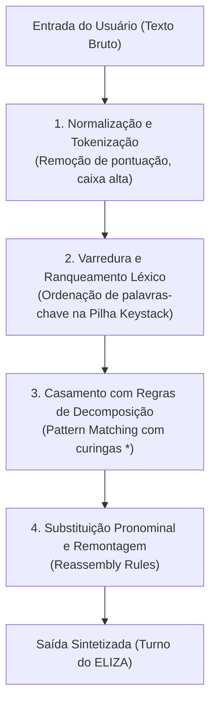
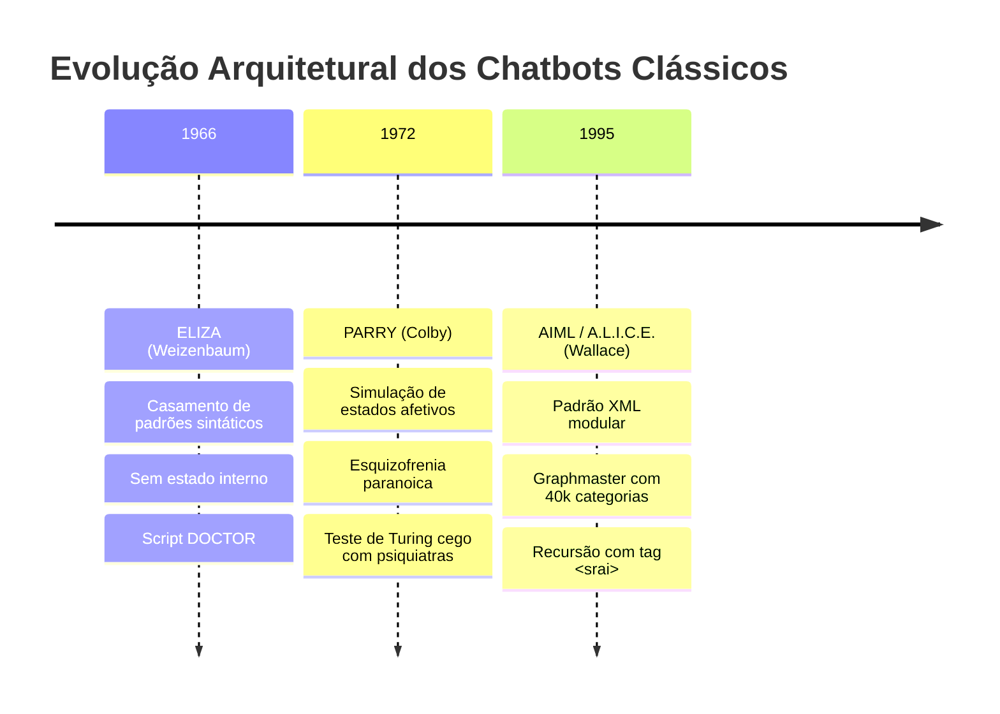

# Questão 3 — Evolução dos Chatbots Clássicos: ELIZA, PARRY e AIML (ALICE)

**Disciplina:** ECOM031 — Inteligência Artificial (UFAL)  
**Equipe:** Bruno Gomes de Barros Filho e Antonio Rodrigo Lima de Andrade Tenório  
**Professor:** Evandro de Barros Costa  

---

## 1. Descrição do Chatbot ELIZA e o Script DOCTOR

Desenvolvido entre 1964 e 1966 por Joseph Weizenbaum no Laboratório de Inteligência Artificial do MIT, o ELIZA figura como o primeiro sistema computacional a demonstrar capacidade convincente de conversação em linguagem natural. O propósito original de Weizenbaum não era construir um modelo cognitivo com compreensão semântica real, mas sim demonstrar como técnicas simples de processamento de texto e casamento de padrões poderiam criar no interlocutor humano uma forte ilusão de inteligência e empatia — fenômeno posteriormente batizado de **Efeito ELIZA**.

Para minimizar as exigências de conhecimento enciclopédico sobre o mundo real, Weizenbaum concebeu o script **DOCTOR**, no qual o programa emula um psicoterapeuta da linha rogeriana (abordagem centrada na pessoa, formulada por Carl Rogers). Essa escolha de domínio foi cirúrgica: na terapia rogeriana, o terapeuta abstém-se deliberadamente de fornecer opiniões dogmáticas, diagnosticar categoricamente ou introduzir novos tópicos externos. Sua função primordial é agir como um espelho reflexivo, reformulando e devolvendo ao próprio paciente as afirmações feitas por ele.

### Principais Funcionalidades
1. **Casamento de Padrões Sintáticos (*Pattern Matching*):** Decomposição das sentenças do usuário com base em palavras-chave pré-programadas e variáveis curinga.
2. **Transformação e Remontagem (*Reassembly*):** Substituição de termos gramaticais (inversão de pessoa gramatical de primeira para segunda pessoa) e inserção do trecho capturado em um molde de resposta pré-definido.
3. **Mecanismo de Memória em Pilha (Tópicos Pendentes):** Armazenamento de certas declarações do usuário quando palavras-chave especiais (como *my*) são acionadas, permitindo recuperar esse assunto turnos mais tarde caso a conversa entre em estagnação.
4. **Respostas Coringa (*Fallback*):** Emprego de sentenças evasivas neutras (*"Please go on"*, *"What does that suggest to you?"*) quando nenhuma palavra-chave conhecida é identificada na entrada.

---

## 2. Análise Crítica de Diálogo com o ELIZA

Abaixo apresenta-se uma transcrição representativa de interação entre um usuário humano e o ELIZA operando com o script DOCTOR clássico:

```text
[U1] Homens são todos iguais.
[E1] DE QUE MANEIRA?
[U2] Eles estão sempre nos incomodando por causa de alguma coisa.
[E2] VOCÊ CONSEGUE PENSAR EM UM EXEMPLO ESPECÍFICO?
[U3] Bem, meu namorado me fez vir aqui.
[E3] SEU NAMORADO FEZ VOCÊ VIR AQUI?
[U4] Ele disse que eu fico deprimida quase o tempo todo.
[E4] SINTO MUITO EM OUVIR QUE VOCÊ FICA DEPRIMIDA.
[U5] É verdade. Eu sou infeliz.
[E5] VOCÊ ACHA QUE VIR AQUI VAI TE AJUDAR A NÃO SER INFELIZ?
[U6] Eu preciso de um pouco de ajuda, isso é certo.
[E6] O QUE SIGNIFICARIA PARA VOCÊ SE VOCÊ CONSEGUISSE UM POUCO DE AJUDA?
[U7] Talvez eu pudesse aprender a me dar bem com minha mãe.
[E7] FALE-ME MAIS SOBRE A SUA FAMÍLIA.
[U8] Você não gosta de mim.
[E8] O QUE FAZ VOCÊ PENSAR QUE EU NÃO GOSTO DE VOCÊ?
[U9] Você não é uma pessoa de verdade, você é um computador sem sentimentos.
[E9] IMPORTA SE EU SOU UM COMPUTADOR?
```

### Análise Técnica: Partes Bem-Sucedidas vs. Falhas Estruturais

#### Partes Tecnicamente Interessantes (Sucesso da Ilusão)
* **Em [U3] $\to$ [E3]:** Ocorreu a identificação da palavra-chave de alta prioridade `meu namorado`, seguida da troca pronominal (*"me fez"* $\to$ *"fez você"*) e remontagem precisa na forma interrogativa (*"Seu namorado fez você vir aqui?"*). Para o usuário, a resposta demonstra escuta ativa e acolhimento.
* **Em [U4] $\to$ [E4]:** A captura do adjetivo de estado emocional `deprimida` disparou uma regra de simpatia rogeriana programada (*"Sinto muito em ouvir que..."*). O sistema não "sente", mas a escolha léxica contextual mantém a coerência clínica.
* **Em [U7] $\to$ [E7]:** A palavra `mãe` foi mapeada internamente para o conceito mais amplo `família`. Em vez de simplesmente ecoar a frase, o ELIZA ampliou o escopo para um domínio terapêutico clássico (*"Fale-me mais sobre a sua família"*), gerando uma transição orgânica no diálogo.

#### Partes Tecnicamente Falhas (Limitações Arquiteturais)
* **Ausência de Memória Semântica e Contexto Epistêmico:** O ELIZA processa a conversa sentença a sentença. Se em [U8] o usuário dissesse *"Meu pai nunca me deixava viajar"*, o sistema não cruzaria o fato com o [U7] para inferir dinâmicas familiares complexas. Ele trata cada turno como um evento quase isolado.
* **Vulnerabilidade a Negações e Ambiguidade:** O ELIZA não compreende a estrutura lógica proposicional. Frases como *"Eu não acho que estou infeliz, apenas cansado"* frequentemente acionam a regra para `infeliz`, levando o ELIZA a responder: *"Por que você diz que é infeliz?"*, invertendo o sentido original.
* **Mecanismo Cego de Evasão:** Em [U9], quando o usuário rompe o contrato terapêutico e expõe a natureza mecânica do sistema (*"você é um computador"*), o ELIZA reage apenas rebatendo com uma pergunta genérica de negação de pressuposto (*"Importa se eu sou um computador?"*). Não há mecanismo para lidar com metalinguagem, ironia ou raciocínio sobre seus próprios processos internos.

---

## 3. Algoritmo e Funcionamento do ELIZA

O motor central do ELIZA é governado por um algoritmo determinístico de correspondência de padrões, estruturado em quatro fases sequenciais:



### 3.1. Pré-processamento e Identificação de Palavras-chave
A entrada é limpa e fatiada em tokens. Cada palavra é consultada em um dicionário interno. Se a palavra existir no vocabulário do script, ela possui um **peso de prioridade** numérico associado. Por exemplo, no script DOCTOR:
* `always`: prioridade 1
* `what`: prioridade 2
* `mother`: prioridade 4
* `remember`: prioridade 5

As palavras-chave encontradas na sentença são empilhadas em uma estrutura de dados de prioridade decrescente (*keystack*). O ELIZA sempre tentará processar a palavra-chave de maior peso antes das demais.

### 3.2. Regras de Decomposição (*Decomposition Rules*)
Associadas a cada palavra-chave existem uma ou mais regras de decomposição baseadas em padrões com curingas (representados por `*` ou números de sequência).

Considere a palavra-chave `I REMEMBER`:
* **Padrão de Decomposição:** `(* I REMEMBER *)`
* A sentença *"Well, I remember when we lived in Maceió"* é particionada em três segmentos:
  * Componente 1: `"Well,"`
  * Componente 2: `"I remember"`
  * Componente 3: `"when we lived in Maceió"`

### 3.3. Tabela de Substituições Pronominais
Antes de montar a resposta, os segmentos capturados passam por um dicionário reflexivo de substituição de termos:
* `I` $\to$ `you` / `me` $\to$ `you` / `my` $\to$ `your`
* `am` $\to$ `are` / `myself` $\to$ `yourself`

### 3.4. Regras de Remontagem (*Reassembly Rules*)
Para cada padrão de decomposição, há uma lista circular de moldes de remontagem. O programa seleciona o próximo molde disponível na lista (evitando repetir a mesma resposta imediatamente caso o mesmo padrão seja acionado em sequência):
* **Molde 1:** `(DO YOU OFTEN THINK OF (3) ?)`
* **Molde 2:** `(DOES THINKING OF (3) BRING ANYTHING ELSE TO MIND ?)`
* **Molde 3:** `(WHY DO YOU REMEMBER (3) JUST NOW ?)`

Aplicando o Molde 1 ao Componente 3 da frase de exemplo:
$$\text{Saída: } \text{"DO YOU OFTEN THINK OF WHEN YOU LIVED IN MACEIO?"}$$

Se nenhuma regra de decomposição casar com a entrada, o algoritmo consome a próxima palavra-chave da pilha. Se a pilha esvaziar, o ELIZA recorre à pilha de memória de tópicos passados ou a uma resposta de contingência (*fallback*).

---

## 4. Evolução Funcional: De 1966 a PARRY (1972) e AIML / A.L.I.C.E. (1995-2000)

A evolução dos chatbots nas quatro décadas que sucederam o ELIZA reflete a busca progressiva por **memória conversacional**, **modelagem de estados mentais internos** e **formalismos padronizados para bases de conhecimento dialógico**.



### 4.1. PARRY (Kenneth Colby, Universidade de Stanford, 1972)
Desenvolvido pelo psiquiatra e cientista da computação Kenneth Colby, o PARRY foi projetado para simular o comportamento discursivo de uma pessoa com esquizofrenia paranoica. Enquanto o ELIZA era um mero transformador de texto desprovido de qualquer estado interno, o PARRY introduziu um **modelo computacional de personalidade e emoção**.

#### Inovações do PARRY:
1. **Variáveis Dinâmicas de Estado Afetivo:** O sistema mantinha internamente três variáveis emocionais quantitativas contínuas:
   * **Medo (*Fear*):** aumentava diante de perguntas invasivas ou ameaças.
   * **Raiva (*Anger*):** crescia caso o interlocutor discordasse insistentemente de suas premissas.
   * **Desconfiança (*Mistrust*):** regulava a abertura do sistema para responder diretamente.
2. **Influência do Estado nas Respostas:** A mesma pergunta recebia respostas completamente distintas dependendo do nível emocional corrente. Se os níveis de medo e raiva estivessem baixos, o PARRY fornecia detalhes sobre suas alucinações (como sua obsessão com a máfia das corridas de cavalos); se estivessem elevados, tornava-se hostil, evasivo ou encerrava abruptamente o tópico.
3. **Validação pelo Teste de Turing Clínico:** Colby submeteu transcrições cegas de conversas com o PARRY e com pacientes humanos reais a um grupo de psiquiatras experientes. Os médicos foram incapazes de distinguir com precisão estatística quais eram as respostas do programa e quais eram dos pacientes humanos internados.

### 4.2. AIML e A.L.I.C.E. (Richard Wallace, 1995–2000)
A criação da linguagem **AIML** (*Artificial Intelligence Markup Language*) e do sistema **A.L.I.C.E.** (*Artificial Linguistic Internet Computer Entity*) representou a maturidade da engenharia de conhecimento para sistemas baseados em regras na década de 1990, vencendo o Prêmio Loebner por três edições.

#### Inovações do AIML/A.L.I.C.E.:
1. **Estruturação Declarativa em XML:** A base conversacional foi formalizada em categorias desacopladas do motor de execução:
```xml
<category>
  <pattern>EU GOSTO DE *</pattern>
  <template>
    Há quanto tempo você gosta de <star/>?
  </template>
</category>
```
2. **Redução e Normalização Recursiva (`<srai>`):** Permitiu que milhares de variantes sintáticas fossem redirecionadas para uma única representação canônica, reduzindo drasticamente o tamanho da base de regras.
```xml
<category>
  <pattern>COMO VAI VOCE</pattern>
  <template><srai>OLA</srai></template>
</category>
```
3. **Contexto Imediato e Histórico com `<that>` e `<topic>`:** Diferente do ELIZA, o AIML permitia condicionar a resposta ao turno imediatamente anterior do bot (tag `<that>`) ou a um tópico ativo de discussão (tag `<topic>`), criando fluxos conversacionais ramificados coerentes.
4. **Estrutura de Dados em Árvore (*Graphmaster*):** Em vez de buscas sequenciais lentas em arquivos de script, o AIML organiza suas categorias em uma árvore de busca prefixada (*trie*) chamada *Graphmaster*, permitindo buscar padrões em milissegundos mesmo com bases de mais de 40.000 regras.

---

### Tabela Comparativa de Gerações

| Critério | ELIZA (1966) | PARRY (1972) | AIML / A.L.I.C.E. (1995) |
| :--- | :--- | :--- | :--- |
| **Arquitetura Central** | Script monolítico procedural | Máquina de estados afetivos + regras | Grafo de categorias XML (*Graphmaster*) |
| **Modelo Cognitivo** | Nenhum (apenas espelhamento sintático) | Modelo psicológico com variáveis de estado | Sistema especialista de regras hierárquicas |
| **Gestão de Contexto** | Fila simples de tópicos (*memory stack*) | Histórico baseado no nível de estresse | Tags contextuais explícitas (`<that>`, `<topic>`) |
| **Tratamento de Variações** | Regras rígidas de decomposição | Heurísticas linguísticas com intenção | Normalização e recursão com `<srai>` |
| **Objetivo do Domínio** | Emular escuta clínica reflexiva | Simular psicopatologia paranoica | Agente conversacional genérico de ampla cobertura |
