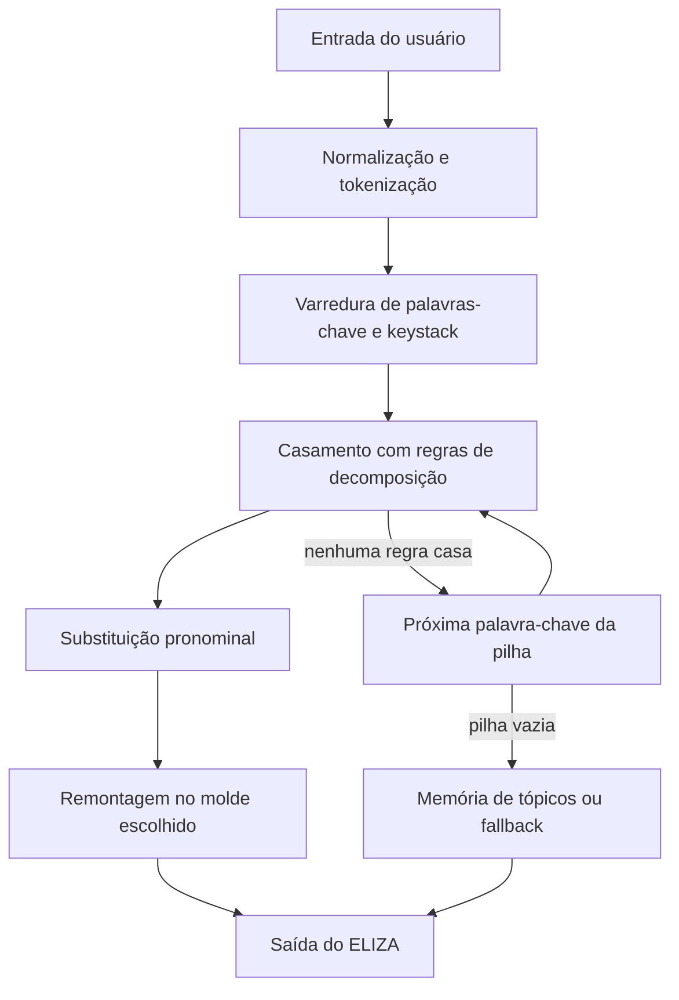
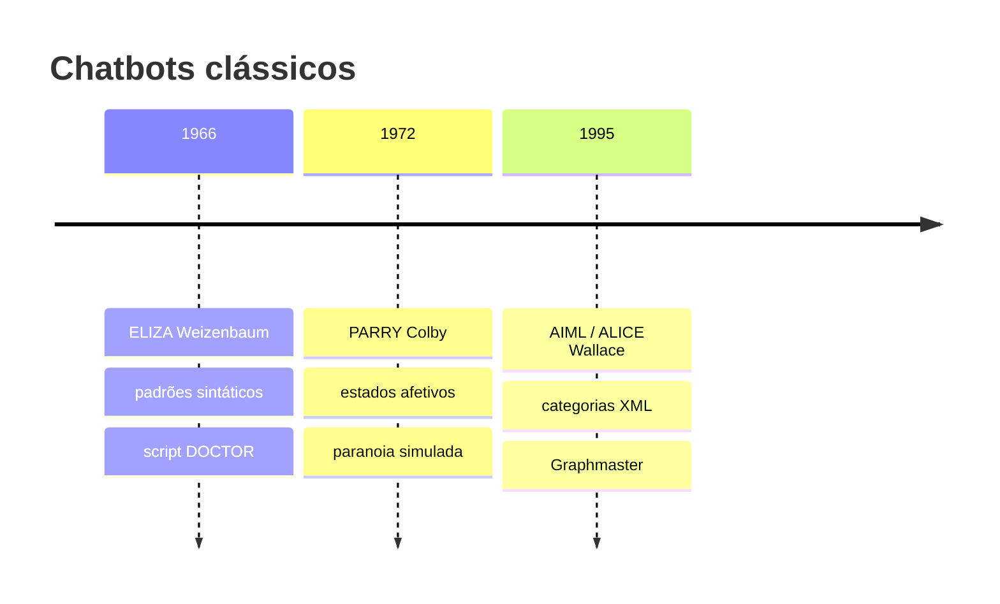

# Questão 3 — Chatbot ELIZA, diálogo, algoritmo e evoluções (PARRY e AIML/ALICE)

**Disciplina:** ECOM031 — Inteligência Artificial (UFAL)
**Equipe:** Bruno Gomes de Barros Filho e Antonio Rodrigo Lima de Andrade Tenório
**Professor:** Evandro de Barros Costa

---

## 1. O chatbot ELIZA e o script DOCTOR

O ELIZA foi desenvolvido entre 1964 e 1966 por Joseph Weizenbaum no MIT Artificial Intelligence Laboratory. O programa conversa em inglês por meio de casamento de padrões e transformação de texto. Weizenbaum não pretendia modelar compreensão semântica: queria mostrar que regras simples bastavam para o interlocutor humano projetar inteligência e empatia no sistema. Esse fenômeno ficou conhecido como efeito ELIZA.

O script mais famoso é o DOCTOR, que emula um psicoterapeuta rogeriano (abordagem centrada na pessoa, de Carl Rogers). A escolha do domínio reduz a necessidade de conhecimento de mundo: o terapeuta rogeriano evita opinar, diagnosticar ou introduzir temas externos. Em vez disso, reformula o que o paciente disse e devolve a fala em forma de pergunta ou comentário reflexivo. O ELIZA se aproveita exatamente desse estilo.

### Principais funcionalidades

1. **Casamento de padrões (*pattern matching*).** A sentença do usuário é decomposta a partir de palavras-chave e curingas (`*`).
2. **Remontagem (*reassembly*).** Trechos capturados entram em moldes de resposta; há troca de pessoa gramatical (`I`/`me`/`my` → `you`/`your`).
3. **Pilha de palavras-chave (*keystack*).** Cada palavra-chave tem um peso; a de maior prioridade é processada primeiro.
4. **Memória de tópicos.** Algumas declarações (em especial com `my`) são guardadas para reaparecer depois, se a conversa estagnar.
5. **Respostas de contingência (*fallback*).** Sem palavra-chave reconhecida, o sistema usa frases neutras do tipo *"Please go on"* ou *"What does that suggest to you?"*.

---

## 2. Trecho de diálogo e análise técnica

O diálogo abaixo adapta, em português, a interação clássica publicada por Weizenbaum (1966) com o script DOCTOR. Mantemos a estrutura das trocas originais para poder apontar o que o algoritmo realmente faz.

```text
[U1] Homens são todos iguais.
[E1] DE QUE MANEIRA?

[U2] Eles estão sempre nos incomodando por causa de alguma coisa.
[E2] VOCÊ CONSEGUE PENSAR EM UM EXEMPLO ESPECÍFICO?

[U3] Bem, meu namorado me fez vir aqui.
[E3] SEU NAMORADO FEZ VOCÊ VIR AQUI?

[U4] Ele disse que eu fico deprimida quase o tempo todo.
[E4] SINTO MUITO EM OUVIR QUE VOCÊ FICA DEPRIMIDA.

[U5] É verdade. Eu sou infeliz.
[E5] VOCÊ ACHA QUE VIR AQUI VAI TE AJUDAR A NÃO SER INFELIZ?

[U6] Eu preciso de um pouco de ajuda, isso é certo.
[E6] O QUE SIGNIFICARIA PARA VOCÊ SE VOCÊ CONSEGUISSE UM POUCO DE AJUDA?

[U7] Talvez eu pudesse aprender a me dar bem com minha mãe.
[E7] FALE-ME MAIS SOBRE A SUA FAMÍLIA.

[U8] Você não gosta de mim.
[E8] O QUE FAZ VOCÊ PENSAR QUE EU NÃO GOSTO DE VOCÊ?

[U9] Você não é uma pessoa de verdade, você é um computador.
[E9] IMPORTA SE EU SOU UM COMPUTADOR?
```

### Partes tecnicamente interessantes

- **[U3] → [E3].** A palavra-chave ligada a `meu`/`my` (prioridade alta no DOCTOR) captura o segmento após o possessivo. A troca pronominal (`meu` → `seu`, `me` → `você`) e a remontagem interrogativa produzem *"Seu namorado fez você vir aqui?"*. Para o usuário, a resposta parece escuta ativa; para o algoritmo, é só transformação sintática.
- **[U4] → [E4].** O adjetivo de estado (`deprimida`) dispara um molde de empatia programado. O sistema não “sente”; apenas escolhe um template associado à palavra-chave.
- **[U7] → [E7].** `mãe`/`mother` é mapeada para o conceito mais amplo `família`. Em vez de ecoar a frase inteira, o script abre um tópico terapêutico clássico. Isso mostra que regras de reassembly podem generalizar o tema, e não só repetir o texto capturado.
- **[U2] → [E2].** A palavra `sempre`/`always` tem prioridade baixa, mas suficiente para pedir um exemplo concreto — típico do estilo rogeriano.

### Partes tecnicamente falhas

- **Sem memória semântica entre turnos.** Cada sentença é tratada quase isoladamente. Se em [U8] o usuário trouxesse um fato novo sobre o pai, o ELIZA não cruzaria isso com [U7] para montar um modelo da família.
- **Negações e escopo lógico.** Frases do tipo *"Eu não acho que estou infeliz"* ainda podem acionar a regra de `infeliz` e inverter o sentido.
- **Metalinguagem e exposição do truque.** Em [U9], ao ser acusado de ser um computador, o sistema só aplica um molde de negação de pressuposto (*"Importa se eu sou um computador?"*). Não há raciocínio sobre o próprio mecanismo.
- **Coerência superficial.** Em [E5], a pergunta sobre “vir aqui” presume continuidade terapêutica que o usuário não afirmou em [U5]; o molde foi escolhido pela palavra `infeliz`, não por um plano de diálogo.

---

## 3. Como o ELIZA funciona: regras e algoritmo

O motor é determinístico e opera em fases. No script DOCTOR original (inglês), as regras usam padrões como `(* I REMEMBER *)`. A descrição abaixo segue essa lógica; o diálogo em português da seção anterior é a mesma sequência de gatilhos, só que traduzida.



### 3.1. Pré-processamento e palavras-chave

A entrada é limpa (pontuação, caixa) e fatiada em tokens. Cada token é consultado no dicionário do script. Se existir, carrega um **peso de prioridade**. Exemplos típicos no DOCTOR:

| Palavra-chave | Prioridade (aprox.) | Papel |
| :--- | :---: | :--- |
| `always` | 1 | Pedir exemplo concreto |
| `what` | 2 | Eco interrogativo |
| `mother` / `family` | 4 | Abrir tópico familiar |
| `remember` | 5 | Remontagem reflexiva |
| `my` | alta | Captura + possível memória |

As palavras-chave encontradas entram numa pilha ordenada por prioridade (*keystack*). O ELIZA tenta sempre a de maior peso primeiro.

### 3.2. Decomposição

Associadas a cada palavra-chave há regras com curingas. Exemplo clássico para `I REMEMBER`:

- **Padrão:** `(* I REMEMBER *)`
- **Entrada:** *"Well, I remember when we lived in Maceió"*
- **Partes:** (1) `"Well,"` · (2) `"I remember"` · (3) `"when we lived in Maceió"`

### 3.3. Substituição pronominal

Antes da remontagem, os segmentos capturados passam por um dicionário reflexivo:

- `I` → `you` · `me` → `you` · `my` → `your`
- `am` → `are` · `myself` → `yourself`

Em português, o equivalente no nosso diálogo é `meu` → `seu`, `me` → `você`, `eu` → `você`.

### 3.4. Remontagem

Para cada padrão de decomposição existe uma lista circular de moldes. O programa escolhe o próximo molde da lista (evita repetir a mesma resposta na hora). Para `I REMEMBER`:

1. `(DO YOU OFTEN THINK OF (3) ?)`
2. `(DOES THINKING OF (3) BRING ANYTHING ELSE TO MIND ?)`
3. `(WHY DO YOU REMEMBER (3) JUST NOW ?)`

Com o molde 1 e o componente (3) do exemplo: *"DO YOU OFTEN THINK OF WHEN YOU LIVED IN MACEIO?"*.

Se nenhuma regra da palavra-chave atual casar, o algoritmo desce na *keystack*. Se a pilha acabar, tenta a memória de tópicos ou uma resposta de contingência.

---

## 4. Como o ELIZA responde cada sentença do diálogo

A tabela abaixo liga cada turno do usuário à palavra-chave dominante, à transformação aplicada e à resposta gerada (versão em português do trecho da seção 2).

| Turno | Entrada (resumo) | Gatilho / regra | Transformação | Saída |
| :--- | :--- | :--- | :--- | :--- |
| U1 → E1 | "Homens são todos iguais." | Padrão genérico de generalização / falta de chave forte | Sem captura útil; molde interrogativo fixo | "De que maneira?" |
| U2 → E2 | "...sempre nos incomodando..." | `sempre` / `always` | Decompõe e pede concretude | "Você consegue pensar em um exemplo específico?" |
| U3 → E3 | "meu namorado me fez vir aqui" | `meu` / `my` + padrão possessivo | Captura "namorado me fez vir aqui"; troca `meu`→`seu`, `me`→`você` | "Seu namorado fez você vir aqui?" |
| U4 → E4 | "...eu fico deprimida..." | palavra-chave de estado (`deprimida`) | Insere o estado no molde de empatia | "Sinto muito em ouvir que você fica deprimida." |
| U5 → E5 | "Eu sou infeliz." | `infeliz` / `unhappy` | Troca de pessoa + molde sobre "vir aqui" / ajuda | "Você acha que vir aqui vai te ajudar a não ser infeliz?" |
| U6 → E6 | "Eu preciso de um pouco de ajuda..." | `preciso` / `need` + `ajuda` / `help` | Captura o objeto do pedido e remonta em pergunta hipotética | "O que significaria para você se você conseguisse um pouco de ajuda?" |
| U7 → E7 | "...com minha mãe." | `mãe` / `mother` → família | Generaliza para o tópico `família` (não ecoa a frase inteira) | "Fale-me mais sobre a sua família." |
| U8 → E8 | "Você não gosta de mim." | acusação ao terapeuta / `you` | Inverte a acusação em pergunta reflexiva | "O que faz você pensar que eu não gosto de você?" |
| U9 → E9 | "...você é um computador." | exposição do sistema / `computer` | Molde de negação de pressuposto (fallback especializado) | "Importa se eu sou um computador?" |

Em todos os casos o “entendimento” é ilusório: o sistema não constrói uma representação do paciente. Ele ranqueia palavras-chave, aplica decomposição, troca pronomes e preenche um molde. A fluência do diálogo rogeriano mascara exatamente essa pobreza semântica.

---

## 5. Evoluções de funcionalidade: ELIZA (1966), PARRY (1972) e AIML / ALICE (1995–2000)



### 5.1. PARRY (Kenneth Colby, Stanford, 1972)

O PARRY simula o discurso de uma pessoa com esquizofrenia paranoica. Enquanto o ELIZA é um transformador de texto sem estado interno rico, o PARRY mantém um **modelo de personalidade e emoção**.

Inovações principais:

1. **Variáveis de estado afetivo.** Medo (*fear*), raiva (*anger*) e desconfiança (*mistrust*) variam ao longo da conversa.
2. **Resposta condicionada ao estado.** A mesma pergunta do interlocutor produz respostas diferentes conforme os níveis emocionais. Com medo e raiva baixos, o PARRY pode falar de suas obsessões (por exemplo, a máfia das corridas); com níveis altos, fica hostil, evasivo ou corta o assunto.
3. **Avaliação com psiquiatras.** Colby apresentou transcrições cegas do PARRY e de pacientes reais a médicos; em vários testes, eles não distinguiram com segurança o programa do humano.

Em resumo: o salto do ELIZA para o PARRY é a introdução de **estado interno** que altera a seleção das respostas.

### 5.2. AIML e A.L.I.C.E. (Richard Wallace, 1995–2000)

A linguagem **AIML** (*Artificial Intelligence Markup Language*) e o bot **A.L.I.C.E.** (*Artificial Linguistic Internet Computer Entity*) padronizam a engenharia de conhecimento conversacional em XML. A.L.I.C.E. venceu o Prêmio Loebner em mais de uma edição.

Inovações principais:

1. **Categorias declarativas em XML**, separadas do motor de execução:

```xml
<category>
  <pattern>EU GOSTO DE *</pattern>
  <template>
    Há quanto tempo você gosta de <star/>?
  </template>
</category>
```

2. **Normalização recursiva com `<srai>`**, para reduzir milhares de variantes a uma forma canônica:

```xml
<category>
  <pattern>COMO VAI VOCE</pattern>
  <template><srai>OLA</srai></template>
</category>
```

3. **Contexto com `<that>` e `<topic>`.** A resposta pode depender do turno anterior do bot ou de um tópico ativo — algo que o ELIZA trata só de forma rudimentar na pilha de memória.
4. **Graphmaster.** As categorias ficam numa árvore de busca (*trie*). Com dezenas de milhares de regras, a busca por padrão permanece rápida.

### 5.3. Comparativo das três gerações

| Critério | ELIZA (1966) | PARRY (1972) | AIML / ALICE (1995) |
| :--- | :--- | :--- | :--- |
| Arquitetura | Script procedural + padrões | Regras + máquina de estados afetivos | Grafo de categorias XML (Graphmaster) |
| Modelo interno | Quase nenhum (espelhamento) | Variáveis emocionais contínuas | Base de conhecimento hierárquica |
| Contexto | Pilha simples de tópicos | Histórico filtrado pelo estresse | Tags `<that>` e `<topic>` |
| Variações de frase | Regras rígidas de decomposição | Heurísticas ligadas à intenção/paranoia | Recursão `<srai>` e normalização |
| Domínio | Escuta clínica reflexiva | Psicopatologia paranoica | Agente conversacional de cobertura ampla |

A linha evolutiva é clara: o ELIZA mostra que padrões sintáticos bastam para a ilusão conversacional; o PARRY acrescenta estado afetivo; o AIML/ALICE transforma o acervo de regras num formalismo modular, indexável e reutilizável. Nenhuma dessas gerações compreende linguagem no sentido semântico profundo — o que muda é o controle de contexto, de estado e de escala da base de regras.
