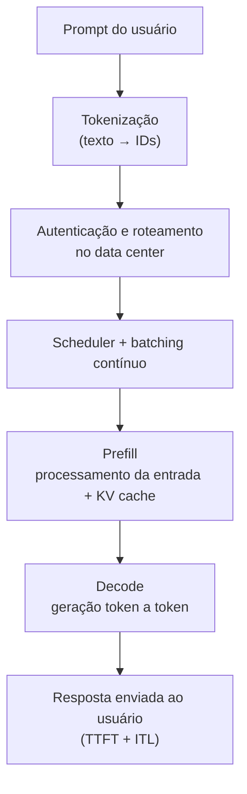

# Lista 2 - Inteligência Artificial

**Dupla:** Bruno Gomes de Barros Filho (21111360); Antônio Rodrigo Lima de Andrade Tenório (23210707)  
**Disciplina:** ECOM031: Inteligência Artificial  
**Professor:** Evandro de Barros Costa  
**Período:** 2026.2

## Questão 5: Resumo estendido — Inferência em LLMs

**Fonte:** vídeo *What is LLM Inference? How AI Models Generate Response*  
**Link:** https://www.youtube.com/watch?v=615-yWyS1n0

Este resumo apresenta os principais conceitos abordados no vídeo indicado no enunciado da Lista 2. O conteúdo explica o que acontece entre o envio de um *prompt* e a geração de uma resposta por um modelo de linguagem de grande porte (*Large Language Model*, LLM). Ao longo da explicação, são apresentados o papel da inferência, os motores responsáveis por executar os modelos e as etapas que influenciam o tempo de resposta percebido pelo usuário.

### 1. Treino versus inferência: do modelo treinado à geração de respostas

O vídeo começa explicando a diferença entre treinar um modelo de linguagem e utilizá-lo depois que o treinamento foi concluído. O treinamento de modelos de grande porte exige uma infraestrutura computacional significativa, pode levar meses e envolver investimentos de centenas de milhões de dólares. Ao final desse processo, o modelo possui um conjunto de parâmetros numéricos, chamados de pesos (*weights*), que armazenam o conhecimento aprendido durante o treinamento.

Esses pesos, por si só, não representam um sistema pronto para conversar ou responder a perguntas. É necessário executar o modelo para que ele processe uma entrada e produza uma saída. Esse processo é chamado de inferência.

Enquanto o treinamento é realizado em etapas específicas do desenvolvimento e da atualização do modelo, a inferência acontece continuamente, sempre que uma aplicação envia uma nova solicitação. É ela que permite o funcionamento de chatbots, assistentes de programação e outras aplicações baseadas em LLMs.

O vídeo também chama atenção para o impacto financeiro dessa etapa. Embora o treinamento tenha um custo inicial muito elevado, a inferência é executada repetidamente a cada solicitação recebida. Quando um modelo passa a ser utilizado por milhões de pessoas, o custo acumulado de execução pode superar o investimento realizado no treinamento. Por isso, reduzir o tempo e o custo de cada inferência é um dos principais desafios para disponibilizar esses modelos em larga escala.

### 2. O motor de inferência (*inference engine*)

Para que um modelo treinado possa atender às solicitações dos usuários, é necessário um componente de software responsável por coordenar sua execução: o motor de inferência (*inference engine*).

Ele atua como uma camada intermediária entre o modelo e a aplicação que o utiliza. Em vez de simplesmente carregar os pesos e executar cálculos, precisa organizar as requisições recebidas, controlar o uso das GPUs e distribuir o processamento de maneira eficiente.

Entre suas principais responsabilidades estão:

- Receber e organizar as requisições enviadas pelas aplicações;
- Gerenciar a utilização da memória e das GPUs;
- Definir quais solicitações serão processadas em conjunto;
- Coordenar a geração e o envio dos tokens de resposta.

O vídeo apresenta ferramentas como **vLLM**, **Ollama** e **llama.cpp** como exemplos de soluções utilizadas para executar modelos localmente ou em servidores.

Outro aspecto importante é a compatibilidade com APIs. Alguns motores oferecem endpoints compatíveis com o formato da API da OpenAI. Isso permite que uma aplicação utilize diferentes modelos ou servidores sem precisar modificar toda a implementação responsável pelo envio das requisições. Assim, a integração entre o modelo e o sistema que o consome fica mais simples.

### 3. Do texto aos identificadores numéricos: tokenização

Antes de ser processado pelo modelo, o texto enviado pelo usuário precisa passar por uma etapa chamada **tokenização**. Nela, a mensagem é dividida em unidades menores, conhecidas como *tokens*.

Um token pode representar uma palavra inteira, parte de uma palavra, um número ou até mesmo um sinal de pontuação. Cada unidade é associada a um identificador numérico, chamado de ID. É essa sequência de números que será utilizada pelo modelo durante o processamento, e não o texto original da maneira como aparece para o usuário.

A quantidade de tokens gerada depende do texto e do vocabulário utilizado pelo modelo. Por isso, duas mensagens com o mesmo número de caracteres podem resultar em quantidades diferentes de tokens.

Essa etapa também tem impacto no custo e no desempenho da inferência. Em muitos serviços, o consumo é contabilizado com base na quantidade de tokens de entrada e saída. Além disso, o número de tokens do *prompt* influencia o volume de informações que o modelo precisará processar.

O tamanho do vocabulário também merece atenção. Um vocabulário maior pode permitir que determinadas palavras sejam representadas com menos tokens, mas aumenta a quantidade de possibilidades que o modelo precisa considerar na etapa de previsão. Portanto, não significa necessariamente que um vocabulário maior resulte em uma inferência mais rápida.

### 4. Autenticação, roteamento e processamento de múltiplas requisições

Depois da tokenização, a solicitação segue para a infraestrutura responsável por executar o modelo. Em serviços disponibilizados pela internet, essa etapa pode envolver autenticação por meio de uma chave de API, utilizada para verificar se a aplicação tem autorização para acessar o serviço.

Em seguida, mecanismos de roteamento direcionam a requisição para os recursos computacionais disponíveis. Essa decisão pode considerar fatores como o tamanho da entrada, o modelo solicitado e a capacidade dos servidores naquele momento.

Um ponto importante apresentado no vídeo é que os servidores normalmente precisam atender várias requisições ao mesmo tempo. Processar cada solicitação isoladamente poderia deixar parte da capacidade das GPUs sem utilização. Para explicar esse problema, o vídeo utiliza a comparação com uma padaria que ligasse um forno industrial para assar apenas um pão por vez.

Uma das soluções para aproveitar melhor esses recursos é o **agrupamento de requisições (*batching*)**. Nesse processo, várias solicitações são reunidas para que o hardware consiga processá-las de maneira mais eficiente.

O vídeo também apresenta o *continuous batching*, ou agrupamento contínuo. Nesse modelo, novas requisições podem ocupar os espaços liberados por aquelas que já terminaram, sem que seja necessário esperar todo o grupo finalizar para iniciar outro processamento.

Um componente chamado *scheduler* coordena essa distribuição, organizando quais requisições serão executadas e em que momento. O objetivo é manter os recursos computacionais ocupados de forma eficiente, sem comprometer excessivamente o tempo de resposta de cada usuário.

### 5. As duas fases da inferência: *prefill* e *decode*

A geração de uma resposta por um LLM não acontece de uma única vez. O processo é dividido em duas fases principais: *prefill* e *decode*. Cada uma possui características próprias e exige os recursos computacionais de maneiras diferentes.

#### 5.1. Prefill e o KV cache

Na fase de *prefill*, o modelo processa os tokens que compõem o *prompt* enviado pelo usuário. Durante esse processamento, são calculadas e armazenadas informações intermediárias chamadas de *key-value cache* (KV cache).

O KV cache guarda os valores de *keys* e *values* produzidos pelas camadas de atenção do modelo para os tokens já processados. Essas informações são reutilizadas durante a geração da resposta, evitando que o modelo precise recalcular tudo a cada novo token.

Isso é especialmente importante em conversas longas. Sem esse mecanismo, o processamento dos tokens seguintes exigiria repetir parte significativa dos cálculos relacionados ao contexto anterior, aumentando o custo da geração.

O *prefill* costuma ser uma etapa limitada pela capacidade de processamento (*compute-bound*), pois envolve operações matemáticas que podem ser executadas em paralelo sobre os tokens de entrada. Seu desempenho depende, entre outros fatores, da capacidade computacional disponível e do tamanho do *prompt*.

#### 5.2. Decode: geração token a token

Depois que o *prefill* termina, começa a fase de *decode*. É nesse momento que o modelo passa a produzir a resposta, gerando um token por vez.

Em cada etapa, o modelo utiliza os tokens anteriores e as informações armazenadas no KV cache para calcular uma distribuição de probabilidades sobre os possíveis próximos tokens. Com base nessa distribuição e na estratégia de geração configurada, um token é selecionado e adicionado à sequência. O processo se repete até que a resposta seja concluída.

Como cada novo token depende dos anteriores, a geração ocorre de maneira sequencial. O KV cache é atualizado durante esse processo para armazenar as informações necessárias aos próximos passos.

Diferentemente do *prefill*, o *decode* costuma ser limitado pela largura de banda da memória (*memory-bandwidth bound*). Isso acontece porque, a cada passo, é necessário acessar os pesos do modelo e as informações armazenadas em memória. Assim, a velocidade de geração depende bastante da rapidez com que esses dados podem ser disponibilizados para o processamento.

De forma simplificada, as duas fases apresentam gargalos diferentes: o *prefill* exige maior capacidade de cálculo sobre a entrada, enquanto o *decode* depende bastante da velocidade de acesso à memória para gerar os tokens seguintes.

### 6. Latência na prática: TTFT e ITL

Para avaliar o desempenho de um sistema de inferência, não basta observar apenas quanto tempo ele leva para gerar uma resposta completa. Também é importante entender quanto tempo o usuário espera pelo início da resposta e qual é a velocidade com que os próximos tokens são enviados.

O vídeo apresenta duas métricas utilizadas para analisar esses aspectos:

| Métrica | Significado | Relação com as fases |
| :--- | :--- | :--- |
| **TTFT** (*Time to First Token*) | Tempo entre o envio da solicitação e o recebimento do primeiro token da resposta. | É influenciado principalmente pelo processamento do *prefill*, além de etapas anteriores, como roteamento e agendamento. |
| **ITL** (*Inter-Token Latency*) | Intervalo de tempo entre o recebimento de tokens consecutivos. | Está relacionado principalmente à velocidade da fase de *decode*. |

As duas métricas ajudam a entender a experiência do usuário durante uma interação com um LLM. Um sistema pode apresentar um TTFT baixo, fazendo com que a resposta comece rapidamente, mas ainda assim gerar os tokens seguintes de forma lenta. Da mesma maneira, pode demorar para iniciar a resposta, mas apresentar uma geração rápida depois que o primeiro token é entregue.

Por isso, analisar TTFT e ITL separadamente permite identificar melhor em qual etapa está o principal gargalo de desempenho.

### 7. Síntese do caminho entre o *prompt* e a resposta

Com base nas etapas apresentadas no vídeo, é possível organizar o funcionamento da inferência na seguinte sequência:

1. O usuário envia uma mensagem para um *endpoint*, que pode utilizar um formato compatível com a API da OpenAI.
2. O texto é convertido em uma sequência de IDs por meio da tokenização.
3. A solicitação passa pelos mecanismos de autenticação e roteamento da infraestrutura.
4. O *scheduler* organiza as requisições e utiliza técnicas de *batching* e *continuous batching* para aproveitar melhor as GPUs.
5. Na fase de *prefill*, o modelo processa os tokens de entrada e constrói o KV cache.
6. Na fase de *decode*, a resposta é gerada token a token, utilizando as informações armazenadas no KV cache.
7. Durante a geração, o desempenho pode ser observado por métricas como TTFT e ITL, que representam o tempo até o primeiro token e o intervalo entre os tokens seguintes.

O fluxo pode ser representado pelo seguinte diagrama:

### 8. Considerações finais

O vídeo apresenta a inferência sob uma perspectiva de engenharia de sistemas, concentrando-se no que acontece para que um modelo já treinado consiga responder às solicitações dos usuários em tempo real. Em vez de abordar como um LLM aprende durante o treinamento, a explicação mostra como seus parâmetros são utilizados na prática e quais componentes tornam possível executar o modelo em escala.

Nesse processo, os motores de inferência organizam o uso dos recursos computacionais e o atendimento das requisições. A tokenização transforma o texto em uma representação numérica, enquanto as fases de *prefill* e *decode* realizam o processamento necessário para gerar a resposta. O KV cache evita a repetição de cálculos sobre o contexto anterior, e métricas como TTFT e ITL ajudam a avaliar a velocidade percebida pelo usuário.

Um dos principais pontos que ficam da explicação é que o desempenho de um LLM não depende somente do tamanho ou da qualidade do modelo. A infraestrutura utilizada para executá-lo também tem papel fundamental. Em aplicações reais, é necessário equilibrar velocidade, custo e capacidade de atendimento, especialmente quando muitas pessoas utilizam o serviço simultaneamente.

### Referência do vídeo

IBM Technology. *What is LLM Inference? How AI Models Generate Response*. YouTube, 2025. Disponível em: https://www.youtube.com/watch?v=615-yWyS1n0. Acesso em: 6 nov. 2026.