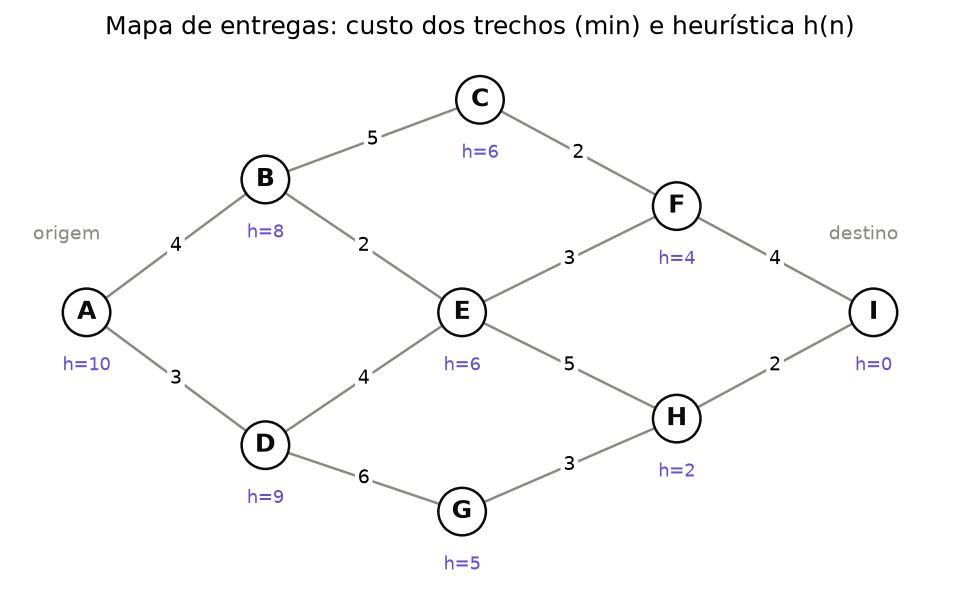
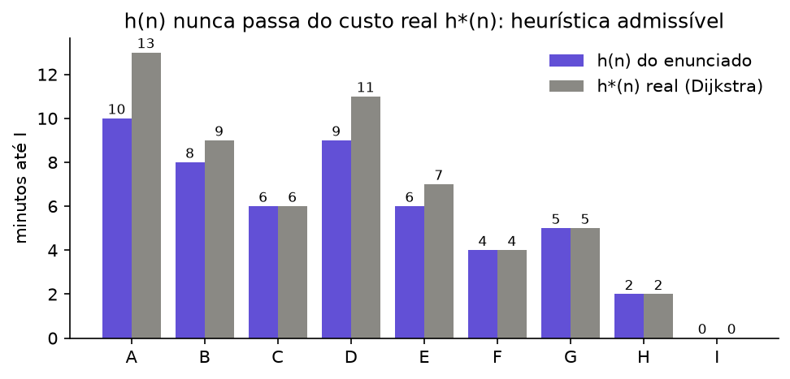
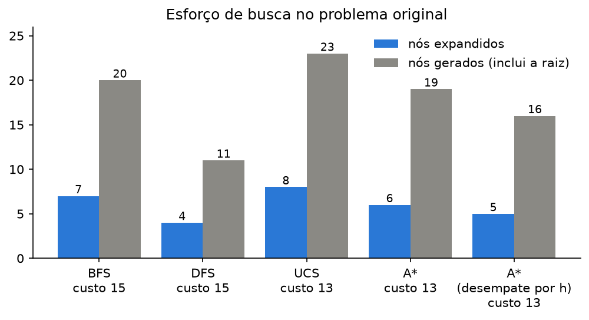
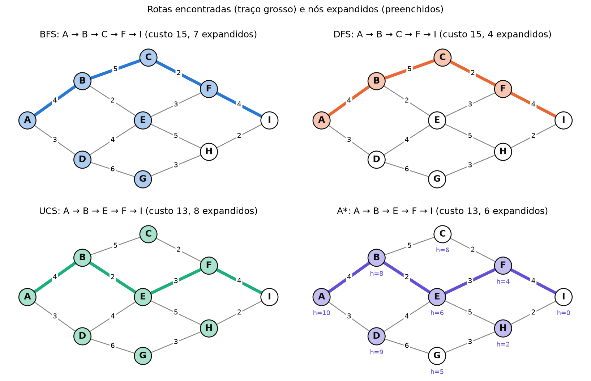
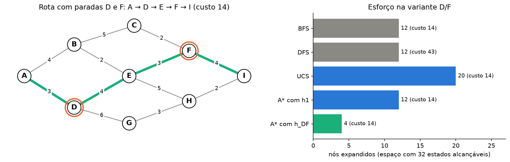

# Lista 2: Inteligência Artificial

**Dupla:** Bruno Gomes de Barros Filho (21111360); Antônio Rodrigo Lima de Andrade Tenório (23210707)  
**Disciplina:** ECOM031: Inteligência Artificial  
**Professor:** Evandro de Barros Costa  
**Período:** 2026.2

## Questão 10: Planejamento de rotas para entregas urbanas

### O problema

Um agente de entregas precisa achar a rota de menor tempo entre o centro de distribuição A e o destino I. O mapa é um grafo não direcionado com nove localidades e doze trechos, com custos em minutos. Para o A*, o enunciado fornece uma heurística h(n).

| Trecho | Custo | Trecho | Custo |
| --- | --- | --- | --- |
| A–B | 4 | A–D | 3 |
| B–C | 5 | B–E | 2 |
| C–F | 2 | D–E | 4 |
| D–G | 6 | E–F | 3 |
| E–H | 5 | F–I | 4 |
| G–H | 3 | H–I | 2 |

| n | A | B | C | D | E | F | G | H | I |
| --- | --- | --- | --- | --- | --- | --- | --- | --- | --- |
| h(n) | 10 | 8 | 6 | 9 | 6 | 4 | 5 | 2 | 0 |



Código e experimentos: `src/q10_buscas/` (módulos `q10_problema.py` e `q10_algoritmos.py`, testes em `test_q10_buscas.py` e notebook `q10_buscas.ipynb`). Todas as tabelas de trace deste documento foram impressas pela função `tabela_trace` do código, sem edição manual.

### 1. Formulação do problema

| Componente | Definição |
| --- | --- |
| Estados | A localidade em que o entregador se encontra: \(S = \{A, B, C, D, E, F, G, H, I\}\) |
| Estado inicial | \(A\) |
| Ações | \(\text{ACOES}(s)\) = { ir para \(x\) : \(x\) é vizinho de \(s\) no grafo } |
| Função de transição | \(\text{RESULTADO}(s, \text{ir para } x) = x\) |
| Teste de objetivo | \(s = I\) |
| Custo do passo | \(c(s, \text{ir para } x, x) = w(s, x)\), o tempo do trecho \(s\)–\(x\) |
| Custo do caminho | \(g = \sum w\) dos trechos percorridos (aditivo, todos os custos positivos) |

Na implementação, `ProblemaRota` segue a interface do AIMA (`acoes`, `resultado`, `custo_acao`, `eh_objetivo`). As ações de um estado saem em ordem alfabética do vizinho; por exemplo, \(\text{ACOES}(E)\) = [ir para B, ir para D, ir para F, ir para H], com custos 2, 4, 3 e 5.

### 2. A heurística dada é admissível e consistente?

Antes de rodar o A*, conferimos as duas propriedades. O custo ótimo real \(h^*(n)\) de cada nó até I foi calculado com Dijkstra a partir de I; como o grafo é não direcionado, a distância de I até n é igual à de n até I.

| n | A | B | C | D | E | F | G | H | I |
| --- | --- | --- | --- | --- | --- | --- | --- | --- | --- |
| h(n) | 10 | 8 | 6 | 9 | 6 | 4 | 5 | 2 | 0 |
| h*(n) | 13 | 9 | 6 | 11 | 7 | 4 | 5 | 2 | 0 |
| h*(n) − h(n) | 3 | 1 | 0 | 2 | 1 | 0 | 0 | 0 | 0 |

Conferência à mão de alguns valores: \(h^*(H) = 2\) (trecho H–I); \(h^*(E) = \min(3 + 4,\ 5 + 2) = 7\); \(h^*(B) = 2 + 7 = 9\); \(h^*(A) = \min(4 + 9,\ 3 + 11) = 13\).

**Admissibilidade.** \(h(n) \le h^*(n)\) em todos os nós. A heurística é exata em C, F, G, H e I e subestima mais em A (3 minutos) e D (2 minutos).

**Consistência.** É preciso \(h(n) \le c(n, n') + h(n')\) para todo par de vizinhos, nos dois sentidos de cada trecho (24 desigualdades). Nenhuma é violada. As que valem com igualdade (folga zero) são:

| n → n' | h(n) | c(n, n') | h(n') | c + h(n') − h(n) |
| --- | --- | --- | --- | --- |
| B → E | 8 | 2 | 6 | 0 |
| C → F | 6 | 2 | 4 | 0 |
| F → I | 4 | 4 | 0 | 0 |
| G → H | 5 | 3 | 2 | 0 |
| H → I | 2 | 2 | 0 | 0 |

A menor folga entre as demais é 1 (por exemplo, E → F: 3 + 4 − 6 = 1). Como nenhuma condição falha, o A* em busca em grafo (com conjunto de explorados) é ótimo com essa heurística. Com h consistente, f nunca diminui ao longo de um caminho, e por isso o primeiro caminho que retira um nó da fronteira já é o de menor g até ele; descartar reaberturas não perde soluções. Se a heurística fosse só admissível, a versão em grafo poderia fechar um nó com g maior que o ótimo e devolver uma rota pior, a menos que se permitisse reabrir nós explorados.



A função `verificar_heuristica` faz as duas checagens em qualquer problema. Ela também detecta violações: nos testes, trocar h(E) por 12 faz a função apontar E como não admissível (12 > 7) e acusar arestas inconsistentes.

### 3. Convenções de execução

O resultado de uma busca feita à mão depende de escolhas que o enunciado não fixa. As adotadas aqui foram:

1. **Busca em grafo**, como na figura 3.7 do AIMA (3ª ed.): os nós expandidos vão para o conjunto de explorados, e um filho só entra na fronteira se o estado não estiver nem na fronteira nem nos explorados.
2. **Ordem dos sucessores**: alfabética.
3. **Teste de objetivo**: a BFS testa quando o filho é gerado (figura 3.11 do AIMA), o que economiza uma camada. DFS, UCS e A* testam quando o nó sai da fronteira. Para UCS e A* esse é o único jeito de garantir a otimalidade: o primeiro caminho a gerar I não é necessariamente o mais barato.
4. **DFS**: os filhos são empilhados em ordem inversa, de modo que o primeiro em ordem alfabética fique no topo.
5. **UCS e A***: se um estado que já está na fronteira for alcançado com g menor, a entrada é substituída. Explorados não são reabertos.
6. **Desempate** na fila de prioridade: ordem de inserção (FIFO). Uma entrada substituída conta como inserida de novo. A seção 5.1 mostra o efeito de outro critério.

Leitura das tabelas: `X[g]` em "Sucessores gerados" é um filho com seu custo acumulado, seguido do que aconteceu com ele (entrou na fronteira, foi descartado por já estar explorado ou na fronteira, ou atualizou uma entrada). Na fronteira, a UCS mostra `X(g)` e o A* mostra `X(f)`; BFS e DFS mostram só o estado. Os elementos aparecem na ordem em que sairiam.

Contagens: "expandidos" são os nós cujos sucessores foram gerados; o objetivo, quando sai da fronteira, encerra a busca sem ser expandido. "Gerados" conta a raiz mais todos os sucessores produzidos, inclusive os descartados.

### 4. Busca não informada

O enunciado pede "Busca em Profundidade (BFS)". A sigla BFS (*breadth-first search*) é de busca em largura; busca em profundidade é DFS (*depth-first search*). Como o nome e a sigla apontam para algoritmos diferentes, executamos os dois.

#### 4.1 BFS (busca em largura)

| Passo | Retirado | g | Sucessores gerados | Fronteira depois | Explorados |
| --- | --- | --- | --- | --- | --- |
| 1 | A | 0 | B[4], D[3] | B D | A |
| 2 | B | 4 | A[8] explorado, C[9], E[6] | D C E | A, B |
| 3 | D | 3 | A[6] explorado, E[7] já na fronteira, G[9] | C E G | A, B, D |
| 4 | C | 9 | B[14] explorado, F[11] | E G F | A, B, D, C |
| 5 | E | 6 | B[8] explorado, D[10] explorado, F[9] já na fronteira, H[11] | G F H | A, B, D, C, E |
| 6 | G | 9 | D[15] explorado, H[12] já na fronteira | F H | A, B, D, C, E, G |
| 7 | F | 11 | C[13] explorado, E[14] explorado, I[15] objetivo | H I | A, B, D, C, E, G, F |

| Ordem de expansão | Rota | Custo | Expandidos | Gerados |
| --- | --- | --- | --- | --- |
| A, B, D, C, E, G, F | A → B → C → F → I | 15 | 7 | 20 |

I é gerado no passo 7, a partir de F, e a busca para ali. A BFS acha uma rota com o menor número de trechos (4), mas os trechos não têm o mesmo custo, e essa rota leva 15 minutos. Repare em F: ele entrou na fronteira no passo 4, filho de C com g = 11; no passo 5, E também chega a F com g = 9, mas a BFS não compara custos e mantém o pai C. Se o teste de objetivo fosse feito na expansão, a BFS expandiria também H (8 expansões) e terminaria na mesma rota.

#### 4.2 DFS (busca em profundidade)

| Passo | Retirado | g | Sucessores gerados | Fronteira depois | Explorados |
| --- | --- | --- | --- | --- | --- |
| 1 | A | 0 | B[4], D[3] | B D | A |
| 2 | B | 4 | A[8] explorado, C[9], E[6] | C E D | A, B |
| 3 | C | 9 | B[14] explorado, F[11] | F E D | A, B, C |
| 4 | F | 11 | C[13] explorado, E[14] já na fronteira, I[15] | I E D | A, B, C, F |
| 5 | I | 15 | objetivo, para | E D | A, B, C, F |

| Ordem de expansão | Rota | Custo | Expandidos | Gerados |
| --- | --- | --- | --- | --- |
| A, B, C, F (I sai da pilha como objetivo) | A → B → C → F → I | 15 | 4 | 11 |

A DFS desce pelo primeiro vizinho em ordem alfabética e encontra I na primeira descida. Ela empata com a BFS na rota, e isso é coincidência da ordem alfabética: com a ordem alfabética invertida, a mesma DFS seguiria A → D → G → H → I (14 minutos, 4 expansões).

#### 4.3 UCS (busca de custo uniforme)

| Passo | Retirado | g | Sucessores gerados | Fronteira depois | Explorados |
| --- | --- | --- | --- | --- | --- |
| 1 | A | 0 | B[4], D[3] | D(3) B(4) | A |
| 2 | D | 3 | A[6] explorado, E[7], G[9] | B(4) E(7) G(9) | A, D |
| 3 | B | 4 | A[8] explorado, C[9], E[6] atualizado (g 7→6) | E(6) G(9) C(9) | A, D, B |
| 4 | E | 6 | B[8] explorado, D[10] explorado, F[9], H[11] | G(9) C(9) F(9) H(11) | A, D, B, E |
| 5 | G | 9 | D[15] explorado, H[12] já na fronteira | C(9) F(9) H(11) | A, D, B, E, G |
| 6 | C | 9 | B[14] explorado, F[11] já na fronteira | F(9) H(11) | A, D, B, E, G, C |
| 7 | F | 9 | C[11] explorado, E[12] explorado, I[13] | H(11) I(13) | A, D, B, E, G, C, F |
| 8 | H | 11 | E[16] explorado, G[14] explorado, I[13] já na fronteira | I(13) | A, D, B, E, G, C, F, H |
| 9 | I | 13 | objetivo, para | ∅ | A, D, B, E, G, C, F, H |

| Ordem de expansão | Rota | Custo | Expandidos | Gerados |
| --- | --- | --- | --- | --- |
| A, D, B, E, G, C, F, H (I sai como objetivo) | A → B → E → F → I | 13 | 8 | 23 |

Três momentos do trace explicam o comportamento da UCS:

- No passo 3, E já estava na fronteira com g = 7 (via D) e é alcançado via B com g = 6. A entrada é substituída, e é por isso que a rota final passa por B e não por D.
- Depois do passo 4, G, C e F empatam com g = 9. O desempate FIFO retira G primeiro (inserido no passo 2), depois C e por último F.
- I é gerado com g = 13 no passo 7, mas só vira solução no passo 9, quando sai da fronteira. Antes disso a UCS expande H (g = 11), que também chega a I com 13 e não melhora a entrada. Se o teste fosse na geração, a resposta neste mapa seria a mesma, mas sem garantia: um caminho gerado antes pode ser mais caro do que outro ainda não gerado.

O mapa tem duas rotas ótimas de 13 minutos: A → B → E → F → I e A → B → E → H → I. A UCS devolve a primeira por causa do desempate.

### 5. Busca informada: A*

O A* ordena a fronteira por \(f(n) = g(n) + h(n)\). Na tabela abaixo, g, h e f são os do nó retirado em cada passo, e a fronteira mostra o f de cada entrada.

| Passo | Retirado | g | h | f | Sucessores gerados | Fronteira depois | Explorados |
| --- | --- | --- | --- | --- | --- | --- | --- |
| 1 | A | 0 | 10 | 10 | B[4], D[3] | B(12) D(12) | A |
| 2 | B | 4 | 8 | 12 | A[8] explorado, C[9], E[6] | D(12) E(12) C(15) | A, B |
| 3 | D | 3 | 9 | 12 | A[6] explorado, E[7] já na fronteira, G[9] | E(12) G(14) C(15) | A, B, D |
| 4 | E | 6 | 6 | 12 | B[8] explorado, D[10] explorado, F[9], H[11] | F(13) H(13) G(14) C(15) | A, B, D, E |
| 5 | F | 9 | 4 | 13 | C[11] já na fronteira, E[12] explorado, I[13] | H(13) I(13) G(14) C(15) | A, B, D, E, F |
| 6 | H | 11 | 2 | 13 | E[16] explorado, G[14] já na fronteira, I[13] já na fronteira | I(13) G(14) C(15) | A, B, D, E, F, H |
| 7 | I | 13 | 0 | 13 | objetivo, para | G(14) C(15) | A, B, D, E, F, H |

| Ordem de expansão | Rota | Custo | Expandidos | Gerados |
| --- | --- | --- | --- | --- |
| A, B, D, E, F, H (I sai como objetivo) | A → B → E → F → I | 13 | 6 | 19 |

Valores de g, h e f dos nós relevantes, no momento em que cada um saiu da fronteira:

| Nó | g(n) | h(n) | f(n) | Observação |
| --- | --- | --- | --- | --- |
| A | 0 | 10 | 10 | raiz |
| B | 4 | 8 | 12 | empata com D em f = 12; sai antes por ter sido inserido antes |
| D | 3 | 9 | 12 | expandido, mas o caminho via D até E (g = 7) perde para o via B (g = 6) |
| E | 6 | 6 | 12 | f = 12 = custo da rota ótima menos 1, porque h(E) = 6 < h*(E) = 7 |
| F | 9 | 4 | 13 | gera I com g = 13 |
| H | 11 | 2 | 13 | empata com I em f = 13 e sai antes (FIFO); não melhora I |
| I | 13 | 0 | 13 | objetivo |
| G | 9 | 5 | 14 | nunca expandido |
| C | 9 | 6 | 15 | nunca expandido |

A sequência de f dos nós retirados é 10, 12, 12, 12, 13, 13, 13, sem nenhuma queda, como se espera de uma heurística consistente. O A* deixa de expandir G e C, cujos f (14 e 15) passam do custo ótimo, e termina com 6 expansões contra 8 da UCS.

#### 5.1 Efeito do desempate

Quando há empate em f, preferir o nó com menor h (o mais perto do objetivo pela estimativa) é um critério comum. Com desempate (f, h, inserção):

| Passo | Retirado | g | h | f | Sucessores gerados | Fronteira depois | Explorados |
| --- | --- | --- | --- | --- | --- | --- | --- |
| 1 | A | 0 | 10 | 10 | B[4], D[3] | B(12) D(12) | A |
| 2 | B | 4 | 8 | 12 | A[8] explorado, C[9], E[6] | E(12) D(12) C(15) | A, B |
| 3 | E | 6 | 6 | 12 | B[8] explorado, D[10] já na fronteira, F[9], H[11] | D(12) H(13) F(13) C(15) | A, B, E |
| 4 | D | 3 | 9 | 12 | A[6] explorado, E[7] explorado, G[9] | H(13) F(13) G(14) C(15) | A, B, E, D |
| 5 | H | 11 | 2 | 13 | E[16] explorado, G[14] já na fronteira, I[13] | I(13) F(13) G(14) C(15) | A, B, E, D, H |
| 6 | I | 13 | 0 | 13 | objetivo, para | F(13) G(14) C(15) | A, B, E, D, H |

A rota muda para a outra ótima, A → B → E → H → I, com os mesmos 13 minutos e 5 expansões. O desempate não afeta a otimalidade; ele decide entre rotas de mesmo custo e altera quantos nós com f igual ao ótimo são expandidos.

#### 5.2 A* com h = 0

Com \(h(n) = 0\) para todo n, \(f = g\) e o A* vira a UCS. O código confirma: a ordem de expansão de `a_estrela(P, h_nula)` é idêntica à da UCS (A, D, B, E, G, C, F, H, I), com a mesma rota e as mesmas 8 expansões.

### 6. Comparação

| Algoritmo | Rota | Custo | Expandidos | Gerados | Completo? | Ótimo? |
| --- | --- | --- | --- | --- | --- | --- |
| BFS | A → B → C → F → I | 15 | 7 | 20 | Sim (fator de ramificação finito) | Só se todos os custos forem iguais |
| DFS | A → B → C → F → I | 15 | 4 | 11 | Sim em grafo finito com explorados; não em árvore com ciclos ou espaço infinito | Não |
| UCS | A → B → E → F → I | 13 | 8 | 23 | Sim (custos ≥ ε > 0) | Sim |
| A* | A → B → E → F → I | 13 | 6 | 19 | Sim (custos ≥ ε > 0) | Sim, pois h é consistente |
| A* (desempate por h) | A → B → E → H → I | 13 | 5 | 16 | Sim | Sim |





**Custo da solução.** UCS e A* acham uma rota de 13 minutos, que é o ótimo (\(h^*(A) = 13\)). BFS e DFS devolvem 15 minutos, 2 a mais (cerca de 15%).

**Nós expandidos.** A DFS expandiu menos (4), mas esse número reflete a ordem alfabética, sem relação com a estrutura de custos. Entre os algoritmos ótimos, o A* expandiu 6 nós contra 8 da UCS: a heurística evitou G e C. A diferença é pequena porque o grafo é pequeno e h subestima bastante perto da origem (h(A) = 10 contra 13 reais), o que deixa D e H entrarem antes do objetivo.

**Completude.** As quatro buscas são completas neste problema, que tem espaço de estados finito e custos positivos. A DFS em grafo é completa em espaços finitos graças ao conjunto de explorados; a versão em árvore pode ficar presa em ciclos como A–B–E–D–A.

**Otimalidade.** BFS é ótima só quando todos os passos custam o mesmo, o que não é o caso. DFS não tem garantia nenhuma. UCS é ótima com custos positivos. A* em busca em grafo é ótimo com heurística consistente, que foi verificada na seção 2.

### 7. Variante: visitar D e F antes de chegar a I

#### 7.1 Nova representação de estados

Só a localidade não basta: chegar a E depois de passar por D não é a mesma situação que chegar a E sem ter passado. O estado precisa guardar o que já foi cumprido:

\[
s = (n,\ v_D,\ v_F), \quad n \in \{A, \dots, I\},\ v_D, v_F \in \{0, 1\}
\]

| Componente | Definição |
| --- | --- |
| Estados | \((n, v_D, v_F)\): 9 × 2 × 2 = 36 estados, dos quais 32 são alcançáveis a partir de A ((D, 0, ·) e (F, ·, 0) não existem, porque estar em D ou F já marca a visita) |
| Estado inicial | \((A, 0, 0)\) |
| Ações | Ir para cada vizinho de \(n\), as mesmas do problema original |
| Transição | \(\text{RESULTADO}((n, v_D, v_F), \text{ir para } x) = (x,\ v_D \lor [x = D],\ v_F \lor [x = F])\) |
| Teste de objetivo | \(n = I\), \(v_D = 1\) e \(v_F = 1\) |
| Custo do passo | \(w(n, x)\), igual ao original |

A ordem entre D e F fica livre porque os dois indicadores são independentes. Passar por I antes de cumprir as paradas é permitido; o estado (I, 0, 1), por exemplo, não é objetivo e a busca continua a partir dele. Neste mapa isso não muda a rota ótima. Implementação: classe `ProblemaRotaDF`.

#### 7.2 Heurística para o espaço aumentado

A primeira opção é reaproveitar a heurística do enunciado olhando só a localidade, \(h_1(n, v_D, v_F) = h(n)\). Ela continua admissível e consistente: toda rota válida no espaço aumentado também é um caminho de n até I no grafo, logo custa pelo menos \(h^*(n) \ge h(n)\), e as transições têm os mesmos custos do grafo original. O problema de \(h_1\) é ignorar as paradas pendentes. Em (I, 0, 0), por exemplo, ela vale 0, mas ainda faltam 22 minutos.

Propomos:

\[
h_{DF}(n, v_D, v_F) = \max\Big(h(n),\ \ [v_D = 0]\cdot\big(\delta(n, D) + h(D)\big),\ \ [v_F = 0]\cdot\big(\delta(n, F) + h(F)\big)\Big)
\]

em que \(\delta(n, m)\) é a menor distância no grafo entre n e a parada m, obtida com um Dijkstra a partir de D e outro a partir de F (pré-processamento feito uma vez). Os termos de paradas já visitadas são omitidos.

| n | A | B | C | D | E | F | G | H | I |
| --- | --- | --- | --- | --- | --- | --- | --- | --- | --- |
| δ(n, D) | 3 | 6 | 9 | 0 | 4 | 7 | 6 | 9 | 11 |
| δ(n, F) | 9 | 5 | 2 | 7 | 3 | 0 | 9 | 6 | 4 |

Na origem, \(h_{DF}(A, 0, 0) = \max(10,\ 3 + 9,\ 9 + 4) = 13\).

**Prova de admissibilidade.** Seja m uma parada pendente no estado s = (n, v_D, v_F). Qualquer rota válida a partir de s precisa chegar a m e, depois, a I. O primeiro trecho custa pelo menos \(\delta(n, m)\), e o segundo custa pelo menos \(h^*(m) \ge h(m)\), porque h é admissível no grafo original. Então \(\delta(n, m) + h(m) \le h^*(s)\). O termo \(h(n)\) também é limite inferior, pelo argumento dado para \(h_1\). O máximo de limites inferiores é limite inferior, logo \(h_{DF}(s) \le h^*(s)\).

**Prova de consistência.** Considere uma transição de s = (n, ·) para s' = (n', ·) com custo c. Basta mostrar que cada termo de \(h_{DF}(s)\) é ≤ \(c + h_{DF}(s')\):

- termo \(h(n)\): \(h(n) \le c + h(n') \le c + h_{DF}(s')\), pela consistência de h (seção 2);
- termo de uma parada m que continua pendente em s': \(\delta(n, m) \le c + \delta(n', m)\) pela desigualdade triangular, então \(\delta(n, m) + h(m) \le c + \delta(n', m) + h(m) \le c + h_{DF}(s')\);
- termo de uma parada m visitada justamente nessa transição (n' = m): \(\delta(n, m) \le c\), então \(\delta(n, m) + h(m) \le c + h(m) = c + h(n') \le c + h_{DF}(s')\).

Como \(h_{DF}(I, 1, 1) = h(I) = 0\), a heurística é consistente e, portanto, também admissível.

**Verificação numérica.** `verificar_heuristica` calculou \(h^*\) de cada um dos 32 estados alcançáveis com UCS e testou as desigualdades em todas as transições: \(h_1\) e \(h_{DF}\) são admissíveis e consistentes. A tabela mostra \(h_1\) / \(h_{DF}\) / \(h^*\) por estado; as colunas são \((v_D, v_F)\).

| n | (0, 0) | (0, 1) | (1, 0) | (1, 1) |
| --- | --- | --- | --- | --- |
| A | 10 / 13 / 14 | 10 / 12 / 14 | 10 / 13 / 13 | 10 / 10 / 13 |
| B | 8 / 15 / 17 | 8 / 15 / 17 | 8 / 9 / 9 | 8 / 8 / 9 |
| C | 6 / 18 / 20 | 6 / 18 / 20 | 6 / 6 / 6 | 6 / 6 / 6 |
| D | inalcançável | inalcançável | 9 / 11 / 11 | 9 / 9 / 11 |
| E | 6 / 13 / 15 | 6 / 13 / 15 | 6 / 7 / 7 | 6 / 6 / 7 |
| F | inalcançável | 4 / 16 / 18 | inalcançável | 4 / 4 / 4 |
| G | 5 / 15 / 17 | 5 / 15 / 17 | 5 / 13 / 13 | 5 / 5 / 5 |
| H | 2 / 18 / 20 | 2 / 18 / 20 | 2 / 10 / 10 | 2 / 2 / 2 |
| I | 0 / 20 / 22 | 0 / 20 / 22 | 0 / 8 / 8 | 0 / 0 / 0 |

\(h_{DF}\) acerta o valor exato em 13 dos 32 estados e erra em média 1,12 minuto, contra 7,12 de \(h_1\). Em todos os estados com D já visitado e F pendente ela é exata, porque nesse caso o melhor caminho é ir até F pelo menor caminho e de lá para I, e h(F) = h*(F).

#### 7.3 UCS no espaço aumentado

<details>
<summary>Trace completo da UCS (21 retiradas da fronteira)</summary>

| Passo | Retirado | g | Sucessores gerados | Fronteira depois | Explorados |
| --- | --- | --- | --- | --- | --- |
| 1 | (A,0,0) | 0 | (B,0,0)[4], (D,1,0)[3] | (D,1,0)(3) (B,0,0)(4) | (A,0,0) |
| 2 | (D,1,0) | 3 | (A,1,0)[6], (E,1,0)[7], (G,1,0)[9] | (B,0,0)(4) (A,1,0)(6) (E,1,0)(7) (G,1,0)(9) | (A,0,0), (D,1,0) |
| 3 | (B,0,0) | 4 | (A,0,0)[8] explorado, (C,0,0)[9], (E,0,0)[6] | (A,1,0)(6) (E,0,0)(6) (E,1,0)(7) (G,1,0)(9) (C,0,0)(9) | (A,0,0), (D,1,0), (B,0,0) |
| 4 | (A,1,0) | 6 | (B,1,0)[10], (D,1,0)[9] explorado | (E,0,0)(6) (E,1,0)(7) (G,1,0)(9) (C,0,0)(9) (B,1,0)(10) | (A,0,0), (D,1,0), (B,0,0), (A,1,0) |
| 5 | (E,0,0) | 6 | (B,0,0)[8] explorado, (D,1,0)[10] explorado, (F,0,1)[9], (H,0,0)[11] | (E,1,0)(7) (G,1,0)(9) (C,0,0)(9) (F,0,1)(9) (B,1,0)(10) (H,0,0)(11) | (A,0,0), (D,1,0), (B,0,0), (A,1,0), (E,0,0) |
| 6 | (E,1,0) | 7 | (B,1,0)[9] atualizado (g 10→9), (D,1,0)[11] explorado, (F,1,1)[10], (H,1,0)[12] | (G,1,0)(9) (C,0,0)(9) (F,0,1)(9) (B,1,0)(9) (F,1,1)(10) (H,0,0)(11) (H,1,0)(12) | (A,0,0), (D,1,0), (B,0,0), (A,1,0), (E,0,0), (E,1,0) |
| 7 | (G,1,0) | 9 | (D,1,0)[15] explorado, (H,1,0)[12] já na fronteira | (C,0,0)(9) (F,0,1)(9) (B,1,0)(9) (F,1,1)(10) (H,0,0)(11) (H,1,0)(12) | (A,0,0), (D,1,0), (B,0,0), (A,1,0), (E,0,0), (E,1,0), (G,1,0) |
| 8 | (C,0,0) | 9 | (B,0,0)[14] explorado, (F,0,1)[11] já na fronteira | (F,0,1)(9) (B,1,0)(9) (F,1,1)(10) (H,0,0)(11) (H,1,0)(12) | (A,0,0), (D,1,0), (B,0,0), (A,1,0), (E,0,0), (E,1,0), (G,1,0), (C,0,0) |
| 9 | (F,0,1) | 9 | (C,0,1)[11], (E,0,1)[12], (I,0,1)[13] | (B,1,0)(9) (F,1,1)(10) (H,0,0)(11) (C,0,1)(11) (H,1,0)(12) (E,0,1)(12) (I,0,1)(13) | (A,0,0), (D,1,0), (B,0,0), (A,1,0), (E,0,0), (E,1,0), (G,1,0), (C,0,0), (F,0,1) |
| 10 | (B,1,0) | 9 | (A,1,0)[13] explorado, (C,1,0)[14], (E,1,0)[11] explorado | (F,1,1)(10) (H,0,0)(11) (C,0,1)(11) (H,1,0)(12) (E,0,1)(12) (I,0,1)(13) (C,1,0)(14) | (A,0,0), (D,1,0), (B,0,0), (A,1,0), (E,0,0), (E,1,0), (G,1,0), (C,0,0), (F,0,1), (B,1,0) |
| 11 | (F,1,1) | 10 | (C,1,1)[12], (E,1,1)[13], (I,1,1)[14] | (H,0,0)(11) (C,0,1)(11) (H,1,0)(12) (E,0,1)(12) (C,1,1)(12) (I,0,1)(13) (E,1,1)(13) (C,1,0)(14) (I,1,1)(14) | (A,0,0), (D,1,0), (B,0,0), (A,1,0), (E,0,0), (E,1,0), (G,1,0), (C,0,0), (F,0,1), (B,1,0), (F,1,1) |
| 12 | (H,0,0) | 11 | (E,0,0)[16] explorado, (G,0,0)[14], (I,0,0)[13] | (C,0,1)(11) (H,1,0)(12) (E,0,1)(12) (C,1,1)(12) (I,0,1)(13) (E,1,1)(13) (I,0,0)(13) (C,1,0)(14) (I,1,1)(14) (G,0,0)(14) | (A,0,0), (D,1,0), (B,0,0), (A,1,0), (E,0,0), (E,1,0), (G,1,0), (C,0,0), (F,0,1), (B,1,0), (F,1,1), (H,0,0) |
| 13 | (C,0,1) | 11 | (B,0,1)[16], (F,0,1)[13] explorado | (H,1,0)(12) (E,0,1)(12) (C,1,1)(12) (I,0,1)(13) (E,1,1)(13) (I,0,0)(13) (C,1,0)(14) (I,1,1)(14) (G,0,0)(14) (B,0,1)(16) | (A,0,0), (D,1,0), (B,0,0), (A,1,0), (E,0,0), (E,1,0), (G,1,0), (C,0,0), (F,0,1), (B,1,0), (F,1,1), (H,0,0), (C,0,1) |
| 14 | (H,1,0) | 12 | (E,1,0)[17] explorado, (G,1,0)[15] explorado, (I,1,0)[14] | (E,0,1)(12) (C,1,1)(12) (I,0,1)(13) (E,1,1)(13) (I,0,0)(13) (C,1,0)(14) (I,1,1)(14) (G,0,0)(14) (I,1,0)(14) (B,0,1)(16) | (A,0,0), (D,1,0), (B,0,0), (A,1,0), (E,0,0), (E,1,0), (G,1,0), (C,0,0), (F,0,1), (B,1,0), (F,1,1), (H,0,0), (C,0,1), (H,1,0) |
| 15 | (E,0,1) | 12 | (B,0,1)[14] atualizado (g 16→14), (D,1,1)[16], (F,0,1)[15] explorado, (H,0,1)[17] | (C,1,1)(12) (I,0,1)(13) (E,1,1)(13) (I,0,0)(13) (C,1,0)(14) (I,1,1)(14) (G,0,0)(14) (I,1,0)(14) (B,0,1)(14) (D,1,1)(16) (H,0,1)(17) | (A,0,0), (D,1,0), (B,0,0), (A,1,0), (E,0,0), (E,1,0), (G,1,0), (C,0,0), (F,0,1), (B,1,0), (F,1,1), (H,0,0), (C,0,1), (H,1,0), (E,0,1) |
| 16 | (C,1,1) | 12 | (B,1,1)[17], (F,1,1)[14] explorado | (I,0,1)(13) (E,1,1)(13) (I,0,0)(13) (C,1,0)(14) (I,1,1)(14) (G,0,0)(14) (I,1,0)(14) (B,0,1)(14) (D,1,1)(16) (H,0,1)(17) (B,1,1)(17) | (A,0,0), (D,1,0), (B,0,0), (A,1,0), (E,0,0), (E,1,0), (G,1,0), (C,0,0), (F,0,1), (B,1,0), (F,1,1), (H,0,0), (C,0,1), (H,1,0), (E,0,1), (C,1,1) |
| 17 | (I,0,1) | 13 | (F,0,1)[17] explorado, (H,0,1)[15] atualizado (g 17→15) | (E,1,1)(13) (I,0,0)(13) (C,1,0)(14) (I,1,1)(14) (G,0,0)(14) (I,1,0)(14) (B,0,1)(14) (H,0,1)(15) (D,1,1)(16) (B,1,1)(17) | (A,0,0), (D,1,0), (B,0,0), (A,1,0), (E,0,0), (E,1,0), (G,1,0), (C,0,0), (F,0,1), (B,1,0), (F,1,1), (H,0,0), (C,0,1), (H,1,0), (E,0,1), (C,1,1), (I,0,1) |
| 18 | (E,1,1) | 13 | (B,1,1)[15] atualizado (g 17→15), (D,1,1)[17] já na fronteira, (F,1,1)[16] explorado, (H,1,1)[18] | (I,0,0)(13) (C,1,0)(14) (I,1,1)(14) (G,0,0)(14) (I,1,0)(14) (B,0,1)(14) (H,0,1)(15) (B,1,1)(15) (D,1,1)(16) (H,1,1)(18) | (A,0,0), (D,1,0), (B,0,0), (A,1,0), (E,0,0), (E,1,0), (G,1,0), (C,0,0), (F,0,1), (B,1,0), (F,1,1), (H,0,0), (C,0,1), (H,1,0), (E,0,1), (C,1,1), (I,0,1), (E,1,1) |
| 19 | (I,0,0) | 13 | (F,0,1)[17] explorado, (H,0,0)[15] explorado | (C,1,0)(14) (I,1,1)(14) (G,0,0)(14) (I,1,0)(14) (B,0,1)(14) (H,0,1)(15) (B,1,1)(15) (D,1,1)(16) (H,1,1)(18) | (A,0,0), (D,1,0), (B,0,0), (A,1,0), (E,0,0), (E,1,0), (G,1,0), (C,0,0), (F,0,1), (B,1,0), (F,1,1), (H,0,0), (C,0,1), (H,1,0), (E,0,1), (C,1,1), (I,0,1), (E,1,1), (I,0,0) |
| 20 | (C,1,0) | 14 | (B,1,0)[19] explorado, (F,1,1)[16] explorado | (I,1,1)(14) (G,0,0)(14) (I,1,0)(14) (B,0,1)(14) (H,0,1)(15) (B,1,1)(15) (D,1,1)(16) (H,1,1)(18) | (A,0,0), (D,1,0), (B,0,0), (A,1,0), (E,0,0), (E,1,0), (G,1,0), (C,0,0), (F,0,1), (B,1,0), (F,1,1), (H,0,0), (C,0,1), (H,1,0), (E,0,1), (C,1,1), (I,0,1), (E,1,1), (I,0,0), (C,1,0) |
| 21 | (I,1,1) | 14 | objetivo, para | (G,0,0)(14) (I,1,0)(14) (B,0,1)(14) (H,0,1)(15) (B,1,1)(15) (D,1,1)(16) (H,1,1)(18) | (A,0,0), (D,1,0), (B,0,0), (A,1,0), (E,0,0), (E,1,0), (G,1,0), (C,0,0), (F,0,1), (B,1,0), (F,1,1), (H,0,0), (C,0,1), (H,1,0), (E,0,1), (C,1,1), (I,0,1), (E,1,1), (I,0,0), (C,1,0) |

</details>

Ordem de expansão: (A,0,0), (D,1,0), (B,0,0), (A,1,0), (E,0,0), (E,1,0), (G,1,0), (C,0,0), (F,0,1), (B,1,0), (F,1,1), (H,0,0), (C,0,1), (H,1,0), (E,0,1), (C,1,1), (I,0,1), (E,1,1), (I,0,0), (C,1,0), e por fim (I,1,1) sai como objetivo. São 20 expansões e 56 nós gerados.

A UCS passa por I duas vezes antes de terminar: (I,0,1) no passo 17 e (I,0,0) no passo 19. Nesses estados o entregador está no destino sem ter cumprido as paradas, então a busca continua. O estado (I,1,1) é gerado no passo 11 com g = 14 e só sai da fronteira no passo 21, depois que todos os estados com g < 14 foram expandidos.

#### 7.4 A* no espaço aumentado

Com \(h_{DF}\):

| Passo | Retirado | g | h | f | Sucessores gerados | Fronteira depois | Explorados |
| --- | --- | --- | --- | --- | --- | --- | --- |
| 1 | (A,0,0) | 0 | 13 | 13 | (B,0,0)[4], (D,1,0)[3] | (D,1,0)(14) (B,0,0)(19) | (A,0,0) |
| 2 | (D,1,0) | 3 | 11 | 14 | (A,1,0)[6], (E,1,0)[7], (G,1,0)[9] | (E,1,0)(14) (B,0,0)(19) (A,1,0)(19) (G,1,0)(22) | (A,0,0), (D,1,0) |
| 3 | (E,1,0) | 7 | 7 | 14 | (B,1,0)[9], (D,1,0)[11] explorado, (F,1,1)[10], (H,1,0)[12] | (F,1,1)(14) (B,1,0)(18) (B,0,0)(19) (A,1,0)(19) (G,1,0)(22) (H,1,0)(22) | (A,0,0), (D,1,0), (E,1,0) |
| 4 | (F,1,1) | 10 | 4 | 14 | (C,1,1)[12], (E,1,1)[13], (I,1,1)[14] | (I,1,1)(14) (B,1,0)(18) (C,1,1)(18) (B,0,0)(19) (A,1,0)(19) (E,1,1)(19) (G,1,0)(22) (H,1,0)(22) | (A,0,0), (D,1,0), (E,1,0), (F,1,1) |
| 5 | (I,1,1) | 14 | 0 | 14 | objetivo, para | (B,1,0)(18) (C,1,1)(18) (B,0,0)(19) (A,1,0)(19) (E,1,1)(19) (G,1,0)(22) (H,1,0)(22) | (A,0,0), (D,1,0), (E,1,0), (F,1,1) |

O A* com \(h_{DF}\) expande apenas os quatro estados da rota ótima. A partir de (D, 1, 0) a heurística é exata (11, 7, 4, 0 ao longo do caminho), e o f de todos os nós retirados depois da raiz fica em 14. O único ponto em que ela subestima é a raiz: \(h_{DF}(A,0,0) = 13\) contra \(h^* = 14\).

Com \(h_1\) (a heurística original), o A* também chega ao ótimo, mas expande 12 estados, entre eles (I,0,1) e (I,0,0), que \(h_1\) avalia com h = 0 por ignorar as paradas:

<details>
<summary>Trace do A* com h1</summary>

| Passo | Retirado | g | h | f | Sucessores gerados | Fronteira depois | Explorados |
| --- | --- | --- | --- | --- | --- | --- | --- |
| 1 | (A,0,0) | 0 | 10 | 10 | (B,0,0)[4], (D,1,0)[3] | (B,0,0)(12) (D,1,0)(12) | (A,0,0) |
| 2 | (B,0,0) | 4 | 8 | 12 | (A,0,0)[8] explorado, (C,0,0)[9], (E,0,0)[6] | (D,1,0)(12) (E,0,0)(12) (C,0,0)(15) | (A,0,0), (B,0,0) |
| 3 | (D,1,0) | 3 | 9 | 12 | (A,1,0)[6], (E,1,0)[7], (G,1,0)[9] | (E,0,0)(12) (E,1,0)(13) (G,1,0)(14) (C,0,0)(15) (A,1,0)(16) | (A,0,0), (B,0,0), (D,1,0) |
| 4 | (E,0,0) | 6 | 6 | 12 | (B,0,0)[8] explorado, (D,1,0)[10] explorado, (F,0,1)[9], (H,0,0)[11] | (E,1,0)(13) (F,0,1)(13) (H,0,0)(13) (G,1,0)(14) (C,0,0)(15) (A,1,0)(16) | (A,0,0), (B,0,0), (D,1,0), (E,0,0) |
| 5 | (E,1,0) | 7 | 6 | 13 | (B,1,0)[9], (D,1,0)[11] explorado, (F,1,1)[10], (H,1,0)[12] | (F,0,1)(13) (H,0,0)(13) (G,1,0)(14) (F,1,1)(14) (H,1,0)(14) (C,0,0)(15) (A,1,0)(16) (B,1,0)(17) | (A,0,0), (B,0,0), (D,1,0), (E,0,0), (E,1,0) |
| 6 | (F,0,1) | 9 | 4 | 13 | (C,0,1)[11], (E,0,1)[12], (I,0,1)[13] | (H,0,0)(13) (I,0,1)(13) (G,1,0)(14) (F,1,1)(14) (H,1,0)(14) (C,0,0)(15) (A,1,0)(16) (B,1,0)(17) (C,0,1)(17) (E,0,1)(18) | (A,0,0), (B,0,0), (D,1,0), (E,0,0), (E,1,0), (F,0,1) |
| 7 | (H,0,0) | 11 | 2 | 13 | (E,0,0)[16] explorado, (G,0,0)[14], (I,0,0)[13] | (I,0,1)(13) (I,0,0)(13) (G,1,0)(14) (F,1,1)(14) (H,1,0)(14) (C,0,0)(15) (A,1,0)(16) (B,1,0)(17) (C,0,1)(17) (E,0,1)(18) (G,0,0)(19) | (A,0,0), (B,0,0), (D,1,0), (E,0,0), (E,1,0), (F,0,1), (H,0,0) |
| 8 | (I,0,1) | 13 | 0 | 13 | (F,0,1)[17] explorado, (H,0,1)[15] | (I,0,0)(13) (G,1,0)(14) (F,1,1)(14) (H,1,0)(14) (C,0,0)(15) (A,1,0)(16) (B,1,0)(17) (C,0,1)(17) (H,0,1)(17) (E,0,1)(18) (G,0,0)(19) | (A,0,0), (B,0,0), (D,1,0), (E,0,0), (E,1,0), (F,0,1), (H,0,0), (I,0,1) |
| 9 | (I,0,0) | 13 | 0 | 13 | (F,0,1)[17] explorado, (H,0,0)[15] explorado | (G,1,0)(14) (F,1,1)(14) (H,1,0)(14) (C,0,0)(15) (A,1,0)(16) (B,1,0)(17) (C,0,1)(17) (H,0,1)(17) (E,0,1)(18) (G,0,0)(19) | (A,0,0), (B,0,0), (D,1,0), (E,0,0), (E,1,0), (F,0,1), (H,0,0), (I,0,1), (I,0,0) |
| 10 | (G,1,0) | 9 | 5 | 14 | (D,1,0)[15] explorado, (H,1,0)[12] já na fronteira | (F,1,1)(14) (H,1,0)(14) (C,0,0)(15) (A,1,0)(16) (B,1,0)(17) (C,0,1)(17) (H,0,1)(17) (E,0,1)(18) (G,0,0)(19) | (A,0,0), (B,0,0), (D,1,0), (E,0,0), (E,1,0), (F,0,1), (H,0,0), (I,0,1), (I,0,0), (G,1,0) |
| 11 | (F,1,1) | 10 | 4 | 14 | (C,1,1)[12], (E,1,1)[13], (I,1,1)[14] | (H,1,0)(14) (I,1,1)(14) (C,0,0)(15) (A,1,0)(16) (B,1,0)(17) (C,0,1)(17) (H,0,1)(17) (E,0,1)(18) (C,1,1)(18) (G,0,0)(19) (E,1,1)(19) | (A,0,0), (B,0,0), (D,1,0), (E,0,0), (E,1,0), (F,0,1), (H,0,0), (I,0,1), (I,0,0), (G,1,0), (F,1,1) |
| 12 | (H,1,0) | 12 | 2 | 14 | (E,1,0)[17] explorado, (G,1,0)[15] explorado, (I,1,0)[14] | (I,1,1)(14) (I,1,0)(14) (C,0,0)(15) (A,1,0)(16) (B,1,0)(17) (C,0,1)(17) (H,0,1)(17) (E,0,1)(18) (C,1,1)(18) (G,0,0)(19) (E,1,1)(19) | (A,0,0), (B,0,0), (D,1,0), (E,0,0), (E,1,0), (F,0,1), (H,0,0), (I,0,1), (I,0,0), (G,1,0), (F,1,1), (H,1,0) |
| 13 | (I,1,1) | 14 | 0 | 14 | objetivo, para | (I,1,0)(14) (C,0,0)(15) (A,1,0)(16) (B,1,0)(17) (C,0,1)(17) (H,0,1)(17) (E,0,1)(18) (C,1,1)(18) (G,0,0)(19) (E,1,1)(19) | (A,0,0), (B,0,0), (D,1,0), (E,0,0), (E,1,0), (F,0,1), (H,0,0), (I,0,1), (I,0,0), (G,1,0), (F,1,1), (H,1,0) |

</details>

#### 7.5 Resultado da variante

| Algoritmo | Rota (localidades) | Custo | Expandidos | Gerados |
| --- | --- | --- | --- | --- |
| UCS | A → D → E → F → I | 14 | 20 | 56 |
| A* com \(h_1 = h(n)\) | A → D → E → F → I | 14 | 12 | 35 |
| A* com \(h_{DF}\) | A → D → E → F → I | 14 | 4 | 13 |
| BFS (referência) | A → D → E → F → I | 14 | 12 | 35 |
| DFS (referência) | A → B → C → F → C → B → A → D → A → B → C → F → I | 43 | 12 | 31 |

A rota de menor custo que passa por D e por F é **A → D → E → F → I, com 14 minutos** (estado final (I, 1, 1)). É só um minuto a mais que a rota ótima sem restrição. A conta à mão confirma: depois de visitar D, o menor caminho de D até F é D → E → F (7 minutos) e de F até I são mais 4, totalizando 3 + 7 + 4 = 14; visitando F primeiro, o melhor seria A → B → E → F (9), depois F → E → D (7) e D → E → F → I ou D → G → H → I (11), num total de 27.

A BFS acerta a rota aqui por coincidência, já que a rota ótima também tem o menor número de trechos. A DFS mostra o que acontece quando os custos são ignorados num espaço de estados maior: como estados com indicadores diferentes são distintos, ela pode voltar a localidades já visitadas e acaba com 12 trechos e 43 minutos.



### Reprodução

```bash
.venv/bin/python -m pytest src/q10_buscas -q
cd src/q10_buscas && ../../.venv/bin/jupyter nbconvert --to notebook --execute --inplace q10_buscas.ipynb
```

### Referências (Q10)

1. RUSSELL, Stuart J.; NORVIG, Peter. *Inteligência Artificial: uma abordagem moderna*. 3. ed. Rio de Janeiro: Elsevier / Campus, 2013. Capítulo 3 (resolução de problemas por meio de busca).
2. HART, Peter E.; NILSSON, Nils J.; RAPHAEL, Bertram. A Formal Basis for the Heuristic Determination of Minimum Cost Paths. *IEEE Transactions on Systems Science and Cybernetics*, v. 4, n. 2, p. 100–107, 1968.
3. DIJKSTRA, Edsger W. A note on two problems in connexion with graphs. *Numerische Mathematik*, v. 1, p. 269–271, 1959.
