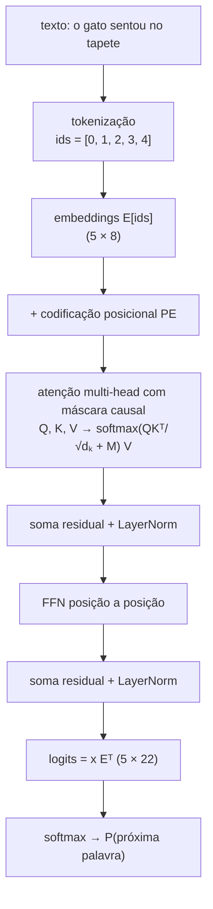
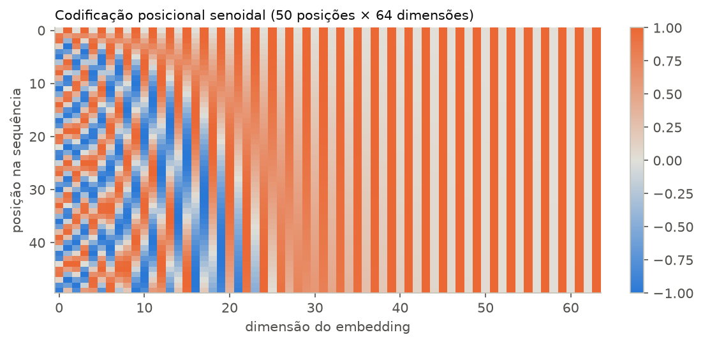
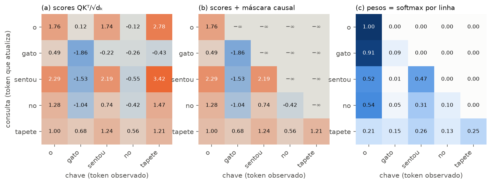
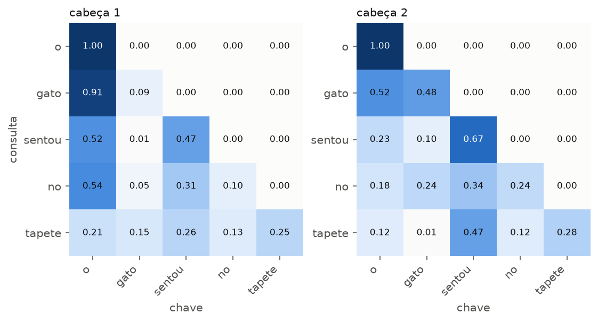
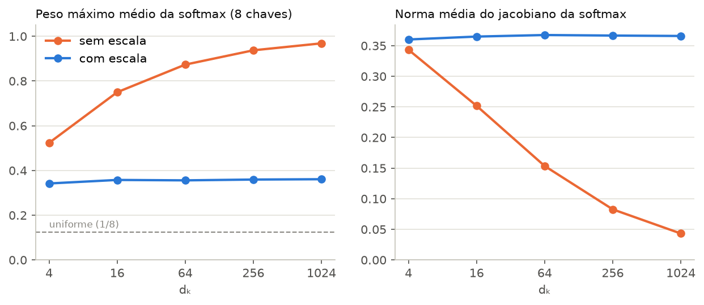
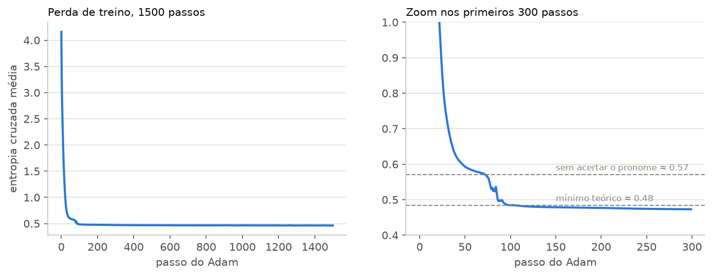
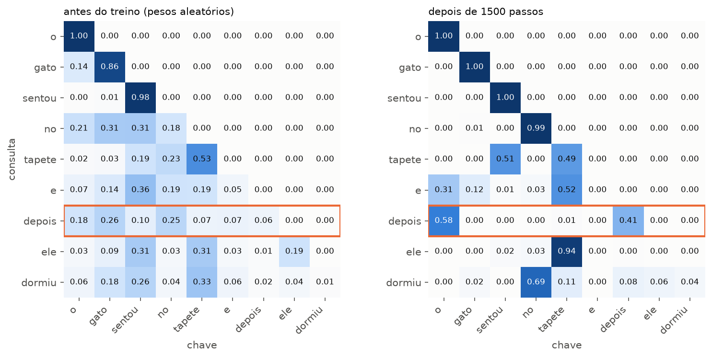
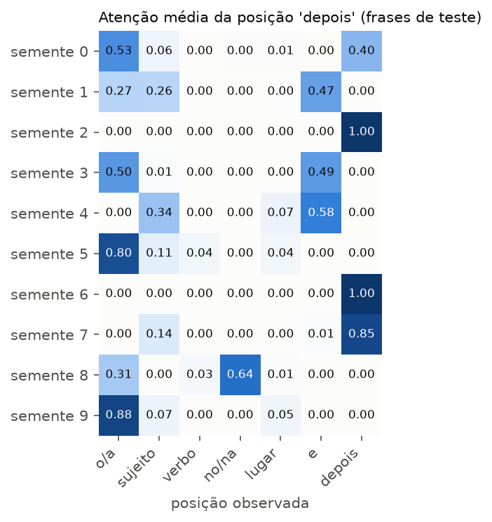

# Lista 2 - Inteligência Artificial

**Dupla:** Bruno Gomes de Barros Filho (21111360); Antônio Rodrigo Lima de Andrade Tenório (23210707)  
**Disciplina:** ECOM031: Inteligência Artificial  
**Professor:** Evandro de Barros Costa  
**Período:** 2026.2

## Questão 13: Ensaio sobre a arquitetura Transformer

**Vídeo indicado no enunciado:** implementitatai, *Encoders vs Decoders Explained: How Transformers Really Work (With Real Attention Math)*, https://youtu.be/bVVm68KTD2M  
**Código e experimentos:** `src/q13_transformers/` (mini-Transformer em numpy, notebook executado, testes)

O vídeo recomendado foi o ponto de partida. Ele compara encoders e decoders e faz as contas da atenção com números. Seguimos a mesma ideia: em vez de descrever o Transformer só com diagramas, escrevemos um bloco decoder-only em numpy puro e acompanhamos a frase **"o gato sentou no tapete"** por todas as etapas, com as matrizes que o código de fato produziu. Na última parte treinamos um modelo minúsculo para ver a atenção aprender algo que dá para interpretar.

### 1. O problema que o Transformer resolveu

Antes de 2017, o padrão para processar texto eram as redes recorrentes (RNNs). Uma RNN lê a frase uma palavra por vez e mantém um vetor de estado $h_t = f(h_{t-1}, x_t)$ que resume tudo o que foi lido até ali. Isso traz dois problemas. O primeiro é de otimização: o gradiente que liga a palavra 20 à palavra 1 passa por 19 multiplicações sucessivas e tende a sumir ou explodir. A LSTM (Hochreiter e Schmidhuber, 1997) ameniza isso com portas que controlam o que entra e o que sai da memória, mas não elimina. O segundo problema é de computação: para calcular $h_{20}$ é preciso ter $h_{19}$, então o processamento de uma frase não pode ser paralelizado ao longo do tempo, e as GPUs ficam subutilizadas.

Na tradução automática, o modelo seq2seq (Sutskever, Vinyals e Le, 2014) usava uma RNN codificadora para comprimir a frase de origem num único vetor e uma RNN decodificadora para gerar a tradução a partir dele. Frases longas não cabem bem num vetor de tamanho fixo. Bahdanau, Cho e Bengio (2015) resolveram esse gargalo com a **atenção**: a cada palavra gerada, o decodificador calcula pesos sobre todos os estados do codificador e usa a média ponderada deles. Ao gerar "mat" em "the cat sat on the mat", o decodificador pode olhar diretamente para o estado de "tapete", sem depender de que essa informação tenha sobrevivido no vetor final.

Vaswani et al. (2017) deram o passo seguinte no artigo *Attention Is All You Need*: se a atenção já permite que qualquer posição consulte qualquer outra, a recorrência pode ser removida. O Transformer processa todos os tokens da frase ao mesmo tempo, e cada camada deixa cada token atualizar sua representação olhando para os demais (autoatenção). O caminho entre duas palavras quaisquer passa a ter comprimento 1, em vez de crescer com a distância entre elas, e o cálculo vira multiplicação de matrizes, que as GPUs fazem bem. O artigo mostrou o modelo em tradução inglês-alemão e inglês-francês, e a mesma arquitetura acabou servindo de base para o BERT, a família GPT e praticamente todos os LLMs atuais.

### 2. Visão geral da arquitetura

O Transformer original tem duas pilhas de blocos. O **encoder** lê a frase de origem inteira, e cada posição pode olhar para todas as outras, inclusive as que vêm depois. O **decoder** gera a frase de destino um token por vez. Ele tem autoatenção com máscara causal (cada posição só vê as anteriores) e uma camada de **atenção cruzada** (*cross-attention*), em que as consultas vêm do decoder e as chaves e os valores vêm da saída do encoder. É nessa camada que o decoder "consulta" a frase de origem, como na atenção de Bahdanau.

Os modelos atuais costumam usar só uma das metades:

| Variante | Atenção | Objetivo de treino típico | Exemplos |
| :--- | :--- | :--- | :--- |
| Só encoder | Bidirecional (sem máscara) | Prever palavras mascaradas (MLM) | BERT |
| Só decoder | Causal | Prever a próxima palavra | GPT-2, GPT-3, Llama |
| Encoder-decoder | Bidirecional no encoder, causal + cruzada no decoder | Gerar a saída dada a entrada | Transformer original, T5 |

O nosso código implementa um bloco **decoder-only**, que é o tipo usado pelos LLMs de chat. O caminho de um token pelo modelo é o seguinte:

Num modelo real, o bloco do meio (atenção, residual, FFN) se repete dezenas de vezes. O Transformer base do artigo tinha 6 camadas no encoder e 6 no decoder, $d_{model}=512$, 8 cabeças com $d_k=64$ e FFN com 2048 neurônios. O nosso usa uma camada, $d_{model}=8$, 2 cabeças com $d_k=4$ e FFN com 32 neurônios, pequeno o bastante para imprimir todas as matrizes. Os pesos são aleatórios (semente 0). Nas seções 3.1 a 3.9 o objetivo é ver as contas; o significado das previsões só aparece depois do treino (seção 5).

### 3. Exemplo completo: "o gato sentou no tapete"

#### 3.1 Tokenização

O modelo não lê caracteres. O texto é quebrado em tokens e cada token vira um inteiro. Usamos tokenização por palavra sobre um vocabulário de 22 palavras (o do corpus de brinquedo da seção 5):

| token | o | gato | sentou | no | tapete |
| :--- | :---: | :---: | :---: | :---: | :---: |
| id | 0 | 1 | 2 | 3 | 4 |

Modelos reais usam subpalavras, com algoritmos como BPE ou WordPiece, para não ter palavras fora do vocabulário. O GPT-2, por exemplo, tem 50.257 tokens, e uma palavra rara é quebrada em pedaços menores. Para o resto da arquitetura isso não muda nada: a entrada é uma sequência de ids.

#### 3.2 Embeddings

Cada id seleciona uma linha da matriz de embeddings $E$ (22 × 8). No início do treino essas linhas são aleatórias; com o treino, palavras que aparecem em contextos parecidos ficam com vetores parecidos.

| $E[\text{ids}]$ | d0 | d1 | d2 | d3 | d4 | d5 | d6 | d7 |
| :--- | ---: | ---: | ---: | ---: | ---: | ---: | ---: | ---: |
| o | 0,13 | -0,13 | 0,64 | 0,10 | -0,54 | 0,36 | 1,30 | 0,95 |
| gato | -0,70 | -1,27 | -0,62 | 0,04 | -2,33 | -0,22 | -1,25 | -0,73 |
| sentou | -0,54 | -0,32 | 0,41 | 1,04 | -0,13 | 1,37 | -0,67 | 0,35 |
| no | 0,90 | 0,09 | -0,74 | -0,92 | -0,46 | 0,22 | -1,01 | -0,21 |
| tapete | -0,16 | 0,54 | 0,21 | 0,36 | -0,65 | -0,13 | 0,78 | 1,49 |

(O artigo original multiplica os embeddings por $\sqrt{d_{model}}$ antes de somar a posição. Como inicializamos $E$ com variância 1, o efeito é o mesmo e omitimos essa multiplicação.)

#### 3.3 Codificação posicional

A atenção, como veremos, trata a entrada como um conjunto: se trocarmos a ordem das palavras, as saídas só trocam de lugar. Sem alguma informação de posição, "o gato sentou no tapete" e "tapete no sentou gato o" seriam a mesma coisa para o modelo. O notebook confirma isso numericamente (seção 8 do notebook e teste `test_equivariancia_a_permutacao_sem_posicao_e_sem_mascara`).

O artigo original soma a cada embedding um vetor fixo que depende só da posição:

$$PE_{(pos,\,2i)} = \sin\!\left(\frac{pos}{10000^{2i/d_{model}}}\right), \qquad PE_{(pos,\,2i+1)} = \cos\!\left(\frac{pos}{10000^{2i/d_{model}}}\right)$$

Cada par de dimensões é uma senoide com frequência diferente. As primeiras dimensões oscilam rápido e distinguem posições vizinhas; as últimas oscilam devagar e distinguem posições distantes, como os ponteiros de um relógio. Os autores escolheram senoides porque $PE_{pos+k}$ é uma função linear de $PE_{pos}$, o que deveria facilitar ao modelo aprender a atender por posição relativa.

| PE | d0 | d1 | d2 | d3 | d4 | d5 | d6 | d7 |
| :--- | ---: | ---: | ---: | ---: | ---: | ---: | ---: | ---: |
| pos 0 | 0,00 | 1,00 | 0,00 | 1,00 | 0,00 | 1,00 | 0,00 | 1,00 |
| pos 1 | 0,84 | 0,54 | 0,10 | 1,00 | 0,01 | 1,00 | 0,00 | 1,00 |
| pos 2 | 0,91 | -0,42 | 0,20 | 0,98 | 0,02 | 1,00 | 0,00 | 1,00 |
| pos 3 | 0,14 | -0,99 | 0,30 | 0,96 | 0,03 | 1,00 | 0,00 | 1,00 |
| pos 4 | -0,76 | -0,65 | 0,39 | 0,92 | 0,04 | 1,00 | 0,00 | 1,00 |

Na posição 1, por exemplo, $d0 = \sin(1) = 0{,}84$ e $d1 = \cos(1) = 0{,}54$. A figura mostra o padrão para 50 posições e 64 dimensões:

A entrada do bloco é $x_0 = E[\text{ids}] + PE$. Para "tapete" (posição 4), $x_0 = [-0{,}92;\ -0{,}11;\ 0{,}60;\ 1{,}28;\ -0{,}61;\ 0{,}87;\ 0{,}79;\ 2{,}49]$.

Há alternativas. O BERT e o GPT-2 aprendem um vetor de posição para cada índice, como se fosse outro embedding. Muitos LLMs recentes, como a família Llama, usam o **RoPE** (Su et al., 2021), que em vez de somar um vetor gira os pares de coordenadas de $Q$ e $K$ por um ângulo proporcional à posição. Com isso, o produto $q_m \cdot k_n$ passa a depender só da diferença $m-n$, e a posição relativa aparece diretamente no score de atenção.

#### 3.4 Consultas, chaves e valores

A autoatenção começa projetando $x_0$ em três matrizes com pesos aprendidos: $Q = x_0 W_Q$, $K = x_0 W_K$ e $V = x_0 W_V$. Uma forma de pensar nelas: a **consulta** $q_i$ descreve o que o token $i$ está procurando, a **chave** $k_j$ descreve o que o token $j$ oferece, e o **valor** $v_j$ é a informação que $j$ repassa a quem prestar atenção nele. Separar chave e valor permite que o critério para escolher um token seja diferente do conteúdo que ele transmite.

Com 2 cabeças, cada matriz 5 × 8 é dividida em duas de 5 × 4. Na cabeça 1:

| token | $Q$ | $K$ | $V$ |
| :--- | :--- | :--- | :--- |
| o | [0,47; 1,15; -1,77; 1,23] | [-0,33; 0,56; -1,66; 0,09] | [-0,81; -0,09; 1,19; -0,47] |
| gato | [0,31; -2,03; -1,42; -1,49] | [1,29; 1,24; 1,05; 0,07] | [-0,63; 1,34; -1,55; 0,69] |
| sentou | [0,39; -0,53; -2,90; 2,43] | [0,52; 0,57; -1,03; 0,61] | [-0,95; -0,04; -0,41; -1,26] |
| no | [0,00; -0,27; -1,64; -0,08] | [1,15; 0,11; 0,49; -0,02] | [-0,75; 0,84; -0,73; -0,19] |
| tapete | [1,45; 0,67; -1,26; 0,06] | [-0,68; 1,19; -2,03; 0,75] | [-1,50; 1,11; 0,83; -0,40] |

#### 3.5 Scores e o fator $\sqrt{d_k}$

A atenção scaled dot-product é

$$\text{Attention}(Q, K, V) = \text{softmax}\!\left(\frac{QK^T}{\sqrt{d_k}} + M\right) V$$

onde $M$ é a máscara (seção 3.6). O produto $QK^T$ dá uma matriz 5 × 5 em que a entrada $(i, j)$ mede o quanto a consulta de $i$ combina com a chave de $j$. Para a consulta de "tapete" e a chave de "o":

$$q_{tapete} \cdot k_{o} = 1{,}45 \cdot (-0{,}33) + 0{,}67 \cdot 0{,}56 + (-1{,}26)(-1{,}66) + 0{,}06 \cdot 0{,}09 \approx 2{,}00$$

e, dividindo por $\sqrt{d_k} = \sqrt{4} = 2$, o score é 1,00. A matriz completa da cabeça 1:

| consulta \ chave | o | gato | sentou | no | tapete |
| :--- | ---: | ---: | ---: | ---: | ---: |
| o | 1,76 | 0,12 | 1,74 | -0,12 | 2,78 |
| gato | 0,49 | -1,86 | -0,22 | -0,26 | -0,43 |
| sentou | 2,29 | -1,53 | 2,19 | -0,55 | 3,42 |
| no | 1,28 | -1,04 | 0,74 | -0,42 | 1,47 |
| tapete | 1,00 | 0,68 | 1,24 | 0,56 | 1,21 |

A divisão por $\sqrt{d_k}$ tem uma razão estatística. Se as componentes de $q$ e $k$ têm média 0 e variância 1, o produto $q \cdot k = \sum_{i=1}^{d_k} q_i k_i$ é uma soma de $d_k$ termos de variância 1 e tem variância $d_k$. Com $d_k = 64$, como no artigo, os scores teriam desvio padrão 8. A softmax de números tão espalhados fica quase *one-hot*: um token recebe praticamente todo o peso e os demais ficam perto de zero. Nessa região a derivada da softmax é quase nula e o gradiente que chega a $W_Q$ e $W_K$ desaparece. Dividir por $\sqrt{d_k}$ traz a variância de volta para 1 qualquer que seja a dimensão. A seção 4 mede esse efeito.

#### 3.6 Máscara causal

Num decoder, a posição $i$ está tentando prever o token $i+1$. Se ela pudesse olhar para $i+1$, a tarefa ficaria trivial durante o treino e impossível de reproduzir na geração, quando o futuro ainda não existe. A máscara causal soma $-\infty$ a todo score com $j > i$:

$$M_{ij} = \begin{cases} 0 & j \le i \\ -\infty & j > i \end{cases}$$

Como $e^{-\infty} = 0$, esses pares recebem peso exatamente zero depois da softmax. "o" só vê a si mesmo, "gato" vê "o" e "gato", e assim por diante até "tapete", que vê a frase toda.

#### 3.7 Softmax e pesos de atenção

Cada linha dos scores mascarados passa pela softmax, $w_{ij} = e^{s_{ij}} / \sum_{j'} e^{s_{ij'}}$. Para a linha de "tapete" a conta é:

| | o | gato | sentou | no | tapete |
| :--- | ---: | ---: | ---: | ---: | ---: |
| score $s$ | 1,00 | 0,68 | 1,24 | 0,56 | 1,21 |
| $e^{s - \max s}$ | 0,79 | 0,58 | 1,00 | 0,51 | 0,97 |
| peso $w$ (divide pela soma 3,85) | **0,21** | **0,15** | **0,26** | **0,13** | **0,25** |

A saída da cabeça para "tapete" é a média dos valores ponderada por esses pesos:

$$z_{tapete} = 0{,}21\, v_{o} + 0{,}15\, v_{gato} + 0{,}26\, v_{sentou} + 0{,}13\, v_{no} + 0{,}25\, v_{tapete} = [-0{,}98;\ 0{,}57;\ 0{,}02;\ -0{,}45]$$

O notebook refaz essa conta à mão e confere com a saída da função `attention`. A figura mostra as três etapas para a cabeça 1: (a) scores, (b) scores com a máscara e (c) pesos depois da softmax.

Os pesos da cabeça 1 ficaram assim (cada linha soma 1):

| consulta \ chave | o | gato | sentou | no | tapete |
| :--- | ---: | ---: | ---: | ---: | ---: |
| o | 1,00 | 0 | 0 | 0 | 0 |
| gato | 0,91 | 0,09 | 0 | 0 | 0 |
| sentou | 0,52 | 0,01 | 0,47 | 0 | 0 |
| no | 0,54 | 0,05 | 0,31 | 0,10 | 0 |
| tapete | 0,21 | 0,15 | 0,26 | 0,13 | 0,25 |

Como os pesos são aleatórios, não há interpretação linguística aqui. "gato" pôr 0,91 em "o" é coincidência da inicialização. O que importa é a forma: triangular inferior, linhas somando 1, e a saída de cada posição sendo uma mistura dos valores das posições que ela pode ver.

#### 3.8 Várias cabeças

Uma única cabeça produz uma única distribuição de pesos por posição. Com várias cabeças, cada uma tem suas próprias $W_Q$, $W_K$, $W_V$ e pode aprender um tipo diferente de relação (concordância, vizinho anterior, sujeito do verbo etc.). As saídas das $h$ cabeças são concatenadas e projetadas por $W_O$:

$$\text{MultiHead}(x) = \text{Concat}(\text{head}_1, \dots, \text{head}_h)\, W_O$$

Como cada cabeça trabalha em dimensão $d_{model}/h$, o custo total é parecido com o de uma cabeça só em dimensão cheia. No exemplo, a cabeça 2 distribui o peso de outro jeito: a linha de "tapete" fica [0,12; 0,01; 0,47; 0,12; 0,28], com quase metade em "sentou".

Para "tapete", a concatenação das duas cabeças é $[-0{,}98;\ 0{,}57;\ 0{,}02;\ -0{,}45;\ 1{,}26;\ -0{,}32;\ -0{,}67;\ 0{,}42]$ e, depois de $W_O$, a saída da subcamada de atenção é $[0{,}78;\ -0{,}04;\ -1{,}23;\ 1{,}18;\ -0{,}79;\ -0{,}31;\ -0{,}23;\ 0{,}59]$.

#### 3.9 Conexão residual, LayerNorm e FFN

A saída da atenção é somada à própria entrada (conexão residual, a mesma ideia da ResNet de He et al., 2016). Assim cada camada aprende uma correção sobre a representação anterior, e o gradiente tem um caminho direto até as camadas iniciais. Em seguida vem a **LayerNorm** (Ba, Kiros e Hinton, 2016), que normaliza cada vetor para média 0 e desvio 1 e depois aplica uma escala $\gamma$ e um deslocamento $\beta$ aprendidos:

$$\text{LN}(x) = \gamma \odot \frac{x - \mu}{\sqrt{\sigma^2 + \epsilon}} + \beta$$

Para "tapete": $x_0 + \text{atenção} = [-0{,}14;\ -0{,}15;\ -0{,}63;\ 2{,}46;\ -1{,}40;\ 0{,}56;\ 0{,}56;\ 3{,}09]$, com média 0,54 e desvio 1,42. Depois da LayerNorm (com $\gamma=1$ e $\beta=0$ na inicialização) fica $x_1 = [-0{,}48;\ -0{,}49;\ -0{,}82;\ 1{,}35;\ -1{,}36;\ 0{,}01;\ 0{,}01;\ 1{,}78]$, com média 0 e desvio 1.

A segunda subcamada é a rede feed-forward, aplicada a cada posição separadamente e com os mesmos pesos para todas:

$$\text{FFN}(x) = \max(0,\ xW_1 + b_1)\, W_2 + b_2$$

Ela expande o vetor para $d_{ff}$ dimensões (32 no nosso caso, 2048 no artigo, em geral $4 \times d_{model}$), aplica ReLU e volta para $d_{model}$. A divisão de trabalho costuma ser descrita assim: a atenção move informação entre posições, e a FFN processa a informação dentro de cada posição. BERT e GPT trocaram a ReLU pela GELU. Para "tapete", 17 dos 32 neurônios ficaram ativos, e a saída do bloco depois da segunda soma residual e da segunda LayerNorm é $x_2 = [-1{,}10;\ -0{,}35;\ -0{,}48;\ 0{,}88;\ -1{,}65;\ 1{,}40;\ 0{,}41;\ 0{,}90]$.

O nosso bloco segue o artigo original, que aplica a LayerNorm depois da soma (pós-LN). O GPT-2 passou a LayerNorm para a entrada de cada subcamada (pré-LN), $x + \text{Subcamada}(\text{LN}(x))$, o que deixa o treino de modelos profundos mais estável. Hoje essa é a escolha mais comum.

#### 3.10 Projeção para o vocabulário e softmax

O último passo transforma $x_2$ em uma distribuição sobre as 22 palavras. Multiplicamos por $E^T$, a transposta da própria matriz de embeddings (o artigo também compartilha esses pesos), e obtemos um *logit* por palavra. A softmax converte os logits em probabilidades. A linha de cada posição é a previsão do token seguinte:

| após | 1ª mais provável | 2ª | 3ª |
| :--- | :--- | :--- | :--- |
| "o" | cama 0,314 | sofá 0,199 | cachorro 0,179 |
| "gato" | cama 0,756 | gato 0,113 | cachorro 0,061 |
| "tapete" | cama 0,255 | gato 0,144 | gata 0,142 |

Com pesos aleatórios a previsão é lixo, como esperado: após "o gato" o modelo aposta em "cama". O mecanismo, porém, já está completo. Treinar significa ajustar $E$, $W_Q$, $W_K$, $W_V$, $W_O$, $W_1$, $W_2$, $\gamma$ e $\beta$ até que essas distribuições concentrem probabilidade nas palavras certas.

### 4. Experimento: o efeito de $\sqrt{d_k}$

Para medir o argumento da seção 3.5, sorteamos 2000 vezes uma consulta e 8 chaves com componentes $\mathcal{N}(0, 1)$ e calculamos a softmax dos scores com e sem a divisão por $\sqrt{d_k}$. A norma do jacobiano da softmax, $\lVert \text{diag}(w) - ww^T \rVert$, indica quanto gradiente consegue passar por ela.

| $d_k$ | desvio dos scores (sem / com) | peso máximo médio (sem / com) | entropia média (sem / com) | norma do jacobiano (sem / com) |
| ---: | :---: | :---: | :---: | :---: |
| 4 | 2,00 / 1,00 | 0,52 / 0,34 | 1,29 / 1,75 | 0,34 / 0,36 |
| 16 | 4,03 / 1,01 | 0,75 / 0,36 | 0,67 / 1,73 | 0,25 / 0,36 |
| 64 | 8,01 / 1,00 | 0,87 / 0,36 | 0,32 / 1,73 | 0,15 / 0,37 |
| 256 | 15,87 / 0,99 | 0,94 / 0,36 | 0,15 / 1,73 | 0,08 / 0,37 |
| 1024 | 31,85 / 1,00 | 0,97 / 0,36 | 0,08 / 1,72 | 0,04 / 0,37 |

O desvio padrão dos scores sem escala cresce como $\sqrt{d_k}$ (2, 4, 8, 16, 32), como previsto. Com $d_k = 64$ o maior peso já leva 87% da atenção, a entropia cai para 0,32 (o máximo com 8 chaves é $\ln 8 = 2{,}08$) e a norma do jacobiano é menos da metade do valor com escala. Em $d_k = 1024$ a softmax é praticamente um *argmax* e passa 9 vezes menos gradiente. Com a divisão, as quatro medidas ficam constantes, independentemente da dimensão.

### 5. Treinamento

#### 5.1 Objetivos

Um modelo decoder-only é treinado para **prever a próxima palavra**. Para uma frase $t_1, \dots, t_n$, a perda é a entropia cruzada média $-\frac{1}{n-1}\sum_i \log P(t_{i+1} \mid t_1, \dots, t_i)$. A máscara causal permite calcular as $n-1$ previsões numa única passada, porque cada posição só enxerga o que veio antes dela. Durante o treino, a entrada de cada posição é o prefixo verdadeiro do texto, e não o que o modelo teria gerado; isso é o *teacher forcing*. Não é preciso rótulo humano: qualquer texto serve como dado de treino, e é isso que permite treinar em corpora enormes.

O BERT (Devlin et al., 2019), que é só encoder, usa outro objetivo, o **modelo de linguagem mascarado** (MLM): 15% dos tokens da entrada são escolhidos, a maioria deles é trocada por `[MASK]`, e o modelo precisa recuperá-los usando o contexto dos dois lados. Isso produz boas representações para classificação e extração, mas o modelo não gera texto da esquerda para a direita. O Transformer original, encoder-decoder, era treinado com pares de frases traduzidas, prevendo a próxima palavra da tradução dado o texto de origem.

#### 5.2 Experimento: a atenção aprendendo a achar o sujeito

Para ver a atenção aprender algo interpretável, montamos um corpus de 96 frases com o molde

> [o gato | a gata | o cachorro | a cadela | o menino | a menina] [sentou | deitou] [no tapete | no sofá | na cadeira | na cama] e depois [ele | ela] [dormiu | saiu]

O pronome depende do gênero do sujeito, que está cinco palavras antes de "depois". As palavras mais próximas, "no/na" e o lugar, também têm gênero, mas variam independentemente do sujeito; quem copiar o gênero delas acerta só metade das vezes. Separamos 72 frases para treino e 24 para teste.

O modelo é uma versão reduzida do bloco da seção 3: uma camada, uma cabeça, $d = 16$, codificação posicional senoidal, máscara causal e conexão residual, sem FFN e sem LayerNorm. Tiramos essas duas peças para poder escrever o gradiente à mão em `treino.py`, em cerca de 20 linhas. O teste `test_gradiente_manual_bate_com_diferencas_finitas` confere esse gradiente contra derivadas numéricas para todos os parâmetros. O otimizador é o Adam, com 1500 passos em lote completo.

Dá para calcular a menor perda possível nesse corpus. Depois do artigo há 3 substantivos possíveis ($\ln 3$); depois do substantivo, do verbo, de "no/na" e do pronome há 2 opções equiprováveis ($\ln 2$ cada); o resto é determinístico. Isso dá $(\ln 3 + 4 \ln 2)/8 \approx 0{,}48$ por posição. Um modelo que não descobriu o pronome perde mais $\ln 2/8$ e fica em 0,57.

A curva tem dois degraus. Nos primeiros 60 passos o modelo aprende o que dá para aprender olhando só a palavra atual (depois de "e" vem "depois", depois de "tapete" vem "e") e para num platô perto de 0,57. Por volta do passo 80 a perda cai de novo para o mínimo de 0,48. É nesse momento que a atenção aprende a buscar o sujeito. Os números da semente 0:

| | antes do treino | depois do treino |
| :--- | :---: | :---: |
| perda de treino | 4,16 | 0,46 |
| acurácia do pronome (treino) | 50% | 100% |
| acurácia do pronome (teste) | 50% | 100% |
| peso da posição "depois" sobre o artigo "o/a" | 0,18 | 0,58 |
| peso da posição "depois" sobre si mesma | 0,06 | 0,41 |

Na figura, a linha destacada é a da consulta "depois". Antes do treino o peso está espalhado (0,18; 0,26; 0,10; 0,25; ...). Depois, 58% vai para o artigo "o", que carrega o gênero do sujeito, e quase todo o resto fica na própria posição. "no" e "tapete", os distratores com gênero, recebem 0 e 0,01. Nas 24 frases de teste, nunca vistas no treino, o modelo põe probabilidade acima de 0,99 no pronome certo em todas. Na geração gulosa, partindo de "a cadela deitou no sofá e depois", o modelo completa com "ela saiu"; partindo de "o menino sentou na cama e depois", com "ele dormiu".

Nas outras linhas, as quatro primeiras posições olham para si mesmas, porque a palavra atual basta para prever a seguinte. As linhas "ele" e "dormiu" têm pesos concentrados em "tapete" e "no", mas isso não significa nada: depois de "ele" vem "dormiu" ou "saiu" com 50% de chance qualquer que seja o contexto, e depois de "dormiu" a frase acaba, então a perda não orienta essas linhas.

#### 5.3 O que o experimento não mostra

Repetimos o treino com 10 sementes diferentes:

Sete sementes chegam a 100% no teste. Duas (2 e 6) ficam presas num mínimo local em que a posição "depois" olha só para si mesma, com perda 0,55 e acurácia de 50%, ou seja, chute. A semente 7 chega a 75%. Entre as que funcionam, o lugar para onde a atenção olha varia: o artigo (sementes 0, 3, 5, 9), o substantivo (semente 4) ou os dois (semente 1). Várias delas também põem quase metade do peso em "e", uma posição que não carrega gênero, e funciona como uma espécie de "lugar neutro" para estacionar atenção.

O caso mais curioso é a semente 8. Ela acerta 100% mesmo pondo 0,64 do peso em "no/na", justamente o distrator. Os 0,31 que vão para o artigo bastam porque $W_V$, $W_O$ e a matriz de saída podem simplesmente ignorar a direção do espaço em que "no/na" codifica gênero. Peso de atenção alto não quer dizer que aquela posição está sendo usada, e é por isso que a literatura recomenda cuidado ao ler mapas de atenção como explicação (Jain e Wallace, 2019).

Há outras limitações. O modelo treinado não tem FFN nem LayerNorm e tem uma só camada e uma só cabeça. O corpus é artificial e minúsculo, e a perda de teste (0,83) fica bem acima da de treino (0,46): nas posições em que a resposta é aleatória (qual verbo segue cada sujeito, por exemplo), o modelo se ajustou às frequências das 72 frases de treino, que não são exatamente as do teste. Isso não afeta o pronome, mas mostra que o modelo está longe de generalizar como um modelo de linguagem de verdade. O experimento serve para mostrar o mecanismo: com gradiente e uma perda de próxima palavra, as matrizes $W_Q$ e $W_K$ se ajustam para que a consulta de uma posição encontre a chave que tem a informação de que ela precisa.

### 6. Inferência: gerando texto

Depois de treinado, o modelo gera texto de forma **autorregressiva**. Ele recebe o prompt, calcula a distribuição da próxima palavra na última posição, escolhe um token, acrescenta esse token à entrada e repete. A escolha pode ser gulosa (sempre o mais provável, como no nosso `generate`) ou por amostragem, com temperatura ou restrita aos $k$ tokens mais prováveis (*top-k*) ou ao menor conjunto que soma probabilidade $p$ (*top-p*). A amostragem dá respostas mais variadas, e a escolha gulosa é determinística mas tende a repetir trechos.

Recalcular a frase inteira a cada token novo seria um desperdício. Com a máscara causal, a chegada de um token no fim não altera as representações das posições anteriores, então as chaves e os valores delas podem ser guardados. Essa é a ideia do **KV cache**, discutida na Questão 5 (`docs/q05_inferencia_llm.md`): na fase de *prefill* o modelo processa o prompt inteiro de uma vez e preenche o cache, e na fase de *decode* cada passo calcula $q$, $k$ e $v$ só do token novo e faz a atenção dele contra as chaves e os valores guardados. O notebook verifica as duas propriedades com o exemplo. A saída do prefixo "o gato sentou no" é idêntica com ou sem "tapete" no fim, e a atenção de "tapete" calculada com 4 linhas de K e V em cache mais a linha nova é igual à da passada completa (`np.allclose` dá `True` nos dois casos). O teste `test_mudar_o_futuro_nao_muda_o_passado` cobre o mesmo ponto.

### 7. Custo computacional

A matriz de scores tem $n \times n$ entradas. Para uma sequência de $n$ tokens, a autoatenção custa $O(n^2 \cdot d)$ em tempo e $O(n^2)$ em memória para os pesos. O artigo original compara isso com uma camada recorrente, que custa $O(n \cdot d^2)$ mas exige $O(n)$ passos sequenciais, contra $O(1)$ da autoatenção. Quando $n$ é menor que $d$, que era o caso típico em tradução de frases, a atenção é até mais barata, além de paralelizável. Com contextos de dezenas de milhares de tokens, o termo $n^2$ domina: dobrar o contexto quadruplica a matriz de atenção. Na geração com KV cache, cada token novo custa $O(n \cdot d)$ por camada, mas o cache ocupa memória proporcional a $n$ multiplicado pelo número de camadas e de cabeças, e é ele que costuma limitar quantas requisições cabem numa GPU (de novo, a Questão 5).

Há várias linhas de trabalho para contornar o custo quadrático. A atenção esparsa (Child et al., 2019) e o Longformer (Beltagy, Peters e Cohan, 2020) restringem cada token a olhar uma janela local e algumas posições globais. O FlashAttention (Dao et al., 2022) calcula a atenção exata, mas em blocos que cabem na memória rápida da GPU, sem materializar a matriz $n \times n$ inteira, o que reduz a memória para linear em $n$ e acelera bastante na prática, embora o número de operações continue quadrático.

### 8. Variantes e usos

A arquitetura se espalhou além do texto. Os principais ramos:

- **Só encoder**, como o BERT: bom para tarefas em que a entrada inteira está disponível, como classificação de sentimento, reconhecimento de entidades e busca semântica.
- **Só decoder**, como o GPT-2 (Radford et al., 2019) e seus sucessores: o mesmo bloco da seção 3 empilhado dezenas de vezes e treinado com a perda de próxima palavra. Com escala suficiente, um modelo desse tipo resolve tarefas variadas só a partir de instruções no prompt, e é a base dos LLMs de chat.
- **Encoder-decoder**, como o Transformer original e o T5 (Raffel et al., 2020): continua comum em tradução e sumarização.
- **Outras modalidades**: o Vision Transformer (Dosovitskiy et al., 2021) corta a imagem em blocos de 16 × 16 pixels e trata cada bloco como um token.

### 9. Considerações finais

Acompanhando "o gato sentou no tapete" pelo código, o Transformer se resume a poucas operações: somar posição ao embedding, comparar consultas com chaves por produto escalar, normalizar com softmax, misturar valores, somar o resultado à entrada e passar por uma rede pequena aplicada a cada posição. A divisão por $\sqrt{d_k}$ mantém a softmax longe da saturação, como o experimento da seção 4 mostrou, e a máscara causal permite treinar todas as posições em paralelo e, na geração, reaproveitar o KV cache. O treino minúsculo mostrou que uma única cabeça aprende a buscar o sujeito a cinco palavras de distância e a ignorar distratores. Também mostrou que o resultado depende da inicialização e que o peso de atenção nem sempre diz qual posição o modelo está de fato usando.

### Referências (Q13)

1. VASWANI, A. et al. Attention Is All You Need. In: *Advances in Neural Information Processing Systems 30 (NeurIPS)*, 2017.
2. IMPLEMENTITATAI. *Encoders vs Decoders Explained: How Transformers Really Work (With Real Attention Math)*. YouTube. Disponível em: https://youtu.be/bVVm68KTD2M. Acesso em: 7 nov. 2026.
3. ALAMMAR, J. *The Illustrated Transformer*. 2018. Disponível em: https://jalammar.github.io/illustrated-transformer/.
4. BAHDANAU, D.; CHO, K.; BENGIO, Y. Neural Machine Translation by Jointly Learning to Align and Translate. In: *ICLR*, 2015.
5. SUTSKEVER, I.; VINYALS, O.; LE, Q. V. Sequence to Sequence Learning with Neural Networks. In: *NeurIPS*, 2014.
6. HOCHREITER, S.; SCHMIDHUBER, J. Long Short-Term Memory. *Neural Computation*, v. 9, n. 8, 1997.
7. DEVLIN, J. et al. BERT: Pre-training of Deep Bidirectional Transformers for Language Understanding. In: *NAACL-HLT*, 2019.
8. RADFORD, A. et al. *Language Models are Unsupervised Multitask Learners*. OpenAI, 2019 (GPT-2).
9. BA, J. L.; KIROS, J. R.; HINTON, G. E. Layer Normalization. arXiv:1607.06450, 2016.
10. HE, K. et al. Deep Residual Learning for Image Recognition. In: *CVPR*, 2016.
11. SU, J. et al. RoFormer: Enhanced Transformer with Rotary Position Embedding. arXiv:2104.09864, 2021.
12. RAFFEL, C. et al. Exploring the Limits of Transfer Learning with a Unified Text-to-Text Transformer. *Journal of Machine Learning Research*, v. 21, 2020 (T5).
13. DOSOVITSKIY, A. et al. An Image is Worth 16x16 Words: Transformers for Image Recognition at Scale. In: *ICLR*, 2021.
14. CHILD, R. et al. Generating Long Sequences with Sparse Transformers. arXiv:1904.10509, 2019.
15. BELTAGY, I.; PETERS, M. E.; COHAN, A. Longformer: The Long-Document Transformer. arXiv:2004.05150, 2020.
16. DAO, T. et al. FlashAttention: Fast and Memory-Efficient Exact Attention with IO-Awareness. In: *NeurIPS*, 2022.
17. JAIN, S.; WALLACE, B. C. Attention is not Explanation. In: *NAACL-HLT*, 2019.
18. RUSSELL, S. J.; NORVIG, P. *Inteligência Artificial*. 3. ed. Rio de Janeiro: Elsevier, 2013.
