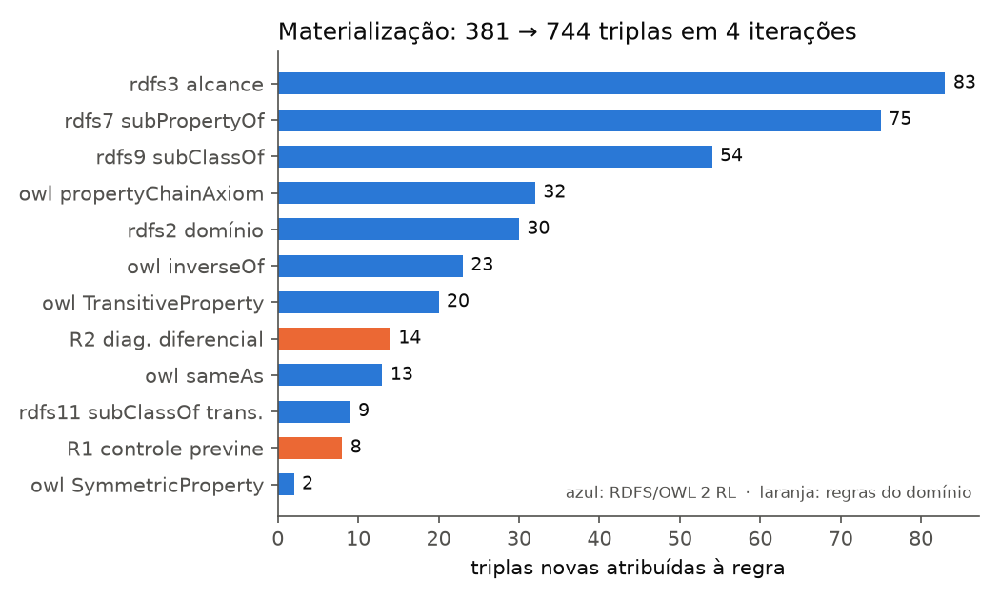
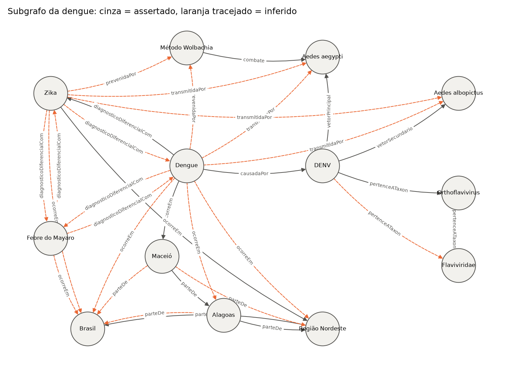
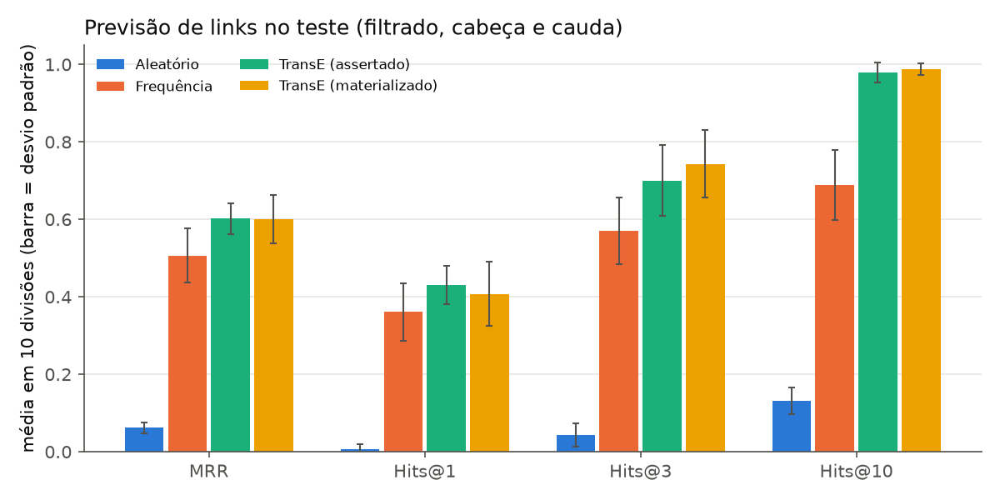
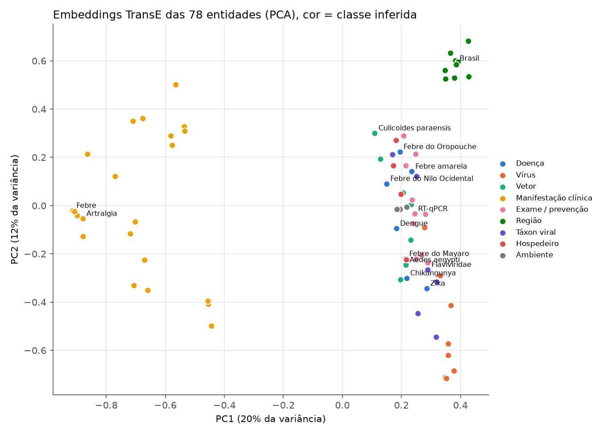

# Lista 2: Inteligência Artificial

**Dupla:** Bruno Gomes de Barros Filho (21111360); Antônio Rodrigo Lima de Andrade Tenório (23210707)  
**Disciplina:** ECOM031: Inteligência Artificial  
**Professor:** Evandro de Barros Costa  
**Período:** 2026.2

## Questão 14: Grafos de conhecimento: representação, inferência e aprendizagem

Na Questão 1 comparamos ontologias e grafos de conhecimento (KGs): hipótese de mundo aberto e fechado, raciocinadores de Lógica de Descrição, grafos de propriedades no Neo4j e o mapeamento de OWL para LPG. Esta questão parte dali e entra nos mecanismos. Primeiro, como um KG representa fatos, esquema, identidade e contexto. Depois, as duas famílias de inferência que convivem nesses sistemas: a dedutiva, que tira conclusões garantidas a partir de axiomas e regras, e a indutiva, que aprende padrões estatísticos do grafo e propõe fatos prováveis. Em seguida comentamos uma aplicação real (Hetionet, usado para reposicionamento de fármacos) e mostramos a aplicação que implementamos, um KG sobre arboviroses no Brasil com materialização RDFS/OWL, consultas SPARQL e Cypher e embeddings TransE.

Código e experimentos: `src/q14_knowledge_graph/` (notebook `q14_knowledge_graph.ipynb`).

### 1. Representação de conhecimento em KGs

Hogan et al. (2021) definem um grafo de conhecimento como um grafo de dados que acumula e transmite conhecimento do mundo real, em que os nós representam entidades e as arestas representam relações entre elas. A definição é propositalmente ampla. Na prática, dois modelos de dados dominam.

#### 1.1 Triplas RDF e grafos de propriedades

No RDF, todo fato é uma tripla `(sujeito, predicado, objeto)`. Sujeitos e predicados são IRIs, identificadores globais; o objeto pode ser outra IRI ou um literal (texto, número, data). Um conjunto de triplas forma um grafo dirigido e rotulado. Em Turtle, o fato "a dengue é causada pelo DENV" fica assim:

```turtle
@prefix arbo: <https://example.org/arbo#> .
arbo:Dengue arbo:causadaPor arbo:DENV ;
            rdfs:label "Dengue"@pt .
```

O modelo é mínimo e uniforme: o próprio esquema (classes, propriedades, axiomas) também é escrito em triplas, e por isso dados e esquema podem ser consultados juntos com SPARQL.

No grafo de propriedades (LPG), usado pelo Neo4j, nós e arestas têm rótulos e carregam pares chave-valor. Uma aresta pode ter atributos próprios, o que no RDF clássico exige um recurso intermediário. Em compensação, o LPG não tem identificadores globais nem uma semântica formal padronizada para o esquema; quem garante o significado é a aplicação.

#### 1.2 Esquema e ontologia

Um KG pode existir sem esquema, mas quase sempre tem algum. O RDFS oferece o mínimo: `rdfs:subClassOf`, `rdfs:subPropertyOf`, `rdfs:domain` e `rdfs:range`. O OWL 2 acrescenta características de propriedades (inversa, transitiva, simétrica, funcional), cadeias de propriedades, equivalência, disjunção e restrições de classe. O perfil OWL 2 RL foi desenhado para ser implementado por regras, com raciocínio em tempo polinomial no tamanho dos dados, e é o fragmento que usamos na implementação.

Há um ponto que costuma confundir. Domínio e alcance em RDFS não são restrições de validação; são regras de inferência. Se `temVetor` tem alcance `Vetor` e alguém escreve `DENV temVetor AedesAegypti`, o raciocinador conclui que *Aedes aegypti* é um `Vetor`. Ele não acusa erro. Para validar dados contra um formato esperado, o W3C padronizou o SHACL (2017), que lê o grafo em mundo fechado e devolve violações.

#### 1.3 Identidade de entidades

Como o RDF não assume nomes únicos, a mesma entidade pode aparecer com IRIs diferentes em fontes diferentes. O `owl:sameAs` declara que duas IRIs denotam o mesmo indivíduo, e a partir daí tudo o que se diz de uma vale para a outra. Em KGs grandes, decidir quando dois registros são a mesma entidade (*entity resolution*) é um problema em si, resolvido com regras, similaridade de atributos ou aprendizado. O Wikidata atribui a cada item um identificador estável (Q-ID) e mantém propriedades que ligam o item a identificadores externos, o que facilita a integração com outras bases (Vrandečić; Krötzsch, 2014).

#### 1.4 Contexto, qualificadores e reificação

Muitos fatos só são verdadeiros com contexto: desde quando, segundo qual fonte, com que confiança. No nosso grafo, "a febre do Nilo Ocidental ocorre no Piauí" ganha sentido com o qualificador "primeiro caso humano em 2014". Há quatro formas comuns de representar isso:

1. Reificação RDF: cria-se um recurso do tipo `rdf:Statement` com `rdf:subject`, `rdf:predicate` e `rdf:object`, e os qualificadores ficam nesse recurso. Funciona, mas quadruplica o número de triplas e separa o qualificador do fato.
2. Relações n-árias: o fato vira um nó (por exemplo, um "registro de ocorrência") ligado à doença, ao lugar e ao ano.
3. Grafos nomeados: o fato fica num grafo identificado por uma IRI, e os metadados descrevem esse grafo. É a solução usual para procedência.
4. RDF-star: permite usar uma tripla como sujeito de outra, `<< arbo:FebreDoNiloOcidental arbo:ocorreEm arbo:Piaui >> arbo:primeiroCasoHumano 2014 .` A proposta deu origem ao trabalho do W3C no RDF 1.2.

O Wikidata usa um modelo próprio de *statements* com qualificadores e referências, e o LPG resolve o caso direto com propriedades na aresta. No nosso script Cypher o qualificador é só `SET r.primeiroCasoHumano = 2014`.

### 2. Inferência em grafos de conhecimento

#### 2.1 Inferência dedutiva

A inferência dedutiva tira do grafo conclusões que valem em todo modelo que satisfaz os axiomas. Para RDFS e OWL 2 RL, ela se escreve como regras do tipo Datalog. Exemplos, na notação das especificações:

- rdfs9: se `C subClassOf D` e `x type C`, então `x type D`;
- prp-trp: se `p` é transitiva, `x p y` e `y p z`, então `x p z`;
- prp-spo2 (cadeia): se `p ≡ p1 ∘ p2`, `x p1 y` e `y p2 z`, então `x p z`.

Há duas maneiras de usar essas regras. Na materialização (encadeamento para frente), aplicam-se as regras até que nada novo apareça, o chamado ponto fixo, e o fecho fica armazenado. As consultas ficam simples e rápidas, ao custo de espaço e de manutenção quando os dados mudam. Na reescrita de consultas (encadeamento para trás), a consulta é expandida para cobrir o que as regras implicariam. Em SPARQL 1.1 os *property paths* fazem parte desse trabalho: `?x rdf:type/rdfs:subClassOf* arbo:Inseto` encontra instâncias de qualquer subclasse de `Inseto` sem materializar nada. O Wikidata Query Service depende desse padrão (`wdt:P31/wdt:P279*`) porque a base não é materializada.

Regras do domínio entram no mesmo mecanismo. Podem ser escritas em SWRL, como regras SHACL ou, como fizemos, como consultas SPARQL `CONSTRUCT` cujo resultado é adicionado ao grafo. A única exigência para que o ponto fixo seja único é que as regras sejam monotônicas: nenhuma conclusão pode depender da ausência de um fato. Uma regra com `FILTER NOT EXISTS` quebra essa garantia, porque o resultado passa a depender da ordem de aplicação.

Consultas de caminho também são uma forma de inferência sobre a estrutura: caminho mais curto, alcançabilidade e padrões de caminho de tamanho variável (`[:PARTE_DE*0..]` em Cypher). Elas não têm a semântica formal do OWL, mas respondem perguntas como "por quais entidades a febre do Nilo Ocidental se liga ao Oropouche?".

#### 2.2 Inferência indutiva: previsão de links

Todo KG real é incompleto. A dedução só explicita o que já estava implícito nos axiomas; se o grafo não diz qual é o vetor de um vírus, nenhuma regra vai descobrir. A inferência indutiva aprende regularidades das triplas conhecidas e atribui um escore de plausibilidade a triplas candidatas. A tarefa padrão é a previsão de links: dada a consulta `(h, r, ?)`, ordenar todas as entidades pela plausibilidade de completar a tripla.

A avaliação usual retira um conjunto de triplas de teste e mede o posto da resposta certa. O MRR é a média de `1/posto`, e Hits@k é a fração de consultas em que a resposta certa ficou entre as k primeiras. No protocolo filtrado, outras respostas verdadeiras conhecidas saem da disputa antes de calcular o posto. Dois cuidados aparecem na literatura. Toutanova e Chen (2015) e Dettmers et al. (2018) mostraram que os conjuntos FB15k e WN18 vazavam informação: muitas triplas de teste tinham a inversa no treino, e um modelo trivial já ia bem. E Ali et al. (2021) discutem como tratar empates no posto, porque a escolha otimista infla resultados de modelos que dão o mesmo escore a muitas candidatas.

#### 2.3 Regras aprendidas

Entre os dois extremos está a mineração de regras. O AMIE (Galárraga et al., 2013) busca regras de Horn como `casadoCom(x, y) ∧ moraEm(y, z) ⇒ moraEm(x, z)` e mede sua confiança sob uma hipótese de completude parcial, adequada a KGs incompletos. O AnyBURL (Meilicke et al., 2019) amostra caminhos do grafo para gerar regras rapidamente, e o Neural LP (Yang; Yang; Cohen, 2017) aprende regras de forma diferenciável. As regras aprendidas são induzidas dos dados, mas depois de aceitas podem ser aplicadas dedutivamente, e cada previsão vem com a regra que a justifica.

### 3. Aprendizagem em grafos de conhecimento

#### 3.1 Embeddings

Os modelos de embedding representam entidades e relações como vetores e definem uma função de escore.

| Modelo | Escore de `(h, r, t)` | O que consegue modelar |
| --- | --- | --- |
| TransE (Bordes et al., 2013) | `-‖h + r - t‖` | composição e inversão; falha em simetria e em relações 1-N e N-1 |
| DistMult (Yang et al., 2015) | `⟨h, r, t⟩` (produto trilinear) | só relações simétricas, porque o escore é igual nos dois sentidos |
| ComplEx (Trouillon et al., 2016) | `Re⟨h, r, conj(t)⟩` em ℂ | simetria e antissimetria |
| RotatE (Sun et al., 2019) | `-‖h ∘ r - t‖` com `|rᵢ| = 1` em ℂ | simetria, antissimetria, inversão e composição |

O TransE trata cada relação como uma translação: espera-se `h + r ≈ t`. A ideia é simples e tem consequências geométricas claras. Se uma doença tem oito sintomas, os oito precisam ficar perto do mesmo ponto `h + r`. Se `r` é simétrica, `h + r ≈ t` e `t + r ≈ h` só valem juntas com `r ≈ 0`. O RotatE troca a translação por uma rotação no plano complexo, e uma rotação de 180° é sua própria inversa, o que resolve a simetria.

O treino usa amostragem negativa: corrompe-se a cabeça ou a cauda de uma tripla verdadeira e minimiza-se uma perda que separa o escore da tripla positiva do da negativa. Como o KG está em mundo aberto, uma tripla "negativa" pode ser verdadeira e só estar ausente, e esse ruído faz parte do método.

#### 3.2 Redes neurais em grafos

As GNNs calculam a representação de um nó agregando as mensagens dos vizinhos, camada por camada. O R-GCN (Schlichtkrull et al., 2018) usa pesos diferentes para cada tipo de relação e foi proposto para KGs, tanto para classificar entidades quanto, com um decodificador como o DistMult, para prever links. A vantagem sobre embeddings rasos é que a representação depende da vizinhança, e por isso pode generalizar para entidades que apareceram depois do treino.

#### 3.3 Completação e construção de KGs

A completação de KG combina as peças anteriores: embeddings, GNNs ou regras propõem triplas candidatas, que são aceitas por limiar ou passam por curadoria. A construção a partir de texto encadeia reconhecimento de entidades, ligação a entidades do KG (*entity linking*) e extração de relações. A supervisão distante (Mintz et al., 2009) usa o próprio KG para rotular frases automaticamente: toda frase que cita duas entidades relacionadas no KG vira exemplo positivo daquela relação. Rotmensch et al. (2017) construíram um KG de saúde ligando doenças e sintomas a partir de prontuários eletrônicos. Modelos de linguagem passaram a ser usados como extratores, e a saída deles precisa da mesma validação que qualquer extração automática.

O survey de Ji et al. (2022) organiza essas linhas em representação, aquisição (completação, extração) e aplicações.

### 4. Aplicação real: Hetionet e o reposicionamento de fármacos

Hetionet (Himmelstein et al., 2017) é um KG biomédico heterogêneo que integra dezenas de bases públicas. Os nós são de onze tipos (compostos, doenças, genes, anatomia, processos biológicos, efeitos colaterais, entre outros) e as arestas, de 24 tipos, como `Compound–binds–Gene`, `Gene–associates–Disease` e `Compound–treats–Disease`. O grafo tem dezenas de milhares de nós e mais de dois milhões de arestas.

A pergunta do projeto (chamado Rephetio) era quais compostos já aprovados poderiam tratar doenças para as quais não são indicados. A inferência foi feita sobre caminhos tipados, os metacaminhos. Um exemplo é `Compound–binds–Gene–associates–Disease`: um composto que se liga a genes associados a uma doença tem alguma evidência de efeito sobre ela. Para cada par (composto, doença), os autores contaram os caminhos de cada metacaminho, com pesos que reduzem a influência de nós muito conectados (o DWPC, *degree-weighted path count*). Essas contagens viraram atributos de uma regressão logística treinada com as indicações conhecidas, e o modelo atribuiu a cada par uma probabilidade de tratamento. As previsões foram comparadas com indicações em ensaios clínicos que não estavam no treino.

O caso mostra as duas inferências trabalhando juntas. O esquema tipado e as consultas de caminho são a parte estrutural; a regressão sobre contagens de caminhos é a parte indutiva. A explicação de cada previsão também sai do grafo: os metacaminhos com maior peso indicam por que o modelo associa aquele composto àquela doença, e um farmacologista consegue conferir os genes envolvidos.

O Google Knowledge Graph, anunciado em 2012 com o lema "things, not strings" (Singhal, 2012), segue a mesma lógica em outra escala. A busca reconhece que o texto da consulta se refere a uma entidade e o painel lateral mostra fatos dessa entidade e de entidades ligadas. Os detalhes de como o Google infere fatos novos não foram publicados com o mesmo nível de detalhe do Hetionet. O Wikidata, ao contrário, é aberto: a inferência mais comum ali é a consulta com caminhos sobre `P31` (instância de) e `P279` (subclasse de), e as restrições de propriedades apontam inconsistências para os editores.

### 5. A aplicação da dupla: KG de arboviroses

#### 5.1 Domínio e modelagem

Escolhemos as arboviroses porque o domínio tem estrutura que gera inferência interessante: taxonomia viral com vários níveis, vetores com papéis principais e secundários, sintomas compartilhados entre doenças e uma geografia hierárquica (município, estado, região, país). As sete doenças são dengue, Zika, chikungunya, febre amarela, Oropouche, Mayaro e Nilo Ocidental. Os fatos são uma simplificação didática, montada pela dupla a partir do conhecimento corrente sobre essas doenças, e não servem para decisão clínica.

O grafo assertado tem 381 triplas: 120 de esquema (30 classes, 20 propriedades de objeto, axiomas OWL), 78 rótulos, 26 tipos declarados, 156 fatos relacionais entre os 78 indivíduos e um `owl:sameAs`. Os fatos mais frequentes são `temSintoma` (46), `ocorreEm` (17), `diagnosticadaPor` (16) e `podeEvoluirPara` (12).

Tomamos uma decisão de modelagem que define o resto do experimento: as classes de papel (`Vetor`, `Arbovirus`, `Arbovirose`) não aparecem nos dados. *Aedes aegypti* está declarado como `Mosquito`, que é subclasse de `Inseto`. Ele só passa a ser `Vetor` porque aparece no alcance de `temVetor`. Isso reflete o domínio: nem todo mosquito transmite vírus, e ser vetor é uma relação com um patógeno.

Os axiomas OWL usados são:

- inversas: `causadaPor`/`causa` e `temVetor`/`vetorDe`;
- transitivas: `pertenceATaxon` (vírus, gênero, família) e `parteDe` (Maceió, Alagoas, Nordeste, Brasil, América do Sul);
- simétrica: `diagnosticoDiferencialCom`;
- cadeias: `transmitidaPor ≡ causadaPor ∘ temVetor` e `ocorreEm ∘ parteDe ⊑ ocorreEm`;
- subpropriedades: `vetorPrincipal` e `vetorSecundario` de `temVetor`; `temSintoma` e `podeEvoluirPara` de `temManifestacao`; `temVacina` de `prevenidaPor`.

Duas regras do domínio foram escritas como SPARQL `CONSTRUCT`. A R1 diz que uma medida que combate o vetor principal de um vírus previne a doença causada por ele. Restringimos ao vetor principal de propósito: *Aedes aegypti* é vetor secundário da febre amarela (o ciclo urbano), e não queríamos concluir que eliminar criadouros urbanos previne a forma silvestre. A R2 coloca no diagnóstico diferencial duas arboviroses que compartilham pelo menos cinco sintomas. As duas são monotônicas.

Para testar identidade, o gênero do vírus chikungunya só aparece numa "fonte B" que usa outra IRI (`arbo:VirusChikungunya owl:sameAs arbo:CHIKV`).

#### 5.2 Inferência dedutiva

A função `materializar` aplica as 13 regras em laço até o ponto fixo e registra qual regra derivou cada tripla nova. Foram quatro iterações (+214, +118, +10, +21) e o grafo passou de 381 para 744 triplas. Os fatos relacionais entre indivíduos passaram de 156 para 338. Reaplicar o procedimento sobre o fecho acrescenta 0 triplas, e inverter a ordem das regras produz o mesmo fecho; os dois casos estão nos testes.



O alcance (83 triplas) e a herança de subpropriedades (75) dominam, o que é esperado num esquema em que os tipos vêm quase todos de domínio e alcance. A cadeia de propriedades gerou 32 triplas: 14 de `transmitidaPor` e 18 de `ocorreEm` herdado das regiões maiores. As 14 triplas da R2 só aparecem na quarta iteração, porque a regra exige que as doenças já estejam tipadas como `Arbovirose`, e esse tipo vem da cadeia seguida do domínio de `transmitidaPor` (terceira iteração).

Para conferir a implementação, rodamos o `owlrl` (implementação de OWL 2 RL em Python) sobre o mesmo grafo, sem R1 e R2. Restritos ao vocabulário do domínio e sem as triplas reflexivas que o `owlrl` também gera (`C subClassOf C`, `x sameAs x`), os dois fechos têm 550 triplas e são idênticos.

A tabela mostra consultas SPARQL escritas por quem conhece só o esquema.

| Consulta | Grafo assertado | Grafo materializado | Respostas depois da inferência |
| --- | ---: | ---: | --- |
| C1 arboviroses | 0 | 7 | as sete doenças |
| C2 vírus da família *Flaviviridae* | 0 | 4 | DENV, WNV, YFV, ZIKV |
| C3 doenças transmitidas por insetos | 0 | 7 | as sete doenças |
| C4 doenças que ocorrem no Nordeste | 2 | 5 | chikungunya, dengue, Nilo Ocidental, Oropouche, Zika |
| C5 medidas que previnem o Oropouche | 0 | 1 | manejo de matéria orgânica (R1) |
| C6 vírus da família *Togaviridae* | 0 | 2 | CHIKV (via `sameAs`), MAYV |
| C7 diagnóstico diferencial do Mayaro | 0 | 3 | chikungunya, dengue, Zika (R2) |
| C8 vetores | 0 | 7 | os sete artrópodes |
| C9 arboviroses sem vacina no grafo | 0 | 4 | Mayaro, Nilo Ocidental, Oropouche, Zika |

A C4 depende de uma cadeia de quatro saltos: a dengue está assertada em Maceió e a chikungunya em Alagoas, e só a cadeia `ocorreEm ∘ parteDe` as leva até o Nordeste. As versões das consultas C2, C3 e C4 com *property paths* (`pertenceATaxon+`, `parteDe*`, `a/rdfs:subClassOf*`) dão a resposta certa já no grafo assertado. A diferença é onde fica o conhecimento: na materialização, as regras estão no esquema e valem para qualquer consulta; nos caminhos, quem escreve a consulta precisa saber quais regras se aplicam.

A C9 usa `FILTER NOT EXISTS` e, portanto, raciocina em mundo fechado. Para as quatro doenças da resposta, de fato não há vacina licenciada para uso humano no Brasil, mas o grafo não tem como garantir isso; ele só não registra vacina. É o problema de OWA e CWA que a Questão 1 discutiu, agora numa consulta concreta.



No recorte em torno da dengue, 20 das 32 arestas foram inferidas.

#### 5.3 Aprendizagem: TransE e previsão de links

Implementamos o TransE em numpy, com perda de margem, uma corrupção de cabeça ou cauda por positivo (quatro negativos por tripla em cada época), normalização das entidades a cada época, como no artigo original, e SGD em minilotes. O protocolo:

- os 156 fatos relacionais assertados são divididos em treino e teste (15%) com 10 sementes; triplas de teste cujas entidades não aparecem no treino voltam para o treino, e o teste ficou com 15 a 21 triplas (17,4 em média);
- cada tripla de teste gera duas consultas, de cabeça e de cauda, ranqueadas contra as 78 entidades no modo filtrado, com o fecho do grafo completo como filtro (assim, prever `ocorreEm Brasil` não conta como erro);
- empates contam pela média entre o posto otimista e o pessimista;
- baselines: escores aleatórios e frequência (a entidade mais comum naquela posição da relação, no treino).

O TransE foi treinado em duas versões. A primeira usa só os fatos assertados de treino. A segunda usa o fecho do grafo de treino, materializado de novo em cada divisão sem as triplas de teste, para que nada do teste vaze por inferência. Quando o raciocinador consegue deduzir uma tripla de teste a partir do treino, ela é contada e retirada do treino materializado.

A dimensão e a margem foram escolhidas numa validação tirada do treino (sementes 100 a 102), sem olhar o teste:

| Dimensão | margem 0,5 | margem 1,0 | margem 2,0 |
| ---: | ---: | ---: | ---: |
| 16 | 0,459 | 0,615 | 0,582 |
| 32 | 0,478 | 0,602 | 0,560 |
| 64 | 0,449 | **0,637** | 0,538 |

A configuração final foi dimensão 64, margem 1,0, taxa 0,01 e 300 épocas. Resultados no teste (média ± desvio padrão em 10 divisões):

| Modelo | Triplas de treino | MRR | Hits@1 | Hits@3 | Hits@10 | MR |
| --- | ---: | ---: | ---: | ---: | ---: | ---: |
| Aleatório | | 0,062 ± 0,014 | 0,006 | 0,043 | 0,131 | 37,6 |
| Frequência | 138,6 | 0,506 ± 0,070 | 0,361 | 0,571 | 0,688 | 14,0 |
| TransE, assertado | 138,6 | 0,602 ± 0,040 | 0,431 | 0,700 | 0,980 | 3,2 |
| TransE, materializado | 284,9 | 0,600 ± 0,063 | 0,407 | 0,743 | 0,988 | 3,1 |



O baseline de frequência é forte porque o grafo é muito repetitivo: febre, cefaleia e mialgia aparecem em quase todas as doenças, e RT-qPCR serve para todas. O TransE ganha dele em todas as métricas e coloca a resposta certa entre as 10 primeiras em 98% das consultas, contra 69% da frequência. A diferença está nas relações em que a resposta depende da entidade da consulta, e não da popularidade.

Treinar no grafo materializado praticamente dobrou o número de triplas de treino e não mudou o MRR (0,602 contra 0,600). O Hits@3 subiu de 0,700 para 0,743 e o Hits@1 caiu de 0,431 para 0,407, mas as duas diferenças ficam dentro do desvio entre divisões. Com cerca de 35 consultas por divisão, este experimento não detecta efeitos dessa ordem. Em 2 das 10 divisões o raciocinador recuperou sozinho uma tripla de teste, nos dois casos pela regra R2 (dengue e Zika, dengue e chikungunya). Nessas triplas a dedução acerta com certeza, enquanto o modelo só atribui um escore.

O desempenho por relação, no TransE treinado com fatos assertados, mostra as limitações geométricas da seção 3.1:

| Relação | Consultas | MRR | Hits@10 |
| --- | ---: | ---: | ---: |
| combate | 2 | 1,000 | 1,000 |
| diagnosticadaPor | 30 | 0,967 | 1,000 |
| diagnosticoDiferencialCom | 8 | 0,875 | 1,000 |
| temSintoma | 116 | 0,767 | 1,000 |
| hospedeiroAmplificador | 24 | 0,684 | 1,000 |
| vetorSecundario | 12 | 0,590 | 1,000 |
| ambiente | 8 | 0,589 | 0,875 |
| podeEvoluirPara | 16 | 0,568 | 1,000 |
| vetorPrincipal | 26 | 0,412 | 0,885 |
| ocorreEm | 40 | 0,404 | 1,000 |
| parteDe | 20 | 0,353 | 0,950 |
| pertenceATaxon | 20 | 0,320 | 0,900 |
| causadaPor | 26 | 0,204 | 1,000 |

`causadaPor` é a pior relação. Ela é 1-para-1 e cada vírus tem poucas outras arestas, então, sem a tripla de teste, DENV e ZIKV ficam quase indistinguíveis (mesmo gênero, mesmos vetores, mesmo hospedeiro). As relações hierárquicas (`parteDe`, `pertenceATaxon`) também vão mal: são N-para-1 e transitivas, e uma única translação não representa uma hierarquia de vários níveis. O diagnóstico diferencial foi bem apesar de ser simétrico, mas com 8 consultas o número diz pouco.

Depois de treinar com todo o fecho, pedimos ao modelo triplas que não estão no grafo:

- para `(FebreOropouche, temSintoma, ?)`, os sete sintomas assertados ficaram no topo, e as melhores candidatas novas foram exantema, icterícia e dor retro-orbital. O exantema é relatado em parte dos casos de Oropouche; os outros dois vêm da semelhança com dengue e febre amarela e precisariam ser conferidos;
- para `(FebreOropouche, diagnosticadaPor, ?)`, a primeira candidata nova foi sorologia IgM, o que é plausível;
- para `(FebreMayaro, vetorSecundario, ?)`, as duas primeiras candidatas novas foram doenças (chikungunya e Zika), e a dengue aparece logo depois de *Aedes albopictus*. O TransE não conhece tipos, e uma restrição de alcance aplicada às candidatas eliminaria essas respostas. É um exemplo de onde o esquema dedutivo pode corrigir o modelo indutivo.



Na projeção por PCA (os dois componentes explicam 32% da variância), as regiões formam um grupo isolado, as manifestações clínicas ficam à esquerda e os vírus embaixo, à direita. Doenças, vetores e intervenções se misturam no centro. O coeficiente de silhueta das classes no espaço completo de 64 dimensões é 0,442. As cores vêm das classes inferidas na seção 5.2, já que quase nenhuma entidade tem tipo declarado.

#### 5.4 Neo4j

O script `neo4j/arboviroses.cypher` é gerado do grafo assertado. Cada indivíduo vira um nó `:Entidade` com o tipo declarado como rótulo extra, cada propriedade de objeto vira um tipo de relação (`causadaPor` vira `CAUSADA_POR`) e a hierarquia de classes vira nós `:Classe` ligados por `:SUBCLASSE_DE`, porque o Neo4j não raciocina sobre `subClassOf`. Em `consultas.cypher`, cada consulta embute a regra que o raciocinador aplicaria. A C3, por exemplo:

```cypher
MATCH (d:Entidade)-[:CAUSADA_POR]->(:Entidade)-[:VETOR_PRINCIPAL|VETOR_SECUNDARIO]->(v:Entidade)
      -[:INSTANCIA_DE]->(:Classe)-[:SUBCLASSE_DE*0..]->(:Classe {nome: 'Inseto'})
RETURN collect(DISTINCT d.rotulo);
```

A R1 aparece como materialização em Cypher, com `MERGE (d)-[:PREVENIDA_POR]->(m)`, e a R2 como agregação com `count(DISTINCT s) >= 5`. Validamos tudo num container `neo4j:5.26-community` temporário (script `neo4j/validar_neo4j.sh`). O grafo carregou com 78 entidades, 29 classes e 206 relações, e as oito consultas comparáveis (C1 a C7 e C9) devolveram os mesmos conjuntos que o SPARQL sobre o grafo materializado. O caminho mais curto entre a febre do Nilo Ocidental e o Oropouche passa por um sintoma em comum (náusea, no resultado registrado; há outros caminhos do mesmo tamanho). O qualificador do primeiro caso humano no Piauí ficou como propriedade da aresta.

A comparação resume as duas abordagens da Questão 1 na prática. No RDF, as regras ficam declaradas no esquema e qualquer consulta se beneficia delas. No Neo4j, as mesmas conclusões saem de padrões de caminho e agregações, e cada consulta precisa repetir a regra.

#### 5.5 Limitações

O grafo tem 78 entidades e 156 fatos. Os números de previsão de links servem para comparar modelos dentro deste experimento, não para estimar o desempenho do TransE em KGs biomédicos reais. O materializador é ingênuo (reaplica todas as regras a cada iteração); levou cerca de 0,15 s aqui, mas um grafo grande pediria avaliação seminaive ou um raciocinador dedicado. A cadeia de propriedades aceita apenas tamanho 2, que é o que o esquema usa. A regra R2 usa um limiar fixo de cinco sintomas, escolhido por nós.

### Referências (Q14)

1. ALI, Mehdi et al. Bringing light into the dark: a large-scale evaluation of knowledge graph embedding models under a unified framework. *IEEE Transactions on Pattern Analysis and Machine Intelligence*, 2021.
2. BORDES, Antoine et al. Translating embeddings for modeling multi-relational data. In: *Advances in Neural Information Processing Systems (NeurIPS)*, 2013.
3. DETTMERS, Tim et al. Convolutional 2D knowledge graph embeddings. In: *AAAI Conference on Artificial Intelligence*, 2018.
4. GALÁRRAGA, Luis et al. AMIE: association rule mining under incomplete evidence in ontological knowledge bases. In: *International World Wide Web Conference (WWW)*, 2013.
5. HIMMELSTEIN, Daniel S. et al. Systematic integration of biomedical knowledge prioritizes drugs for repurposing. *eLife*, v. 6, e26726, 2017.
6. HOGAN, Aidan et al. Knowledge graphs. *ACM Computing Surveys*, v. 54, n. 4, 2021.
7. JI, Shaoxiong et al. A survey on knowledge graphs: representation, acquisition, and applications. *IEEE Transactions on Neural Networks and Learning Systems*, v. 33, n. 2, 2022.
8. MEILICKE, Christian et al. Anytime bottom-up rule learning for knowledge graph completion. In: *International Joint Conference on Artificial Intelligence (IJCAI)*, 2019.
9. MINTZ, Mike et al. Distant supervision for relation extraction without labeled data. In: *Annual Meeting of the ACL*, 2009.
10. ROTMENSCH, Maya et al. Learning a health knowledge graph from electronic medical records. *Scientific Reports*, v. 7, 2017.
11. SCHLICHTKRULL, Michael et al. Modeling relational data with graph convolutional networks. In: *Extended Semantic Web Conference (ESWC)*, 2018.
12. SINGHAL, Amit. Introducing the Knowledge Graph: things, not strings. *Google Blog*, maio 2012.
13. SUN, Zhiqing et al. RotatE: knowledge graph embedding by relational rotation in complex space. In: *International Conference on Learning Representations (ICLR)*, 2019.
14. TOUTANOVA, Kristina; CHEN, Danqi. Observed versus latent features for knowledge base and text inference. In: *Workshop on Continuous Vector Space Models and their Compositionality*, 2015.
15. TROUILLON, Théo et al. Complex embeddings for simple link prediction. In: *International Conference on Machine Learning (ICML)*, 2016.
16. VRANDEČIĆ, Denny; KRÖTZSCH, Markus. Wikidata: a free collaborative knowledgebase. *Communications of the ACM*, v. 57, n. 10, 2014.
17. W3C. *OWL 2 Web Ontology Language Profiles*. Recomendação W3C, 2012.
18. W3C. *RDF 1.1 Concepts and Abstract Syntax*; *RDF Schema 1.1*; *SPARQL 1.1 Query Language*; *Shapes Constraint Language (SHACL)*. Recomendações W3C, 2013 a 2017.
19. YANG, Bishan et al. Embedding entities and relations for learning and inference in knowledge bases. In: *International Conference on Learning Representations (ICLR)*, 2015.
20. YANG, Fan; YANG, Zhilin; COHEN, William W. Differentiable learning of logical rules for knowledge base reasoning. In: *Advances in Neural Information Processing Systems (NeurIPS)*, 2017.
21. RUSSELL, Stuart J.; NORVIG, Peter. *Inteligência Artificial: uma abordagem moderna*. 3. ed. Rio de Janeiro: Elsevier, 2013.
