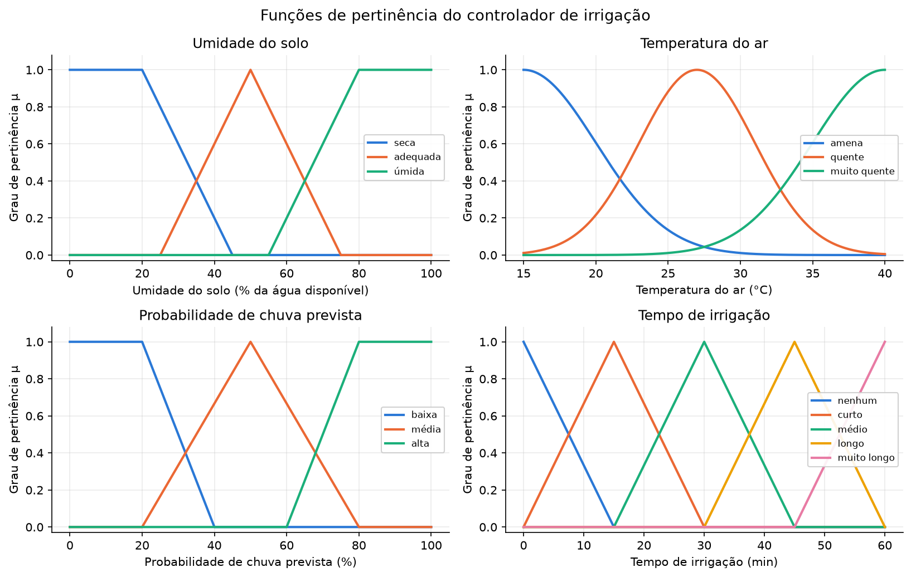
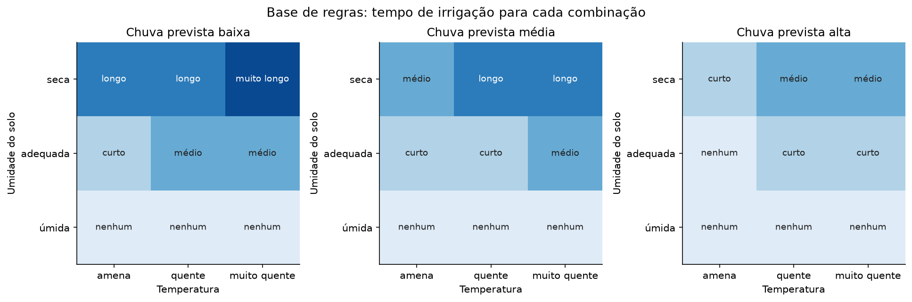
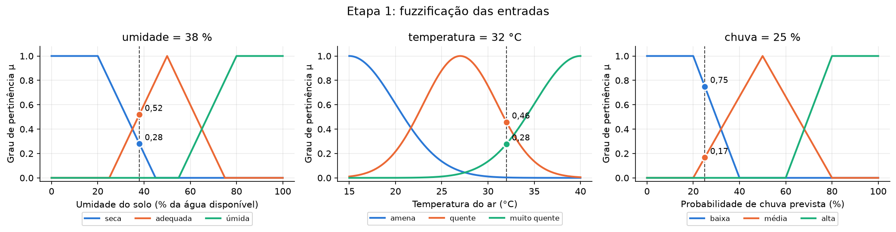
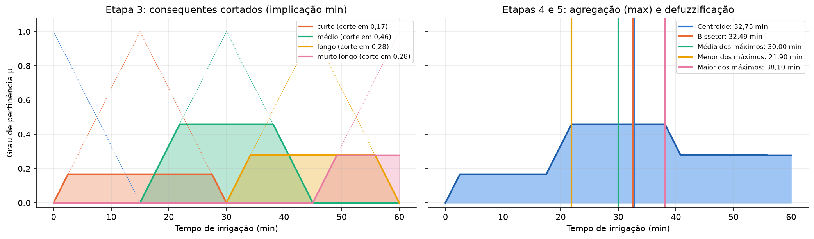
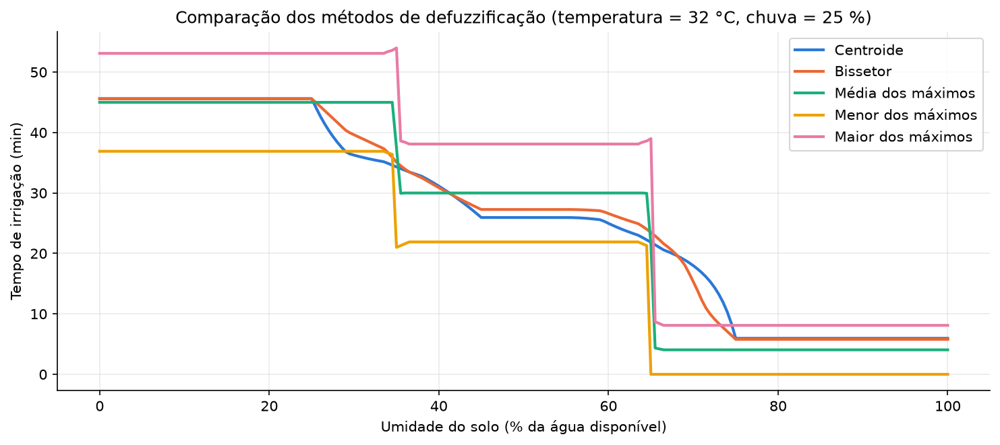
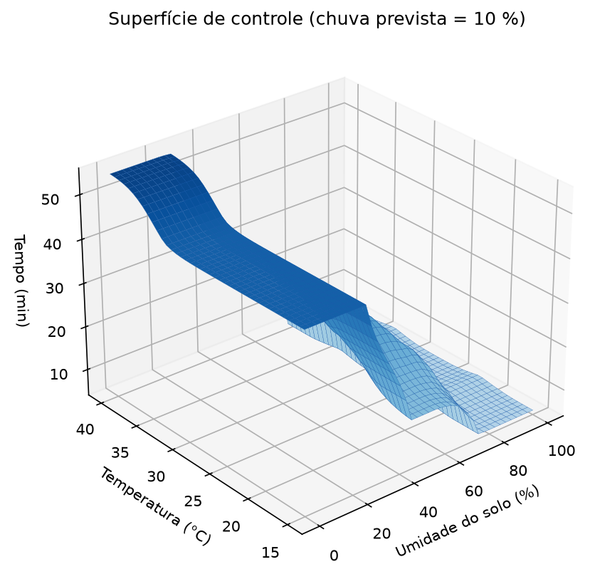
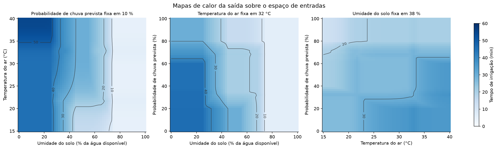
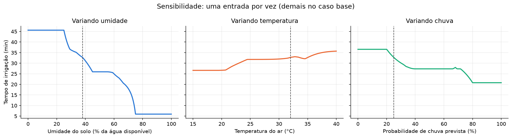

# Questão 6: Sistema fuzzy de Mamdani para irrigação de hortaliças

**Dupla:** Bruno Gomes de Barros Filho (21111360); Antônio Rodrigo Lima de Andrade Tenório (23210707)
**Disciplina:** ECOM031: Inteligência Artificial
**Professor:** Evandro de Barros Costa
**Período:** 2026.2

## Enunciado

> Desenvolva um sistema baseado em regras fuzzy, usando a ferramenta Scikit Fuzzy (ou uma outra de
> sua livre escolha), para uma aplicação de sua escolha. Sobre a solução a ser desenvolvida, apresente:
> Descrição do processo de modelagem, mostrando e discutindo as variáveis e os seus universos de
> discursos, as funções de pertinência utilizadas na etapa de fuzzificação, bem como a solução para
> etapa de defuzzificação), e discuta e mostre como é feita a inferência sobre o conhecimento.
> Obs.: Considere a metodologia e inferência de Mamdani.

Onde cada item do enunciado é respondido:

| Item pedido | Seção deste relatório |
|---|---|
| processo de modelagem | [1](#1-aplicação-escolhida) e [2](#2-processo-de-modelagem) |
| variáveis e universos de discurso | [2.1](#21-variáveis-e-universos-de-discurso) |
| funções de pertinência (fuzzificação) | [2.2](#22-funções-de-pertinência-fuzzificação) |
| base de conhecimento | [2.3](#23-base-de-conhecimento-27-regras) |
| inferência de Mamdani, mostrada e discutida | [3](#3-inferência-de-mamdani-passo-a-passo) |
| defuzzificação | [3.5](#35-etapa-5-defuzzificação-pelo-centroide) e [4](#4-comparação-dos-métodos-de-defuzzificação) |

## Como executar

Na raiz do repositório, com o ambiente virtual já criado:

```bash
# testes (112 casos)
.venv/bin/python -m pytest src/q06_fuzzy -q

# executa o notebook do zero e regrava as saídas e as figuras
cd src/q06_fuzzy && ../../.venv/bin/jupyter nbconvert --to notebook --execute --inplace q06_fuzzy.ipynb
```

Uso direto do módulo (com `src/q06_fuzzy` como diretório atual):

```python
import fuzzy_irrigacao as fi
fi.tempo_irrigacao(umidade=38, temperatura=32, chuva=25)   # 32.75 (minutos)
```

Bibliotecas usadas: scikit-fuzzy 0.5.0, NumPy 2.5.4, pandas, matplotlib e pytest, todas já listadas
no ambiente do repositório.

## Arquivos

| Arquivo | Conteúdo |
|---|---|
| `fuzzy_irrigacao.py` | variáveis, universos, funções de pertinência, base de regras, inferência Mamdani manual e o mesmo sistema montado com `skfuzzy.control` |
| `fuzzy_graficos.py` | funções que geram as figuras |
| `q06_fuzzy.ipynb` | notebook executado: percorre a modelagem e a inferência passo a passo |
| `test_q06_fuzzy_irrigacao.py` | testes pytest |
| `figures/*.png` | figuras geradas pelo notebook |

O sistema foi implementado duas vezes de propósito. A função `inferir` faz a inferência de Mamdani
com NumPy e devolve todos os valores intermediários (graus, forças, cortes, conjunto agregado), o que
permite mostrar cada etapa. A função `criar_sistema_skfuzzy` monta o mesmo sistema com a API de alto
nível do scikit-fuzzy e serve de referência: as duas versões são comparadas no notebook e nos testes.

## 1. Aplicação escolhida

O sistema decide quanto tempo ligar a irrigação por gotejamento de uma horta no Agreste alagoano
(região de Arapiraca, onde a olericultura irrigada é comum). Uma vez por dia ele lê três grandezas e
devolve o tempo de funcionamento da bomba.

| Papel | Variável | Origem da medida |
|---|---|---|
| entrada | umidade do solo, em % da água disponível | sensor capacitivo ou tensiômetro |
| entrada | temperatura do ar, em °C | estação meteorológica simples |
| entrada | probabilidade de chuva nas próximas 24 h, em % | previsão do tempo |
| saída | tempo de irrigação, em minutos | acionamento da bomba |

A escolha se justifica porque o conhecimento de quem maneja a horta já é verbal ("solo seco e dia muito
quente pedem irrigação longa", "se vai chover, não precisa irrigar") e as categorias têm fronteiras
graduais: 34 % de água disponível não é muito diferente de 36 %. Um controle por limiar fixo (liga
abaixo de X %) ignora temperatura e previsão e muda de comportamento de forma brusca no limiar. A
aplicação também tem significado prático no estado, onde parte da produção de hortaliças depende de
irrigação na estação seca.

## 2. Processo de modelagem

A modelagem seguiu a ordem clássica de um controlador de Mamdani:

1. escolher as variáveis linguísticas de entrada e de saída;
2. definir o universo de discurso de cada uma;
3. dividir cada universo em termos linguísticos e escolher a função de pertinência de cada termo;
4. escrever a base de regras SE-ENTÃO;
5. escolher os operadores de inferência e o método de defuzzificação;
6. validar o comportamento (superfície de controle, sensibilidade, casos de borda).

### 2.1 Variáveis e universos de discurso

| Variável | Universo | Discretização | Termos |
|---|---|---|---|
| Umidade do solo (% da água disponível) | 0 a 100 | passo 0,5 (201 pontos) | seca, adequada, úmida |
| Temperatura do ar (°C) | 15 a 40 | passo 0,1 (251 pontos) | amena, quente, muito quente |
| Probabilidade de chuva prevista (%) | 0 a 100 | passo 0,5 (201 pontos) | baixa, média, alta |
| Tempo de irrigação (min) | 0 a 60 | passo 0,1 (601 pontos) | nenhum, curto, médio, longo, muito longo |

Justificativas:

* **Umidade do solo.** A escala é a fração da água disponível: 0 % é o ponto de murcha permanente e
  100 % é a capacidade de campo. Com ela o sistema não depende do tipo de solo; a calibração do sensor
  converte a umidade volumétrica para essa escala.
* **Temperatura.** No Agreste alagoano as mínimas raramente ficam abaixo de 15 °C e as máximas raramente
  passam de 40 °C, então o intervalo cobre o ano com folga.
* **Chuva prevista.** É uma probabilidade, então o universo é o intervalo inteiro.
* **Tempo de irrigação.** Para gotejamento em canteiros de hortaliças, uma hora por dia é um teto
  razoável; acima disso a água em excesso drena abaixo das raízes.

O passo fino da saída importa na defuzzificação, porque o centroide é uma integral calculada
numericamente sobre esses pontos.

### 2.2 Funções de pertinência (fuzzificação)

| Variável | Termo | Tipo | Parâmetros |
|---|---|---|---|
| umidade | seca | trapezoidal | [0, 0, 20, 45] |
| umidade | adequada | triangular | [25, 50, 75] |
| umidade | úmida | trapezoidal | [55, 80, 100, 100] |
| temperatura | amena | gaussiana | média 15, σ = 5 |
| temperatura | quente | gaussiana | média 27, σ = 4 |
| temperatura | muito quente | gaussiana | média 40, σ = 5 |
| chuva | baixa | trapezoidal | [0, 0, 20, 40] |
| chuva | média | triangular | [20, 50, 80] |
| chuva | alta | trapezoidal | [60, 80, 100, 100] |
| tempo | nenhum | triangular | [0, 0, 15] |
| tempo | curto | triangular | [0, 15, 30] |
| tempo | médio | triangular | [15, 30, 45] |
| tempo | longo | triangular | [30, 45, 60] |
| tempo | muito longo | triangular | [45, 60, 60] |



Por que cada formato:

* **Umidade: trapézios nas pontas e triângulo no meio.** O manejo de irrigação trabalha com limiares.
  O boletim FAO-56 (Allen et al., 1998) recomenda repor a água quando o esgotamento passa de uma fração
  *p* da água disponível, que para a maioria das hortaliças fica entre 0,3 e 0,5. Abaixo de 20 % o solo
  está seco sob qualquer critério e acima de 80 % está úmido, por isso os trapézios têm patamar com
  pertinência 1. O termo `adequada` tem pico em 50 %, o meio da faixa de esgotamento permitido.
* **Temperatura: gaussianas.** O efeito do calor sobre a evapotranspiração cresce de forma suave, e a
  gaussiana descreve isso sem pontos de quebra. Ela também diversifica os tipos de função usados no
  trabalho. O preço é que a gaussiana nunca chega a zero, então todo termo de temperatura tem algum
  grau positivo em qualquer ponto. Isso aparece na inferência (regras disparando com força 0,003) e
  na análise de monotonicidade (seção 6.2).
* **Chuva: trapézios e triângulo.** Previsões abaixo de 20 % contam como "não vai chover" e acima de
  80 % como "vai chover", com uma faixa de dúvida no meio.
* **Tempo: cinco triângulos iguais.** Picos em 0, 15, 30, 45 e 60 min, cada triângulo terminando no
  pico do vizinho. Em qualquer ponto as pertinências somam 1 (partição de Ruspini), o que torna a
  saída fácil de interpretar.

### 2.3 Base de conhecimento: 27 regras

Com 3 termos em cada entrada há 3 × 3 × 3 = 27 combinações, e há uma regra para cada uma. Assim
nenhuma região do espaço de entradas fica sem resposta. Todas têm a forma
`SE umidade é A E temperatura é B E chuva é C ENTÃO tempo é D`.

A tabela foi escrita com quatro critérios:

1. a umidade do solo é o fator principal: solo seco pede irrigação longa, solo úmido não pede nenhuma;
2. passar de `amena` para `muito quente` pode subir a saída um nível;
3. cada nível a mais de chuva prevista pode descer a saída um nível;
4. com solo `úmido` a saída é sempre `nenhum`, porque irrigar perto da capacidade de campo só faz a
   água drenar e carregar nutrientes.



A mesma base em texto (linhas: umidade; colunas: temperatura amena / quente / muito quente):

| Chuva | Umidade | amena | quente | muito quente |
|---|---|---|---|---|
| baixa | seca | longo | longo | muito longo |
| baixa | adequada | curto | médio | médio |
| baixa | úmida | nenhum | nenhum | nenhum |
| média | seca | médio | longo | longo |
| média | adequada | curto | curto | médio |
| média | úmida | nenhum | nenhum | nenhum |
| alta | seca | curto | médio | médio |
| alta | adequada | nenhum | curto | curto |
| alta | úmida | nenhum | nenhum | nenhum |

Os consequentes ficaram assim distribuídos: 10 regras `nenhum`, 6 `curto`, 6 `médio`, 4 `longo` e
1 `muito longo`. As regras são numeradas R1 a R27 com a umidade variando mais devagar, depois a
temperatura, depois a chuva (R1 = seca, amena, baixa; R27 = úmida, muito quente, alta). O teste
`test_regras_monotonas_na_tabela` confere, regra a regra, que mais umidade ou mais chuva nunca aumenta
o nível de saída e que mais calor nunca o reduz.

### 2.4 Operadores

| Etapa | Operação | Operador |
|---|---|---|
| conjunção dos antecedentes (E) | força de disparo | mínimo |
| disjunção (OU, não usada nas regras) | | máximo |
| implicação | corta o consequente na altura da força | mínimo |
| agregação | une as saídas de todas as regras | máximo |
| defuzzificação | conjunto agregado → número | centroide |

São os operadores da formulação original de Mamdani e também os padrões do `skfuzzy.control`.

## 3. Inferência de Mamdani passo a passo

Caso concreto: uma tarde de verão com o solo secando, **umidade 38 %, temperatura 32 °C e chuva
prevista de 25 %**. Todos os números abaixo saem da execução do notebook.

### 3.1 Etapa 1: fuzzificação

| Variável | Termo | Grau μ |
|---|---|---|
| umidade = 38 % | seca / adequada / úmida | 0,280 / 0,520 / 0,000 |
| temperatura = 32 °C | amena / quente / muito quente | 0,003 / 0,458 / 0,278 |
| chuva = 25 % | baixa / média / alta | 0,750 / 0,167 / 0,000 |



A umidade de 38 % é ao mesmo tempo um pouco `seca` e mais `adequada`. O grau 0,003 de `amena` vem da
cauda da gaussiana.

### 3.2 Etapa 2: força de disparo (E = mínimo)

A força de cada regra é o menor dos graus dos seus antecedentes. Das 27 regras, 12 têm força positiva
e 8 têm força acima de 0,01. As que importam:

| Regra | Antecedentes | Consequente | Graus | Força |
|---|---|---|---|---|
| R13 | adequada, quente, baixa | médio | 0,52; 0,458; 0,75 | 0,458 |
| R4 | seca, quente, baixa | longo | 0,28; 0,458; 0,75 | 0,280 |
| R7 | seca, muito quente, baixa | muito longo | 0,28; 0,278; 0,75 | 0,278 |
| R16 | adequada, muito quente, baixa | médio | 0,52; 0,278; 0,75 | 0,278 |
| R17 | adequada, muito quente, média | médio | 0,52; 0,278; 0,167 | 0,167 |
| R8 | seca, muito quente, média | longo | 0,28; 0,278; 0,167 | 0,167 |
| R5 | seca, quente, média | longo | 0,28; 0,458; 0,167 | 0,167 |
| R14 | adequada, quente, média | curto | 0,52; 0,458; 0,167 | 0,167 |

As outras quatro regras com força positiva envolvem `amena` e disparam com 0,003. As regras com chuva
`alta` ou solo `úmido` têm força zero.

### 3.3 Etapa 3: implicação (mínimo)

Cada regra corta o seu conjunto consequente na altura da sua força. Como várias regras apontam para o
mesmo termo e a agregação é por máximo, o corte efetivo de cada termo é a maior força entre as regras
daquele termo:

| Termo de saída | Regras com esse consequente | Corte | Regra que define o corte |
|---|---|---|---|
| nenhum | 10 | 0,000 | |
| curto | 6 | 0,167 | R14 |
| médio | 6 | 0,458 | R13 |
| longo | 4 | 0,280 | R4 |
| muito longo | 1 | 0,278 | R7 |

### 3.4 Etapa 4: agregação (máximo)

O conjunto agregado é o máximo ponto a ponto dos consequentes cortados. À esquerda, os cortes; à
direita, o conjunto agregado com a posição de cada método de defuzzificação.



### 3.5 Etapa 5: defuzzificação pelo centroide

$$ z^* = \frac{\int z\,\mu_{agr}(z)\,dz}{\int \mu_{agr}(z)\,dz} $$

| Cálculo | Resultado |
|---|---|
| ∫ z·μ(z) dz (regra do trapézio, NumPy) | 585,2610 |
| ∫ μ(z) dz | 17,8705 |
| centroide pela integral (`centroide_manual`) | **32,750 min** |
| soma discreta Σzμ / Σμ | 32,771 min |
| `fuzz.defuzz(..., "centroid")` | 32,750 min |
| `skfuzzy.control` (sistema completo) | 32,750 min |

O centroide calculado à mão coincide com o do scikit-fuzzy. A soma discreta dos livros fica 0,02 min
acima porque dá peso cheio aos pontos extremos do universo, e aqui o ponto z = 60 min tem pertinência
0,278; a regra do trapézio dá meio peso às pontas. Em 300 entradas sorteadas no espaço todo, a maior
diferença entre a implementação manual e o `skfuzzy.control` foi de 0,00047 min. Essa sobra vem de o
`skfuzzy.control` inserir no universo os pontos exatos onde as linhas de corte cruzam as funções de
pertinência, enquanto a versão manual usa a grade fixa de 0,1 min.

Resultado do caso: **irrigar por cerca de 33 minutos**. Faz sentido: o solo está mais para adequado do
que para seco, mas o calor e a previsão de pouca chuva puxam o tempo para acima do termo `médio`.

## 4. Comparação dos métodos de defuzzificação

No caso concreto:

| Método | Tempo (min) |
|---|---|
| centroide | 32,75 |
| bissetor | 32,49 |
| média dos máximos (mom) | 30,00 |
| menor dos máximos (som) | 21,90 |
| maior dos máximos (lom) | 38,10 |

Os métodos de máximo só olham o patamar mais alto do conjunto agregado, que aqui é o termo `médio`
(21,9 a 38,1 min); ignoram que `longo` e `muito longo` também foram ativados. Para ver o efeito na
operação, a umidade foi varrida de 0 a 100 % em passos de 0,5 %, com 32 °C e 25 % de chuva:



| Método | Maior salto entre passos de 0,5 % (min) | Valores distintos na varredura |
|---|---|---|
| centroide | 2,43 | 80 |
| bissetor | 1,58 | 80 |
| média dos máximos | 17,12 | 8 |
| menor dos máximos | 21,30 | 8 |
| maior dos máximos | 30,30 | 11 |

Os métodos de máximo geram uma saída em degraus, com saltos de até 30 min por uma variação de 0,5 % no
sensor. Para um controlador isso é ruim, então adotamos o centroide. O maior passo dele (2,4 min,
entre 74,5 % e 75 % de umidade) acontece quando `adequada` chega a zero e só `nenhum` continua ativo;
é um trecho íngreme da curva, sem descontinuidade. O bissetor teria sido uma escolha equivalente.

## 5. Superfície de controle e mapas de calor





O que a superfície mostra:

* abaixo de 20 % de umidade a saída não depende da umidade, porque `seca` está no patamar do
  trapézio; o mesmo acontece acima de 80 % com `úmida`;
* a temperatura pesa mais com solo seco ou adequado. Com 90 % de umidade e 10 % de chuva a saída
  ainda varia de 5,0 a 6,3 min com a temperatura, embora a tabela mande `nenhum` em todos os casos
  (a causa está na seção 6.2);
* o mínimo da saída não é 0 min. Com só `nenhum` ativo e corte 1, o centroide do triângulo [0, 0, 15]
  é 5 min; com corte menor o triângulo vira trapézio e o valor sobe (5,95 min com corte 0,458);
* nos cantos do universo a saída vai de 5,0 min (solo úmido) a 54,82 min (solo seco, 40 °C, sem
  chuva). O centroide nunca alcança as pontas do universo de saída.

## 6. Análise de sensibilidade

### 6.1 Uma entrada por vez

Cada entrada percorre seu universo com as outras fixas no caso base (38 %, 32 °C, 25 %).



| Entrada | Saída mín (min) | Saída máx (min) | Amplitude (min) | Derivada no caso base |
|---|---|---|---|---|
| umidade | 5,95 | 45,61 | 39,66 | −0,628 min/% |
| temperatura | 26,62 | 35,71 | 9,09 | +0,572 min/°C |
| chuva | 20,79 | 36,57 | 15,77 | −0,637 min/% |

Numa grade 26 × 26 × 26 do espaço inteiro, a amplitude média da saída quando só uma entrada varia foi
de 32,3 min para a umidade, 11,5 min para a chuva e 8,6 min para a temperatura. A ordem de influência
é a que os critérios da seção 2.3 pedem.

### 6.2 Monotonicidade

A base de regras é monótona, mas a saída defuzzificada não é estritamente monótona. Na mesma grade,
contando passos entre vizinhos em que a saída anda mais de 0,1 min no sentido errado:

| Entrada | Sentido esperado | Inversões > 0,1 min (27 regras) | Maior inversão | Inversões (19 regras) | Maior inversão |
|---|---|---|---|---|---|
| umidade | diminui | 124 de 16900 | 0,98 min | 123 de 16900 | 0,98 min |
| temperatura | aumenta | 1600 de 16900 | 1,29 min | 405 de 16900 | 1,24 min |
| chuva | diminui | 1421 de 16900 | 1,89 min | 416 de 16900 | 1,77 min |

A pior inversão no eixo da chuva ajuda a entender a causa. Com umidade 72 % e 40 °C, subir a chuva de
28 % para 32 % fez a saída subir de 14,11 para 16,00 min. Nesse ponto o solo é `úmido` com grau 0,68 e
`adequado` com 0,12. As nove regras de solo úmido mandam não irrigar, mas cada uma também exige um termo
de chuva, e o corte de `nenhum` vira min(0,68; maior grau de chuva). Entre 28 % e 32 % a chuva sai de
`baixa` e entra em `média`, e o maior dos dois graus cai de 0,60 para 0,40. O corte de `nenhum` cai
junto (0,60 → 0,40), o de `médio` fica em 0,12, e o centroide sobe. Na temperatura o efeito aparece com
mais frequência porque as gaussianas vizinhas se cruzam em graus menores, entre 0,35 e 0,41.

O problema está em escrever regras com antecedentes irrelevantes. A variante `REGRAS_COMPACTAS` troca
as nove regras de solo úmido por `SE umidade é úmida ENTÃO tempo é nenhum` e mantém as outras 18. Ela
reduz as inversões de temperatura e chuva a menos de um terço e elimina a ondulação com solo úmido
(saída fixa em 5,0 min a 90 % de umidade). A maior diferença de saída entre as duas bases foi de
2,7 min, em 72 % de umidade, 33 °C e sem chuva. As inversões que restam vêm do mesmo mecanismo nas regras
de solo seco e adequado. Ficam abaixo de 2 min, irrelevante numa irrigação diária, e esse é o limite
usado em `test_monotonia_aproximada_em_varreduras`. A base de 27 regras continua sendo o sistema
principal por corresponder à matriz da seção 2.3; a compacta fica como melhoria documentada.

## 7. Casos de borda

**Limites do universo.** Os oito cantos do espaço de entradas dão o mesmo resultado na versão manual e
no `skfuzzy.control`:

| Umidade | Temperatura | Chuva | Tempo (min) |
|---|---|---|---|
| 0 | 15 | 0 | 45,00 |
| 0 | 15 | 100 | 15,25 |
| 0 | 40 | 0 | 54,82 |
| 0 | 40 | 100 | 30,00 |
| 100 | qualquer canto | qualquer canto | 5,00 |

**Entradas fora do universo.** Uma leitura fora da faixa (sensor com defeito ou fim de escala) é
saturada no limite, como faz o skfuzzy com `clip_to_bounds=True`. A leitura (−10 %, 55 °C, −5 %) é
tratada como (0, 40, 0) e dá 54,82 min nas duas implementações; (120 %, 10 °C, 150 %) dá 5,00 min.

**Nenhuma regra disparando.** Com a base completa e as entradas saturadas, sempre há regra com força
positiva. O caso foi provocado de duas formas: uma base reduzida às 9 regras de solo seco recebendo
solo a 90 %, e a base completa sem saturação recebendo 45 °C. Nas duas, a maior força é 0 e a área do
conjunto agregado é 0, e o centroide vira 0/0. A implementação manual levanta `ValueError` ("nenhuma
regra disparou"). O `skfuzzy.control`, no modo padrão (`lenient=True`), não produz saída nenhuma
(`sim.output` fica vazio), e com `lenient=False` levanta `EmptyMembershipError`. Num controlador real o
chamador deve tratar esse erro com uma ação segura, como manter a bomba desligada e registrar alarme.
Escrever as 27 combinações evita o problema na operação normal.

## 8. Testes

`test_q06_fuzzy_irrigacao.py` tem 112 casos (incluindo parametrizações), todos passando:

* base completa com 27 combinações distintas;
* monotonicidade da tabela de regras;
* centroide manual igual ao `fuzz.defuzz` e ao `skfuzzy.control` (tolerância 0,001 min) em 30 entradas
  sorteadas;
* saída dentro de [0, 60] min para os cinco métodos de defuzzificação, incluindo cantos e entradas
  fora do universo;
* ordem esperada entre extremos de cada entrada e monotonicidade aproximada (inversões < 2 min) em
  varreduras;
* saturação de entradas fora do universo;
* erro quando nenhuma regra dispara;
* base compacta: igual ao `skfuzzy.control` e sem lacunas de cobertura.

## 9. Discussão e limitações

* **Parâmetros escolhidos à mão.** As funções de pertinência e a tabela de regras vêm de critério
  agronômico geral, sem calibração com dados de campo. Um sistema real precisaria ajustar os limiares
  ao solo e à cultura (alface e tomate têm frações de esgotamento diferentes, por exemplo) e validar o
  tempo de irrigação contra medidas de umidade nos dias seguintes.
* **Faixa útil da saída.** O centroide não alcança 0 nem 60 min; a saída fica entre 5,0 e 54,8 min.
  Para desligar a bomba de fato, o atuador deveria tratar saídas abaixo de um limiar (por exemplo,
  6 min) como "não irrigar", ou o termo `nenhum` poderia virar um singleton em 0.
* **Monotonicidade aproximada.** A combinação mínimo/máximo/centroide produz inversões locais de até
  1,9 min, explicadas na seção 6.2. A base compacta reduz o efeito; um modelo do tipo Sugeno ou outra
  t-norma (produto) seria o próximo passo para quem precisar de monotonicidade garantida.
* **Caudas gaussianas.** As gaussianas fazem regras dispararem com forças minúsculas e criam vales
  entre termos vizinhos. Para este problema, triângulos ou trapézios com cruzamento em 0,5 na
  temperatura seriam igualmente defensáveis.
* **Uma decisão por dia.** O sistema não tem memória: não considera quanto foi irrigado ontem nem a
  chuva que de fato caiu. Isso exigiria uma entrada a mais ou um controle em malha fechada.

## Referências

* MAMDANI, E. H.; ASSILIAN, S. An experiment in linguistic synthesis with a fuzzy logic controller.
  *International Journal of Man-Machine Studies*, v. 7, n. 1, p. 1-13, 1975.
* ALLEN, R. G.; PEREIRA, L. S.; RAES, D.; SMITH, M. *Crop evapotranspiration: guidelines for computing
  crop water requirements*. FAO Irrigation and Drainage Paper 56. Roma: FAO, 1998.
* ROSS, T. J. *Fuzzy Logic with Engineering Applications*. 3. ed. Wiley, 2010.
* RUSSELL, S.; NORVIG, P. *Inteligência Artificial*. 3. ed. Rio de Janeiro: Elsevier, 2013.
* WARNER, J. et al. scikit-fuzzy, documentação da versão 0.5.0. Disponível em
  <https://scikit-fuzzy.github.io/scikit-fuzzy/>.
