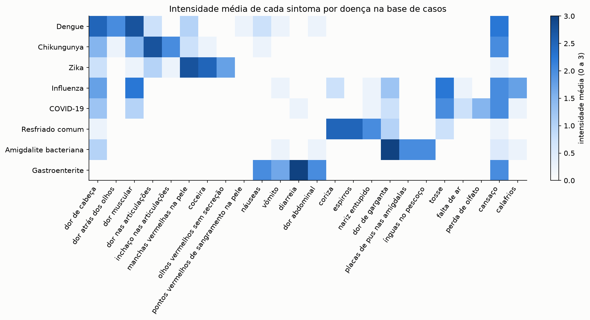
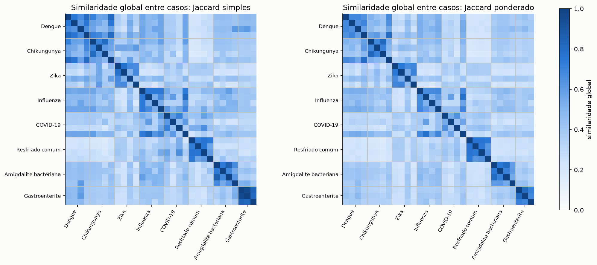
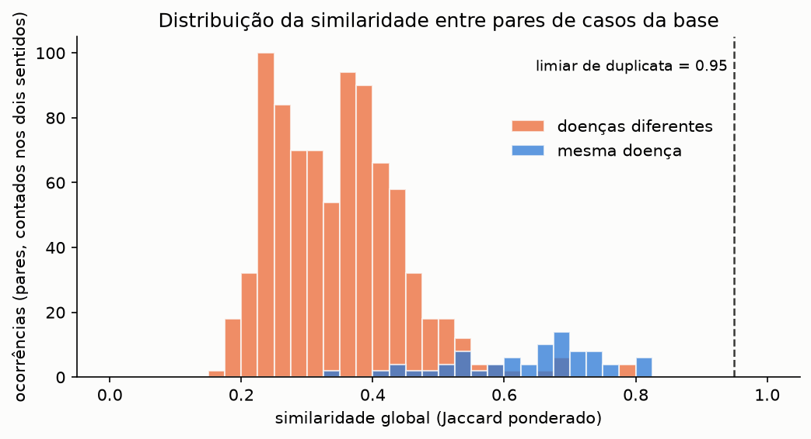
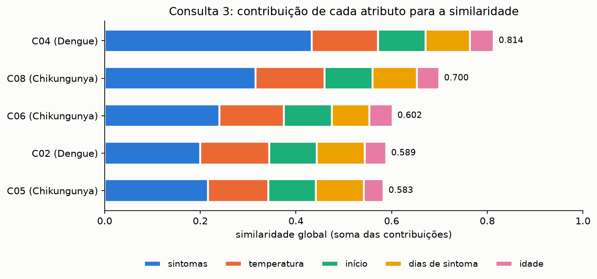
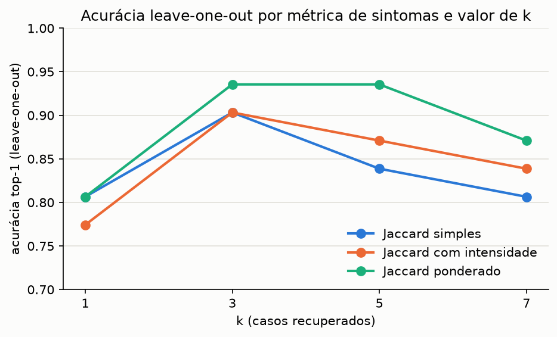
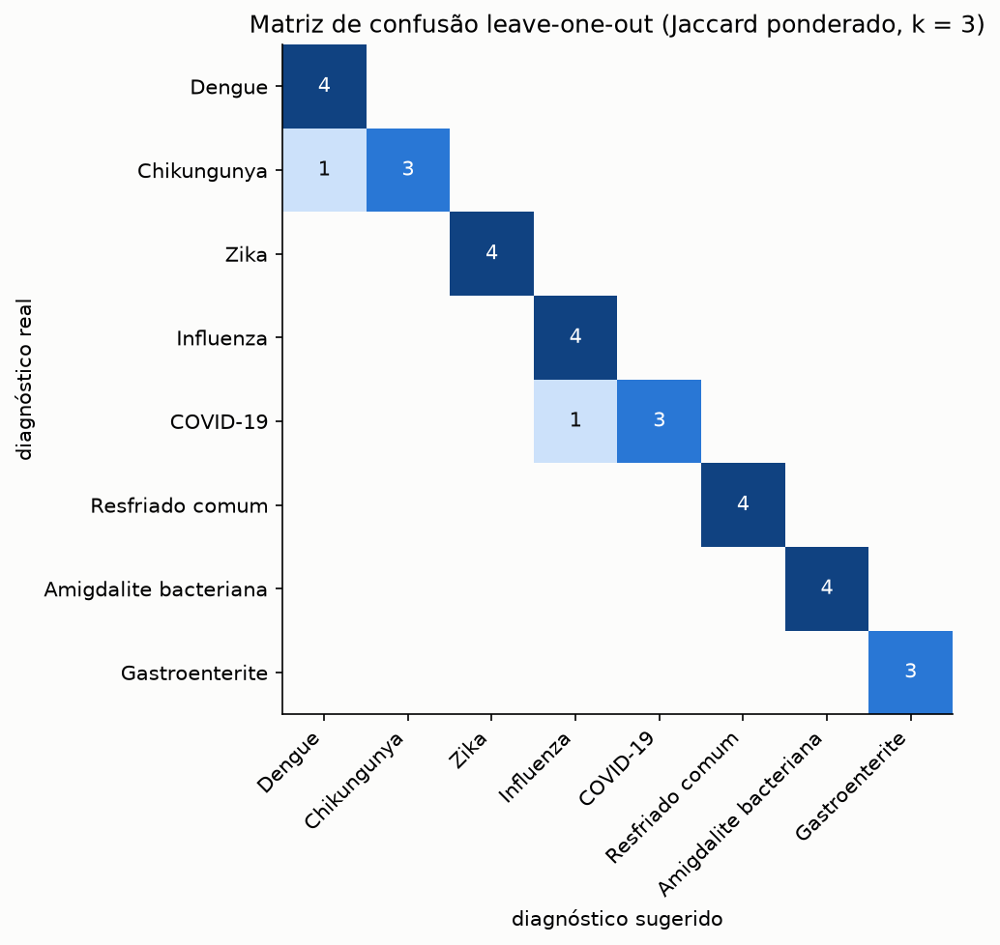

# Questão 7: Sistema de Apoio ao Diagnóstico Médico Baseado em Casos (CBR)

**Dupla:** Bruno Gomes de Barros Filho (21111360); Antônio Rodrigo Lima de Andrade Tenório (23210707)  
**Disciplina:** ECOM031: Inteligência Artificial  
**Professor:** Evandro de Barros Costa  
**Período:** 2026.2

> Aviso: todos os casos, sintomas e tratamentos deste trabalho são fictícios e foram escritos para fins didáticos. O sistema não deve ser usado para diagnóstico ou tratamento reais.

## Enunciado

> Desenvolva um Sistema de Apoio ao Diagnóstico Médico Baseado em Casos. O sistema deverá ser capaz de receber como entrada um conjunto de sintomas informados pelo paciente e compará-los com uma base de casos previamente armazenados. Cada caso deverá conter, no mínimo, informações sobre sintomas observados, diagnóstico realizado e tratamento recomendado. O sistema deverá implementar as etapas fundamentais do ciclo de Raciocínio Baseado em Casos:
>
> - Recuperação (Retrieve): localizar os casos mais semelhantes ao problema apresentado;
> - Reutilização (Reuse): utilizar os casos recuperados para propor um possível diagnóstico;
> - Revisão (Revise): permitir a validação ou correção do diagnóstico sugerido;
> - Retenção (Retain): armazenar novos casos ou atualizações na base de conhecimento para uso futuro.
>
> Requisitos mínimos: construir uma base contendo pelo menos 15 casos médicos fictícios; considerar, no mínimo, cinco tipos diferentes de doenças; implementar um mecanismo de cálculo de similaridade entre casos; exibir os casos mais semelhantes encontrados; apresentar o diagnóstico sugerido e um possível tratamento associado; permitir a inclusão de novos casos na base de conhecimento.
>
> Relatório técnico contendo: descrição da base de casos; representação dos casos; método de cálculo de similaridade utilizado; exemplos de consultas realizadas; análise dos resultados obtidos; vídeo ou demonstração do funcionamento do protótipo.

### Onde cada requisito é atendido

| Requisito | Onde |
|---|---|
| Base com pelo menos 15 casos fictícios | `base_casos.json`, 31 casos ([seção 1](#1-descrição-da-base-de-casos)) |
| Pelo menos cinco doenças | 8 doenças ([seção 1](#1-descrição-da-base-de-casos)) |
| Cálculo de similaridade | `cbr_similaridade.py` ([seção 3](#3-método-de-cálculo-de-similaridade)) |
| Exibir os casos mais semelhantes | `SistemaCBR.recuperar`, tabela da CLI e do notebook ([seção 5](#5-exemplos-de-consultas)) |
| Diagnóstico sugerido e tratamento | `SistemaCBR.reutilizar` ([seção 4.2](#42-reuse)) |
| Revisão (validação ou correção) | `revisar` e `revisar_interativo` ([seção 4.3](#43-revise)) |
| Inclusão de novos casos | `SistemaCBR.reter` ([seção 4.4](#44-retain)) |
| Exemplos de consultas | [seção 5](#5-exemplos-de-consultas) |
| Análise dos resultados | [seção 6](#6-análise-dos-resultados) |
| Vídeo ou demonstração | CLI `cbr_cli.py`, notebook e [roteiro do vídeo](#8-roteiro-para-o-vídeo-de-demonstração) |

## Como executar

Todos os comandos partem da raiz do repositório e usam o ambiente virtual do projeto (Python 3.12). O ciclo CBR e a CLI usam só a biblioteca padrão; a avaliação usa `pandas`, o notebook usa também `matplotlib` e `scikit-learn` (para a matriz de confusão) e os testes usam `pytest`.

```bash
# Demonstração interativa (ciclo completo, uma consulta por vez)
.venv/bin/python src/q07_cbr/cbr_cli.py
# Opções: --k 5, --metrica {simples,intensidade,ponderada}, --base outro_arquivo.json
.venv/bin/python src/q07_cbr/cbr_cli.py --k 3 --metrica ponderada

# Testes
.venv/bin/python -m pytest src/q07_cbr -q

# Reexecutar o notebook do zero (regera as figuras)
cd src/q07_cbr && ../../.venv/bin/jupyter nbconvert --to notebook --execute --inplace q07_cbr.ipynb
```

Na primeira execução a CLI copia `base_casos.json` para `base_casos_local.json` e passa a trabalhar sobre a cópia, que está no `.gitignore` da pasta. Assim os casos retidos durante uma demonstração não alteram a base versionada. Para recomeçar com a base original, basta apagar `base_casos_local.json`. O notebook e os testes também usam cópias temporárias; o notebook confere no final, por hash SHA-256, que `base_casos.json` não mudou.

## Mapa dos arquivos

| Arquivo | Conteúdo |
|---|---|
| `base_casos.json` | Base de casos versionada (31 casos, 8 doenças) |
| `cbr_casos.py` | Vocabulário de sintomas, dataclasses `Problema` e `Caso`, leitura e gravação do JSON |
| `cbr_similaridade.py` | Similaridades locais, Jaccard simples e ponderado, pesos e similaridade global |
| `cbr_ciclo.py` | `SistemaCBR` (Retrieve, Reuse, Retain), adaptação do tratamento, `revisar` e `revisar_interativo` (Revise) |
| `cbr_avaliacao.py` | Avaliação leave-one-out |
| `cbr_cli.py` | Interface de linha de comando com o ciclo completo |
| `test_q07_cbr.py` | 16 testes com pytest |
| `q07_cbr.ipynb` | Notebook executado com a exploração, as consultas de exemplo e a avaliação |
| `figures/` | Figuras PNG geradas pelo notebook |

## 1. Descrição da base de casos

A base tem 31 casos fictícios de oito doenças comuns em atendimento ambulatorial no Brasil:

| Doença | Casos | Temperatura média (°C) | Dias de sintoma (média) | Idades |
|---|---|---|---|---|
| Dengue | 4 | 39,1 | 3,5 | 12 a 45 |
| Chikungunya | 4 | 39,2 | 6,0 | 29 a 61 |
| Zika | 4 | 37,4 | 3,5 | 19 a 31 |
| Influenza | 4 | 38,9 | 2,5 | 9 a 68 |
| COVID-19 | 4 | 38,1 | 4,8 | 28 a 63 |
| Resfriado comum | 4 | 37,1 | 2,5 | 6 a 55 |
| Amigdalite bacteriana | 4 | 39,0 | 2,0 | 8 a 25 |
| Gastroenterite | 3 | 37,8 | 1,7 | 4 a 70 |

As doenças foram escolhidas para que a recuperação tivesse trabalho de verdade. Dengue, chikungunya e zika compartilham febre, dor no corpo, dor articular e manchas na pele; influenza e COVID-19 compartilham febre, tosse, cansaço e dor muscular. Resfriado, amigdalite e gastroenterite têm quadros mais característicos e funcionam como controle.

Cada doença tem um caso "clássico" e alguns casos escritos de propósito perto da fronteira com outra doença:

- C04: dengue com dor articular e manchas na pele, parecida com chikungunya;
- C08: chikungunya com dor atrás dos olhos e dor de cabeça forte, parecida com dengue;
- C20: COVID-19 de início súbito e sem perda de olfato, parecida com gripe;
- C12: zika sem febre;
- C28: amigdalite em que as placas ainda não apareceram.

Os tratamentos seguem, de forma simplificada, as orientações gerais conhecidas para cada doença (hidratação e proibição de anti-inflamatórios na dengue, isolamento na COVID-19, reidratação oral na gastroenterite etc.). Casos de pacientes com alergia trazem tratamento já ajustado (C02 sem dipirona, C27 com azitromicina) e casos infantis trazem a orientação de dose por peso.

O mapa abaixo mostra a intensidade média de cada sintoma por doença.



## 2. Representação dos casos

Um caso é o par problema e solução, representado com duas dataclasses em `cbr_casos.py`:

```python
@dataclass(frozen=True)
class Problema:
    sintomas: dict[str, int]      # nome do sintoma -> intensidade (1 leve, 2 moderada, 3 intensa)
    temperatura: float            # °C
    dias_sintomas: int
    idade: int
    inicio: str                   # "subito" ou "gradual"
    alergias: tuple[str, ...] = ()

@dataclass
class Caso:
    id: str
    problema: Problema
    diagnostico: str
    tratamento: list[str]
    origem: str = "novo"          # "base", "retido" ou "novo" (revisado, ainda não retido)
    confirmacoes: int = 0         # quantas vezes um atendimento repetido confirmou o caso
    observacao: str = ""
```

Os sintomas vêm de um vocabulário fechado de 24 nomes (`SINTOMAS`), cada um com uma descrição em linguagem comum para a interface. Representar os sintomas como dicionário com intensidade, em vez de lista, permite distinguir uma dor articular leve de uma incapacitante, o que importa para separar dengue de chikungunya. As alergias não entram na similaridade; servem apenas para adaptar o tratamento.

O construtor de `Problema` valida a entrada: rejeita sintomas fora do vocabulário, intensidades fora de 1 a 3, temperatura fora de 34 a 43 °C, idade fora de 0 a 120 e início diferente de `subito` ou `gradual`. No JSON cada caso fica assim (trecho do C01):

```json
{
  "id": "C01",
  "diagnostico": "Dengue",
  "problema": {
    "sintomas": {"dor_retroorbital": 3, "dor_cabeca": 3, "mialgia": 3, "artralgia": 1, "nauseas": 2, "cansaco": 2},
    "temperatura": 39.4, "dias_sintomas": 3, "idade": 27, "inicio": "subito", "alergias": []
  },
  "tratamento": [
    "Hidratação oral abundante (cerca de 60 ml/kg/dia)",
    "Paracetamol ou dipirona para febre e dor",
    "Evitar AAS e anti-inflamatórios (ibuprofeno, diclofenaco)",
    "Retorno imediato se houver sinais de alarme: dor abdominal intensa, sangramento ou vômitos persistentes"
  ],
  "origem": "base", "confirmacoes": 0, "observacao": "Quadro clássico."
}
```

A gravação da base é atômica (escreve num arquivo temporário e troca pelo original), para que uma interrupção durante a retenção não corrompa o JSON.

## 3. Método de cálculo de similaridade

Usamos o modelo local-global comum em CBR (Richter e Weber, 2013): cada atributo tem uma similaridade local em [0, 1] e a similaridade global é a média ponderada das locais.

| Atributo | Similaridade local | Peso |
|---|---|---|
| sintomas | Jaccard ponderado (abaixo) | 0,60 |
| temperatura | 1 − \|a − b\| / 5 | 0,15 |
| início | 1 se igual, 0 se diferente | 0,10 |
| dias de sintoma | 1 − \|a − b\| / 14 | 0,10 |
| idade | 1 − \|a − b\| / 100 | 0,05 |

As similaridades numéricas são truncadas em 0, e as amplitudes (5 °C, 14 dias, 100 anos) são fixas para que a escala não mude quando a base cresce.

Justificativa dos pesos: os sintomas carregam quase toda a informação diagnóstica e ficaram com 60%. A temperatura vem em seguida porque separa os quadros febris (dengue, chikungunya, influenza, amigdalite) dos de febre baixa ou ausente (zika, resfriado). Início e duração ajudam em pares específicos: influenza costuma começar de forma súbita e COVID-19 de forma gradual, e a dor articular da chikungunya dura mais. A idade pesa pouco porque quase todas as doenças da base atingem qualquer faixa etária.

### Similaridade dos sintomas

Comparamos três variantes, todas em `cbr_similaridade.py` (`METRICAS_SINTOMAS`). Seja a<sub>s</sub> a intensidade do sintoma s no primeiro caso (0 se ausente) e b<sub>s</sub> no segundo:

- Jaccard simples: |A ∩ B| / |A ∪ B|, olhando só presença ou ausência;
- Jaccard com intensidade: Σ min(a<sub>s</sub>, b<sub>s</sub>) / Σ max(a<sub>s</sub>, b<sub>s</sub>);
- Jaccard ponderado (adotado): Σ w<sub>s</sub>·min(a<sub>s</sub>, b<sub>s</sub>) / Σ w<sub>s</sub>·max(a<sub>s</sub>, b<sub>s</sub>), com peso w<sub>s</sub> por sintoma.

O peso de cada sintoma é 1, 2 ou 3, conforme o quanto ele aponta para uma doença específica:

| Peso | Sintomas | Nº médio de doenças da base em que aparece |
|---|---|---|
| 3 (quase exclusivo) | dor retro-orbital, edema articular, petéquias, placas nas amígdalas, perda de olfato | 1,40 |
| 2 (aponta um grupo) | dor articular, manchas na pele, coceira, conjuntivite, diarreia, coriza, espirros, ínguas no pescoço, falta de ar | 1,89 |
| 1 (inespecífico) | dor de cabeça, dor muscular, cansaço, calafrios, náuseas, vômito, dor abdominal, tosse, dor de garganta, nariz entupido | 4,30 |

A correlação de Spearman entre o peso e o número de doenças em que o sintoma aparece é −0,815. Os pesos não foram calculados a partir da base; conjuntivite, espirros e ínguas aparecem numa única doença da base e ficaram com peso 2 porque também ocorrem em quadros que a base não cobre (outras viroses, rinite alérgica, infecções em geral).

Um exemplo pequeno mostra o efeito do peso. Consulta com dor retro-orbital e dor de cabeça (ambas moderadas); o caso A compartilha a dor retro-orbital e o caso B compartilha a dor de cabeça, e os dois têm tosse.

| | Jaccard simples | Jaccard com intensidade | Jaccard ponderado |
|---|---|---|---|
| caso A | 0,333 | 0,333 | 0,600 |
| caso B | 0,333 | 0,333 | 0,200 |

### Propriedades verificadas

Os testes confirmam, para as três variantes e para todos os pares de casos da base, que a similaridade de um caso com ele mesmo é 1, que a medida é simétrica e que fica em [0, 1].

### Comparação das métricas sobre a base

A figura mostra a similaridade global entre todos os pares de casos, agrupados por doença. Com o Jaccard ponderado os blocos da diagonal ficam mais destacados do fundo.



| Métrica | Média, mesma doença | Média, doenças diferentes | Diferença | Maior sim. entre doenças diferentes | Vizinho mais próximo com mesma doença |
|---|---|---|---|---|---|
| Jaccard simples | 0,664 | 0,390 | 0,274 | 0,816 | 80,6% |
| Jaccard com intensidade | 0,630 | 0,365 | 0,264 | 0,767 | 77,4% |
| Jaccard ponderado | 0,633 | 0,348 | 0,286 | 0,797 | 80,6% |

O ponderado é o que mais afasta os pares de doenças diferentes (média 0,348) e tem a maior diferença entre as duas médias. A distribuição dos pares no Jaccard ponderado aparece abaixo; a sobreposição entre 0,5 e 0,8 corresponde aos pares de arboviroses e de quadros respiratórios.



## 4. O ciclo CBR implementado

O ciclo segue o modelo de Aamodt e Plaza (1994). As quatro etapas estão em `cbr_ciclo.py`.

### 4.1 Retrieve

`SistemaCBR.recuperar(problema)` calcula a similaridade global entre o problema e todos os casos e devolve os k mais similares em ordem decrescente (k = 3 por padrão). Como a base é pequena, a busca é linear. A CLI e o notebook mostram, para cada vizinho, a similaridade global e as cinco similaridades locais, o que deixa claro por que um caso ficou à frente de outro.

### 4.2 Reuse

`SistemaCBR.reutilizar(problema, vizinhos)` faz duas coisas.

Diagnóstico por voto ponderado: cada vizinho vota no seu diagnóstico com peso igual à sua similaridade. Vence o diagnóstico com maior soma; num empate, vence o do vizinho mais similar. A confiança é a fração dos votos que foi para o vencedor (1,0 quando os três vizinhos concordam).

Adaptação do tratamento: o tratamento vem do vizinho mais similar que tem o diagnóstico vencedor e passa por `adaptar_tratamento`, com três regras:

1. alergia: um item que cita um medicamento ao qual o paciente é alérgico é trocado por "Não usar X (alergia informada): Y como alternativa, a critério médico", com Y tirado da tabela `SUBSTITUTOS` (dipirona e paracetamol, ibuprofeno para paracetamol, amoxicilina e azitromicina). Itens que já são proibições ("Evitar ...") ficam como estão;
2. criança (menos de 12 anos): acrescenta "Paciente pediátrico: doses calculadas pelo peso";
3. idoso (60 anos ou mais): acrescenta orientação de reavaliação em 24 a 48 h e reforço da hidratação.

Orientações de faixa etária herdadas do caso fonte são descartadas antes de aplicar as regras, porque se referem ao paciente antigo. Cada ajuste aplicado é listado junto com a sugestão.

### 4.3 Revise

`revisar(problema, sugestao, diagnostico=None, tratamento=None, observacao="")` devolve o caso resolvido. Sem argumentos extras, o médico confirma a sugestão. Com `diagnostico` e `tratamento`, corrige. Se o diagnóstico for corrigido sem um tratamento novo, a função levanta erro, porque o tratamento sugerido era para outra doença.

`revisar_interativo` faz as mesmas perguntas no terminal (confirma? qual o diagnóstico correto? qual o tratamento? observação?) e é o que a CLI usa. A função recebe a forma de perguntar como parâmetro, o que permite testá-la e simulá-la no notebook com respostas prontas.

### 4.4 Retain

`SistemaCBR.reter(caso)` aplica uma política simples para não encher a base de repetições:

- procura, entre os casos com o mesmo diagnóstico, o mais similar ao caso revisado;
- se a similaridade for maior ou igual a `LIMIAR_DUPLICATA = 0,95`, o caso não é incluído e o caso existente ganha uma confirmação (`confirmacoes += 1`). Essa é a "atualização" da base prevista no enunciado;
- caso contrário, o caso entra com um id novo e `origem = "retido"`, e a base é regravada no JSON.

O limiar foi calibrado na base: a maior similaridade entre dois casos distintos da mesma doença é 0,823, bem abaixo de 0,95, então nenhum caso cadastrado seria considerado duplicata de outro. Para passar de 0,95, dois atendimentos precisam ter praticamente os mesmos sintomas e valores numéricos muito próximos (no teste do notebook, o mesmo quadro com 0,1 °C de diferença dá 0,997). Casos de diagnósticos diferentes nunca são tratados como duplicata: um caso quase igual com outro diagnóstico é um conflito, e é informação que vale guardar.

## 5. Exemplos de consultas

As saídas abaixo foram copiadas da execução do notebook (k = 3, Jaccard ponderado). As colunas "loc." são as similaridades locais de sintomas, temperatura, início, dias e idade.

### Consulta 1: dengue clássica em paciente idosa alérgica a dipirona

Entrada: dor retro-orbital 3, dor de cabeça 3, dor muscular 2, náusea 1, cansaço 2; 39,1 °C; 3 dias; 72 anos; início súbito; alergia a dipirona.

| Caso | Diagnóstico | Sim. global | loc. sintomas | loc. temp. | loc. início | loc. dias | loc. idade |
|---|---|---|---|---|---|---|---|
| C01 | Dengue | 0,854 | 0,81 | 0,94 | 1,0 | 1,00 | 0,55 |
| C03 | Dengue | 0,733 | 0,63 | 0,94 | 1,0 | 0,93 | 0,40 |
| C02 | Dengue | 0,699 | 0,54 | 0,98 | 1,0 | 0,93 | 0,73 |

Sugestão: Dengue, confiança 100%. Tratamento adaptado do C01: hidratação oral; "Não usar dipirona (alergia informada): paracetamol como alternativa, a critério médico"; evitar AAS e anti-inflamatórios; retorno se houver sinais de alarme; e a orientação para idoso acrescentada.

### Consulta 2: amigdalite em criança de 7 anos alérgica a amoxicilina

Os três vizinhos são de amigdalite (C26 0,872; C25 0,833; C27 0,770), confiança 100%. O item "Amoxicilina por 10 dias" do C26 foi trocado pela indicação de azitromicina e foi acrescentada a orientação de dose por peso.

### Consulta 3: arbovirose ambígua

Entrada: dor articular 2, manchas na pele 2, dor muscular 2, dor de cabeça 2, cansaço 1; 38,8 °C; 4 dias; 35 anos; início súbito.

| Caso | Diagnóstico | Sim. global |
|---|---|---|
| C04 | Dengue | 0,814 |
| C08 | Chikungunya | 0,700 |
| C06 | Chikungunya | 0,602 |

Sugestão: Chikungunya, confiança 62% (votos: chikungunya 1,302; dengue 0,814). Sem nenhum sintoma de peso 3, o vizinho mais próximo é de dengue e os dois seguintes de chikungunya. As três métricas concordam no primeiro lugar e divergem a partir do segundo:

| Posição | Jaccard simples | Jaccard com intensidade | Jaccard ponderado |
|---|---|---|---|
| 1º | C04 Dengue (0,880) | C04 Dengue (0,830) | C04 Dengue (0,814) |
| 2º | C05 Chikungunya (0,767) | C08 Chikungunya (0,707) | C08 Chikungunya (0,700) |
| 3º | C08 Chikungunya (0,727) | C05 Chikungunya (0,667) | C06 Chikungunya (0,602) |
| 4º | C01 Dengue (0,714) | C02 Dengue (0,636) | C02 Dengue (0,589) |
| 5º | C06 Chikungunya (0,705) | C06 Chikungunya (0,602) | C05 Chikungunya (0,583) |

A figura decompõe a similaridade dos cinco primeiros na contribuição de cada atributo. Temperatura, início, dias e idade contribuem quase igual para todos; quem decide o ranking é a parcela dos sintomas.



No notebook, essa consulta também serve de exemplo de revisão: o médico informa que a sorologia deu chikungunya, confirma o diagnóstico e troca o tratamento.

### Consulta 4: quadro respiratório entre gripe e COVID-19

Entrada: tosse 2, cansaço 2, dor muscular 2, dor de cabeça 1, dor de garganta 1; 38,2 °C; 4 dias; 45 anos; início gradual. Vizinhos: C16 Influenza 0,690, C20 COVID-19 0,609 e C17 COVID-19 0,593. Sugestão: COVID-19, confiança 64%. Acrescentando perda de olfato moderada à mesma consulta, os três vizinhos passam a ser de COVID-19 (C17 0,805) e a confiança vai a 100%.

### Consulta 5: doença fora da base, revisão e retenção

Paciente com nariz entupido 3, dor de cabeça 3 e coriza 2 há 12 dias, 38,0 °C, 40 anos, início gradual. A base não tem sinusite, e o sistema sugere resfriado comum (C23 0,599, C21 0,515, C22 0,501). A sequência no notebook foi:

1. o médico corrige para "Sinusite bacteriana" com tratamento próprio; o caso é retido como C32;
2. um segundo paciente parecido (37,9 °C, 10 dias, 45 anos) recupera o C32 em primeiro lugar, com similaridade 0,920, mas o voto ainda dá resfriado com confiança de 56% (resfriado 1,181 contra sinusite 0,920). O médico corrige de novo e o caso é retido como C33;
3. um terceiro paciente recebe a sugestão "Sinusite bacteriana", com confiança de 73% (C32 0,860, C33 0,814, C23 0,611);
4. o primeiro paciente é registrado de novo, com 38,1 °C. A similaridade com o C32 é 0,997, acima do limiar; nada é incluído e o C32 passa a ter `confirmacoes = 1`.

### Demonstração pela CLI

Trecho de uma execução real da CLI (consulta 1), com a lista de sintomas omitida:

```text
[Retrieve] Casos mais semelhantes:
  caso  diagnóstico              sim  sint. temp. início  dias idade  origem
  C01   Dengue                 0.854   0.81  0.94   1.00  1.00  0.55  base
  C03   Dengue                 0.733   0.63  0.94   1.00  0.93  0.40  base
  C02   Dengue                 0.699   0.54  0.98   1.00  0.93  0.73  base

[Reuse] Diagnóstico sugerido: Dengue (confiança 100%)
  Votos: Dengue = 2.286
  Tratamento (adaptado do caso C01):
   - Hidratação oral abundante (cerca de 60 ml/kg/dia)
   - Não usar dipirona (alergia informada): paracetamol como alternativa, a critério médico
   - Evitar AAS e anti-inflamatórios (ibuprofeno, diclofenaco)
   - Retorno imediato se houver sinais de alarme: dor abdominal intensa, sangramento ou vômitos persistentes
   - Paciente idoso: reavaliar em 24 a 48 h e reforçar a hidratação
   * ajuste: Item 'Paracetamol ou dipirona para febre e dor' trocado por causa da alergia a dipirona
   * ajuste: Orientação para idoso acrescentada

[Revise]
Confirma o diagnóstico 'Dengue'? [s/n] s

[Retain] Guardar este caso na base? [s/n] s
  Caso retido como C32 (base agora com 32 casos).
```

Os sintomas podem ser digitados pelo nome ou pelo número da lista (`2:3, mialgia:2, tosse`); sem intensidade, vale 2. Entradas inválidas (sintoma inexistente, intensidade 5, temperatura com letras) geram uma mensagem e a pergunta é repetida. Quando o caso mais próximo tem similaridade abaixo de 0,6, a CLI avisa que nenhum caso da base é muito parecido.

## 6. Análise dos resultados

### Avaliação leave-one-out

Cada um dos 31 casos foi retirado da base e consultado contra os 30 restantes. Medimos a acurácia top-1 (o diagnóstico votado é o real) e a top-3 (o diagnóstico real está entre os três diagnósticos distintos mais próximos no ranking completo, como numa lista de diagnósticos diferenciais).

| k | Jaccard simples | Jaccard com intensidade | Jaccard ponderado |
|---|---|---|---|
| 1 | 0,806 | 0,774 | 0,806 |
| 3 | 0,903 | 0,903 | **0,935** |
| 5 | 0,839 | 0,871 | **0,935** |
| 7 | 0,806 | 0,839 | 0,871 |



A acurácia top-3 foi 1,000 em todas as 12 combinações: o diagnóstico real sempre aparece entre os três mais próximos. Com k = 1 o sistema fica sujeito ao vizinho isolado mais parecido, que nos casos de fronteira costuma ser da doença vizinha. Com k = 7 o voto passa a incluir casos de outras doenças em número suficiente para virar o resultado em grupos pequenos (cada doença tem só 3 ou 4 casos, e 2 ou 3 sobram quando um deles é retirado). k = 3 e k = 5 empataram no Jaccard ponderado, e ficamos com k = 3 por ser o menor.

A configuração adotada (Jaccard ponderado, k = 3) acertou 29 de 31 casos (top-1 = 0,935), com confiança média de 0,825.



### Análise dos erros

Os dois erros foram justamente dois dos casos escritos para ficar na fronteira:

| Caso | Real | Sugerido | Confiança | Vizinhos |
|---|---|---|---|---|
| C08 | Chikungunya | Dengue | 100% | C04 Dengue 0,797; C01 Dengue 0,675; C02 Dengue 0,652 |
| C20 | COVID-19 | Influenza | 100% | C14 Influenza 0,781; C16 Influenza 0,693; C13 Influenza 0,679 |

O C08 tem dor de cabeça e dor muscular intensas e dor retro-orbital leve, sem edema articular; pelos sintomas é uma dengue, e o sistema não teria como acertar sem um exame. O C20 é uma COVID-19 de início súbito, sem perda de olfato e com calafrios, ou seja, com o perfil da gripe. Nos dois casos a confiança foi de 100%, porque os três vizinhos eram da outra doença. A confiança do voto mede a concordância entre os vizinhos e não detecta esse tipo de erro. Os casos de fronteira C04 (dengue) e C28 (amigdalite sem placas) foram acertados, o C04 com confiança de 62,6%.

Entre as arboviroses houve 11 acertos em 12 (o erro é o C08). Zika foi sempre separada das outras duas, graças a coceira, conjuntivite e febre baixa.

### Jaccard simples contra ponderado

Com k = 3 a única diferença entre as duas métricas foi o C05 (chikungunya clássica com edema articular intenso), que o Jaccard simples classificou como dengue e o ponderado acertou: o edema articular tem peso 3 e puxou os outros casos de chikungunya para perto. Nenhum caso piorou com a ponderação. Com 31 casos, porém, um acerto vale 3,2 pontos percentuais, e a vantagem do ponderado (29 contra 28 acertos com k = 3; 29 contra 26 com k = 5) é pequena demais para uma conclusão firme. O que a base mostra com mais clareza é o mecanismo: os pesos ajudam quando existe um sinal específico e não fazem diferença quando não existe (consulta 3).

### O ciclo como aprendizado

A consulta 5 mostra a vantagem prática do CBR em relação a um classificador treinado uma vez: a sinusite, ausente da base original, passou a ser sugerida a partir do segundo caso retido, sem mudar nenhuma linha de código. Ela também mostra um efeito do voto ponderado: com um único caso, a doença nova perde para dois casos medianamente parecidos de outra doença, mesmo estando em primeiro lugar no ranking. Na prática a tabela de vizinhos e a confiança baixa (56%) avisam o médico disso.

## 7. Limitações

- A base é pequena e foi escrita por nós. As acurácias medem a coerência interna da base e não dizem nada sobre o desempenho com pacientes reais.
- Os pesos dos atributos e dos sintomas foram definidos à mão, com justificativa qualitativa. Com uma base maior, poderiam ser ajustados por otimização (por exemplo, maximizando a acurácia leave-one-out), com o cuidado de não sobreajustar.
- A confiança do voto mede só a concordância entre os k vizinhos. Os dois erros da avaliação tiveram confiança de 100%.
- A adaptação do tratamento procura o nome do medicamento no texto do item. Tratamentos estruturados (medicamento, dose, duração) permitiriam regras mais seguras, como checar classes de medicamentos (penicilinas, anti-inflamatórios).
- A similaridade simbólica do início é 0 ou 1; não há escala intermediária. Atributos como região, época do ano ou exames laboratoriais, que ajudam muito a separar as arboviroses, não foram modelados.
- A busca é linear sobre toda a base, o que é suficiente para dezenas ou centenas de casos.

## 8. Roteiro para o vídeo de demonstração

Duração sugerida: 5 a 7 minutos. Antes de gravar, apague `src/q07_cbr/base_casos_local.json` (se existir) para começar com a base original, e deixe o terminal com fonte grande.

1. Apresentação (30 s): nome da dupla, a questão e o aviso de que os dados são fictícios.
2. A base (1 min): abrir `base_casos.json` e mostrar um caso (sintomas com intensidade, diagnóstico, tratamento). Mostrar no notebook a tabela-resumo e a figura `q07_perfil_sintomas.png`.
3. Similaridade (1 min): mostrar `cbr_similaridade.py` (pesos dos atributos e dos sintomas) e o exemplo dos casos A e B no notebook.
4. Consulta clara pela CLI (1 min 30 s): rodar `.venv/bin/python src/q07_cbr/cbr_cli.py` e digitar a consulta 1 (`dor_retroorbital:3, dor_cabeca:3, mialgia:2, nauseas:1, cansaco:2`; 39,1; 3 dias; 72 anos; súbito; alergia `dipirona`). Comentar a tabela de vizinhos (Retrieve), o voto e a confiança (Reuse) e os dois ajustes no tratamento. Confirmar o diagnóstico (Revise) e responder "n" para não reter.
5. Consulta ambígua (1 min): nova consulta com a consulta 3 (`artralgia:2, exantema:2, mialgia:2, dor_cabeca:2, cansaco:1`; 38,8; 4; 35; súbito). Mostrar que a confiança cai para 62% e que o vizinho mais próximo é de outra doença.
6. Caso novo e retenção (1 min 30 s): consulta de sinusite (`congestao_nasal:3, dor_cabeca:3, coriza:2`; 38,0; 12; 40; gradual). Responder "n" na confirmação, digitar `Sinusite bacteriana` e um tratamento, e reter. Em seguida, fazer a consulta parecida (`congestao_nasal:3, dor_cabeca:2, coriza:2`; 37,9; 10; 45; gradual) e mostrar o caso retido em primeiro lugar, com `origem = retido`. Por fim, repetir a primeira consulta de sinusite com o mesmo diagnóstico e mostrar a mensagem de que o caso não foi duplicado.
7. Avaliação (1 min): no notebook, mostrar a tabela leave-one-out, a matriz de confusão e os dois erros (C08 e C20), explicando por que são casos de fronteira.
8. Testes (15 s): rodar `.venv/bin/python -m pytest src/q07_cbr -q` e mostrar os 16 testes passando.

## Referências

- AAMODT, A.; PLAZA, E. Case-Based Reasoning: Foundational Issues, Methodological Variations, and System Approaches. *AI Communications*, v. 7, n. 1, p. 39-59, 1994.
- KOLODNER, J. *Case-Based Reasoning*. San Mateo: Morgan Kaufmann, 1993.
- RICHTER, M. M.; WEBER, R. O. *Case-Based Reasoning: A Textbook*. Berlin: Springer, 2013.
- RUSSELL, S.; NORVIG, P. *Inteligência Artificial: uma abordagem moderna*. 4. ed. Rio de Janeiro: GEN LTC, 2022.
- BRASIL. Ministério da Saúde. *Dengue: diagnóstico e manejo clínico: adulto e criança*. Brasília: Ministério da Saúde. (usado apenas como referência geral para os tratamentos fictícios)
