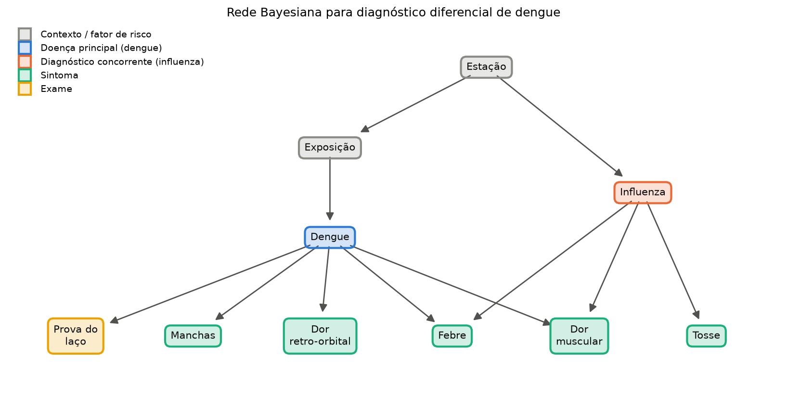
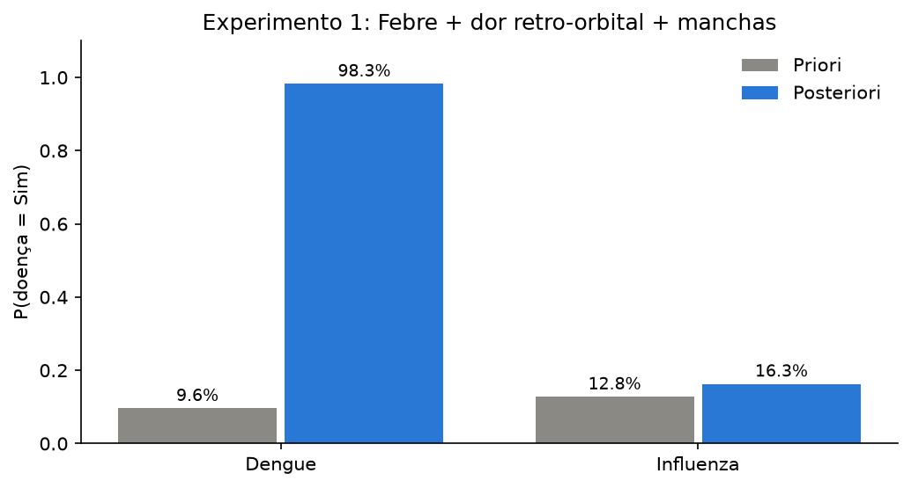
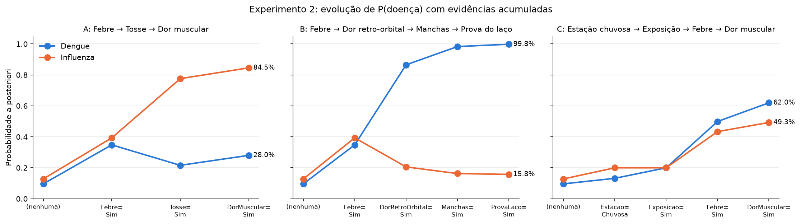
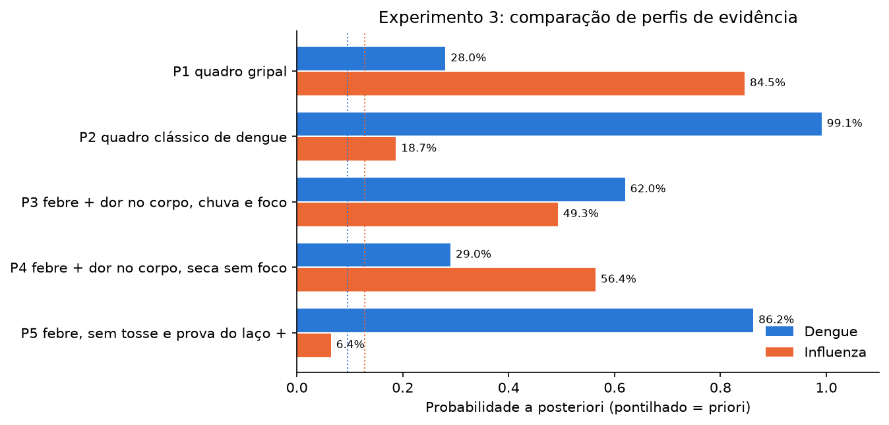
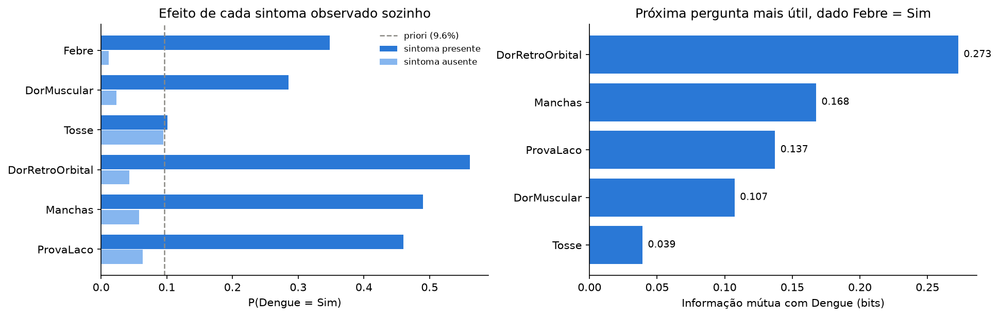
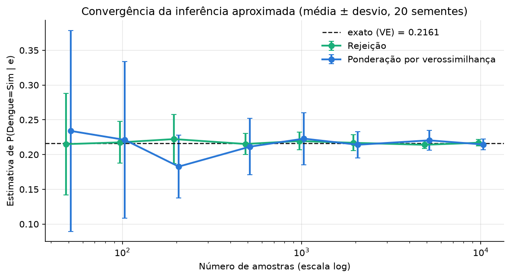

# Questão 8: Sistema de Diagnóstico Médico com Redes Bayesianas

**Dupla:** Bruno Gomes de Barros Filho (21111360); Antônio Rodrigo Lima de Andrade Tenório (23210707)
**Disciplina:** ECOM031: Inteligência Artificial
**Professor:** Evandro de Barros Costa
**Período:** 2026.2

## Enunciado

> Desenvolva de um Sistema de Diagnóstico Médico Utilizando Redes Bayesianas. Trata-se de uma atividade na qual se aplicará os conceitos de Representação do Conhecimento sob Incerteza por meio da modelagem e implementação de um sistema inteligente de diagnóstico médico baseado em Redes Bayesianas. Cada equipe deverá desenvolver um modelo probabilístico capaz de representar relações de dependência entre doenças, sintomas e outros fatores relevantes, permitindo a realização de inferências diagnósticas a partir das evidências observadas. O sistema deverá utilizar uma Rede Bayesiana para:
>
> a) Modelar relações de causa e efeito entre doenças e sintomas;
> b) Realizar inferências diagnósticas diante de evidências incompletas ou incertas;
> c) Atualizar probabilidades à medida que novas evidências forem fornecidas.
>
> **1. Modelagem da Rede Bayesiana.** A rede deverá conter pelo menos uma doença principal a ser diagnosticada; no mínimo cinco variáveis relacionadas ao problema; pelo menos três sintomas observáveis; relações de dependência justificadas entre os nós da rede; Tabelas de Probabilidades Condicionais (CPTs) associadas aos nós. A modelagem deve ser apresentada graficamente, mostrando claramente os relacionamentos probabilísticos entre as variáveis. A equipe deverá descrever o domínio médico escolhido; o significado de cada variável; as hipóteses consideradas; a justificativa para as probabilidades utilizadas; as independências condicionais representadas na rede. As probabilidades poderão ser obtidas de literatura especializada, bases de dados públicas ou definidas de forma plausível para fins educacionais, desde que devidamente justificadas.
>
> **3. Implementação.** A solução deverá ser implementada utilizando uma ferramenta apropriada, tais como Netica, GeNIe, BayesiaLab, Python (pgmpy, PyMC, bnlearn ou bibliotecas equivalentes) ou outra ferramenta aprovada pelo professor.
>
> **4. Inferência Bayesiana.** O sistema deverá demonstrar o funcionamento da inferência probabilística em diferentes cenários. Para cada cenário, deverão ser apresentados as evidências observadas, as probabilidades a priori, as probabilidades a posteriori obtidas após a inferência e a interpretação dos resultados.
>
> **Experimentos.** Realize pelo menos três experimentos distintos, tais como inferência diagnóstica a partir de sintomas observados; atualização do diagnóstico após a inclusão de novos sintomas; comparação entre diferentes conjuntos de evidências. Exemplo: Evidência 1: Febre = Sim; Evidência 2: Tosse = Sim; Evidência 3: Dor muscular = Sim. Mostrar como a probabilidade da doença é atualizada à medida que novas evidências são inseridas.
>
> A equipe deverá discutir como a rede representa a incerteza; a influência de cada evidência no diagnóstico; as vantagens das Redes Bayesianas em relação a sistemas baseados apenas em regras; limitações da modelagem desenvolvida; possíveis melhorias para tornar o sistema mais realista.
>
> Cada equipe deverá entregar: 1. Modelo da Rede Bayesiana; 2. Arquivo do projeto na ferramenta utilizada; 3. Código-fonte (quando aplicável); 4. Relatório técnico contendo descrição do domínio, modelagem da rede, tabelas de probabilidades condicionais, exemplos de inferência, análise e discussão dos resultados; 5. Apresentação ou vídeo demonstrando o funcionamento do sistema.

### Onde cada item é respondido

| Item do enunciado | Seção deste relatório |
| --- | --- |
| Domínio médico escolhido | [1](#1-domínio-médico) |
| Significado de cada variável | [2](#2-variáveis-e-significado) |
| Representação gráfica e dependências justificadas (item a) | [3](#3-estrutura-da-rede-e-justificativa-das-dependências) |
| Hipóteses consideradas | [4](#4-hipóteses-do-modelo) |
| CPTs e justificativa das probabilidades | [5](#5-tabelas-de-probabilidades-condicionais-e-justificativa) |
| Independências condicionais | [6](#6-independências-condicionais) |
| Implementação na ferramenta | [7](#7-implementação) |
| Inferência com evidências incompletas (item b) e experimentos | [8](#8-experimentos-de-inferência) |
| Atualização incremental (item c) | [8.2](#82-experimento-2-atualização-incremental-febre--tosse--dor-muscular) |
| Evidências incertas (item b) | [8.5](#85-experimento-5-evidência-incerta) |
| Influência de cada evidência | [9](#9-influência-de-cada-evidência-e-valor-da-informação) |
| Arquivo do projeto na ferramenta | [11](#11-arquivo-do-projeto-na-ferramenta) |
| Discussão, limitações, melhorias | [12](#12-discussão) |
| Vídeo | [14](#14-roteiro-para-o-vídeoapresentação) |

## Como executar

Na raiz do repositório, com o ambiente `.venv` já criado (Python 3.12, pgmpy 1.1.2, numpy, pandas, matplotlib):

```bash
# testes (25 casos)
.venv/bin/python -m pytest src/q08_bayes -q

# reexecutar o notebook do zero, regravando figuras e arquivos do modelo
cd src/q08_bayes && ../../.venv/bin/jupyter nbconvert --to notebook --execute --inplace q08_bayes.ipynb
```

Uso direto em Python, a partir de `src/q08_bayes/`:

```python
from pgmpy.inference import VariableElimination
from rede_dengue import construir_rede
from inferencia_bayes import distribuicao

rede = construir_rede()
ve = VariableElimination(rede)
distribuicao(ve, "Dengue", {"Febre": "Sim", "Tosse": "Sim"})   # Sim 0.2161, Nao 0.7839
```

## Mapa dos arquivos

| Arquivo | Conteúdo |
| --- | --- |
| `rede_dengue.py` | Estrutura (arestas), significado das variáveis, CPTs, `construir_rede()`, exportação e releitura em BIF/XMLBIF/XDSL/NET |
| `inferencia_bayes.py` | Consultas: `distribuicao` (Variable Elimination), `enumeracao_manual` (conferência com numpy), `atualizacao_incremental`, `estimar_por_amostragem` (rejeição e ponderação por verossimilhança), `evidencia_incerta`, `entropia`, `valor_da_informacao` |
| `test_q08_rede_bayesiana.py` | Testes pytest: requisitos mínimos, CPTs normalizadas, `check_model`, enumeração = VE, d-separação, explaining away, evidência virtual, amostragem, round-trip dos arquivos |
| `q08_bayes.ipynb` | Notebook executado que importa os módulos e percorre toda a solução com tabelas e gráficos |
| `modelo/rede_dengue.{bif,xml,xdsl,net}` | Arquivo do projeto exportado (BIF, XMLBIF, GeNIe, Hugin) |
| `figures/*.png` | Figuras usadas neste relatório |

## 1. Domínio médico

O cenário é a triagem de pacientes com quadro febril agudo numa unidade de pronto atendimento em Alagoas. A dengue é endêmica no Nordeste e costuma ter mais casos no período chuvoso, quando sobram recipientes com água parada para o *Aedes aegypti* se reproduzir. No mesmo período circulam vírus respiratórios, entre eles o da influenza, que também provoca febre e dor no corpo. O médico de plantão precisa separar as duas hipóteses com pouca informação: o relato do paciente, o exame físico e, no máximo, a prova do laço, que é feita na beira do leito com um esfigmomanômetro.

A doença principal do sistema é a **dengue**. A **influenza** entra como diagnóstico concorrente. Como as duas doenças dividem sintomas, a rede precisa pesar uma explicação contra a outra, e é aí que aparecem os efeitos mais interessantes da inferência.

## 2. Variáveis e significado

São 10 variáveis discretas e binárias.

| Variável | Tipo | Estados | Pais | Significado |
| --- | --- | --- | --- | --- |
| `Estacao` | contexto | Chuvosa / Seca | (nenhum) | Período do ano em Alagoas: chuvoso (cerca de abril a agosto) ou seco |
| `Exposicao` | fator de risco | Sim / Nao | Estacao | Paciente mora ou circula perto de foco do *Aedes aegypti* |
| `Dengue` | doença principal | Sim / Nao | Exposicao | Paciente está com dengue |
| `Influenza` | doença concorrente | Sim / Nao | Estacao | Paciente está com gripe |
| `Febre` | sintoma | Sim / Nao | Dengue, Influenza | Febre aferida ou relatada (≥ 38 °C) |
| `DorMuscular` | sintoma | Sim / Nao | Dengue, Influenza | Mialgia, dor no corpo |
| `Tosse` | sintoma | Sim / Nao | Influenza | Tosse |
| `DorRetroOrbital` | sintoma | Sim / Nao | Dengue | Dor atrás dos olhos |
| `Manchas` | sintoma | Sim / Nao | Dengue | Exantema (manchas vermelhas na pele) |
| `ProvaLaco` | exame | Sim / Nao | Dengue | Prova do laço positiva |

Os requisitos mínimos ficam cobertos com folga: 1 doença principal (mais 1 concorrente), 10 variáveis e 5 sintomas observáveis, além de um exame.

## 3. Estrutura da rede e justificativa das dependências



Todas as arestas apontam de causa para efeito, que é o que o item a) pede.

| Aresta | Justificativa |
| --- | --- |
| Estacao → Exposicao | Chuva acumula água em pneus, caixas e calhas, o que aumenta os criadouros do mosquito perto de casa. |
| Estacao → Influenza | No Nordeste, a circulação de vírus respiratórios aumenta no período chuvoso. |
| Exposicao → Dengue | A dengue só é transmitida pela picada do mosquito infectado; mais criadouros por perto, mais chance de infecção. |
| Dengue → Febre, Influenza → Febre | As duas doenças causam febre. A febre tem dois pais e funciona como "colisor". |
| Dengue → DorMuscular, Influenza → DorMuscular | Mialgia aparece nas duas. |
| Influenza → Tosse | Tosse é sintoma respiratório típico da gripe e incomum na dengue; por isso a dengue não é pai da tosse. |
| Dengue → DorRetroOrbital, Dengue → Manchas | Sinais característicos da dengue clássica, pouco comuns na gripe. |
| Dengue → ProvaLaco | A prova do laço avalia fragilidade capilar, alterada na dengue. |

A estação influencia a dengue apenas pela exposição. Optamos por isso para não duplicar caminhos; o efeito da chuva sobre a dengue é justamente o aumento de criadouros.

## 4. Hipóteses do modelo

1. **População-alvo.** As probabilidades valem para pacientes que procuram um pronto atendimento com alguma queixa aguda, e não para a população geral. Por isso a priori de dengue (9,6%) é bem maior que a incidência anual na população.
2. **Variáveis binárias.** Cada sintoma está presente ou ausente; intensidade e duração ficam de fora.
3. **Sintomas condicionalmente independentes dadas as doenças.** Saber que o paciente tem manchas não muda a chance de dor retro-orbital quando já se sabe que ele tem dengue.
4. **Duas doenças apenas.** Outras causas de febre (chikungunya, zika, covid-19, infecções bacterianas) são absorvidas pelo "vazamento" das CPTs: a linha Dengue = Nao, Influenza = Nao ainda dá 10% de febre.
5. **Doenças independentes entre si dada a estação.** Uma pessoa pode ter as duas ao mesmo tempo; não há interação biológica modelada além do efeito nos sintomas.
6. **Retrato estático.** A rede descreve um único atendimento, sem evolução no tempo.

## 5. Tabelas de probabilidades condicionais e justificativa

As probabilidades são **valores plausíveis definidos para fins educacionais**, como o enunciado permite. Não foram tiradas de um estudo epidemiológico específico. A forma qualitativa segue a descrição clínica da dengue usada pelo Ministério da Saúde (febre, mialgia, dor retro-orbital, exantema, prova do laço como sinal de alerta). Os números foram escolhidos para respeitar as relações que um clínico reconheceria: sinais específicos raros na ausência da doença, febre quase certa com dengue, tosse muito mais ligada à gripe.

Cada tabela mostra P(nó = primeiro estado | pais); o complemento é 1 menos o valor.

**P(Estacao)**

| Chuvosa | Seca |
| --- | --- |
| 0,40 | 0,60 |

Cerca de cinco meses chuvosos em doze.

**P(Exposicao = Sim | Estacao)**

| Estacao | P(Sim) |
| --- | --- |
| Chuvosa | 0,60 |
| Seca | 0,25 |

Na chuva, a maior parte dos bairros tem algum foco; na seca, ainda sobram focos em reservatórios domésticos.

**P(Influenza = Sim | Estacao)**

| Estacao | P(Sim) |
| --- | --- |
| Chuvosa | 0,20 |
| Seca | 0,08 |

**P(Dengue = Sim | Exposicao)**

| Exposicao | P(Sim) |
| --- | --- |
| Sim | 0,20 |
| Nao | 0,03 |

Sem foco por perto, a infecção ainda pode ocorrer no trabalho ou na escola, por isso 3% e não zero.

**P(Febre = Sim | Dengue, Influenza)**

| Dengue | Influenza | P(Sim) |
| --- | --- | --- |
| Sim | Sim | 0,98 |
| Sim | Nao | 0,90 |
| Nao | Sim | 0,75 |
| Nao | Nao | 0,10 |

Febre é o sintoma de entrada da dengue, por isso 90%. Na gripe é frequente, mas há quadros leves sem febre. Com as duas doenças a febre é quase certa. O 0,10 da última linha cobre outras causas de febre.

**P(DorMuscular = Sim | Dengue, Influenza)**

| Dengue | Influenza | P(Sim) |
| --- | --- | --- |
| Sim | Sim | 0,95 |
| Sim | Nao | 0,80 |
| Nao | Sim | 0,70 |
| Nao | Nao | 0,15 |

A dor no corpo da dengue costuma ser intensa ("febre quebra-ossos"), um pouco mais frequente que na gripe.

**P(Tosse = Sim | Influenza)**

| Influenza | P(Sim) |
| --- | --- |
| Sim | 0,80 |
| Nao | 0,15 |

Os 15% sem gripe vêm de resfriados, alergias e fumantes.

**P(DorRetroOrbital = Sim | Dengue)**, **P(Manchas = Sim | Dengue)** e **P(ProvaLaco = Sim | Dengue)**

| Dengue | DorRetroOrbital | Manchas | ProvaLaco |
| --- | --- | --- | --- |
| Sim | 0,60 | 0,45 | 0,40 |
| Nao | 0,05 | 0,05 | 0,05 |

Os três são pouco sensíveis (ficam abaixo de 60%) e bem específicos (5% de falso positivo). A prova do laço é conhecida por ser negativa em boa parte dos casos de dengue, então ficou com a menor sensibilidade.

Todas as colunas somam 1; o `check_model()` do pgmpy e o teste `test_cpts_normalizadas` verificam isso.

## 6. Independências condicionais

### 6.1 Propriedade de Markov local

Cada nó é independente dos seus não descendentes dados os pais. Saída de `rede.local_independencies(no)`:

```
(Exposicao ⟂ Influenza, Tosse | Estacao)
(Influenza ⟂ Dengue, DorRetroOrbital, Exposicao, Manchas, ProvaLaco | Estacao)
(Dengue ⟂ Estacao, Influenza, Tosse | Exposicao)
(Febre ⟂ DorMuscular, DorRetroOrbital, Estacao, Exposicao, Manchas, ProvaLaco, Tosse | Dengue, Influenza)
(DorMuscular ⟂ DorRetroOrbital, Estacao, Exposicao, Febre, Manchas, ProvaLaco, Tosse | Dengue, Influenza)
(Tosse ⟂ Dengue, DorMuscular, DorRetroOrbital, Estacao, Exposicao, Febre, Manchas, ProvaLaco | Influenza)
(DorRetroOrbital ⟂ DorMuscular, Estacao, Exposicao, Febre, Influenza, Manchas, ProvaLaco, Tosse | Dengue)
(Manchas ⟂ DorMuscular, DorRetroOrbital, Estacao, Exposicao, Febre, Influenza, ProvaLaco, Tosse | Dengue)
(ProvaLaco ⟂ DorMuscular, DorRetroOrbital, Estacao, Exposicao, Febre, Influenza, Manchas, Tosse | Dengue)
```

Na prática isso reduz o número de parâmetros. A distribuição conjunta das 10 variáveis binárias teria 2¹⁰ − 1 = 1023 parâmetros livres; com a fatoração da rede são 1 + 2 + 2 + 2 + 4 + 4 + 2 + 2 + 2 + 2 = 23.

### 6.2 d-separação

Testada com `rede.is_dconnected(a, b, observed=...)`:

| Par | Observado | d-conectados? | Motivo |
| --- | --- | --- | --- |
| Dengue e Influenza | (nada) | Sim | caminho Dengue ← Exposição ← Estação → Influenza aberto |
| Dengue e Influenza | Estacao | Não | a estação bloqueia o único caminho aberto |
| Dengue e Influenza | Estacao, Febre | Sim | Febre é colisor; observá-la abre o caminho |
| Dengue e Influenza | Estacao, DorMuscular | Sim | DorMuscular também é colisor |
| Manchas e DorRetroOrbital | (nada) | Sim | causa comum (Dengue) não observada |
| Manchas e DorRetroOrbital | Dengue | Não | dada a dengue, um sintoma nada diz sobre o outro |
| Estacao e Dengue | Exposicao | Não | a estação só age sobre a dengue via exposição |
| Tosse e Manchas | (nada) | Sim | Tosse ← Influenza ← Estação → Exposição → Dengue → Manchas |
| Tosse e Manchas | Estacao | Não | bloqueado na estação; o colisor Febre não está observado |
| Tosse e Manchas | Estacao, Febre | Sim | observar a febre liga os dois ramos |

### 6.3 Explaining away em números

Influenza e Dengue são independentes quando a estação é conhecida. Quando a febre é observada, as duas doenças passam a competir pela explicação:

| Evidência | P(Influenza = Sim) |
| --- | --- |
| Estação seca | 0,0800 |
| Estação seca + Febre | 0,2967 |
| Estação seca + Febre + Dengue = Sim | 0,0865 |
| Estação seca + Febre + Dengue = Nao | 0,3947 |
| Estação seca + Dengue = Sim (sem febre observada) | 0,0800 |

Confirmar a dengue derruba a gripe de 29,7% para 8,7%, quase de volta à priori, porque a dengue sozinha já explica a febre. Descartar a dengue faz a gripe subir para 39,5%. Na última linha, sem febre observada, saber da dengue não muda nada na gripe, como a d-separação da tabela anterior previa.

## 7. Implementação

A ferramenta escolhida foi Python com **pgmpy 1.1.2** (`DiscreteBayesianNetwork`, `TabularCPD`, `VariableElimination`, `BayesianModelSampling`). O código fica em dois módulos importados pelo notebook:

- `rede_dengue.py` monta as CPTs com nomes de estado legíveis (`Sim`/`Nao`, `Chuvosa`/`Seca`), cria a rede e chama `check_model()`. Também exporta e relê o modelo.
- `inferencia_bayes.py` concentra as consultas. A inferência exata usa Variable Elimination.

Como conferência independente, `enumeracao_manual` faz inferência por enumeração sem usar nenhum algoritmo do pgmpy: multiplica as 10 CPTs com `np.einsum` para obter a tabela conjunta de 1024 células, fixa as evidências por indexação, soma as variáveis ocultas e normaliza. O teste `test_enumeracao_manual_igual_eliminacao_de_variaveis` compara os dois métodos em 10 combinações de alvo e evidência com tolerância de 10⁻¹²; no Experimento 1 os dois dão P(Dengue = Sim) = 0,9830.

Uma priori também foi conferida à mão: P(Exposição) = 0,4·0,6 + 0,6·0,25 = 0,39 e P(Dengue) = 0,39·0,20 + 0,61·0,03 = 0,0963, igual ao valor do pgmpy.

## 8. Experimentos de inferência

Prioris das doenças (sem nenhuma evidência): **P(Dengue = Sim) = 0,0963** e **P(Influenza = Sim) = 0,1280**.

### 8.1 Experimento 1: diagnóstico a partir de sintomas típicos

**Evidências:** Febre = Sim, DorRetroOrbital = Sim, Manchas = Sim. Estação e exposição não informadas (evidência incompleta).

| Variável não observada | Estado | Priori | Posteriori | Razão |
| --- | --- | --- | --- | --- |
| Estacao | Chuvosa | 0,4000 | 0,5498 | 1,37 |
| Exposicao | Sim | 0,3900 | 0,8032 | 2,06 |
| Influenza | Sim | 0,1280 | 0,1629 | 1,27 |
| **Dengue** | **Sim** | **0,0963** | **0,9830** | **10,21** |
| DorMuscular | Sim | 0,2774 | 0,8169 | 2,95 |
| Tosse | Sim | 0,2332 | 0,2559 | 1,10 |
| ProvaLaco | Sim | 0,0837 | 0,3940 | 4,71 |



**Interpretação.** Três achados bastam para levar a dengue de 9,6% a 98,3%. A rede também raciocina "para cima" e "para os lados": a exposição a foco sobe para 80%, a estação chuvosa para 55%, e a rede prevê que a prova do laço daria positivo com 39% de chance e que há 82% de chance de dor no corpo, sintomas que ainda nem foram perguntados. A influenza sobe um pouco (12,8% → 16,3%) porque a febre também é compatível com ela e porque a estação chuvosa ficou mais provável.

### 8.2 Experimento 2: atualização incremental (Febre → Tosse → Dor muscular)

**Sequência A, a do enunciado:**

| Evidência acumulada | P(Dengue = Sim) | P(Influenza = Sim) |
| --- | --- | --- |
| (nenhuma, priori) | 0,0963 | 0,1280 |
| + Febre = Sim | 0,3481 | 0,3934 |
| + Tosse = Sim | 0,2161 | 0,7757 |
| + DorMuscular = Sim | 0,2804 | 0,8455 |

**Sequência B, sinais específicos de dengue:**

| Evidência acumulada | P(Dengue = Sim) | P(Influenza = Sim) |
| --- | --- | --- |
| (nenhuma, priori) | 0,0963 | 0,1280 |
| + Febre = Sim | 0,3481 | 0,3934 |
| + DorRetroOrbital = Sim | 0,8650 | 0,2057 |
| + Manchas = Sim | 0,9830 | 0,1629 |
| + ProvaLaco = Sim | 0,9978 | 0,1575 |

**Sequência C, contexto epidemiológico primeiro:**

| Evidência acumulada | P(Dengue = Sim) | P(Influenza = Sim) |
| --- | --- | --- |
| (nenhuma, priori) | 0,0963 | 0,1280 |
| + Estacao = Chuvosa | 0,1320 | 0,2000 |
| + Exposicao = Sim | 0,2000 | 0,2000 |
| + Febre = Sim | 0,4989 | 0,4336 |
| + DorMuscular = Sim | 0,6196 | 0,4928 |



**Interpretação.** Na sequência A a febre sozinha multiplica a probabilidade de dengue por 3,6. Quando a tosse chega, a dengue *cai* de 34,8% para 21,6%, mesmo sendo a tosse quase irrelevante para a dengue de forma direta (a dengue nem é pai da tosse). O que acontece é explaining away: a tosse torna a gripe muito provável (77,6%) e a gripe passa a explicar a febre, tirando o "mérito" da dengue. A dor muscular sobe as duas doenças, porque ambas a causam; a dengue ganha um pouco mais (de 21,6% para 28,0%) porque a CPT da dor muscular é mais alta para dengue. No fim, o quadro aponta para gripe.

Na sequência B cada sinal específico faz a dengue saltar, e a gripe recua conforme a dengue assume a explicação da febre. Na sequência C, o contexto sozinho já dobra a probabilidade de dengue (9,6% → 20,0%). Com esse ponto de partida, febre e dor no corpo, que são inespecíficos, levam a dengue a 62,0% e ela passa a ser a hipótese mais provável.

### 8.3 Experimento 3: comparação entre conjuntos de evidências

| Perfil | Evidências | P(Dengue = Sim) | P(Influenza = Sim) |
| --- | --- | --- | --- |
| P1 quadro gripal | Febre, Tosse, DorMuscular | 0,2804 | 0,8455 |
| P2 quadro clássico de dengue | Febre, DorRetroOrbital, Manchas, DorMuscular | 0,9909 | 0,1867 |
| P3 febre + dor no corpo, chuva e foco | Estacao = Chuvosa, Exposicao = Sim, Febre, DorMuscular | 0,6196 | 0,4928 |
| P4 febre + dor no corpo, seca sem foco | Estacao = Seca, Exposicao = Nao, Febre, DorMuscular | 0,2900 | 0,5637 |
| P5 febre, sem tosse, prova do laço + | Febre = Sim, Tosse = Nao, ProvaLaco = Sim | 0,8619 | 0,0641 |

(Todos os achados listados sem valor explícito são "Sim".)



**Interpretação.** P3 e P4 têm exatamente os mesmos sintomas; só muda o contexto, e a dengue vai de 62,0% para 29,0%. Uma regra do tipo "febre e dor no corpo ⇒ suspeita de dengue" não faz essa distinção. P5 mostra o peso de um achado negativo: a ausência de tosse derruba a gripe para 6,4%, e uma prova do laço positiva, que sozinha é um exame fraco, leva a dengue a 86,2%.

### 8.4 Experimento 4: explicação mais provável (MAP)

`ve.map_query(["Dengue", "Influenza"], evidence=...)` devolve a combinação conjunta mais provável das duas doenças.

| Perfil | MAP (Dengue, Influenza) | P(MAP \| e) | P(ambas \| e) |
| --- | --- | --- | --- |
| P1 quadro gripal | Dengue = Nao, Influenza = Sim | 0,6939 | 0,1516 |
| P2 quadro clássico de dengue | Dengue = Sim, Influenza = Nao | 0,8118 | 0,1792 |
| P3 febre + dor no corpo, chuva e foco | Dengue = Sim, Influenza = Nao | 0,4682 | 0,1514 |
| P4 febre + dor no corpo, seca sem foco | Dengue = Nao, Influenza = Sim | 0,5344 | 0,0293 |
| P5 febre, sem tosse, prova do laço + | Dengue = Sim, Influenza = Nao | 0,8257 | 0,0361 |

**Interpretação.** A MAP dá uma resposta única, útil como "diagnóstico de trabalho", mas esconde a incerteza. Em P3 a melhor explicação tem só 46,8% de probabilidade, e as marginais (62,0% e 49,3%) mostram que as duas doenças continuam bem possíveis. A coluna P(ambas) mostra que coinfecção nunca é a explicação preferida, mas também não é desprezível nos perfis com febre e dor no corpo.

### 8.5 Experimento 5: evidência incerta

O item b) fala em evidências incertas. Um paciente que "acha que teve febre", mas não mediu, fornece uma evidência virtual: um peso λ a favor de Febre = Sim e 1 − λ a favor de Febre = Nao (`virtual_evidence` do pgmpy, criada por `evidencia_incerta`). Além disso, foi observada DorRetroOrbital = Sim.

| Peso a favor de Febre = Sim | P(Dengue = Sim) |
| --- | --- |
| 0,5 (relato não informa nada) | 0,5612 |
| 0,6 | 0,6305 |
| 0,7 | 0,6951 |
| 0,8 | 0,7555 |
| 0,9 | 0,8120 |
| 1,0 (febre confirmada) | 0,8650 |

**Interpretação.** Com λ = 0,5 o resultado coincide com não ter perguntado sobre febre (0,5612), e com λ = 1 coincide com a evidência dura (0,8650). Entre os extremos o diagnóstico se move de forma gradual, de acordo com o quanto se confia no relato. O teste `test_evidencia_incerta_pondera_os_dois_cenarios` confere esse cálculo contra a fórmula P(D | λ) ∝ λ·P(D, F = Sim) + (1 − λ)·P(D, F = Nao).

## 9. Influência de cada evidência e valor da informação

Efeito de cada sintoma observado sozinho, a partir da priori de 9,6%:

| Sintoma | P(Dengue \| presente) | P(Dengue \| ausente) | Razão de verossimilhança + |
| --- | --- | --- | --- |
| Febre | 0,3481 | 0,0114 | 5,01 |
| DorMuscular | 0,2853 | 0,0237 | 3,75 |
| Tosse | 0,1011 | 0,0948 | 1,06 |
| DorRetroOrbital | 0,5612 | 0,0429 | 12,00 |
| Manchas | 0,4896 | 0,0581 | 9,00 |
| ProvaLaco | 0,4602 | 0,0631 | 8,00 |

A razão de verossimilhança positiva é P(sintoma | Dengue) / P(sintoma | sem dengue). Os sinais específicos (dor retro-orbital, manchas, prova do laço) são os que mais elevam a dengue quando presentes. A febre é o achado cuja *ausência* mais pesa: sem febre a dengue cai para 1,1%. A tosse sozinha mal mexe na dengue; seu efeito só aparece em conjunto com a febre, como visto no Experimento 2.

Para decidir qual pergunta fazer em seguida a um paciente que só relatou febre, calculamos a informação mútua I(Dengue; C | Febre = Sim), que é a redução esperada da entropia (em bits) do diagnóstico ao observar C:

| Próxima observação C | P(C = Sim \| e) | P(Dengue \| e, C = Sim) | P(Dengue \| e, C = Nao) | Informação mútua (bits) |
| --- | --- | --- | --- | --- |
| DorRetroOrbital | 0,2414 | 0,8650 | 0,1835 | 0,2728 |
| Manchas | 0,1892 | 0,8277 | 0,2361 | 0,1676 |
| ProvaLaco | 0,1718 | 0,8103 | 0,2522 | 0,1372 |
| DorMuscular | 0,5708 | 0,5022 | 0,1431 | 0,1073 |
| Tosse | 0,4057 | 0,2161 | 0,4382 | 0,0391 |



Perguntar sobre dor atrás dos olhos é o que mais reduz a incerteza. A tosse é a que menos ajuda a decidir sobre dengue, embora seja ótima para decidir sobre gripe. Note que a tosse inverte o sentido usual: presente, ela *reduz* a dengue (21,6%); ausente, aumenta (43,8%).

## 10. Inferência exata versus aproximada

Para a consulta P(Dengue = Sim | Febre = Sim, Tosse = Sim), cujo valor exato é 0,2161, rodamos amostragem por rejeição e ponderação por verossimilhança (*likelihood weighting*) do pgmpy, com 20 sementes por tamanho.

| n | Rejeição: média | Rejeição: desvio | Ponderação: média | Ponderação: desvio |
| --- | --- | --- | --- | --- |
| 50 | 0,2150 | 0,0731 | 0,2340 | 0,1446 |
| 100 | 0,2175 | 0,0301 | 0,2211 | 0,1126 |
| 200 | 0,2223 | 0,0354 | 0,1827 | 0,0452 |
| 500 | 0,2152 | 0,0153 | 0,2113 | 0,0405 |
| 1000 | 0,2195 | 0,0127 | 0,2229 | 0,0374 |
| 2000 | 0,2169 | 0,0114 | 0,2141 | 0,0187 |
| 5000 | 0,2140 | 0,0051 | 0,2204 | 0,0142 |
| 10000 | 0,2170 | 0,0045 | 0,2145 | 0,0076 |



Os dois métodos convergem para o valor exato e o desvio cai aproximadamente com 1/√n. A rejeição parece melhor na tabela, mas a comparação engana: no pgmpy o `size` da rejeição conta amostras *aceitas*, e como P(Febre = Sim, Tosse = Sim) = 0,1023, cerca de 90% das amostras geradas são descartadas. Para 10.000 amostras aceitas a rejeição gera perto de 100.000. Na ponderação nenhuma amostra é descartada, mas os pesos variam muito (de 0,015 a 0,78 nesta consulta), o que aumenta a variância. Numa rede deste tamanho a inferência exata é instantânea; a amostragem só valeria a pena numa rede muito maior.

## 11. Arquivo do projeto na ferramenta

O modelo é exportado por `exportar_rede` para `modelo/`:

| Arquivo | Formato | Abre em |
| --- | --- | --- |
| `rede_dengue.bif` | Bayesian Interchange Format (texto) | pgmpy, bnlearn (R) |
| `rede_dengue.xml` | XMLBIF | pgmpy, Weka |
| `rede_dengue.xdsl` | XDSL (formato nativo do GeNIe/SMILE) | GeNIe |
| `rede_dengue.net` | NET (formato do Hugin) | Hugin; GeNIe também importa |

Cada arquivo foi relido pelo leitor correspondente do pgmpy. Nos quatro casos a rede relida tem as mesmas arestas, as mesmas CPTs e dá a mesma posteriori do Experimento 1 (0,9830). O teste `test_round_trip_dos_arquivos_exportados` repete essa verificação. Não tivemos o GeNIe instalado no ambiente de desenvolvimento, então a abertura nele não foi testada; o XDSL gerado pelo pgmpy não traz posições dos nós, e o GeNIe deve dispor os nós automaticamente.

## 12. Discussão

### Como a rede representa a incerteza

A incerteza aparece em dois lugares. Na estrutura, as arestas dizem quem influencia quem, e a ausência de aresta é uma afirmação de independência condicional. Nas CPTs, cada relação causal tem uma força graduada: dengue causa febre em 90% dos casos, não em 100%; sem dengue e sem gripe ainda há 10% de febre por outras causas. O resultado de uma consulta é uma distribuição de probabilidade sobre os diagnósticos. Quando falta informação (estação desconhecida, prova do laço não feita), a rede soma sobre os valores possíveis da variável ausente, ponderando cada um pela sua probabilidade. Evidência incerta entra como evidência virtual (Experimento 5).

### Influência de cada evidência

- Sinais específicos da dengue (dor retro-orbital, manchas, prova do laço) têm razões de verossimilhança entre 8 e 12 e dominam o diagnóstico quando presentes.
- A febre é pouco específica, mas sua ausência praticamente descarta a dengue (1,1%).
- A tosse quase não influencia a dengue sozinha; junto com a febre ela *reduz* a dengue por explaining away (34,8% → 21,6%).
- O contexto epidemiológico muda a interpretação dos mesmos sintomas: 62,0% contra 29,0% de dengue entre P3 e P4.
- Achados negativos também são evidência: "sem tosse" leva a gripe a 6,4% em P5.

### Vantagens em relação a sistemas baseados só em regras

Um sistema de regras do tipo SE febre E dor muscular ENTÃO dengue dispara ou não dispara. Ele não diz o quanto confia na conclusão, não lida bem com sintomas faltantes e não tem como combinar evidências que apontam em direções diferentes. A rede bayesiana faz essas três coisas com o mesmo mecanismo.

Na rede, o conhecimento é local: cada CPT descreve uma relação causa-efeito que um especialista consegue avaliar isoladamente. As interações entre evidências, como o explaining away da tosse, saem da teoria da probabilidade sem que alguém precise prever e escrever uma regra para cada combinação. A mesma rede responde perguntas em qualquer direção: do sintoma para a doença (diagnóstico), da doença para o sintoma (previsão, como a chance de a prova do laço dar positiva) e sobre qual exame fazer em seguida (valor da informação). Num sistema de regras, cada uma dessas perguntas exigiria um conjunto de regras próprio.

### Limitações da modelagem

- As probabilidades são plausíveis, não medidas. Os números exatos dos experimentos não devem ser usados clinicamente; o que vale é o comportamento qualitativo.
- O diagnóstico diferencial real das arboviroses inclui chikungunya e zika, que compartilham quase todos os sintomas da dengue e não estão na rede. Hoje elas estão escondidas no "vazamento" das CPTs.
- Variáveis binárias perdem informação: dias de febre, intensidade da dor, idade e comorbidades importam na prática.
- A hipótese de sintomas independentes dada a doença é forte; manchas e prova do laço positiva, por exemplo, podem ser correlacionadas por gravidade.
- A rede é estática; a dengue tem fases (febril, crítica, convalescença) e sinais de alarme que aparecem com os dias.
- Não há exames laboratoriais (NS1, sorologia, hemograma com plaquetas) nem decisão de conduta.

### Possíveis melhorias

- Estimar as CPTs a partir de dados reais, como as notificações do SINAN para dengue e os registros de síndrome gripal, usando `MaximumLikelihoodEstimator` ou `BayesianEstimator` do pgmpy.
- Incluir chikungunya, zika e covid-19 como doenças concorrentes, e variáveis como idade e dias desde o início dos sintomas.
- Acrescentar exames (NS1, plaquetas, hematócrito) e uma variável de gravidade com os sinais de alarme da classificação de risco.
- Usar uma rede bayesiana dinâmica para acompanhar a evolução do paciente dia a dia.
- Transformar a rede num diagrama de influência, com nós de decisão (pedir exame, internar, hidratar) e utilidade, para recomendar condutas.
- Validar com especialistas e medir calibração das probabilidades em casos reais.

## 13. Testes

`.venv/bin/python -m pytest src/q08_bayes -q` executa 25 testes, todos passando:

- requisitos mínimos (≥ 5 variáveis, ≥ 3 sintomas, arestas declaradas);
- CPTs normalizadas e `check_model()`;
- enumeração manual com numpy igual ao Variable Elimination (2 alvos × 5 conjuntos de evidência);
- priori de dengue igual à conta feita à mão;
- explaining away (tosse reduz dengue com febre) e d-separação;
- evidência virtual igual à fórmula de ponderação;
- amostragem por rejeição e ponderação dentro de 0,02 do valor exato com 20.000 amostras;
- informação mútua não negativa e ordenada;
- round-trip dos quatro formatos exportados.

## 14. Roteiro para o vídeo/apresentação

Sugestão de roteiro com cerca de 8 minutos. Os números citados são os que o notebook produz.

1. **Abertura (30 s).** Apresentar a dupla e o problema: separar dengue de gripe num pronto atendimento em Alagoas.
2. **A rede (1 min 30 s).** Mostrar `figures/q08_rede.png`. Explicar os quatro grupos de nós e por que a febre e a dor muscular têm dois pais. Mostrar a CPT da febre no notebook.
3. **Independências (1 min).** Rodar a célula de `is_dconnected`. Destacar a linha Dengue e Influenza: independentes dada a estação, dependentes quando a febre é observada.
4. **Experimento 1 (1 min).** Febre + dor retro-orbital + manchas: dengue de 9,6% para 98,3%. Mostrar a conferência com enumeração em numpy dando o mesmo valor.
5. **Experimento 2 (1 min 30 s).** Sequência do enunciado. Parar na tosse e perguntar "por que a dengue caiu?". Explicar o explaining away. Comparar com a sequência C.
6. **Experimento 3 e MAP (1 min).** P3 contra P4: mesmos sintomas, contexto diferente, 62,0% contra 29,0%.
7. **Evidência incerta e valor da informação (1 min).** Tabela de λ e o gráfico de informação mútua: a próxima pergunta deveria ser sobre dor atrás dos olhos.
8. **Arquivo do projeto e testes (30 s).** Mostrar a pasta `modelo/` e rodar `pytest`.
9. **Fechamento (30 s).** Uma limitação (probabilidades educacionais, faltam chikungunya e zika) e uma melhoria (estimar CPTs com dados do SINAN).

## Referências

- RUSSELL, S.; NORVIG, P. *Artificial Intelligence: A Modern Approach*. 4. ed. Pearson, 2020. Capítulos sobre incerteza, redes bayesianas e inferência exata e aproximada.
- KOLLER, D.; FRIEDMAN, N. *Probabilistic Graphical Models: Principles and Techniques*. MIT Press, 2009.
- PEARL, J. *Probabilistic Reasoning in Intelligent Systems: Networks of Plausible Inference*. Morgan Kaufmann, 1988.
- COVER, T. M.; THOMAS, J. A. *Elements of Information Theory*. 2. ed. Wiley, 2006. Definição de entropia e informação mútua.
- ANKAN, A.; PANDA, A. pgmpy: Probabilistic Graphical Models using Python. In: *Proceedings of the 14th Python in Science Conference (SciPy 2015)*. Documentação: https://pgmpy.org
- BRASIL. Ministério da Saúde. *Dengue: diagnóstico e manejo clínico: adulto e criança*. Brasília: Ministério da Saúde. Usado apenas para o quadro clínico qualitativo (sintomas e prova do laço); nenhum número da rede foi retirado dele.
