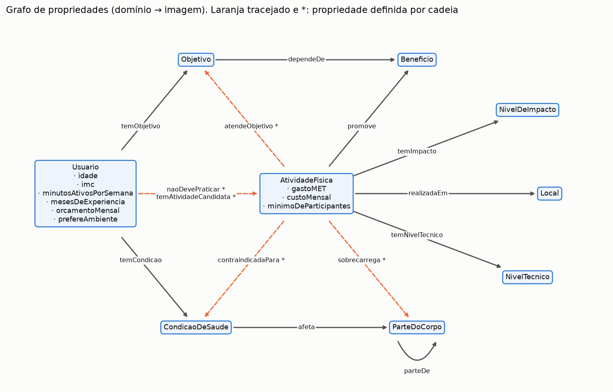
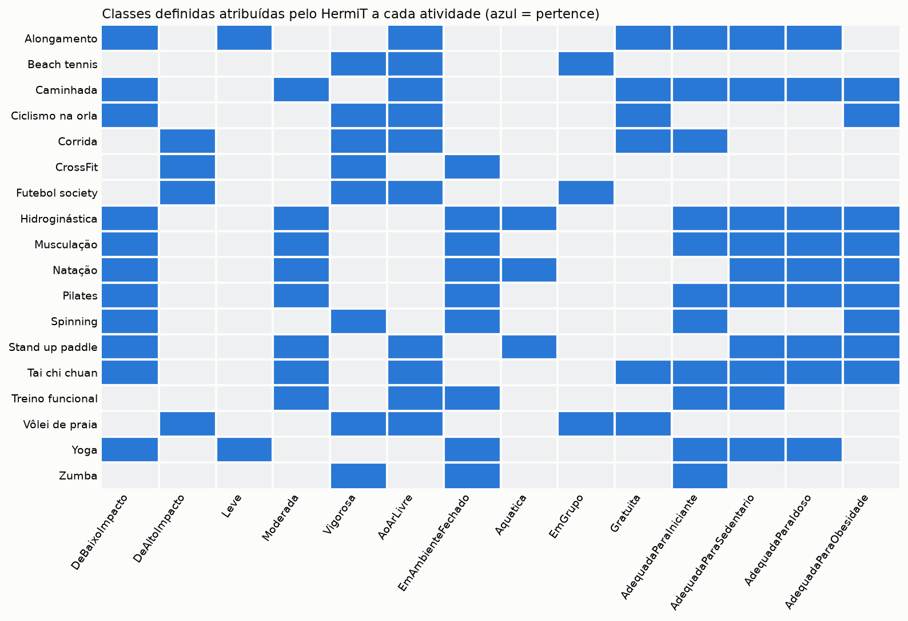
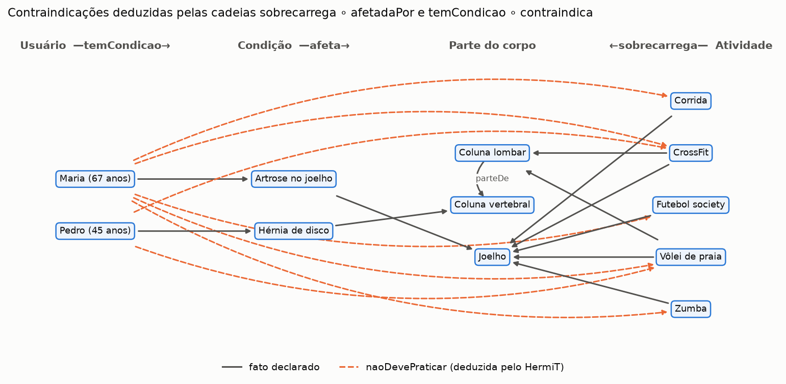
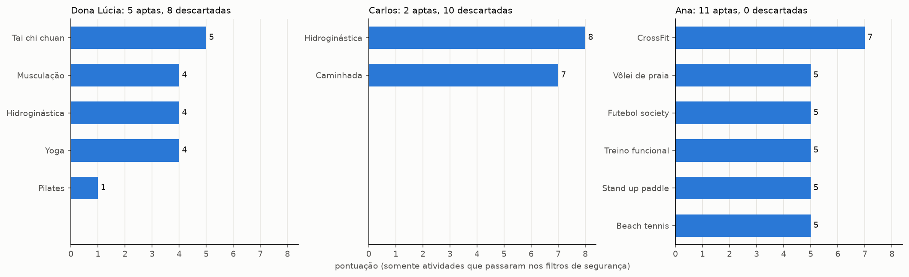
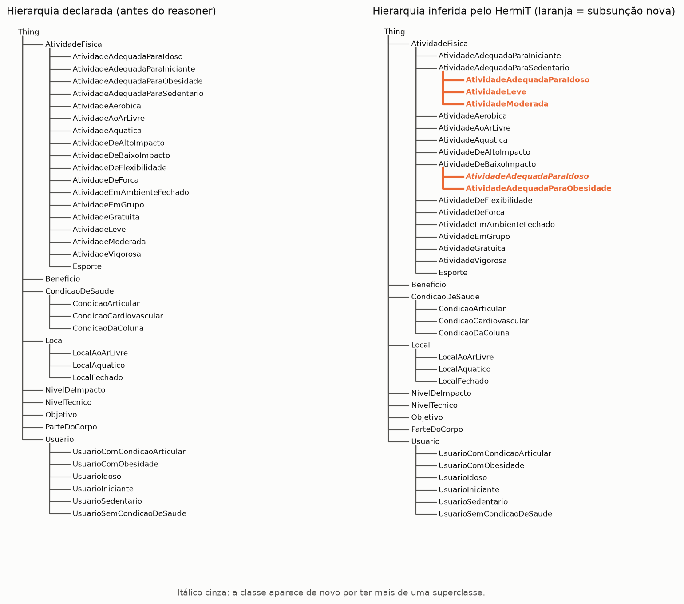
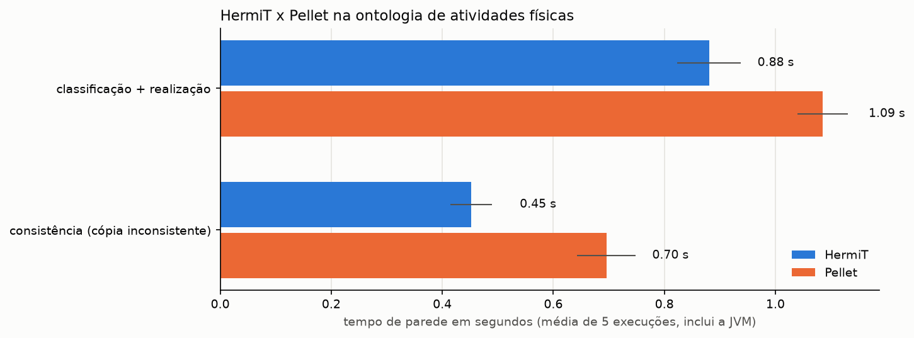

# Questões 9 e 15: ontologia OWL 2 para recomendação de atividades físicas

**Dupla:** Bruno Gomes de Barros Filho (21111360); Antônio Rodrigo Lima de Andrade Tenório (23210707)
**Disciplina:** ECOM031: Inteligência Artificial
**Professor:** Evandro de Barros Costa
**Período:** 2026.2

As duas questões usam a mesma ontologia. A Questão 9 constrói um sistema de recomendação de atividades
físicas que depende das inferências do reasoner. A Questão 15 usa essa ontologia como exemplo para discutir
representação do conhecimento em OWL 2 e as tarefas de raciocínio, com HermiT e Pellet.

Todos os números deste relatório saem das execuções salvas nos notebooks.

## Arquivos

| Arquivo | Conteúdo |
| :--- | :--- |
| `ontologia_atividades_fisicas.owl` | Ontologia principal em RDF/XML (abre no Protégé 5) |
| `ontologia_atividades_fisicas_inconsistente.owl` | Cópia com um erro de cadastro que torna a ontologia inconsistente |
| `ontologia_atividades_fisicas_insatisfazivel.owl` | Cópia consistente com uma classe insatisfazível |
| `ontologia_atividades.py` | Script que gera os três `.owl` (TBox, ABox e variantes) |
| `raciocinio_owl.py` | Chamada do HermiT (owlready2) e do Pellet (linha de comando), comparação e explicações |
| `sintaxe_owl.py` | Conversão de axiomas para Manchester Syntax e notação DL |
| `recomendador_atividades.py` | Recomendador (função `recomendar`) e interface de linha de comando |
| `figuras_ontologia.py` | Funções das figuras |
| `q09_recomendador_ontologia.ipynb` | Notebook da Questão 9, executado |
| `q15_representacao_raciocinio.ipynb` | Notebook da Questão 15, executado |
| `test_q09_*.py`, `test_q15_*.py` | 22 testes (pytest) |
| `figures/` | Figuras PNG geradas pelos notebooks |

## Como executar

Na raiz do repositório, com o ambiente `.venv` (Python 3.12, owlready2 0.51, rdflib, pandas, matplotlib) e
Java instalado (testado com OpenJDK 21):

```bash
cd src/q09_q15_ontologia
../../.venv/bin/python ontologia_atividades.py          # regera os três .owl
../../.venv/bin/python recomendador_atividades.py       # recomendador interativo
../../.venv/bin/jupyter nbconvert --to notebook --execute --inplace q09_recomendador_ontologia.ipynb
../../.venv/bin/jupyter nbconvert --to notebook --execute --inplace q15_representacao_raciocinio.ipynb
cd ../.. && .venv/bin/python -m pytest src/q09_q15_ontologia -q
```

O HermiT e o Pellet vêm empacotados no owlready2; não há pacote extra a instalar.

---

## Questão 9

> Desenvolva um Sistema de Recomendação Baseado em Ontologias [...] utilizando a linguagem OWL 2.0.

### 9.1 Descrição do domínio

O sistema recomenda atividades físicas para moradores de Maceió. Quem pede a recomendação informa idade,
peso, altura, quantos minutos de exercício faz por semana, há quantos meses pratica, seus objetivos
(perder peso, prevenir quedas, socializar etc.), condições de saúde, orçamento mensal e se prefere lugares
abertos ou fechados.

O domínio foi escolhido porque nele a segurança vem antes da preferência. Uma pessoa com artrose no
joelho não deve receber corrida como sugestão, por mais que corrida atenda o objetivo dela, e essa
restrição sai de conhecimento geral (corrida sobrecarrega o joelho, artrose afeta o joelho) que se
expressa bem como axioma. As atividades, locais e custos são fictícios, mas plausíveis para a cidade
(orla de Ponta Verde, Parque Municipal, Praia da Pajuçara). O gasto energético de cada atividade em MET
é uma aproximação arredondada do Compendium of Physical Activities (Ainsworth et al., 2011), e os
limiares seguem referências conhecidas: 3 e 6 MET para moderada e vigorosa (ACSM), 150 minutos por
semana (OMS), IMC 30 para obesidade e 60 anos para pessoa idosa.

### 9.2 Modelagem conceitual

A ontologia tem IRI `http://ic.ufal.br/ecom031/lista2/atividades-fisicas`, rótulos `rdfs:label` em
pt-BR para todas as entidades e `rdfs:comment` nas classes e propriedades que precisam de explicação.

| Elemento | Quantidade |
| :--- | :--- |
| Classes | 39 (17 primitivas e 22 definidas por equivalência) |
| Propriedades | 28 (19 de objeto e 9 de dados), mais 1 propriedade de anotação |
| Indivíduos | 66 (18 atividades, 9 locais, 9 partes do corpo, 5 condições, 7 benefícios, 7 objetivos, 6 níveis, 5 usuários) |
| Triplas RDF | 1147 |
| Axiomas de TBox/RBox | 36 de subclasse, 22 de equivalência, 23 de domínio, 23 de imagem, 12 de característica, 5 de inversa, 5 cadeias, 3 de disjunção |

A taxonomia declarada tem nove classes de topo, disjuntas entre si: `AtividadeFisica`, `Usuario`,
`CondicaoDeSaude`, `Local`, `ParteDoCorpo`, `Beneficio`, `Objetivo`, `NivelDeImpacto` e `NivelTecnico`.
Abaixo delas estão as especializações primitivas: `AtividadeAerobica`, `AtividadeDeForca`,
`AtividadeDeFlexibilidade` e `Esporte` (disjuntas, pela modalidade predominante); `CondicaoArticular`,
`CondicaoDaColuna` e `CondicaoCardiovascular`; `LocalAoArLivre` e `LocalFechado` (disjuntas) e
`LocalAquatico` (ortogonal, porque a Praia da Pajuçara é aquática e ao ar livre).



As propriedades de objeto ligam essas classes (figura acima). As que aparecem em laranja não são
cadastradas: o reasoner as deduz por cadeias de propriedades.

| Axioma (Manchester Syntax) | Papel |
| :--- | :--- |
| `parteDe` transitiva | coluna lombar é parte da coluna vertebral, que é parte do tronco |
| `sobrecarrega` com cadeia `sobrecarrega o parteDe` | quem sobrecarrega a coluna lombar sobrecarrega a coluna vertebral |
| `contraindicadaPara` com cadeia `sobrecarrega o afetadaPor` | atividade que sobrecarrega uma parte afetada pela condição é contraindicada para ela |
| `naoDevePraticar` com cadeia `temCondicao o contraindica` | o usuário não deve praticar o que é contraindicado para alguma condição sua |
| `atendeObjetivo` com cadeia `promove o contribuiPara` | a atividade atende o objetivo se promove um benefício de que o objetivo depende |
| `temAtividadeCandidata` com cadeia `temObjetivo o atendidoPor` | candidatas do usuário são as que atendem algum objetivo dele |
| `afetadaPor`, `contraindica`, `contribuiPara`, `atendidoPor`, `sediaAtividade` | inversas, necessárias para escrever as cadeias na direção certa |
| `temImpacto`, `temNivelTecnico` e todas as propriedades de dados funcionais | cada atividade tem um único impacto, um único MET etc. |

As classes definidas são o ponto principal da modelagem. Alguns exemplos:

```text
AtividadeDeBaixoImpacto        EquivalentTo: AtividadeFisica and (temImpacto value impacto_baixo)
AtividadeVigorosa              EquivalentTo: AtividadeFisica and (gastoMET some decimal[>= 6.0])
AtividadeVigorosa              SubClassOf:   sobrecarrega value sistema_cardiovascular
AtividadeAoArLivre             EquivalentTo: AtividadeFisica and (realizadaEm some LocalAoArLivre)
AtividadeEmGrupo               EquivalentTo: AtividadeFisica and (minimoDeParticipantes some integer[>= 2])
AtividadeAdequadaParaIdoso     EquivalentTo: AtividadeFisica and (temImpacto value impacto_baixo) and (gastoMET some decimal[< 6.0])
AtividadeAdequadaParaIniciante EquivalentTo: AtividadeFisica and (temNivelTecnico value nivel_basico)
UsuarioIdoso                   EquivalentTo: Usuario and (idade some integer[>= 60])
UsuarioSedentario              EquivalentTo: Usuario and (minutosAtivosPorSemana some integer[< 150])
UsuarioComObesidade            EquivalentTo: Usuario and (imc some decimal[>= 30.0])
UsuarioSemCondicaoDeSaude      EquivalentTo: Usuario and (temCondicao max 0 CondicaoDeSaude)
NivelDeImpacto                 EquivalentTo: {impacto_baixo, impacto_moderado, impacto_alto}
AtividadeFisica                SubClassOf:   temImpacto exactly 1 NivelDeImpacto, gastoMET exactly 1 decimal,
                                             promove min 1 Beneficio, realizadaEm min 1 Local
```

A lista completa, em DL e em Manchester, está na seção 1 do notebook da Questão 15.

### 9.3 Justificativa das principais classes e propriedades

`AtividadeFisica` e suas quatro modalidades formam a taxonomia que um especialista reconheceria. A
disjunção entre elas força uma escolha de modalidade predominante para cada atividade; o treino funcional,
por exemplo, foi classificado como força.

O impacto e o nível técnico foram modelados como indivíduos de classes enumeradas (`NivelDeImpacto ≡
{impacto_baixo, impacto_moderado, impacto_alto}`) em vez de strings. Assim eles podem aparecer em
restrições `value`, e a declaração `AllDifferent` mais a funcionalidade de `temImpacto` tornam
contraditório atribuir dois impactos a uma atividade (é o caso usado no teste de consistência).

Os perfis de usuário (`UsuarioIdoso`, `UsuarioSedentario`, `UsuarioIniciante`, `UsuarioComObesidade`) são
definidos por restrições sobre tipos de dados. Ninguém declara que Maria é idosa: o cadastro diz que ela
tem 67 anos e o HermiT faz a classificação.

As classes `AtividadeAdequadaPara...` são o lado das atividades dessas regras de segurança. A ligação entre
um perfil e a classe de atividades que ele exige é a anotação `exigeAtividadeDoTipo` (por exemplo,
`UsuarioIdoso exigeAtividadeDoTipo AtividadeAdequadaParaIdoso`). Usei anotação porque OWL DL não permite
uma propriedade de objeto entre classes, e a regra "todo usuário idoso só pode receber atividades
adequadas a idosos" envolve dois indivíduos, o que exigiria SWRL (ver 15.6). A anotação fica visível no
Protégé e o recomendador a lê.

`ParteDoCorpo`, `sobrecarrega` e `afeta` existem para que a contraindicação seja deduzida em vez de
cadastrada par a par. Com 18 atividades e 5 condições seriam 90 pares para manter à mão; na ontologia há
15 fatos `sobrecarrega` e 5 fatos `afeta`, e o reasoner deduz as 23 contraindicações. A mesma ideia vale
para `Beneficio`: objetivos dependem de benefícios, atividades promovem benefícios e o reasoner liga
atividades a objetivos.

O axioma `AtividadeVigorosa SubClassOf sobrecarrega value sistema_cardiovascular` mostra outra forma de
gerar relações: nenhuma atividade tem `sobrecarrega sistema_cardiovascular` cadastrado, mas toda atividade
classificada como vigorosa passa a ter, e daí a hipertensão não controlada a contraindica.

### 9.4 Requisitos mínimos

| Requisito | Atendimento |
| :--- | :--- |
| Pelo menos 10 classes | 39 classes |
| Pelo menos 15 propriedades | 28 (19 de objeto, 9 de dados) |
| Hierarquia de classes | 9 classes de topo com especializações; o reasoner acrescenta 5 subsunções |
| Restrições e axiomas | equivalências, `some`, `value`, `exactly`, `min`, `max`, restrições de tipo de dado, disjunções, propriedades funcionais, transitiva, inversas e cadeias |
| Indivíduos suficientes | 66 indivíduos, entre eles 18 atividades e 5 usuários de exemplo |
| Consultas semânticas | SPARQL no owlready2 (sobre o grafo inferido) e no rdflib (sobre o arquivo) |
| Inferência por reasoner | HermiT pelo owlready2; Pellet para comparação e explicações |
| Receber informações do usuário | `PerfilUsuario` e CLI interativa |
| Recomendações justificadas e elementos da decisão | relatório com perfis inferidos, axiomas usados, contraindicações com o caminho da dedução, pontuação parcela a parcela e candidatas descartadas com o motivo |

### 9.5 Exemplos de consultas e inferências

Depois do HermiT, a ontologia tem relações que não foram cadastradas (contagem de pares no notebook da
Q9, seção 2.2):

| Propriedade | Declarados | Após o HermiT |
| :--- | ---: | ---: |
| `parteDe` | 5 | 6 |
| `sobrecarrega` | 15 | 37 |
| `contraindicadaPara` | 0 | 23 |
| `naoDevePraticar` | 0 | 15 |
| `atendeObjetivo` | 0 | 51 |
| `temAtividadeCandidata` | 0 | 52 |

As 18 atividades receberam 103 pertinências a classes definidas (figura abaixo). Exemplos: spinning é
`AtividadeVigorosa` (8,5 MET) e `AtividadeDeBaixoImpacto`, por isso serve para quem tem obesidade e não
serve para hipertensos; natação é `AtividadeAdequadaParaIdoso` (5,8 MET, baixo impacto), mas não é
`AtividadeAdequadaParaIniciante` (exige nível intermediário).



Os usuários de exemplo foram classificados assim: Maria (67 anos, 60 min/semana, 0 meses, artrose) em
`UsuarioIdoso`, `UsuarioSedentario`, `UsuarioIniciante` e `UsuarioComCondicaoArticular`; João (IMC 31,5) em
`UsuarioComObesidade`, `UsuarioSedentario` e `UsuarioIniciante`; Lucas em `UsuarioSemCondicaoDeSaude`;
Carla e Pedro só em `Usuario`.



Na figura acima, Pedro tem hérnia de disco, que afeta a coluna vertebral. Nenhuma atividade foi
cadastrada como sobrecarregando a coluna vertebral. CrossFit e vôlei de praia sobrecarregam a coluna
lombar; pela transitividade de `parteDe` e pela cadeia `sobrecarrega o parteDe`, sobrecarregam também a
coluna vertebral, e a contraindicação aparece.

Consultas SPARQL executadas no notebook:

```sparql
# 1. Atividades que o HermiT classificou como adequadas a idosos (9 resultados)
SELECT ?atividade ?met ?custo WHERE {
  ?atividade a :AtividadeAdequadaParaIdoso ; :gastoMET ?met ; :custoMensal ?custo .
} ORDER BY ?met

# 2. Pares usuário/atividade deduzidos pela cadeia (15 resultados: 5 de Maria, 8 de João, 2 de Pedro)
SELECT ?usuario ?atividade WHERE { ?usuario :naoDevePraticar ?atividade . }

# 3. Quantas atividades promovem cada benefício (condicionamento e gasto calórico: 11 cada)
SELECT ?beneficio (COUNT(?a) AS ?n) WHERE { ?a :promove ?beneficio . } GROUP BY ?beneficio ORDER BY DESC(?n)

# 4. Sem reasoner (rdflib sobre o arquivo): a cadeia precisa ser reescrita como caminho de propriedades
SELECT ?atividade ?condicao WHERE {
  :pedro :temCondicao ?condicao . ?condicao :afeta ?parte .
  ?atividade :sobrecarrega/:parteDe* ?parte .
}
```

A consulta 4 devolve CrossFit e vôlei de praia, o mesmo que o reasoner, mas só porque quem escreveu a
consulta conhecia o caminho. Ela não cobre a contraindicação vinda de `AtividadeVigorosa`, que depende de
classificar a atividade pelo MET.

### 9.6 Inferência e raciocínio

As quatro demonstrações pedidas estão no notebook da Q9:

* classificação automática de indivíduos: matriz de atividades por classe definida e tabela de usuários
  (seção 2.1);
* descoberta de relacionamentos implícitos: tabela de pares antes e depois e figura das cadeias (seção 2.2);
* verificação de consistência: a ontologia principal é consistente e não tem classes insatisfazíveis; a
  cópia `_inconsistente.owl`, em que a corrida recebe também `temImpacto value impacto_baixo`, é rejeitada
  pelo HermiT (`OwlReadyInconsistentOntologyError`), e o Pellet aponta os quatro axiomas responsáveis
  (seção 4);
* apoio à recomendação: o recomendador só usa o que o HermiT inferiu (seção 5).

### 9.7 Mecanismo de recomendação

`recomendar(perfil)` em `recomendador_atividades.py` faz o seguinte a cada consulta:

1. valida a entrada (faixas de idade, peso e altura; objetivos e condições precisam existir na ontologia);
2. carrega o `.owl` num `World` novo do owlready2 e cria o indivíduo `usuario_consulta` com os dados
   informados (o IMC é calculado em Python, porque OWL não faz aritmética);
3. se o usuário disse que não tem nenhuma condição, acrescenta `temCondicao max 0 CondicaoDeSaude`; se não
   respondeu, não acrescenta nada (ver hipótese de mundo aberto, 15.4);
4. roda o HermiT com inferência de valores de propriedades;
5. lê os perfis inferidos do usuário e, pela anotação `exigeAtividadeDoTipo`, as classes de atividade que
   esses perfis exigem;
6. parte das atividades em `temAtividadeCandidata` (deduzidas pela cadeia de objetivos) e descarta as que
   estão em `naoDevePraticar` ou que não foram classificadas em alguma classe exigida;
7. pontua as restantes: +3 por objetivo atendido, +1 se a atividade é da classe do ambiente preferido
   (`AtividadeAoArLivre` ou `AtividadeEmAmbienteFechado`), +1 se o custo cabe no orçamento e -2 se não
   cabe. Empates são decididos pelo menor custo.

O relatório mostra os fatos informados, cada perfil inferido com a definição em Manchester e o valor que
a satisfez, as exigências de segurança, cada contraindicação com o caminho da dedução (fato declarado,
`parteDe` transitiva ou classificação como vigorosa), as recomendações com cada parcela da pontuação e
as candidatas descartadas com o motivo.

A justificativa mostrada pelo recomendador é reconstruída a partir dos axiomas; quem deduz é o HermiT.
Para conferir, o notebook pede ao Pellet a justificativa mínima dos mesmos fatos. Para
`maria naoDevePraticar zumba`, o Pellet devolve: `maria temCondicao artrose_no_joelho`,
`zumba sobrecarrega joelho`, `artrose_no_joelho afeta joelho`, as duas cadeias e as duas inversas, os
mesmos elementos que o recomendador lista.

### 9.8 Exemplos de recomendação

Dona Lúcia, 68 anos, IMC 28,1, 40 minutos por semana, nunca treinou, artrose no joelho, quer prevenir
quedas e socializar, R$ 200 por mês, prefere ar livre. O HermiT a classificou em `UsuarioIdoso`,
`UsuarioSedentario`, `UsuarioIniciante` e `UsuarioComCondicaoArticular`. De 13 candidatas, 8 foram
descartadas: zumba, CrossFit, futebol society e vôlei de praia por contraindicação (sobrecarregam o
joelho) e também por não serem adequadas a idosos; natação, stand up paddle, beach tennis e treino
funcional por não serem adequadas a idosos ou a iniciantes. A corrida também é contraindicada, mas nem
chega a ser candidata, porque não promove equilíbrio, força nem interação social.
Ranking: tai chi chuan (5: prevenir quedas +3, ao ar livre +1, gratuito +1), musculação (4), hidroginástica
(4), yoga (4) e pilates (1, porque custa R$ 280 e perde 2 pontos).

Carlos, 38 anos, IMC 32, hipertensão não controlada e hérnia de disco, quer perder peso e melhorar o
condicionamento, R$ 150, prefere ambiente fechado. Oito atividades vigorosas foram contraindicadas pela
hipertensão (via `AtividadeVigorosa ⊑ sobrecarrega value sistema_cardiovascular`) e CrossFit e vôlei também
pela hérnia. Sobraram duas: hidroginástica (8) e caminhada (7).

Ana, 26 anos, treina há mais de 3 anos e declarou não ter condições de saúde. O sistema fechou o mundo para
`temCondicao`, ela foi classificada como `UsuarioSemCondicaoDeSaude`, nenhum filtro se aplicou e as 11
candidatas ficaram aptas. CrossFit ficou em primeiro (7), por atender força e socialização.



O notebook também registra uma execução da CLI com respostas pela entrada padrão (Rafael, 45 anos,
hipertenso, quer reduzir o estresse e socializar): alongamento, caminhada, tai chi chuan,
hidroginástica e stand up paddle, todos com 4 pontos.

### 9.9 Análise crítica

Vantagens observadas:

* O conhecimento de segurança fica num lugar só. Para incluir uma atividade nova basta dizer seu MET,
  impacto, nível técnico, locais e partes que sobrecarrega; a classificação e as contraindicações vêm do
  reasoner, sem mexer em código.
* As explicações saem naturalmente. Cada decisão aponta para um axioma ou fato, e o Pellet (ou o botão de
  explicação do Protégé) gera a justificativa formal.
* A verificação de consistência pegou um erro de cadastro realista (dois impactos para a mesma atividade).
* A distinção entre "o usuário disse que não tem condições" e "o usuário não informou" ficou explícita,
  coisa que um sistema baseado em tabelas costuma confundir.

Limitações:

* A pontuação é procedural e os pesos foram escolhidos à mão. OWL classifica e deduz, mas não ordena.
* OWL não compara valores de dois indivíduos (custo da atividade e orçamento do usuário) nem calcula IMC;
  essas partes ficaram em Python.
* A ligação perfil → tipo de atividade é uma anotação lida pelo código. Fazer isso dentro da lógica
  exigiria SWRL ou artifícios de modelagem.
* Cada consulta roda o reasoner do zero, o que custa cerca de 0,9 s (a maior parte é iniciar a JVM). Para
  uma base com milhares de usuários seria melhor classificar as atividades uma vez e manter só a parte do
  usuário dinâmica.
* O conteúdo médico é simplificado e não substitui avaliação profissional; os valores de MET são
  aproximados.
* Pela hipótese de mundo aberto, cardinalidades como `realizadaEm min 1 Local` não validam o cadastro
  (ver 15.4). Checagens de completude dos dados precisariam de SPARQL ou SHACL.

---

## Questão 15

> Apresente e discuta um exemplo de aplicação de sua escolha que faça uso de ontologia com OWL 2.0,
> enfatizando a representação do conhecimento e raciocínio. Para isso, utilize a ferramenta protégé
> (ou alguma outra de sua preferência) e alguma máquina de inferência embutida nela.

### 15.1 Aplicação e ferramentas

A aplicação é a ontologia de atividades físicas da Questão 9. O arquivo `.owl` abre no Protégé 5 e o
passo a passo para raciocinar com o HermiT dentro do Protégé está na seção "Como abrir no Protégé". Como
a interface gráfica não pode ser registrada num notebook, o notebook da Q15 reproduz cada operação em
Python com o HermiT empacotado no owlready2 (versão 1.3.8; o Protégé 5.6 traz a 1.4.3, do mesmo grupo de
Oxford e com o mesmo algoritmo de hipertableau) e com o Pellet 2.3.1, que também existe como plugin do
Protégé.

### 15.2 Representação: Lógica de Descrição e Manchester Syntax

A ontologia está em OWL 2 DL, cuja semântica é a da Lógica de Descrição SROIQ(D). O conhecimento se
divide em TBox (definições de classes), RBox (propriedades e relações entre elas) e ABox (fatos sobre
indivíduos). O módulo `sintaxe_owl.py` converte os axiomas do arquivo nas duas notações:

| DL | Manchester Syntax |
| :--- | :--- |
| `AtividadeVigorosa ≡ AtividadeFisica ⊓ ∃gastoMET.decimal[≥ 6.0]` | `Class: AtividadeVigorosa EquivalentTo: AtividadeFisica and (gastoMET some decimal[>= 6.0])` |
| `AtividadeVigorosa ⊑ ∃sobrecarrega.{sistema_cardiovascular}` | `Class: AtividadeVigorosa SubClassOf: sobrecarrega value sistema_cardiovascular` |
| `AtividadeAdequadaParaIdoso ≡ AtividadeFisica ⊓ ∃temImpacto.{impacto_baixo} ⊓ ∃gastoMET.decimal[< 6.0]` | `Class: AtividadeAdequadaParaIdoso EquivalentTo: AtividadeFisica and (temImpacto value impacto_baixo) and (gastoMET some decimal[< 6.0])` |
| `UsuarioSemCondicaoDeSaude ≡ Usuario ⊓ ≤0 temCondicao.CondicaoDeSaude` | `Class: UsuarioSemCondicaoDeSaude EquivalentTo: Usuario and (temCondicao max 0 CondicaoDeSaude)` |
| `NivelDeImpacto ≡ {impacto_baixo, impacto_moderado, impacto_alto}` | `Class: NivelDeImpacto EquivalentTo: {impacto_baixo, impacto_moderado, impacto_alto}` |
| `AtividadeFisica ⊑ =1 temImpacto.NivelDeImpacto` | `Class: AtividadeFisica SubClassOf: temImpacto exactly 1 NivelDeImpacto` |
| `Disj(AtividadeAerobica, AtividadeDeForca, AtividadeDeFlexibilidade, Esporte)` | `DisjointClasses: AtividadeAerobica, AtividadeDeForca, AtividadeDeFlexibilidade, Esporte` |
| `temCondicao ∘ contraindica ⊑ naoDevePraticar` | `ObjectProperty: naoDevePraticar SubPropertyChain: temCondicao o contraindica` |
| `parteDe ∘ parteDe ⊑ parteDe` | `ObjectProperty: parteDe Characteristics: Transitive` |
| `contraindica ≡ contraindicadaPara⁻` | `ObjectProperty: contraindica InverseOf: contraindicadaPara` |
| `⊤ ⊑ ≤1 temImpacto.⊤` | `ObjectProperty: temImpacto Characteristics: Functional` |

Na ABox, a corrida é descrita por fatos como `AtividadeAerobica(corrida)`, `temImpacto(corrida,
impacto_alto)`, `gastoMET(corrida, 9.8)` e `sobrecarrega(corrida, joelho)`.

Cada letra de SROIQ(D) aparece em algum axioma: S (base ALC mais papéis transitivos: `parteDe`), R
(inclusões e cadeias de papéis), O (nominais: `{impacto_baixo}`), I (inversas), Q (cardinalidade
qualificada: `=1 temImpacto.NivelDeImpacto`) e (D) (tipos de dados com facetas: `decimal[≥ 6.0]`).

### 15.3 Tarefas de raciocínio

Consistência. A ontologia principal é consistente para os dois reasoners. Na cópia inconsistente, os dois
detectam o problema e o Pellet explica com quatro axiomas: `temImpacto` funcional, `temImpacto(corrida,
impacto_alto)`, `corrida ∈ ∃temImpacto.{impacto_baixo}` e `DifferentIndividuals(impacto_alto,
impacto_baixo, impacto_moderado)`. Sem a última declaração não haveria contradição: OWL não adota a
hipótese de nomes únicos e o reasoner concluiria que os dois níveis são o mesmo indivíduo.

Satisfatibilidade de classes. A cópia `_insatisfazivel.owl` define
`AtividadeSuaveDeAltoImpacto ≡ AtividadeDeBaixoImpacto ⊓ AtividadeDeAltoImpacto`. A ontologia continua
consistente, porque ninguém é instância dessa classe, mas HermiT e Pellet a apontam como equivalente a
`owl:Nothing`, com a mesma justificativa da funcionalidade. Ao criar um indivíduo nessa classe, a
ontologia passa a ser inconsistente (demonstrado no notebook).

Subsunção e classificação. As classes definidas foram declaradas só como subclasses de `AtividadeFisica`
ou `Usuario`. O HermiT encontrou 5 subsunções novas:

| Subclasse | Superclasse inferida |
| :--- | :--- |
| `AtividadeAdequadaParaIdoso` | `AtividadeAdequadaParaSedentario` |
| `AtividadeAdequadaParaIdoso` | `AtividadeDeBaixoImpacto` |
| `AtividadeAdequadaParaObesidade` | `AtividadeDeBaixoImpacto` |
| `AtividadeLeve` | `AtividadeAdequadaParaSedentario` |
| `AtividadeModerada` | `AtividadeAdequadaParaSedentario` |

A primeira vale porque as duas definições exigem `gastoMET < 6` e a de idoso ainda exige baixo impacto.
`AtividadeAdequadaParaObesidade` não é subclasse de `AtividadeAdequadaParaSedentario` porque não limita o
MET por cima; o ciclismo na orla (8 MET, baixo impacto) é adequado para obesidade e não para sedentários.



Realização. 21 indivíduos ganharam tipos que não estavam declarados, 111 tipos novos ao todo. A caminhada,
por exemplo, foi declarada só como `AtividadeAerobica` e terminou com 10 tipos, entre eles
`AtividadeModerada`, `AtividadeGratuita` e `AtividadeAdequadaParaIdoso`.

Relações entre indivíduos. O HermiT deduziu 15 pares `naoDevePraticar` e completou `sobrecarrega` pela
transitividade: o CrossFit, declarado como sobrecarregando coluna lombar, joelho e ombro, termina com
coluna vertebral, tronco, membros inferior e superior e sistema cardiovascular.

### 15.4 Hipótese de mundo aberto

Carla e Lucas não têm condição de saúde cadastrada. A consulta SPARQL com `FILTER NOT EXISTS` (mundo
fechado sobre os dados) devolve os dois. O HermiT classifica só Lucas como `UsuarioSemCondicaoDeSaude`,
porque para Lucas existe o axioma de fechamento `temCondicao max 0 CondicaoDeSaude`; para Carla, a falta do
fato significa apenas que não se sabe. Acrescentando o mesmo axioma a Carla, ela passa a ser classificada.

O segundo exemplo mostra que cardinalidade não é restrição de integridade. Uma atividade nova, `remo_indoor`,
sem local cadastrado, não viola `AtividadeFisica ⊑ ≥1 realizadaEm.Local`: o reasoner supõe um local
desconhecido. Ela é classificada como `AtividadeVigorosa` e `AtividadeAdequadaParaObesidade`, mas nem como
ao ar livre nem como fechada. Quando se declara `realizadaEm max 0 Local`, aí sim a ontologia fica
inconsistente.

O recomendador da Q9 usa essa distinção: "nenhuma condição" vira axioma de fechamento; "prefiro não
informar" não vira nada, e o relatório avisa que nenhuma contraindicação pôde ser deduzida.

### 15.5 HermiT e Pellet

Cada reasoner rodou 5 vezes sobre os mesmos arquivos (tempo de parede, incluindo iniciar a JVM; valores da
execução salva no notebook, que variam alguns centésimos entre execuções):

| Reasoner | Tarefa | Média (s) | Desvio (s) |
| :--- | :--- | ---: | ---: |
| HermiT | classificação + realização (principal) | 0,880 | 0,057 |
| Pellet | classificação + realização (principal) | 1,085 | 0,045 |
| HermiT | consistência (cópia inconsistente) | 0,452 | 0,037 |
| Pellet | consistência (cópia inconsistente) | 0,696 | 0,053 |



Os resultados coincidiram: mesma hierarquia para as 39 classes, mesmos tipos para os 66 indivíduos (211
pares indivíduo/classe), mesma classe insatisfazível e mesmo veredito de consistência nos três arquivos. O
Pellet também justificou os 5 pares `naoDevePraticar` de Maria deduzidos pelo HermiT e não justificou
`maria naoDevePraticar caminhada`, usado como controle negativo. Com uma ontologia deste tamanho, os
tempos medem sobretudo a inicialização da JVM e a leitura do arquivo; não dizem qual algoritmo é mais
rápido. Na prática, o HermiT foi mais simples de usar pelo owlready2 e o Pellet foi mais útil pelas
explicações.

Uma observação de ambiente: o `sync_reasoner_pellet` do owlready2 0.51 falha com Java 21, porque três
classes do jar `jena-arq-fixed` que acompanha o pacote foram compiladas para Java 25. O Pellet foi chamado
pela linha de comando com `--loader OWLAPIv3`, que não usa essas classes. Por esse caminho ele faz
consistência, classificação, realização e explicações, mas não exporta em lote os valores de propriedades
inferidos; por isso a comparação das relações deduzidas foi feita fato a fato com
`explain --property-value`.

### 15.6 Limites

Decidibilidade. Raciocinar em SROIQ(D) é decidível, com complexidade N2ExpTime no pior caso. Para manter a
decidibilidade, OWL 2 DL impõe restrições globais: as cadeias precisam formar uma hierarquia regular e
propriedades não simples (transitivas ou definidas por cadeia) não podem aparecer em restrições de
cardinalidade. O notebook tenta definir `AtividadeFisica and (sobrecarrega max 1 ParteDoCorpo)` e o HermiT
recusa a ontologia com `Non-simple property 'sobrecarrega' [...] appears in the cardinality restriction`
(ele reescreve `max 1` como a negação de `min 2`, por isso a mensagem fala em `ObjectMinCardinality(2 ...)`).

Sem aritmética. OWL compara um valor com constantes (`gastoMET ≥ 6`), mas não calcula IMC nem compara o
custo de uma atividade com o orçamento de um usuário.

Sem regras com variáveis compartilhadas. "Se o usuário é idoso e a atividade é adequada a idosos, recomende"
seria, em SWRL, `UsuarioIdoso(?u) ∧ AtividadeAdequadaParaIdoso(?a) → recomendavelPara(?a, ?u)`. Não usei
SWRL: regras gerais tornam o raciocínio indecidível e os reasoners só tratam a forma DL-safe. As cadeias de
propriedades resolveram os casos que são composição de relações (`temCondicao ∘ contraindica`); a junção
perfil/tipo de atividade ficou na anotação lida pelo código.

Mundo aberto como custo. Domínios, imagens e cardinalidades produzem inferências, não erros. Validar o
cadastro (toda atividade tem local?) pede SPARQL ou SHACL.

---

## Como abrir no Protégé e rodar o HermiT

O Protégé não pôde ser aberto no ambiente em que este trabalho foi executado; o arquivo foi validado
relendo-o com owlready2 e rdflib e raciocinando sobre ele com HermiT e Pellet. Os passos abaixo seguem a
interface do Protégé 5.6, que já traz o HermiT 1.4.3 (o Pellet pode ser instalado em
*File → Check for plugins*). Os resultados esperados são os mesmos obtidos nos notebooks.

1. *File → Open...* e escolha `ontologia_atividades_fisicas.owl`. Na aba *Active Ontology* aparecem a IRI
   `http://ic.ufal.br/ecom031/lista2/atividades-fisicas`, o rótulo e o comentário com os nomes da dupla.
2. Opcional: *View → Render by label (rdfs:label)* mostra os nomes em português com acento.
3. Na aba *Entities → Classes*, a hierarquia declarada tem as 9 classes de topo. As classes definidas (como
   `AtividadeVigorosa`) mostram o ícone de equivalência e, em *Description*, a definição em Manchester
   Syntax igual à da seção 15.2.
4. *Reasoner → HermiT 1.4.3* e depois *Reasoner → Start reasoner*. Para ver também as relações deduzidas
   entre indivíduos, antes de iniciar abra *Reasoner → Configure...* (ou *File → Preferences → Reasoner*) e
   marque *Object property assertions* em *Displayed inferences*.
5. No seletor da hierarquia de classes, troque de *Asserted* para *Inferred*. `AtividadeAdequadaParaIdoso`
   aparece sob `AtividadeAdequadaParaSedentario` e sob `AtividadeDeBaixoImpacto`; `AtividadeLeve` e
   `AtividadeModerada` aparecem sob `AtividadeAdequadaParaSedentario` (as 5 subsunções da seção 15.3).
6. Em *Entities → Individuals*, selecione `maria`. Em *Types* aparecem em amarelo `UsuarioIdoso`,
   `UsuarioSedentario`, `UsuarioIniciante` e `UsuarioComCondicaoArticular`. Em *Object property assertions*
   aparecem em amarelo os `naoDevePraticar` (corrida, zumba, CrossFit, futebol society, vôlei de praia) e
   os `temAtividadeCandidata`. O botão "?" ao lado de cada inferência abre a explicação, que deve listar os
   mesmos fatos e axiomas mostrados pelo Pellet no notebook.
7. Selecione `spinning`: entre os tipos inferidos estão `AtividadeVigorosa` e `AtividadeAdequadaParaObesidade`.
   Selecione `carla` e `lucas` para comparar o efeito do axioma de fechamento (só Lucas é
   `UsuarioSemCondicaoDeSaude`).
8. Na aba *DL Query* (com o reasoner ativo, marcando *Instances*), experimente:
   `AtividadeFisica and temImpacto value impacto_baixo and gastoMET some xsd:decimal[< 6.0]` (9 atividades)
   e `inverse (naoDevePraticar) value joao` (as 8 atividades vigorosas).
9. Abra `ontologia_atividades_fisicas_inconsistente.owl` e inicie o reasoner: o Protégé abre a janela de
   ontologia inconsistente com a explicação (funcionalidade de `temImpacto`, os dois valores da corrida e
   `DifferentIndividuals`).
10. Abra `ontologia_atividades_fisicas_insatisfazivel.owl` e inicie o reasoner: `AtividadeSuaveDeAltoImpacto`
    fica em vermelho, sob `owl:Nothing` na hierarquia inferida.

## Roteiro para o vídeo/apresentação

Duração sugerida: 8 a 10 minutos.

1. (1 min) Problema e domínio: recomendar atividade física com segurança; mostrar o enunciado e a figura
   `q09_grafo_propriedades.png`.
2. (2 min) Protégé, ontologia declarada: classes de topo, uma classe definida (`AtividadeVigorosa`), as
   propriedades com cadeia (`naoDevePraticar`) e os fatos da corrida.
3. (2 min) Protégé, HermiT: *Start reasoner*, trocar para a hierarquia inferida e mostrar as subsunções
   novas; abrir `maria` e mostrar tipos e `naoDevePraticar` em amarelo; clicar no "?" de
   `maria naoDevePraticar zumba`.
4. (1 min) Consistência: abrir a cópia inconsistente e a cópia insatisfazível.
5. (2 min) Recomendador: rodar `python recomendador_atividades.py` com o perfil de Dona Lúcia (68 anos,
   72 kg, 1,60 m, 40 min, 0 meses, objetivos 5 e 7, condição 1, R$ 200, ar livre) e comentar perfis,
   contraindicações, ranking e descartadas.
6. (1 min) Mundo aberto: repetir com condição em branco e com "0" e mostrar o aviso e a classificação
   `UsuarioSemCondicaoDeSaude`.
7. (1 min) Fechamento: tabela HermiT x Pellet e limites (sem aritmética, sem SWRL, cardinalidade não valida
   dados).

## Referências

* Ainsworth, B. E. et al. 2011 Compendium of Physical Activities. *Medicine & Science in Sports & Exercise*, 43(8), 2011.
* Baader, F. et al. *The Description Logic Handbook*. Cambridge University Press, 2003.
* Glimm, B. et al. HermiT: An OWL 2 Reasoner. *Journal of Automated Reasoning*, 53, 2014.
* Horrocks, I.; Kutz, O.; Sattler, U. The Even More Irresistible SROIQ. KR 2006.
* Lamy, J.-B. Owlready: Ontology-oriented programming in Python with automatic classification and high level constructs for biomedical ontologies. *Artificial Intelligence in Medicine*, 80, 2017.
* Sirin, E. et al. Pellet: A practical OWL-DL reasoner. *Journal of Web Semantics*, 5(2), 2007.
* W3C. OWL 2 Web Ontology Language: Manchester Syntax e Structural Specification, 2ª edição, 2012.
* World Health Organization. *Guidelines on physical activity and sedentary behaviour*, 2020.
