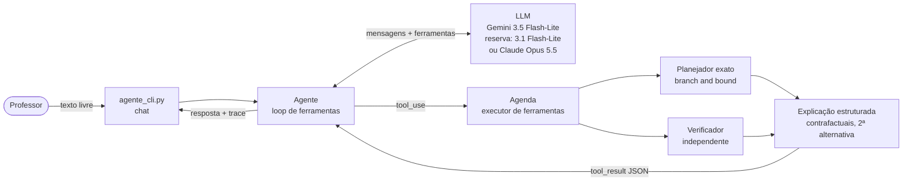
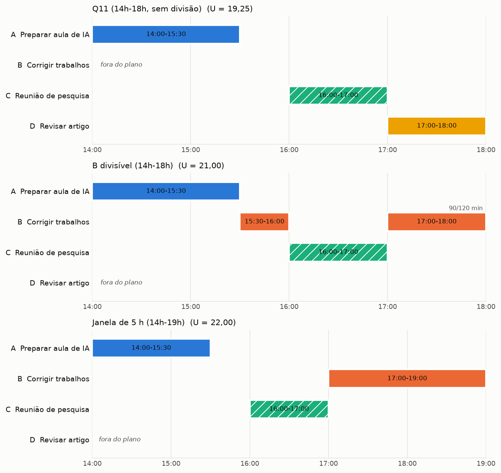
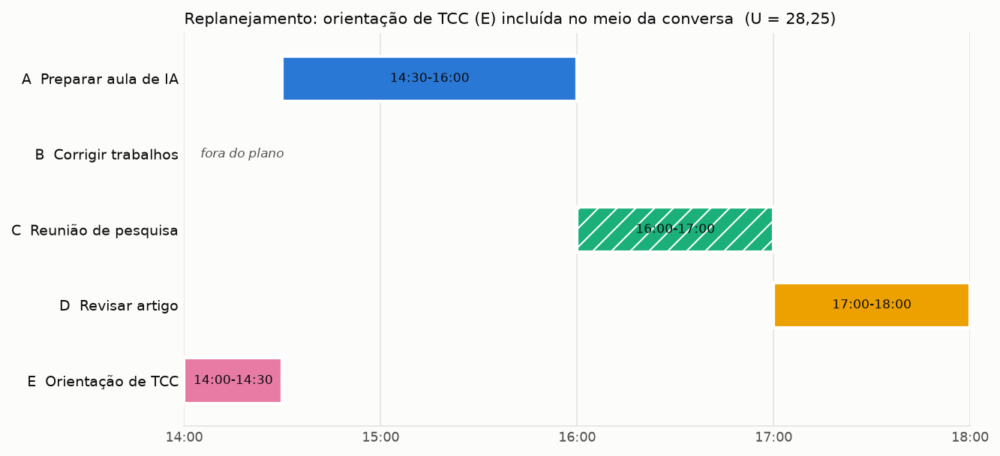

# Questão 12: Assistente de agenda acadêmica baseado em LLM

**Dupla:** Bruno Gomes de Barros Filho (21111360); Antônio Rodrigo Lima de Andrade Tenório (23210707)
**Disciplina:** ECOM031: Inteligência Artificial
**Professor:** Evandro de Barros Costa
**Período:** 2026.2

> Especifique e desenvolva uma aplicação, de sua escolha, de sistema de agente baseado em LLM, incluindo
> componentes de interface de usuário em linguagem natural, inferência e explicabilidade.

A aplicação é um assistente que organiza o dia de um professor a partir de um pedido em texto livre,
generalizando o cenário da Q11 (aula, correção, reunião e revisão de artigo entre 14h e 18h). A resposta
da Q11 (`docs/q11_agentes_classicos_vs_llm.md`) concluiu que o LLM é bom para interpretar pedidos em
linguagem natural e redigir respostas, e que restrições, planejamento e verificação devem ficar em
mecanismos explícitos. Este trabalho implementa essa arquitetura híbrida: um LLM conversa com o
professor e chama ferramentas (por padrão o Gemini `gemini-3.5-flash-lite`, com `gemini-3.1-flash-lite`
como reserva; o Claude `claude-opus-5-5` é a alternativa); um planejador exato em Python decide os horários; um
verificador independente confere o plano; e as justificativas que o modelo apresenta vêm prontas das
ferramentas.

## 1. Arquivos

| Arquivo | Conteúdo |
| :--- | :--- |
| `planejador.py` | Modelo do problema, função de utilidade, busca exata com poda e verificador de restrições |
| `explicacao.py` | Resumo estruturado do plano: justificativas, contrafactuais, ociosidade, restrições ativas, 2ª melhor alternativa |
| `agente.py` | Ferramentas (schemas estritos), estado da agenda, loop de uso de ferramentas e cliente da API do Claude |
| `cliente_gemini.py` | Cliente do Gemini (Google AI Studio): tradução do histórico, modelo principal e de reserva |
| `agente_cli.py` | Interface de chat em linha de comando |
| `simulacao.py` | Cliente roteirizado (mesmo formato das mensagens da API, sem modelo) e roteiro do cenário da Q11 |
| `gantt.py` | Gráfico de Gantt do plano |
| `q12_agente_llm.ipynb` | Notebook executado com o cenário da Q11, variações, verificador e o agente |
| `test_q12_planejador.py`, `test_q12_verificador.py`, `test_q12_agente.py`, `test_q12_cliente_gemini.py` | Testes (447 casos) |
| `figures/` | Gantt do cenário da Q11, das variações e do replanejamento (PNG e PDF) |

## 2. Especificação

### 2.1 Requisitos

Funcionais:

1. Receber pedidos em português livre, inclusive o texto da Q11, e extrair atividades (nome, duração,
   prioridade, prazo, horário fixo, prazo com horário, permissão para dividir) e a janela disponível.
2. Perguntar ao professor quando faltar um dado essencial, em vez de inventá-lo.
3. Calcular o plano de maior utilidade que respeite as restrições: janela, compromissos fixos, nenhuma
   sobreposição, atividade não divisível executada sem interrupção, blocos mínimos das divisíveis e prazos
   com horário.
4. Conferir o plano com um verificador independente e avaliar planos propostos pelo próprio professor.
5. Explicar o resultado: por que cada atividade está naquele horário, por que cada atividade ficou de
   fora ou incompleta, quais restrições pesaram, qual é a segunda melhor alternativa e quanto ela perde.
6. Manter a conversa: pedidos novos ("surgiu uma orientação de TCC") alteram a agenda e disparam
   replanejamento.

Não funcionais:

- Toda afirmação sobre horários e utilidades deve vir de código determinístico e testado.
- Funcionar sem chave de API para demonstração e testes (cliente do LLM injetável).
- Erros de ferramenta e da API não podem corromper o estado da conversa.

### 2.2 PEAS do agente

| Elemento | Descrição |
| :--- | :--- |
| Medida de desempenho | Utilidade do plano (prioridade x urgência x fração concluída), zero violações de restrição, explicações fiéis ao que foi calculado |
| Ambiente | Agenda do dia do professor: janela, atividades, compromissos fixos, prazos; parcialmente observável (só sabe o que o professor diz) e dinâmico entre turnos |
| Atuadores | Mensagens ao professor; chamadas de ferramentas que alteram a agenda (`definir_janela`, `registrar_atividades`, `remover_atividade`) |
| Sensores | Texto digitado pelo professor; resultados das ferramentas (`planejar_agenda`, `avaliar_plano`) |

Na classificação do AIMA, o conjunto é um agente baseado em utilidade: o LLM faz o papel de percepção
(transforma texto em estado estruturado) e de comunicação, e a escolha da ação usa uma função de utilidade
explícita.

### 2.3 Arquitetura



Fluxo de um turno:

1. O professor escreve o pedido.
2. O agente envia histórico, prompt de sistema e as cinco ferramentas ao LLM.
3. O LLM responde com chamadas de ferramenta (blocos `tool_use`) (por exemplo `definir_janela` e `registrar_atividades` em
   paralelo). O agente executa cada um e devolve todos os `tool_result` numa única mensagem de usuário,
   com `is_error: true` quando a ferramenta falha.
4. O LLM chama `planejar_agenda`. O executor roda o planejador, o verificador e o gerador de explicações
   e devolve um JSON com o plano e as justificativas.
5. O LLM redige a resposta final a partir desse JSON. A CLI mostra a resposta e o trace das ferramentas.

## 3. Componentes

### 3.1 Interface em linguagem natural

`agente_cli.py` é um chat de terminal. O professor escreve o que quiser; `/agenda` mostra o estado
estruturado atual (o que o agente entendeu) e `sair` encerra. Depois de cada resposta a CLI imprime o
trace das ferramentas chamadas, com entradas e resultados resumidos, para que o professor veja o que foi
extraído do texto dele.

A interpretação fica com o Claude. O prompt de sistema (em `agente.py`) define as convenções de extração
(hoje = 0 dias, amanhã = 1, próxima semana = 7; dividir só com permissão explícita), manda perguntar
quando faltar duração e proíbe calcular horários ou utilidades por conta própria.

As cinco ferramentas usam `strict: true`, com `additionalProperties: false` e todos os campos em
`required` (campos opcionais aceitam `null`). Assim os argumentos sempre seguem o schema. Mesmo assim o
executor valida tudo de novo em Python (formato HH:MM, durações positivas, prioridades conhecidas,
compromissos fora da janela, compromissos sobrepostos), porque a entrada do modelo é tratada como dado
não confiável. Uma validação que falha vira `tool_result` com `is_error: true` e a mensagem do erro, e o
modelo pode corrigir a chamada.

### 3.2 Inferência: planejador exato

Utilidade (mesma estrutura da Q11):

$$U = \sum_a \text{peso}(\text{prioridade}_a)\cdot\text{urg}(\text{prazo}_a)\cdot\frac{\text{minutos feitos}_a}{\text{duração}_a},\qquad \text{urg}(d) = 1 + \frac{2}{1+d}$$

Pesos: alta 3, média 2, baixa 1. Urgência: hoje 3, amanhã 2, uma semana 1,25. A fração final é o $f(B)$ da
Q11: uma atividade divisível feita pela metade rende metade do valor; uma não divisível rende tudo ou
nada. Compromissos fixos são restrições rígidas e sempre entram.

Busca (`planejar` em `planejador.py`): profundidade sobre agendas justificadas à esquerda. Em cada
instante livre o planejador começa uma atividade não divisível, executa um bloco de uma divisível
(comprimentos múltiplos de 15 min a partir do bloco mínimo, mais o bloco que esgota o intervalo ou a
atividade) ou fica ocioso até o próximo compromisso fixo. Ficar ocioso e começar algo depois, antes do
próximo compromisso, nunca é necessário: qualquer agenda viável pode ser deslocada para a esquerda sem
violar restrições, e terminar mais cedo só facilita os prazos. A poda usa como limite superior a mochila
fracionária do tempo livre restante; um ramo com limite abaixo da melhor utilidade encontrada é
descartado. Empates de utilidade são resolvidos terminando antes o que vale mais e, depois, com menos
blocos.

Por que busca exata: um dia de trabalho tem poucas atividades. No cenário da Q11 a busca visita 13 nós
(47 com B divisível). Com isso o agente pode afirmar que o plano é ótimo para a utilidade declarada e
calcular contrafactuais exatos. A seção 7 mostra onde essa escolha deixa de valer.

Verificador (`verificar`): código separado, que não reaproveita nada da busca. Recebe uma lista de blocos e
confere janela, sobreposição, horário exato dos compromissos fixos, não interrupção, blocos mínimos,
prazos com horário e mínimos exigidos. Roda sobre todo plano devolvido pelo planejador e sobre planos
propostos de fora (ferramenta `avaliar_plano`).

### 3.3 Explicabilidade

`explicacao.explicar` devolve, junto com o plano:

- `justificativa` de cada atividade: como o valor foi calculado e o que delimita cada bloco ("logo após o
  fim de C; termina no fim da janela").
- `contrafactual` de cada atividade fora do plano ou incompleta: o planejador roda de novo exigindo essa
  atividade e informa a nova utilidade, a perda e o que teria de sair. Se nem assim houver plano viável,
  informa o motivo (por exemplo, nenhum intervalo contínuo comporta a atividade).
- `ociosidade`: cada intervalo sem uso e o motivo de nada caber nele.
- `restricoes_ativas`: janela, compromissos, intervalos livres, demanda contra tempo disponível,
  atividades não divisíveis e prazos.
- `segunda_melhor_alternativa`: o melhor dos contrafactuais, ou seja, o melhor plano que muda a decisão
  sobre alguma atividade.
- `verificacao`: resultado do verificador independente.

Divisão de trabalho e risco de alucinação. O Claude escreve a resposta final, mas só depois de receber
esse JSON, e o prompt pede que use somente fatos vindos das ferramentas. Isso reduz bastante o espaço para
alucinação: o modelo não precisa somar minutos nem comparar planos, só reescrever números que estão no
contexto. O risco não desaparece. O modelo ainda pode copiar um horário errado, omitir uma atividade ou
dar um motivo que não está no JSON. Três coisas limitam o estrago:

1. O trace mostrado na CLI e o comando `/agenda` deixam o professor conferir o que foi extraído e
   calculado.
2. `texto_explicacao` gera uma explicação só com código, a partir do mesmo resumo; ela é usada no modo
   de demonstração e serve de referência para comparar com o texto do modelo.
3. Se o modelo alterar a agenda e tentar responder sem chamar `planejar_agenda`, o agente devolve um
   lembrete e pede o replanejamento antes da resposta (com `tool_choice: auto` não há garantia de
   chamada; veja 3.4).

A extração também pode errar, e esse erro o verificador não pega: se o modelo registrar a correção com 90
minutos em vez de 120, o plano será ótimo para dados errados. Por isso o trace mostra as entradas das
ferramentas, e o prompt manda listar as suposições feitas na interpretação.

### 3.4 Loop do agente e uso da API

O loop (`Agente.processar`) trabalha com mensagens em blocos (`text`, `tool_use`, `tool_result`) e recebe o
cliente do LLM por injeção: qualquer objeto com o método `criar_mensagem(system, tools, messages)` serve.
Há dois clientes reais.

**Gemini (padrão), `cliente_gemini.py`.**

- Modelo principal `gemini-3.5-flash-lite` e reserva `gemini-3.1-flash-lite`, os dois na camada gratuita do
  Google AI Studio. Se o principal devolver 404, 429 ou 5xx (modelo indisponível, cota esgotada, falha do
  servidor) ou der erro de conexão, a mesma requisição vai para a reserva. Erros do próprio pedido (400) e
  de chave (401/403) não tentam a reserva, porque falhariam do mesmo jeito.
- Tradução nos dois sentidos: os schemas das ferramentas viram `FunctionDeclaration` com
  `parameters_json_schema`; o histórico vira `Content` com papéis `user`/`model`; cada `tool_result` vira um
  `FunctionResponse` com o nome e o id da chamada correspondente (`{"resultado": ...}` ou `{"erro": ...}`).
  As respostas voltam como blocos `tool_use`/`text`, e o `finish_reason` vira `stop_reason`
  (`SAFETY`/`PROHIBITED_CONTENT` → `refusal`, `MAX_TOKENS` → `max_tokens`).
- As partes originais da resposta do Gemini são guardadas no histórico e reenviadas sem alteração. Os
  modelos Gemini 3 exigem isso: cada chamada de função carrega uma `thought_signature` que precisa voltar
  no turno seguinte.
- A execução automática de funções do SDK fica desligada; quem executa as ferramentas é o agente.
- A chave é lida de `GEMINI_API_KEY`. A CLI e o notebook carregam o arquivo `.env` da raiz do repositório,
  que está no `.gitignore`; a chave não aparece em código, saídas ou commits.

**Claude, `ClienteAnthropic` em `agente.py`** (alternativa, `--provedor claude`):

- Modelo `claude-opus-5-5`. O thinking é sempre ligado nesse modelo; o código não envia `thinking`
  (equivale a adaptativo) nem `budget_tokens`. A profundidade é controlada por
  `output_config={"effort": "medium"}`, ajustável com `--esforco` na CLI.
- `tool_choice` fica no padrão `auto`, porque forçar ferramenta (`any`/`tool`) retorna erro 400 nesse
  modelo. A orientação para usar ferramentas está no prompt e os schemas são estritos.
- Loop manual: enquanto `stop_reason == "tool_use"`, o agente executa as ferramentas e devolve todos os
  `tool_result` numa única mensagem. A resposta do assistente entra inteira no histórico
  (`response.content`, incluindo blocos de thinking), o que mantém o prefixo idêntico entre chamadas.
  `pause_turn` é reenviado; `end_turn` encerra o turno.
- `stop_reason` é checado antes de usar o conteúdo. Em `refusal` (mostra `stop_details.category`) ou
  `max_tokens`, o turno é desfeito: histórico e agenda voltam ao estado anterior.
- Fallback de recusa no servidor: a chamada usa `client.beta.messages.create` com
  `betas=["server-side-fallback-2026-07-01"]` e `fallbacks="default"`. Se os classificadores do Opus 5.5
  recusarem o pedido, a API refaz a requisição no modelo de fallback recomendado dentro da mesma chamada.
  Para um assistente de agenda uma recusa é improvável, mas sem essa opção um falso positivo pararia a
  conversa. Se o fallback rodar, os turnos seguintes ficam sem os blocos de thinking do Opus 5.5, o que
  não afeta este agente, já que o estado relevante está nas ferramentas.
- Erros do SDK são convertidos em `ErroLLM` com mensagem clara, na ordem de especificidade:
  `AuthenticationError`, `PermissionDeniedError`, `RateLimitError`, `BadRequestError`, `APIStatusError`,
  `APIConnectionError`. O SDK já faz novas tentativas automáticas em 429 e 5xx. Em erro o turno é
  desfeito.
- O cliente do LLM é um protocolo de um método (`criar_mensagem`). `ClienteAnthropic` usa a API real;
  `ClienteRoteirizado` (em `simulacao.py`) devolve respostas pré-escritas com os tipos do SDK
  (`BetaMessage`, `BetaToolUseBlock`, `BetaTextBlock`).

## 4. Como executar

Dependências (todas já estão no `.venv` do repositório): `google-genai` (testado com 3.0.0), `anthropic`
(testado com 2.6.0), `matplotlib`, `pandas`, `pytest`, `jupyter`/`nbconvert` para o notebook. Em outro
ambiente:

```bash
pip install "google-genai>=3.0" "anthropic>=2.6" matplotlib pandas pytest jupyter
```

Os comandos abaixo partem desta pasta (`src/q12_agente_llm`).

Sem chave de API:

```bash
python agente_cli.py --demo        # conversa roteirizada da Q11 (2 turnos); planejador real, sem LLM
python -m pytest -q                # 447 testes
jupyter nbconvert --to notebook --execute --inplace q12_agente_llm.ipynb
```

Com chave de API. Crie o arquivo `.env` na raiz do repositório (ele já está no `.gitignore`) com a chave
gratuita do Google AI Studio:

```bash
echo "GEMINI_API_KEY=sua-chave" > ../../.env
python agente_cli.py                     # chat com o Gemini (3.5 Flash-Lite, reserva 3.1 Flash-Lite)
python agente_cli.py --provedor claude   # chat com o Claude (precisa de ANTHROPIC_API_KEY no .env ou no ambiente)
```

Com a chave definida, a seção 6.3 do notebook também chama o Gemini de verdade. Sem ela, a célula é
pulada e avisa isso.

## 5. Resultados

Todos os números abaixo foram calculados pelo planejador (notebook, seções 2 a 6).

| Cenário | Plano ótimo | U | Fora ou incompleta | 2ª alternativa |
| :--- | :--- | :---: | :--- | :--- |
| Q11, 14h-18h, sem divisão | A 14:00-15:30, C 16:00-17:00, D 17:00-18:00 | 19,25 | B | forçar B: 14,25 |
| B divisível (blocos >= 30 min) | A 14:00-15:30, B 15:30-16:00, C 16:00-17:00, B 17:00-18:00 | 21,00 | B parcial (90/120), D | forçar D: 20,25 |
| Janela 14h-19h | A 14:00-15:30, C 16:00-17:00, B 17:00-19:00 | 22,00 | D | forçar D: 19,25 |
| Pedido novo: orientação de TCC (E), 30 min, alta, hoje | E 14:00-14:30, A 14:30-16:00, C 16:00-17:00, D 17:00-18:00 | 28,25 | B | forçar B: 22,00 |



Saída do modo `--demo` para o pedido da Q11 (explicação gerada por `texto_explicacao`, sem LLM):

```text
Plano para 14:00-18:00 (utilidade 19,25; 23,25 se tudo coubesse):
  14:00-15:30  A  Preparar aula de IA
  16:00-17:00  C  Reunião de pesquisa
  17:00-18:00  D  Revisar artigo
Por que algo ficou de fora ou incompleto:
  - B (Corrigir trabalhos): exigir B levaria a utilidade a 14,25 (perda de 5,00), com as trocas A 90->0 min, B 0->120 min.
Tempo livre não usado 15:30-16:00 (30 min): B precisa de 120 min contínuos.
Segunda melhor alternativa: forçar B dá utilidade 14,25, 5,00 abaixo do plano escolhido.
Verificador independente: nenhuma violação.
```

Comparação com os planos feitos à mão na Q11, usando o verificador (`avaliar_plano`):

| Plano | Válido | U | U ótima | O que faltou |
| :--- | :---: | :---: | :---: | :--- |
| Q11 sem divisão (A, C; B e D adiadas) | sim | 18,00 | 19,25 | D cabia em 17h-18h |
| Q11 com divisão (A, C, B 17h-18h) | sim | 20,00 | 21,00 | os 30 min antes da reunião podiam adiantar B |
| B 14h-16h, A 16h-17h30, C 16h-17h | não | - | 19,25 | sobreposição de A com a reunião |

Os planos manuais da Q11 eram válidos, mas deixavam utilidade para trás. O terceiro é o tipo de plano que
um LLM sem ferramentas pode escrever, e o verificador o rejeita apontando a sobreposição.

No replanejamento, a orientação de TCC entra às 14h e ocupa o tempo que estava ocioso antes da reunião; a
aula passa para 14h30-16h. E e A têm o mesmo valor (9), então as duas ordens têm a mesma utilidade, e o
desempate termina antes a atividade que acaba mais cedo.



### Execução real com o Gemini

A seção 6.3 do notebook roda o agente com o Gemini nos mesmos dois turnos da simulação (pedido da Q11 e,
depois, a orientação de TCC). Na execução salva, o `gemini-3.5-flash-lite` respondeu sozinho (a reserva não
foi necessária), cada turno levou cerca de 8 segundos e a sequência de ferramentas foi a esperada:
`definir_janela` e `registrar_atividades` em paralelo, depois `planejar_agenda`. O plano final foi o ótimo
do planejador (utilidade 19,25 no primeiro turno e 28,25 depois do replanejamento), e a resposta trouxe a
tabela, o motivo de B ficar de fora e a segunda melhor alternativa, tudo tirado do JSON da ferramenta.

O que muda entre execuções é a interpretação do pedido, e isso confirma a divisão de trabalho da Q11:

- Numa execução de teste, o modelo marcou a correção (B) como divisível, contrariando a instrução do prompt
  ("na dúvida, use false"). O planejador então dividiu B em dois blocos, e a resposta declarou a suposição.
- Na execução salva, B ficou indivisível, mas o modelo registrou B com prioridade alta. O texto do pedido
  não diz a prioridade da correção (a tabela da Q11 diz "média"), então a escolha é defensável, mas muda a
  utilidade da segunda alternativa (16,25 em vez de 14,25).

Nos dois casos o plano foi ótimo para os dados que o modelo registrou, e o trace e a lista de suposições
deixam o professor ver e corrigir a interpretação. O verificador garante as restrições; ele não garante que
a extração esteja certa.

## 6. Testes

- `test_q12_planejador.py`: planos e utilidades dos três cenários da Q11; explicações e contrafactuais;
  prazos com horário; instâncias mal definidas; um caso em que o ótimo exige um bloco menor que o máximo
  possível; ótimo igual ao de uma força bruta em 120 instâncias aleatórias pequenas (toda atribuição de
  horários em slots de 30 min, filtrada pelo verificador); busca com poda igual à busca sem poda em 200
  instâncias maiores; plano sempre aprovado pelo verificador em 60 instâncias.
- `test_q12_verificador.py`: cada tipo de violação é detectado; `avaliar_plano` compara com o ótimo.
- `test_q12_agente.py`: com o cliente roteirizado, o loop executa as ferramentas, devolve os `tool_result`
  com os ids certos numa única mensagem, marca `is_error` em entrada inválida e ferramenta desconhecida,
  para em `end_turn`, guarda blocos de thinking no histórico, insiste uma vez quando o modelo não replaneja,
  desfaz o turno em recusa, `max_tokens`, erro de API e excesso de iterações, e mantém o estado entre
  turnos. Com um transporte HTTP falso, confere que a requisição real leva `claude-opus-5-5`, o header
  `server-side-fallback-2026-07-01`, `fallbacks: "default"`, `output_config.effort`, ferramentas estritas
  e nenhum `tool_choice` ou `thinking`, e que respostas 400, 401, 429 e 529 viram `ErroLLM`.
- `test_q12_cliente_gemini.py`: com um cliente falso que devolve objetos reais do SDK `google-genai`,
  confere a tradução de chamadas de função e de motivos de parada, a ligação de cada `FunctionResponse` à
  chamada certa (nome e id), a preservação da parte original com `thought_signature`, a queda para o modelo
  de reserva em 404/429/5xx, a ausência de reserva em 400/401/403 e um turno completo do agente.

Para checar se os testes pegam erros de verdade, introduzimos três defeitos no planejador (remover a
opção de ficar ocioso, testar só o maior bloco possível, podar com folga de 0,5). Os três foram
detectados.

## 7. Limitações

- Custo da busca: até seis atividades numa janela de 8 horas a busca leva menos de 0,1 s. Com sete
  atividades, várias delas divisíveis, passa de um milhão de nós (cerca de 7 s no notebook), e oito
  levaram cerca de um minuto nos nossos testes. O crescimento vem das muitas formas de fatiar atividades
  divisíveis com a mesma utilidade, que a poda não elimina. Para agendas maiores, programação dinâmica
  sobre o estado (instante, minutos feitos por atividade) ou um resolvedor como o CP-SAT seriam o próximo
  passo.
- Horário discretizado: blocos de atividades divisíveis variam em passos de 15 minutos.
- A função de utilidade é uma escolha nossa. Com B divisível, a segunda melhor alternativa perde só 0,75;
  mudar um pouco os pesos inverte a decisão entre B e D. O agente explica a escolha, mas não descobre as
  preferências reais do professor.
- Um único dia. Não há dependências entre atividades, deslocamento, pausas, nem a parte de B que fica
  para amanhã é agendada.
- A extração depende do LLM. Se ele entender errado uma duração, o plano será ótimo para dados errados;
  o trace e o `/agenda` existem para o professor conferir.
- O Gemini foi testado contra a API real (seção 6.3 do notebook). O caminho do Claude não foi: não havia
  chave da Anthropic, e a forma das requisições foi verificada com transporte HTTP falso.
- A extração varia entre execuções (seção 5, "Execução real com o Gemini"): o mesmo pedido já gerou atividades com divisibilidade e
  prioridade diferentes. Um passo de confirmação ("entendi isto; posso planejar?") reduziria o risco.

## 8. Custos e latência

Com o Gemini, o uso cabe na camada gratuita do Google AI Studio, que tem limite de requisições por minuto e
por dia; a queda para o modelo de reserva cobre o caso de a cota de um modelo acabar. Na execução salva cada
turno levou cerca de 8 segundos (três chamadas sequenciais). A estimativa abaixo é para o Claude.


Cada turno típico faz três chamadas ao modelo (extração, planejamento, resposta). O prompt de sistema tem
cerca de 1,4 mil caracteres, as definições das ferramentas cerca de 2,9 mil e o resultado de
`planejar_agenda` no cenário da Q11 cerca de 3,6 mil, o que dá algo como 6 a 8 mil tokens de entrada
somando as três chamadas. A saída (chamadas de ferramenta, resposta e thinking com esforço `medium`)
deve ficar entre 1 e 3 mil tokens. Ao preço do Opus 5.5 (US$ 4 por milhão de tokens de entrada e US$ 20
por milhão de saída), isso dá na ordem de US$ 0,05 a 0,10 por turno. A latência é dominada pelas três
chamadas sequenciais, provavelmente de 10 a 30 segundos por turno; o planejador leva menos de 1 ms no
cenário da Q11. `--esforco low` reduz custo e tempo. Como o prompt de sistema e as ferramentas não mudam
entre chamadas, cache de prompt é uma otimização direta caso o uso cresça.

## 9. Referências

- RUSSELL, S.; NORVIG, P. *Inteligência Artificial*. 3. ed. Rio de Janeiro: Elsevier, 2013. Cap. 2
  (agentes, PEAS, agentes baseados em utilidade), cap. 6 (problemas de satisfação de restrições) e
  cap. 10/11 (planejamento e escalonamento).
- YAO, S. et al. ReAct: Synergizing Reasoning and Acting in Language Models. ICLR, 2023.
- SCHICK, T. et al. Toolformer: Language Models Can Teach Themselves to Use Tools. NeurIPS, 2023.
- KAMBHAMPATI, S. et al. LLMs Can't Plan, But Can Help Planning in LLM-Modulo Frameworks. ICML, 2024.
- Google. Documentação da Gemini API (Google AI Studio): function calling e thought signatures.
  https://ai.google.dev/gemini-api/docs
- Anthropic. Documentação da Messages API: uso de ferramentas, strict tool use, thinking adaptativo,
  effort e fallback de recusa no servidor. https://platform.claude.com/docs
- Questão 11 desta lista: `docs/q11_agentes_classicos_vs_llm.md`.
